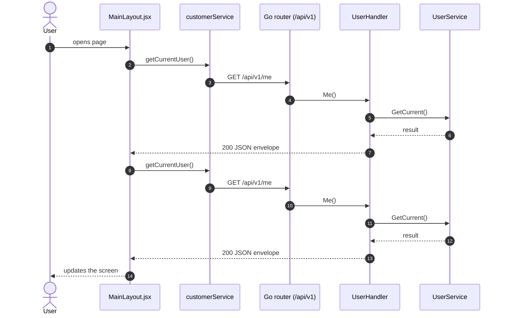
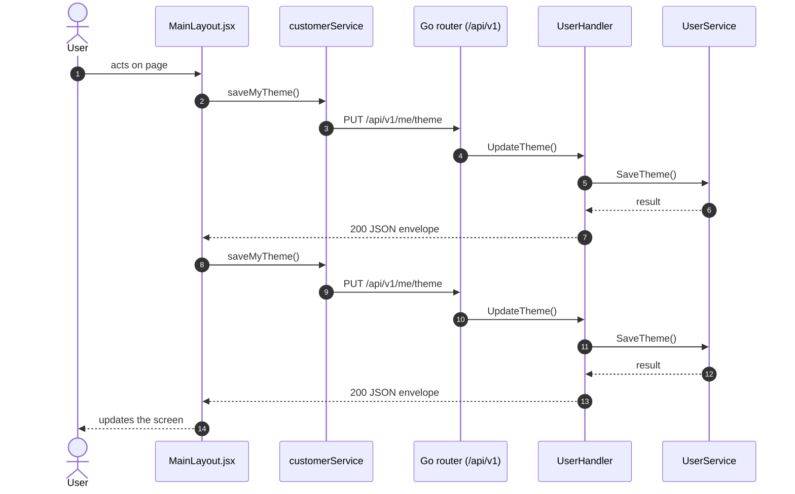
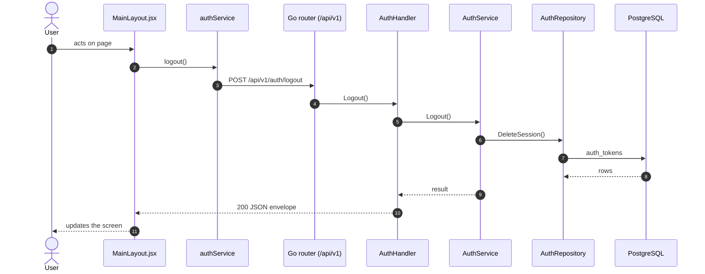

# App shell (session, logout, theme)

- **Route:** `every protected route` · **Component:** [MainLayout.jsx](../../src/components/layout/MainLayout.jsx) · **Auth:** protected (every logged-in role) · **Guard/Layout:** `ProtectedRoute` (session) + role guard · `MainLayout`
- **Purpose:** Behaviour shared by every protected page: session check, theme load / save, logout. Implemented in the layout and providers, not a route.
- **Navigation:** Wraps every protected route

## On page load

**Steps**

1. [theme.js](../../src/utils/theme.js) → refreshUserTheme(): runs `getCurrentUser()`
2. [customerService.js](../../src/services/customerService.js) → getCurrentUser(): calls `GET /api/v1/me`
3. [user_routes.go](../../../7th-sense-server/internal/routes/user_routes.go) → `GET /v1/me` → UserHandler.Me
4. [user_handler.go](../../../7th-sense-server/internal/handler/user_handler.go) → Me(): reads the logged-in user; calls the service
5. [user_service.go](../../../7th-sense-server/internal/service/user_service.go) → GetCurrent(): Returns the logged-in user (userID) with its details.
6. [theme.js](../../src/utils/theme.js) → refreshUserTheme(): runs `getCurrentUser()`
7. [customerService.js](../../src/services/customerService.js) → getCurrentUser(): calls `GET /api/v1/me`
8. [user_routes.go](../../../7th-sense-server/internal/routes/user_routes.go) → `GET /v1/me` → UserHandler.Me
9. [user_handler.go](../../../7th-sense-server/internal/handler/user_handler.go) → Me(): reads the logged-in user; calls the service
10. [user_service.go](../../../7th-sense-server/internal/service/user_service.go) → GetCurrent(): Returns the logged-in user (userID) with its details.

## Change theme

**Sequence diagram**

**Steps**

1. [theme.js](../../src/utils/theme.js) → chooseTheme(): runs `saveMyTheme()`
2. [customerService.js](../../src/services/customerService.js) → saveMyTheme(): calls `PUT /api/v1/me/theme`
3. [user_routes.go](../../../7th-sense-server/internal/routes/user_routes.go) → `PUT /v1/me/theme` → UserHandler.UpdateTheme
4. [user_handler.go](../../../7th-sense-server/internal/handler/user_handler.go) → UpdateTheme(): decodes `dto.UpdateThemeRequest` and runs its Validate(); calls the service
5. [user_service.go](../../../7th-sense-server/internal/service/user_service.go) → SaveTheme(): Sets the UI theme of userID (the logged-in user).
6. [theme.js](../../src/utils/theme.js) → chooseTheme(): runs `saveMyTheme()`
7. [customerService.js](../../src/services/customerService.js) → saveMyTheme(): calls `PUT /api/v1/me/theme`
8. [user_routes.go](../../../7th-sense-server/internal/routes/user_routes.go) → `PUT /v1/me/theme` → UserHandler.UpdateTheme
9. [user_handler.go](../../../7th-sense-server/internal/handler/user_handler.go) → UpdateTheme(): decodes `dto.UpdateThemeRequest` and runs its Validate(); calls the service
10. [user_service.go](../../../7th-sense-server/internal/service/user_service.go) → SaveTheme(): Sets the UI theme of userID (the logged-in user).

**Rules & edge cases**

- Server validation (`dto.UpdateThemeRequest.Validate`): Please enter valid theme.

## Click Log out

**Sequence diagram**

**Steps**

1. [AuthProvider.jsx](../../src/context/AuthProvider.jsx) → logout(): runs `logout()`
2. [authService.js](../../src/services/authService.js) → logout(): calls `POST /api/v1/auth/logout`
3. [auth_routes.go](../../../7th-sense-server/internal/routes/auth_routes.go) → `POST /v1/auth/logout` → AuthHandler.Logout
4. [auth_handler.go](../../../7th-sense-server/internal/handler/auth_handler.go) → Logout(): reads the logged-in user; calls the service
5. [auth_service.go](../../../7th-sense-server/internal/service/auth_service.go) → Logout(): Ends the session of token. An unknown or empty token is not an error.
6. [auth_repository.go](../../../7th-sense-server/internal/repository/auth_repository.go) → DeleteSession(): reads / writes `auth_tokens`

**Rules & edge cases**

- Any 401 from the API (expired or missing session) fires `onUnauthorized` in [apiClient.js](../../src/services/apiClient.js); [AuthProvider.jsx](../../src/context/AuthProvider.jsx) drops the user and the routes redirect to `/login`.
- [ProtectedRoute.jsx](../../src/routes/ProtectedRoute.jsx) renders `Forbidden` when the user's role is not in the route's `roles`.
- The theme is read from the user (`GET /me`) after login and saved with `PUT /me/theme` when changed ([theme.js](../../src/utils/theme.js)); saves are queued so the last choice wins.

## UI states

- **Success / failure of an action:** toast message (`utils/toast.js`).

## API calls on this page

| Method | Endpoint | Triggered by (section) | API docs |
|---|---|---|---|
| GET | `/api/v1/me` | On page load | [Swagger](http://localhost:8080/api-docs/index.html#/Users/getCurrentUser) · [openapi.yaml](../../../7th-sense-server/docs/api/openapi.yaml) |
| PUT | `/api/v1/me/theme` | Change theme | [Swagger](http://localhost:8080/api-docs/index.html#/Users/saveMyTheme) · [openapi.yaml](../../../7th-sense-server/docs/api/openapi.yaml) |
| POST | `/api/v1/auth/logout` | Click Log out | [Swagger](http://localhost:8080/api-docs/index.html#/Auth/logout) · [openapi.yaml](../../../7th-sense-server/docs/api/openapi.yaml) |

## State & storage

- `useAuth()` (logged-in user, roles)
- `useTheme()`
- Local component state (`useState`) for filters, form and modal

## Shared components used

[BrandLogo.jsx](../../src/components/common/BrandLogo.jsx), [LiveClock.jsx](../../src/components/common/LiveClock.jsx)

## Decisions

- [Client ADR index](../adr/README.md)
