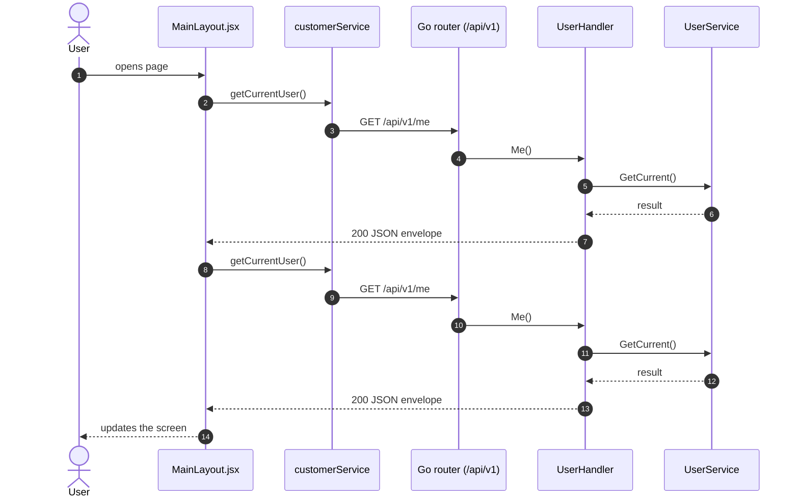
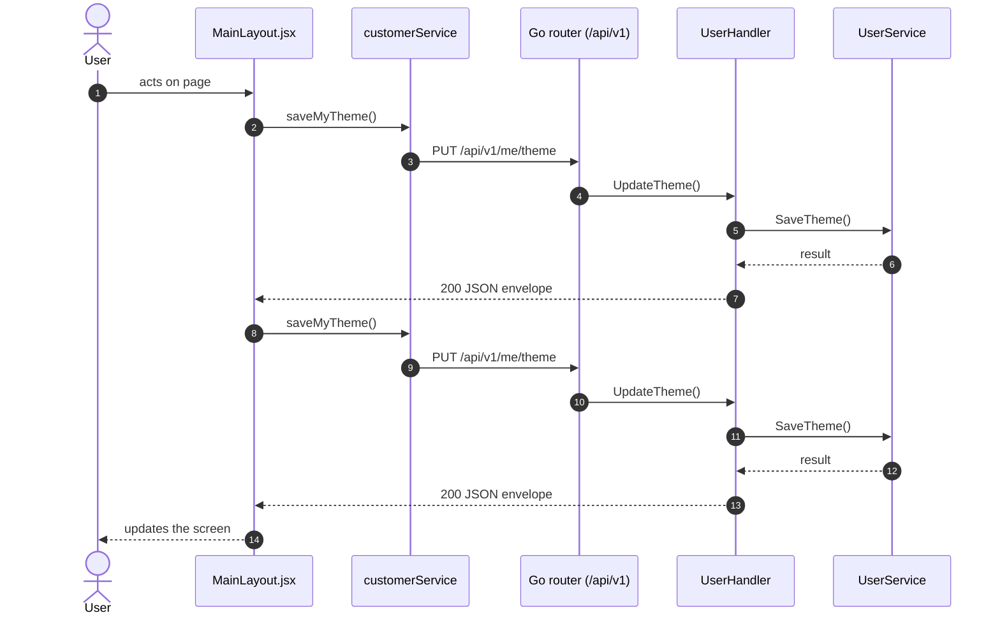
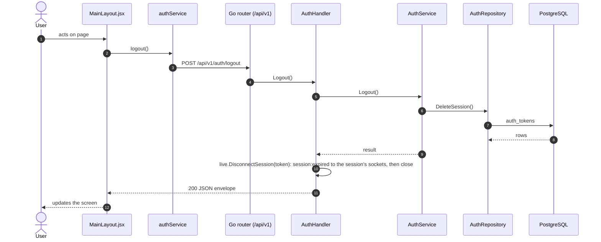
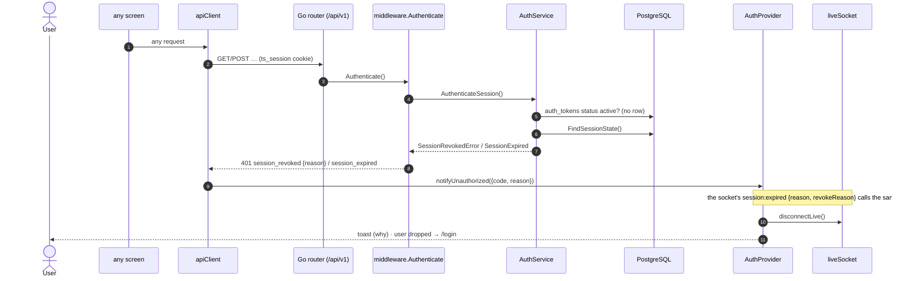

# App shell (session, logout, theme)

- **Route:** `every protected route` · **Component:** [MainLayout.jsx](../../src/components/layout/MainLayout.jsx) · **Auth:** protected (every logged-in role) · **Guard/Layout:** `ProtectedRoute` (session) + role guard · `MainLayout`
- **Purpose:** Behaviour shared by every protected page: session check, theme load / save, logout. Implemented in the layout and providers, not a route.
- **Navigation:** Wraps every protected route

## On page load

**Steps**

1. [theme.js](../../src/utils/theme.js) → refreshUserTheme(): runs `getCurrentUser()`
2. [customerService.js](../../src/services/customerService.js) → getCurrentUser(): calls `GET /api/v1/me`
3. [user_routes.go](../../../7th-sense-server/internal/routes/user_routes.go) → `GET /v1/me` → UserHandler.Me
4. [user_handler.go](../../../7th-sense-server/internal/handler/user_handler.go) → Me(): reads the logged-in user; calls the service
5. [user_service.go](../../../7th-sense-server/internal/service/user_service.go) → GetCurrent(): Returns the logged-in user (userID) with its details.
6. [theme.js](../../src/utils/theme.js) → refreshUserTheme(): runs `getCurrentUser()`
7. [customerService.js](../../src/services/customerService.js) → getCurrentUser(): calls `GET /api/v1/me`
8. [user_routes.go](../../../7th-sense-server/internal/routes/user_routes.go) → `GET /v1/me` → UserHandler.Me
9. [user_handler.go](../../../7th-sense-server/internal/handler/user_handler.go) → Me(): reads the logged-in user; calls the service
10. [user_service.go](../../../7th-sense-server/internal/service/user_service.go) → GetCurrent(): Returns the logged-in user (userID) with its details.

## Change theme

**Sequence diagram**

**Steps**

1. [theme.js](../../src/utils/theme.js) → chooseTheme(): runs `saveMyTheme()`
2. [customerService.js](../../src/services/customerService.js) → saveMyTheme(): calls `PUT /api/v1/me/theme`
3. [user_routes.go](../../../7th-sense-server/internal/routes/user_routes.go) → `PUT /v1/me/theme` → UserHandler.UpdateTheme
4. [user_handler.go](../../../7th-sense-server/internal/handler/user_handler.go) → UpdateTheme(): decodes `dto.UpdateThemeRequest` and runs its Validate(); calls the service
5. [user_service.go](../../../7th-sense-server/internal/service/user_service.go) → SaveTheme(): Sets the UI theme of userID (the logged-in user).
6. [theme.js](../../src/utils/theme.js) → chooseTheme(): runs `saveMyTheme()`
7. [customerService.js](../../src/services/customerService.js) → saveMyTheme(): calls `PUT /api/v1/me/theme`
8. [user_routes.go](../../../7th-sense-server/internal/routes/user_routes.go) → `PUT /v1/me/theme` → UserHandler.UpdateTheme
9. [user_handler.go](../../../7th-sense-server/internal/handler/user_handler.go) → UpdateTheme(): decodes `dto.UpdateThemeRequest` and runs its Validate(); calls the service
10. [user_service.go](../../../7th-sense-server/internal/service/user_service.go) → SaveTheme(): Sets the UI theme of userID (the logged-in user).

**Rules & edge cases**

- Server validation (`dto.UpdateThemeRequest.Validate`): Please enter valid theme.

## Click Log out

**Sequence diagram**

**Steps**

1. [AuthProvider.jsx](../../src/context/AuthProvider.jsx) → logout(): runs `logout()`
2. [authService.js](../../src/services/authService.js) → logout(): calls `POST /api/v1/auth/logout`
3. [auth_routes.go](../../../7th-sense-server/internal/routes/auth_routes.go) → `POST /v1/auth/logout` → AuthHandler.Logout
4. [auth_handler.go](../../../7th-sense-server/internal/handler/auth_handler.go) → Logout(): reads the logged-in user; calls the service
5. [auth_service.go](../../../7th-sense-server/internal/service/auth_service.go) → Logout(): Ends the session of token. An unknown or empty token is not an error.
6. [auth_repository.go](../../../7th-sense-server/internal/repository/auth_repository.go) → DeleteSession(): `auth_tokens` status → `logged_out`, soft-deleted
7. [live_handler.go](../../../7th-sense-server/internal/handler/live_handler.go) → DisconnectSession(): every live socket of this session (all its tabs) gets `session:expired {reason: logged_out}` and is closed; the user's other sessions keep theirs
8. [AuthProvider.jsx](../../src/context/AuthProvider.jsx) → `disconnectLive()` ([liveSocket.js](../../src/services/liveSocket.js)) when the user is dropped or changes, so a new login opens a new socket for the new session

## Session ended

The session can end without this browser asking: another login with "Log out other device and continue" ([login.md](login.md)), the user on another device ([my-sessions.md](my-sessions.md)), the superadmin ([user-sessions.md](user-sessions.md)), or its lifetime.

**Steps**

1. [middleware/auth.go](../../../7th-sense-server/internal/middleware/auth.go) → Authenticate(): a revoked session answers 401 `session_revoked` with `data.reason`; an expired one 401 `session_expired`; anything else "Please log in to continue"
2. [auth_service.go](../../../7th-sense-server/internal/service/auth_service.go) → sessionEndedError(): reads the row's status only when the active lookup failed
3. [apiClient.js](../../src/services/apiClient.js) → response interceptor: every 401 calls `notifyUnauthorized({ code: message, reason: data?.reason })`
4. [liveSocket.js](../../src/services/liveSocket.js) → `session:expired`: same call with the socket's `reason` / `revokeReason` (the server closes the socket right after)
5. [AuthProvider.jsx](../../src/context/AuthProvider.jsx) → onUnauthorized(): `disconnectLive()`, warning toast with [constants/session.js](../../src/constants/session.js) `sessionEndedMessage()` (e.g. "You were logged out because your account signed in on another device."), clears a "log in as" key, drops the user; the routes redirect to `/login`

**Rules & edge cases**

- Any 401 from the API fires `onUnauthorized`; the toast shows when a user was loaded, or always for `session_revoked` / `session_expired` (e.g. a reload of a tab whose session was revoked meanwhile). After a refused or server-closed socket the client checks `GET /auth/me` (live data: [ADR 0021](../adr/0021-virtual-screen-socket.md)).
- In a "log in as customer" tab ([customer-user-list.md](customer-user-list.md#view-customer-log-in-as)) every call goes to `/api/as/<key>/v1` ([loginAs.js](../../src/utils/loginAs.js)); logout ends only that tab's session, drops its key and shows the login screen. The superadmin's session is untouched.
- [ProtectedRoute.jsx](../../src/routes/ProtectedRoute.jsx) renders `Forbidden` when the user's role is not in the route's `roles`.
- The theme is read from the user (`GET /me`) after login and saved with `PUT /me/theme` when changed ([theme.js](../../src/utils/theme.js)); saves are queued so the last choice wins.

## UI states

- **A screen crashes, or its code cannot be downloaded** (e.g. a tab left open across a deploy): [ErrorBoundary.jsx](../../src/components/common/ErrorBoundary.jsx) around the routes shows "This page could not be shown" with a Reload button instead of a blank app.
- **Success / failure of an action:** toast message (`utils/toast.js`).

## API calls on this page

| Method | Endpoint | Triggered by (section) | API docs |
|---|---|---|---|
| GET | `/api/v1/me` | On page load | [Swagger](http://localhost:8080/api-docs/index.html#/Users/getCurrentUser) · [openapi.yaml](../../../7th-sense-server/docs/api/openapi.yaml) |
| PUT | `/api/v1/me/theme` | Change theme | [Swagger](http://localhost:8080/api-docs/index.html#/Users/saveMyTheme) · [openapi.yaml](../../../7th-sense-server/docs/api/openapi.yaml) |
| POST | `/api/v1/auth/logout` | Click Log out | [Swagger](http://localhost:8080/api-docs/index.html#/Auth/logout) · [openapi.yaml](../../../7th-sense-server/docs/api/openapi.yaml) |

## State & storage

- `useAuth()` (logged-in user, roles)
- `useTheme()`
- Local component state (`useState`) for filters, form and modal

## Shared components used

[BrandLogo.jsx](../../src/components/common/BrandLogo.jsx), [LiveClock.jsx](../../src/components/common/LiveClock.jsx)

## Decisions

- [Client ADR index](../adr/README.md) · session codes: [ADR 0027](../adr/0027-session-codes-and-conflict-modal.md), server [ADR 0014](../../../7th-sense-server/docs/adr/0014-session-modes-and-login-conflict.md)
