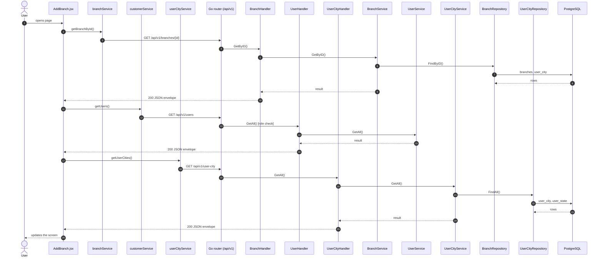
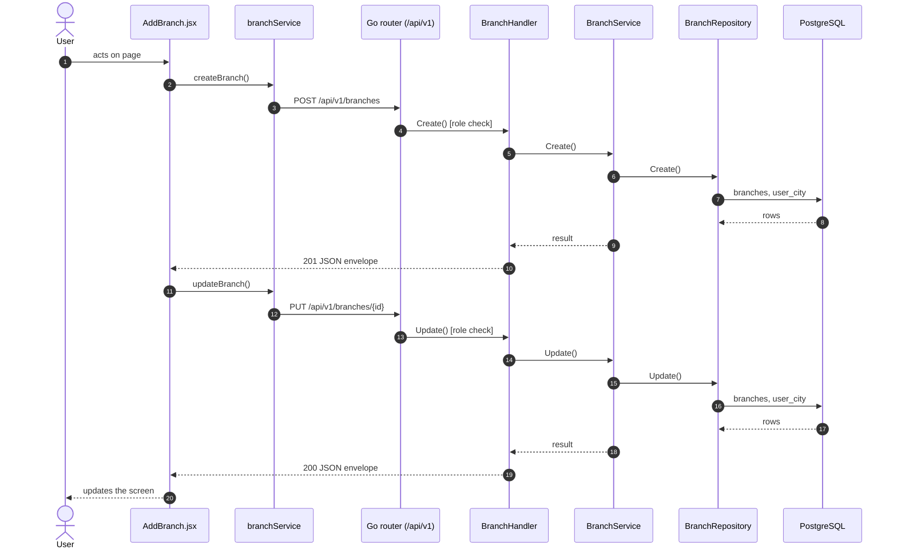

# Add / edit branch

- **Route:** `/masters/branches/add` · `/masters/branches/:id/edit` · **Component:** [AddBranch.jsx](../../src/pages/Branches/AddBranch.jsx) · **Auth:** protected (superadmin) · **Guard/Layout:** `ProtectedRoute` (session) + role guard · `MainLayout`
- **Purpose:** Add or edit a branch (superadmin).
- **Navigation:** Branches → form → back to Branches

## On page load

**Steps**

1. [AddBranch.jsx](../../src/pages/Branches/AddBranch.jsx) → useEffect(): runs on load `getBranchById()`
2. [branchService.js](../../src/services/branchService.js) → getBranchById(): calls `GET /api/v1/branches/{id}`
3. [branch_routes.go](../../../7th-sense-server/internal/routes/branch_routes.go) → `GET /v1/branches/{id}` → BranchHandler.GetByID
4. [branch_handler.go](../../../7th-sense-server/internal/handler/branch_handler.go) → GetByID(): reads {id}; calls the service
5. [branch_service.go](../../../7th-sense-server/internal/service/branch_service.go) → GetByID(): 
6. [branch_repository.go](../../../7th-sense-server/internal/repository/branch_repository.go) → FindByID(): reads / writes `branches`, `user_city`
7. [AddBranch.jsx](../../src/pages/Branches/AddBranch.jsx) → useEffect(): runs on load `getUsers()`
8. [customerService.js](../../src/services/customerService.js) → getUsers(): calls `GET /api/v1/users`
9. [user_routes.go](../../../7th-sense-server/internal/routes/user_routes.go) → `GET /v1/users` (managersOnly: superadmin, customer, admin) → UserHandler.GetAll
10. [user_handler.go](../../../7th-sense-server/internal/handler/user_handler.go) → GetAll(): query companyId, filterRole; calls the service
11. [user_service.go](../../../7th-sense-server/internal/service/user_service.go) → GetAll(): Returns the users the user may see, narrowed by filter: every user for the superadmin, the company's members for a customer or admin. A customer or admin asking for another company gets Forbidden.
12. [AddBranch.jsx](../../src/pages/Branches/AddBranch.jsx) → useEffect(): runs on load `getUserCities()`
13. [userCityService.js](../../src/services/userCityService.js) → getUserCities(): calls `GET /api/v1/user-city`
14. [user_city_routes.go](../../../7th-sense-server/internal/routes/user_city_routes.go) → `GET /v1/user-city` → UserCityHandler.GetAll
15. [user_city_handler.go](../../../7th-sense-server/internal/handler/user_city_handler.go) → GetAll(): query userStateId, userId; calls the service
16. [user_city_service.go](../../../7th-sense-server/internal/service/user_city_service.go) → GetAll(): Returns the user's cities. A non-nil userStateID keeps only that state's cities.
17. [user_city_repository.go](../../../7th-sense-server/internal/repository/user_city_repository.go) → FindAll(): reads / writes `user_city`, `user_state`

## Save branch (add / edit form)

**Sequence diagram**

**Steps**

1. [AddBranch.jsx](../../src/pages/Branches/AddBranch.jsx) → onSubmit(): runs `createBranch()`
2. [branchService.js](../../src/services/branchService.js) → createBranch(): calls `POST /api/v1/branches`
3. [branch_routes.go](../../../7th-sense-server/internal/routes/branch_routes.go) → `POST /v1/branches` (superAdminOnly) → BranchHandler.Create
4. [branch_handler.go](../../../7th-sense-server/internal/handler/branch_handler.go) → Create(): decodes `dto.CreateBranchRequest` and runs its Validate(); calls the service
5. [branch_service.go](../../../7th-sense-server/internal/service/branch_service.go) → Create(): Adds a branch. A city, when given, must be one of the branch customer's cities.
6. [branch_repository.go](../../../7th-sense-server/internal/repository/branch_repository.go) → Create(): reads / writes `branches`, `user_city`
7. [AddBranch.jsx](../../src/pages/Branches/AddBranch.jsx) → onSubmit(): runs `updateBranch()`
8. [branchService.js](../../src/services/branchService.js) → updateBranch(): calls `PUT /api/v1/branches/{id}`
9. [branch_routes.go](../../../7th-sense-server/internal/routes/branch_routes.go) → `PUT /v1/branches/{id}` (superAdminOnly) → BranchHandler.Update
10. [branch_handler.go](../../../7th-sense-server/internal/handler/branch_handler.go) → Update(): reads {id}; decodes `dto.UpdateBranchRequest` and runs its Validate(); calls the service
11. [branch_service.go](../../../7th-sense-server/internal/service/branch_service.go) → Update(): Replaces the branch. A city, when given, must be one of the branch customer's cities.
12. [branch_repository.go](../../../7th-sense-server/internal/repository/branch_repository.go) → Update(): reads / writes `branches`, `user_city`

**Rules & edge cases**

- Superadmin only (server `superAdminOnly`, others 403).

## UI states

- **Loading:** `<Loader>` while the request runs.
- **Error:** a red `<Alert>` with the server message (some pages add Retry).
- **Success / failure of an action:** toast message (`utils/toast.js`).

## API calls on this page

| Method | Endpoint | Triggered by (section) | API docs |
|---|---|---|---|
| POST | `/api/v1/branches` | Save branch (add / edit form) | [Swagger](http://localhost:8080/api-docs/index.html#/Branches/createBranch) · [openapi.yaml](../../../7th-sense-server/docs/api/openapi.yaml) |
| GET | `/api/v1/branches/{id}` | On page load | [Swagger](http://localhost:8080/api-docs/index.html#/Branches/getBranchById) · [openapi.yaml](../../../7th-sense-server/docs/api/openapi.yaml) |
| PUT | `/api/v1/branches/{id}` | Save branch (add / edit form) | [Swagger](http://localhost:8080/api-docs/index.html#/Branches/updateBranch) · [openapi.yaml](../../../7th-sense-server/docs/api/openapi.yaml) |
| GET | `/api/v1/users` | On page load | [Swagger](http://localhost:8080/api-docs/index.html#/Users/getUsers) · [openapi.yaml](../../../7th-sense-server/docs/api/openapi.yaml) |
| GET | `/api/v1/user-city` | On page load | [Swagger](http://localhost:8080/api-docs/index.html#/Organization/getUserCities) · [openapi.yaml](../../../7th-sense-server/docs/api/openapi.yaml) |

## State & storage

- Route param `:id` (`useParams`)
- `useAuth()` (logged-in user, roles)
- Local component state (`useState`) for filters, form and modal

## Shared components used

[FieldLabel.jsx](../../src/components/common/FieldLabel.jsx), [Loader.jsx](../../src/components/common/Loader.jsx), [StatusToggle.jsx](../../src/components/common/StatusToggle.jsx)

## Decisions

- [Client ADR index](../adr/README.md)
