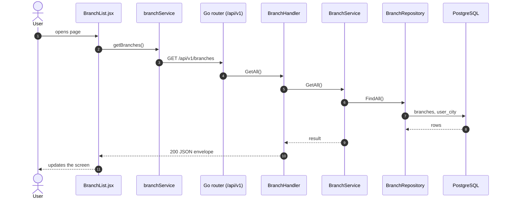
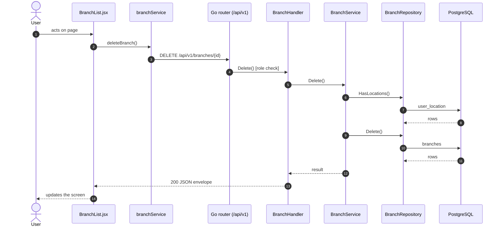
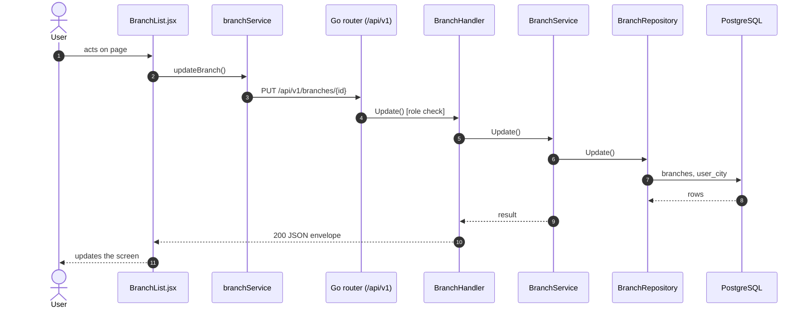

# Branches

- **Route:** `/masters/branches` · **Component:** [BranchList.jsx](../../src/pages/Branches/BranchList.jsx) · **Auth:** protected (every logged-in role) · **Guard/Layout:** `ProtectedRoute` (session) + role guard · `MainLayout`
- **Purpose:** Lists branches; the superadmin adds, edits and deletes them.
- **Navigation:** Sidebar › Masters › Organization → **Branch** tab ([OrganizationPage.jsx](../../src/pages/Organization/OrganizationPage.jsx): page header + tabs, this list is the tab body; the tab is the route) → Add / Edit

## On page load

**Steps**

1. [BranchList.jsx](../../src/pages/Branches/BranchList.jsx) → useEffect(): runs on load `getBranches()`
2. [branchService.js](../../src/services/branchService.js) → getBranches(): calls `GET /api/v1/branches`
3. [branch_routes.go](../../../7th-sense-server/internal/routes/branch_routes.go) → `GET /v1/branches` → BranchHandler.GetAll
4. [branch_handler.go](../../../7th-sense-server/internal/handler/branch_handler.go) → GetAll(): query userCityId; calls the service
5. [branch_service.go](../../../7th-sense-server/internal/service/branch_service.go) → GetAll(): Returns the branches. A non-nil userCityID keeps only that city's branches.
6. [branch_repository.go](../../../7th-sense-server/internal/repository/branch_repository.go) → FindAll(): reads / writes `branches`, `user_city`

## Delete branch

**Sequence diagram**

**Steps**

1. [BranchList.jsx](../../src/pages/Branches/BranchList.jsx) → confirmDelete(): runs `deleteBranch()`
2. [branchService.js](../../src/services/branchService.js) → deleteBranch(): calls `DELETE /api/v1/branches/{id}`
3. [branch_routes.go](../../../7th-sense-server/internal/routes/branch_routes.go) → `DELETE /v1/branches/{id}` (superAdminOnly) → BranchHandler.Delete
4. [branch_handler.go](../../../7th-sense-server/internal/handler/branch_handler.go) → Delete(): reads {id}; calls the service
5. [branch_service.go](../../../7th-sense-server/internal/service/branch_service.go) → Delete(): Soft-deletes the branch. A branch that still has locations is kept: its locations must be deleted first.
6. [branch_repository.go](../../../7th-sense-server/internal/repository/branch_repository.go) → HasLocations(): reads / writes `user_location`
7. [branch_repository.go](../../../7th-sense-server/internal/repository/branch_repository.go) → Delete(): reads / writes `branches`

**Rules & edge cases**

- Superadmin only (server `superAdminOnly`, others 403).

## Save branch (add / edit form)

**Sequence diagram**

**Steps**

1. [BranchList.jsx](../../src/pages/Branches/BranchList.jsx) → handleToggleStatus(): runs `updateBranch()`
2. [branchService.js](../../src/services/branchService.js) → updateBranch(): calls `PUT /api/v1/branches/{id}`
3. [branch_routes.go](../../../7th-sense-server/internal/routes/branch_routes.go) → `PUT /v1/branches/{id}` (superAdminOnly) → BranchHandler.Update
4. [branch_handler.go](../../../7th-sense-server/internal/handler/branch_handler.go) → Update(): reads {id}; decodes `dto.UpdateBranchRequest` and runs its Validate(); calls the service
5. [branch_service.go](../../../7th-sense-server/internal/service/branch_service.go) → Update(): Replaces the branch. A city, when given, must be one of the branch customer's cities.
6. [branch_repository.go](../../../7th-sense-server/internal/repository/branch_repository.go) → Update(): reads / writes `branches`, `user_city`

**Rules & edge cases**

- Superadmin only (server `superAdminOnly`, others 403).

## UI states

- **Loading:** `<Loader>` while the request runs.
- **Error:** a red `<Alert>` with the server message (some pages add Retry).
- **Success / failure of an action:** toast message (`utils/toast.js`).
- **Empty:** an empty-state message instead of the table / chart.
- **Delete:** asks for confirmation first.

## API calls on this page

| Method | Endpoint | Triggered by (section) | API docs |
|---|---|---|---|
| DELETE | `/api/v1/branches/{id}` | Delete branch | [Swagger](http://localhost:8080/api-docs/index.html#/Branches/deleteBranch) · [openapi.yaml](../../../7th-sense-server/docs/api/openapi.yaml) |
| GET | `/api/v1/branches` | On page load | [Swagger](http://localhost:8080/api-docs/index.html#/Branches/getBranches) · [openapi.yaml](../../../7th-sense-server/docs/api/openapi.yaml) |
| PUT | `/api/v1/branches/{id}` | Save branch (add / edit form) | [Swagger](http://localhost:8080/api-docs/index.html#/Branches/updateBranch) · [openapi.yaml](../../../7th-sense-server/docs/api/openapi.yaml) |

## State & storage

- `useAuth()` (logged-in user, roles)
- `useOrgUser()` (organization user picked)
- Local component state (`useState`) for filters, form and modal

## Shared components used

[ConfirmModal.jsx](../../src/components/common/ConfirmModal.jsx), [Loader.jsx](../../src/components/common/Loader.jsx), [TablePagination.jsx](../../src/components/common/TablePagination.jsx), [SortableHead.jsx](../../src/components/common/SortableHead.jsx), [IconAction.jsx](../../src/components/common/IconAction.jsx)

## Decisions

- [Client ADR index](../adr/README.md)
