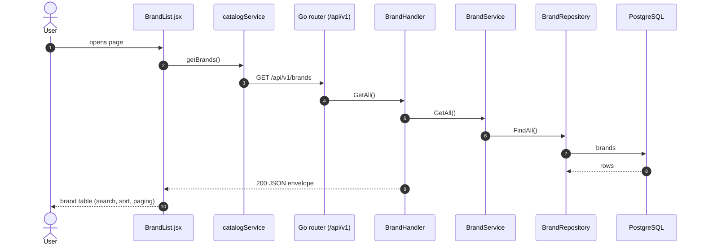
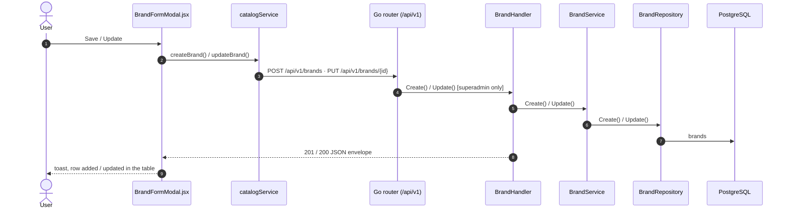
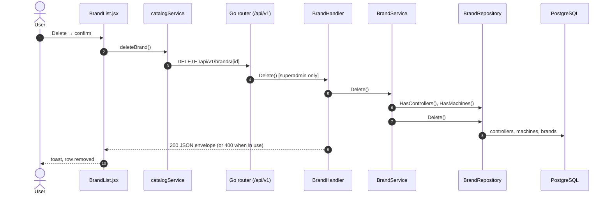

# Brands

- **Route:** `/masters/brands` · **Component:** [BrandList.jsx](../../src/pages/Brands/BrandList.jsx) · **Auth:** protected (superadmin) · **Guard/Layout:** `ProtectedRoute` (session) + role guard · `MainLayout`
- **Purpose:** Machine catalog: the machine brands (superadmin). Every user picks them in the machine form; each controller belongs to a brand.
- **Navigation:** Sidebar › System › Account Center → **Machine Catalog** tab → **Brands** tab (second tab row: Brands, Controllers, Models; [AccountCenterPage.jsx](../../src/pages/AccountCenter/AccountCenterPage.jsx), each one its own route). Machine Catalog opens on Brands.

## On page load

**Steps**

1. [BrandList.jsx](../../src/pages/Brands/BrandList.jsx) → useEffect(): runs on load (and Retry) `getBrands()`
2. [catalogService.js](../../src/services/catalogService.js) → getBrands(): calls `GET /api/v1/brands`
3. [brand_routes.go](../../../7th-sense-server/internal/routes/brand_routes.go) → `GET /v1/brands` (every logged-in user) → BrandHandler.GetAll
4. [brand_service.go](../../../7th-sense-server/internal/service/brand_service.go) → GetAll() → [brand_repository.go](../../../7th-sense-server/internal/repository/brand_repository.go) → FindAll(): reads `brands`

## Save brand (add / edit form)

**Steps**

1. [BrandFormModal.jsx](../../src/pages/Brands/BrandFormModal.jsx) → onSubmit(): validates with `brandSchema` ([brandForm.js](../../src/pages/Brands/brandForm.js): name required ≤ 100, code optional 2–50 of A–Z 0–9 - _, description ≤ 1000) and sends `toBrandPayload()` (code upper-cased)
2. [catalogService.js](../../src/services/catalogService.js) → createBrand() / updateBrand(): `POST /api/v1/brands` · `PUT /api/v1/brands/{id}` with `{name, code, description}`
3. [brand_routes.go](../../../7th-sense-server/internal/routes/brand_routes.go) → `superAdminOnly` → BrandHandler.Create / Update
4. [brand_handler.go](../../../7th-sense-server/internal/handler/brand_handler.go) → Create() / Update(): decodes `dto.CreateBrandRequest` / `dto.UpdateBrandRequest` and runs Validate()
5. [brand_service.go](../../../7th-sense-server/internal/service/brand_service.go) → Create() / Update(): "Name already exists" / "Code already exists" on duplicates
6. [brand_repository.go](../../../7th-sense-server/internal/repository/brand_repository.go) → Create() / Update(): writes `brands`

## Delete brand

**Steps**

1. [BrandList.jsx](../../src/pages/Brands/BrandList.jsx) → confirmDelete(): after the confirm dialog calls `deleteBrand()`
2. [catalogService.js](../../src/services/catalogService.js) → deleteBrand(): `DELETE /api/v1/brands/{id}`
3. [brand_service.go](../../../7th-sense-server/internal/service/brand_service.go) → Delete(): refuses a brand with controllers ("This brand has controllers. Delete its controllers first") or used by machines ("Machines use this brand. Change or delete those machines first")
4. [brand_repository.go](../../../7th-sense-server/internal/repository/brand_repository.go) → HasControllers(), HasMachines(), Delete(): soft delete of `brands`

**Rules & edge cases**

- Superadmin only (route and tab `SUPERADMIN_ONLY`; server `superAdminOnly`, others 403). Everyone else only reads brands (machine form).
- A deleted brand's name and code can be used again.

## UI states

- **Loading:** `<Loader>` while the list loads.
- **Error:** a red `<Alert>` with the server message and Retry.
- **Empty:** "No brands yet" with Add the first brand; "No brands match this search" when filtered.
- **Success / failure of an action:** toast message (`utils/toast.js`).
- **Delete:** asks for confirmation first.

## API calls on this page

| Method | Endpoint | Triggered by (section) | API docs |
|---|---|---|---|
| GET | `/api/v1/brands` | On page load | [Swagger](http://localhost:8080/api-docs/index.html#/Machine%20catalog/getBrands) · [openapi.yaml](../../../7th-sense-server/docs/api/openapi.yaml) |
| POST | `/api/v1/brands` | Save brand (add / edit form) | [Swagger](http://localhost:8080/api-docs/index.html#/Machine%20catalog/createBrand) · [openapi.yaml](../../../7th-sense-server/docs/api/openapi.yaml) |
| PUT | `/api/v1/brands/{id}` | Save brand (add / edit form) | [Swagger](http://localhost:8080/api-docs/index.html#/Machine%20catalog/updateBrand) · [openapi.yaml](../../../7th-sense-server/docs/api/openapi.yaml) |
| DELETE | `/api/v1/brands/{id}` | Delete brand | [Swagger](http://localhost:8080/api-docs/index.html#/Machine%20catalog/deleteBrand) · [openapi.yaml](../../../7th-sense-server/docs/api/openapi.yaml) |

## State & storage

- Local component state (`useState`) for the list, search, paging, form and confirm modals

## Shared components used

[ConfirmModal.jsx](../../src/components/common/ConfirmModal.jsx), [Loader.jsx](../../src/components/common/Loader.jsx), [TablePagination.jsx](../../src/components/common/TablePagination.jsx), [SortableHead.jsx](../../src/components/common/SortableHead.jsx), [IconAction.jsx](../../src/components/common/IconAction.jsx), [FieldLabel.jsx](../../src/components/common/FieldLabel.jsx)

## Decisions

- [ADR 0014: Account Center](../adr/0014-account-center.md), [ADR 0016: Account Center superadmin only](../adr/0016-account-center-superadmin-only.md)
- [Client ADR index](../adr/README.md)
