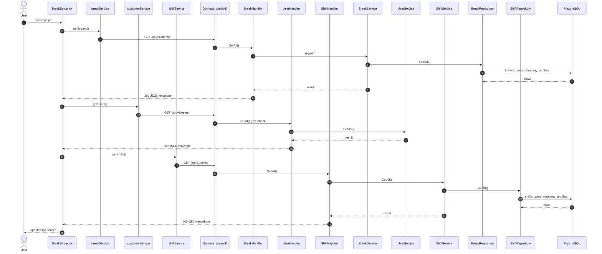
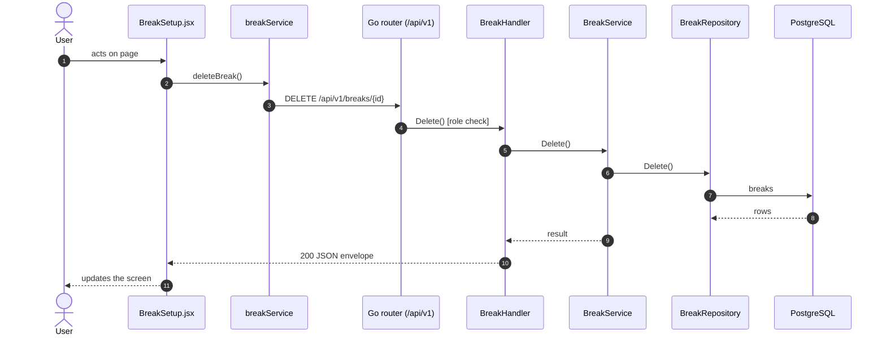
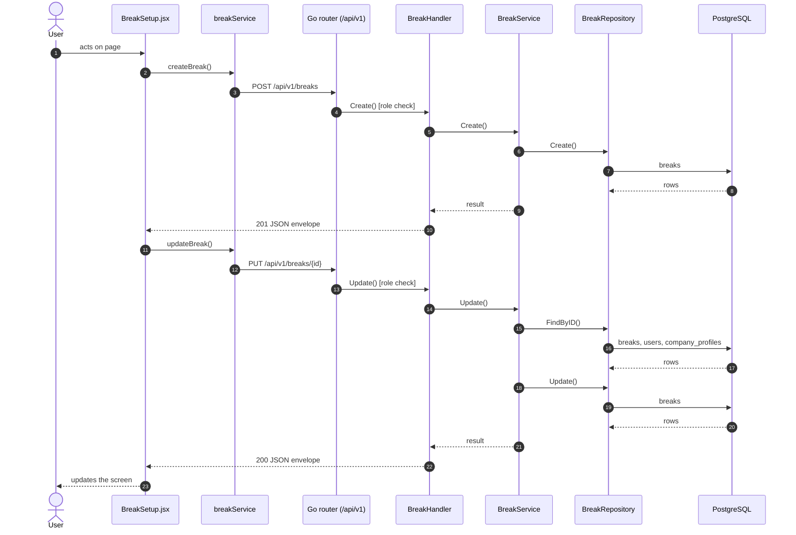

# Breaks

- **Route:** `/masters/breaks` · **Component:** [BreakSetup.jsx](../../src/pages/Breaks/BreakSetup.jsx) · **Auth:** protected (every logged-in role) · **Guard/Layout:** `ProtectedRoute` (session) + role guard · `MainLayout`
- **Purpose:** Breaks of the company's shifts; managers add, edit and delete in a modal.
- **Navigation:** Sidebar › Masters › Shift → Breaks

## On page load

**Steps**

1. [BreakSetup.jsx](../../src/pages/Breaks/BreakSetup.jsx) → useEffect(): runs on load `getBreaks()`
2. [breakService.js](../../src/services/breakService.js) → getBreaks(): calls `GET /api/v1/breaks`
3. [break_routes.go](../../../7th-sense-server/internal/routes/break_routes.go) → `GET /v1/breaks` → BreakHandler.GetAll
4. [break_handler.go](../../../7th-sense-server/internal/handler/break_handler.go) → GetAll(): query userId; calls the service
5. [break_service.go](../../../7th-sense-server/internal/service/break_service.go) → GetAll(): Returns the breaks the user may read. A non-nil customerID keeps only that customer's breaks.
6. [break_repository.go](../../../7th-sense-server/internal/repository/break_repository.go) → FindAll(): reads / writes `breaks`, `users`, `company_profiles`, `shifts`
7. [BreakSetup.jsx](../../src/pages/Breaks/BreakSetup.jsx) → useEffect(): runs on load `getUsers()`
8. [customerService.js](../../src/services/customerService.js) → getUsers(): calls `GET /api/v1/users`
9. [user_routes.go](../../../7th-sense-server/internal/routes/user_routes.go) → `GET /v1/users` (managersOnly: superadmin, customer, admin) → UserHandler.GetAll
10. [user_handler.go](../../../7th-sense-server/internal/handler/user_handler.go) → GetAll(): query companyId, filterRole; calls the service
11. [user_service.go](../../../7th-sense-server/internal/service/user_service.go) → GetAll(): Returns the users the user may see, narrowed by filter: every user for the superadmin, the company's members for a customer or admin. A customer or admin asking for another company gets Forbidden.
12. [BreakFormModal.jsx](../../src/pages/Breaks/BreakFormModal.jsx) → useEffect(): runs on load `getShifts()`
13. [shiftService.js](../../src/services/shiftService.js) → getShifts(): calls `GET /api/v1/shifts`
14. [shift_routes.go](../../../7th-sense-server/internal/routes/shift_routes.go) → `GET /v1/shifts` → ShiftHandler.GetAll
15. [shift_handler.go](../../../7th-sense-server/internal/handler/shift_handler.go) → GetAll(): query userId; calls the service
16. [shift_service.go](../../../7th-sense-server/internal/service/shift_service.go) → GetAll(): Returns the shifts the user may read, each with its breaks. A non-nil customerID keeps only that customer's shifts.
17. [shift_repository.go](../../../7th-sense-server/internal/repository/shift_repository.go) → FindAll(): reads / writes `shifts`, `users`, `company_profiles`

## Delete break

**Sequence diagram**

**Steps**

1. [BreakSetup.jsx](../../src/pages/Breaks/BreakSetup.jsx) → confirmDelete(): runs `deleteBreak()`
2. [breakService.js](../../src/services/breakService.js) → deleteBreak(): calls `DELETE /api/v1/breaks/{id}`
3. [break_routes.go](../../../7th-sense-server/internal/routes/break_routes.go) → `DELETE /v1/breaks/{id}` (managersOnly: superadmin, customer, admin) → BreakHandler.Delete
4. [break_handler.go](../../../7th-sense-server/internal/handler/break_handler.go) → Delete(): reads {id}; calls the service
5. [break_service.go](../../../7th-sense-server/internal/service/break_service.go) → Delete(): Soft-deletes the break (its shift no longer takes it). A customer or admin (the logged-in user) deletes only their company's breaks ("Break not found" for others).
6. [break_repository.go](../../../7th-sense-server/internal/repository/break_repository.go) → Delete(): reads / writes `breaks`

**Rules & edge cases**

- Only superadmin, customer and admin may do this (server `managersOnly`, others 403); the page hides the controls for other roles.

## Save break (add / edit form)

**Sequence diagram**

**Steps**

1. [BreakFormModal.jsx](../../src/pages/Breaks/BreakFormModal.jsx) → onSubmit(): runs `createBreak()`
2. [breakService.js](../../src/services/breakService.js) → createBreak(): calls `POST /api/v1/breaks`
3. [break_routes.go](../../../7th-sense-server/internal/routes/break_routes.go) → `POST /v1/breaks` (managersOnly: superadmin, customer, admin) → BreakHandler.Create
4. [break_handler.go](../../../7th-sense-server/internal/handler/break_handler.go) → Create(): decodes `dto.CreateBreakRequest` and runs its Validate(); calls the service
5. [break_service.go](../../../7th-sense-server/internal/service/break_service.go) → Create(): Adds a break, on the shift named or on none. A customer or admin (the logged-in user) adds it to their own company, whatever customer the request names; the superadmin to the customer named.
6. [break_repository.go](../../../7th-sense-server/internal/repository/break_repository.go) → Create(): reads / writes `breaks`
7. [BreakFormModal.jsx](../../src/pages/Breaks/BreakFormModal.jsx) → onSubmit(): runs `updateBreak()`
8. [breakService.js](../../src/services/breakService.js) → updateBreak(): calls `PUT /api/v1/breaks/{id}`
9. [break_routes.go](../../../7th-sense-server/internal/routes/break_routes.go) → `PUT /v1/breaks/{id}` (managersOnly: superadmin, customer, admin) → BreakHandler.Update
10. [break_handler.go](../../../7th-sense-server/internal/handler/break_handler.go) → Update(): reads {id}; decodes `dto.UpdateBreakRequest` and runs its Validate(); calls the service
11. [break_service.go](../../../7th-sense-server/internal/service/break_service.go) → Update(): Replaces the break, its shift included (nil takes it off its shift). A blank status keeps the saved one.
12. [break_repository.go](../../../7th-sense-server/internal/repository/break_repository.go) → FindByID(): reads / writes `breaks`, `users`, `company_profiles`, `shifts`
13. [break_repository.go](../../../7th-sense-server/internal/repository/break_repository.go) → Update(): reads / writes `breaks`

**Rules & edge cases**

- Only superadmin, customer and admin may do this (server `managersOnly`, others 403); the page hides the controls for other roles.
- Server validation (`dto.UpdateBreakRequest.Validate`): Please enter valid status.

## UI states

- **Loading:** `<Loader>` while the request runs.
- **Error:** a red `<Alert>` with the server message (some pages add Retry).
- **Success / failure of an action:** toast message (`utils/toast.js`).
- **Empty:** an empty-state message instead of the table / chart.
- **Delete:** asks for confirmation first.

## API calls on this page

| Method | Endpoint | Triggered by (section) | API docs |
|---|---|---|---|
| DELETE | `/api/v1/breaks/{id}` | Delete break | [Swagger](http://localhost:8080/api-docs/index.html#/Breaks/deleteBreak) · [openapi.yaml](../../../7th-sense-server/docs/api/openapi.yaml) |
| GET | `/api/v1/breaks` | On page load | [Swagger](http://localhost:8080/api-docs/index.html#/Breaks/getBreaks) · [openapi.yaml](../../../7th-sense-server/docs/api/openapi.yaml) |
| GET | `/api/v1/users` | On page load | [Swagger](http://localhost:8080/api-docs/index.html#/Users/getUsers) · [openapi.yaml](../../../7th-sense-server/docs/api/openapi.yaml) |
| POST | `/api/v1/breaks` | Save break (add / edit form) | [Swagger](http://localhost:8080/api-docs/index.html#/Breaks/createBreak) · [openapi.yaml](../../../7th-sense-server/docs/api/openapi.yaml) |
| PUT | `/api/v1/breaks/{id}` | Save break (add / edit form) | [Swagger](http://localhost:8080/api-docs/index.html#/Breaks/updateBreak) · [openapi.yaml](../../../7th-sense-server/docs/api/openapi.yaml) |
| GET | `/api/v1/shifts` | On page load | [Swagger](http://localhost:8080/api-docs/index.html#/Shifts/getShifts) · [openapi.yaml](../../../7th-sense-server/docs/api/openapi.yaml) |

## State & storage

- `useAuth()` (logged-in user, roles)
- Local component state (`useState`) for filters, form and modal

## Shared components used

[ConfirmModal.jsx](../../src/components/common/ConfirmModal.jsx), [Loader.jsx](../../src/components/common/Loader.jsx), [TablePagination.jsx](../../src/components/common/TablePagination.jsx), [SortableHead.jsx](../../src/components/common/SortableHead.jsx), [IconAction.jsx](../../src/components/common/IconAction.jsx), [StatusBadge.jsx](../../src/components/common/StatusBadge.jsx), [FieldLabel.jsx](../../src/components/common/FieldLabel.jsx), [TimePicker.jsx](../../src/components/common/TimePicker.jsx), [StatusToggle.jsx](../../src/components/common/StatusToggle.jsx)

## Decisions

- [Client ADR index](../adr/README.md)
