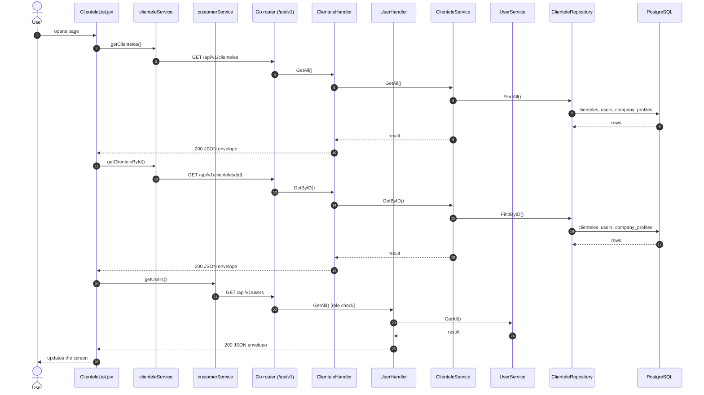
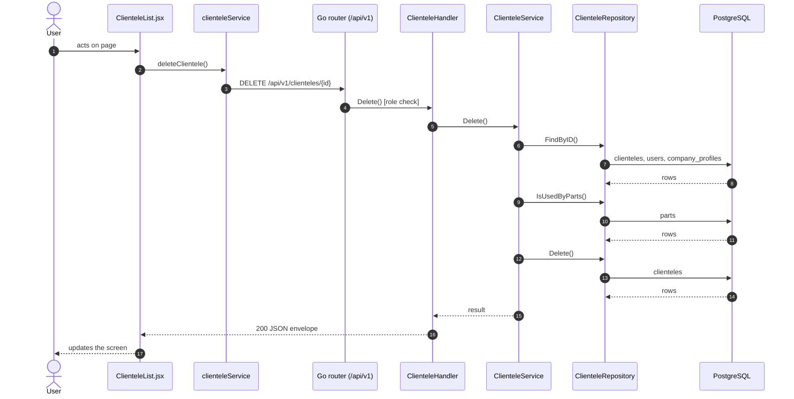
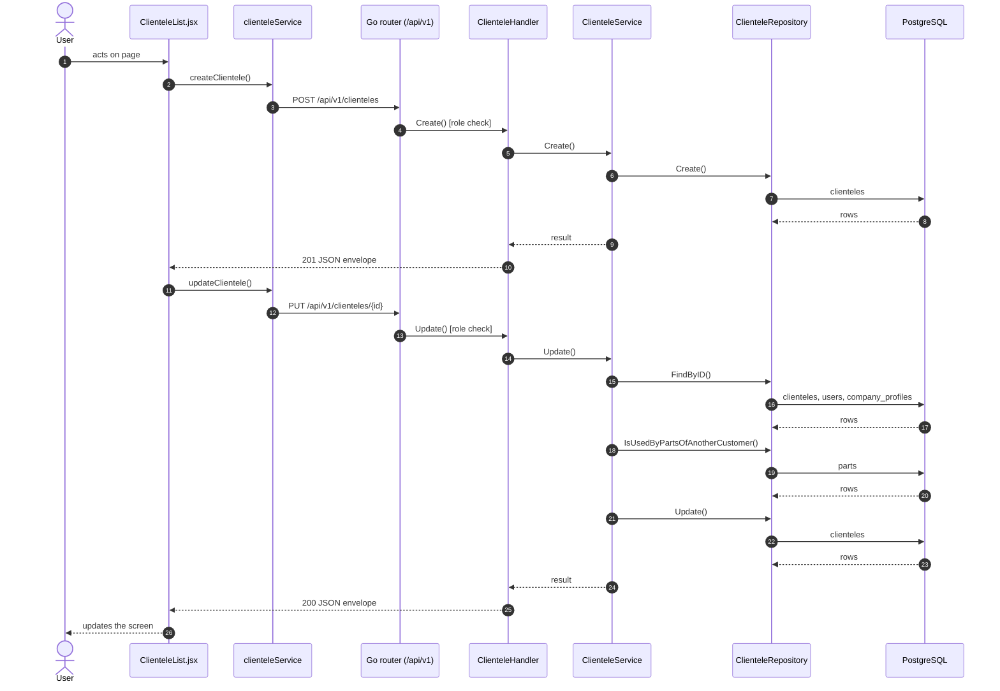

# Clientele

- **Route:** `/masters/clienteles` · **Component:** [ClienteleList.jsx](../../src/pages/Clienteles/ClienteleList.jsx) · **Auth:** protected (every logged-in role) · **Guard/Layout:** `ProtectedRoute` (session) + role guard · `MainLayout`
- **Purpose:** Lists the company's clientele (their customers); managers add, edit and delete in a modal.
- **Navigation:** Sidebar › System › Account Center → **Clientele** tab ([AccountCenterPage.jsx](../../src/pages/AccountCenter/AccountCenterPage.jsx): page header + tabs (only the ones the role may open), this screen is the tab body; the tab is the route)

## On page load

**Steps**

1. [ClienteleList.jsx](../../src/pages/Clienteles/ClienteleList.jsx) → useEffect(): runs on load `getClienteles()`
2. [clienteleService.js](../../src/services/clienteleService.js) → getClienteles(): calls `GET /api/v1/clienteles`
3. [clientele_routes.go](../../../7th-sense-server/internal/routes/clientele_routes.go) → `GET /v1/clienteles` → ClienteleHandler.GetAll
4. [clientele_handler.go](../../../7th-sense-server/internal/handler/clientele_handler.go) → GetAll(): query userId; calls the service
5. [clientele_service.go](../../../7th-sense-server/internal/service/clientele_service.go) → GetAll(): Returns the clienteles the user may read. A non-nil customerID keeps only that customer's clienteles.
6. [clientele_repository.go](../../../7th-sense-server/internal/repository/clientele_repository.go) → FindAll(): reads / writes `clienteles`, `users`, `company_profiles`
7. [ClienteleFormModal.jsx](../../src/pages/Clienteles/ClienteleFormModal.jsx) → useEffect(): runs on load `getClienteleById()`
8. [clienteleService.js](../../src/services/clienteleService.js) → getClienteleById(): calls `GET /api/v1/clienteles/{id}`
9. [clientele_routes.go](../../../7th-sense-server/internal/routes/clientele_routes.go) → `GET /v1/clienteles/{id}` → ClienteleHandler.GetByID
10. [clientele_handler.go](../../../7th-sense-server/internal/handler/clientele_handler.go) → GetByID(): reads {id}; query userId; calls the service
11. [clientele_service.go](../../../7th-sense-server/internal/service/clientele_service.go) → GetByID(): Returns the clientele when the user may read it, else "Clientele not found".
12. [clientele_repository.go](../../../7th-sense-server/internal/repository/clientele_repository.go) → FindByID(): reads / writes `clienteles`, `users`, `company_profiles`
13. [ClienteleFormModal.jsx](../../src/pages/Clienteles/ClienteleFormModal.jsx) → useEffect(): runs on load `getUsers()`
14. [customerService.js](../../src/services/customerService.js) → getUsers(): calls `GET /api/v1/users`
15. [user_routes.go](../../../7th-sense-server/internal/routes/user_routes.go) → `GET /v1/users` (managersOnly: superadmin, customer, admin) → UserHandler.GetAll
16. [user_handler.go](../../../7th-sense-server/internal/handler/user_handler.go) → GetAll(): query companyId, filterRole; calls the service
17. [user_service.go](../../../7th-sense-server/internal/service/user_service.go) → GetAll(): Returns the users the user may see, narrowed by filter: every user for the superadmin, the company's members for a customer or admin. A customer or admin asking for another company gets Forbidden.

## Delete clientele

**Sequence diagram**

**Steps**

1. [ClienteleList.jsx](../../src/pages/Clienteles/ClienteleList.jsx) → confirmDelete(): runs `deleteClientele()`
2. [clienteleService.js](../../src/services/clienteleService.js) → deleteClientele(): calls `DELETE /api/v1/clienteles/{id}`
3. [clientele_routes.go](../../../7th-sense-server/internal/routes/clientele_routes.go) → `DELETE /v1/clienteles/{id}` (managersOnly: superadmin, customer, admin) → ClienteleHandler.Delete
4. [clientele_handler.go](../../../7th-sense-server/internal/handler/clientele_handler.go) → Delete(): reads {id}; calls the service
5. [clientele_service.go](../../../7th-sense-server/internal/service/clientele_service.go) → Delete(): Soft-deletes the clientele unless parts use it. A customer or admin (the logged-in user) deletes only their company's clienteles ("Clientele not found" for others).
6. [clientele_repository.go](../../../7th-sense-server/internal/repository/clientele_repository.go) → FindByID(): reads / writes `clienteles`, `users`, `company_profiles`
7. [clientele_repository.go](../../../7th-sense-server/internal/repository/clientele_repository.go) → IsUsedByParts(): reads / writes `parts`
8. [clientele_repository.go](../../../7th-sense-server/internal/repository/clientele_repository.go) → Delete(): reads / writes `clienteles`

**Rules & edge cases**

- Only superadmin, customer and admin may do this (server `managersOnly`, others 403); the page hides the controls for other roles.

## Save clientele (add / edit form)

**Sequence diagram**

**Steps**

1. [ClienteleFormModal.jsx](../../src/pages/Clienteles/ClienteleFormModal.jsx) → onSubmit(): runs `createClientele()`
2. [clienteleService.js](../../src/services/clienteleService.js) → createClientele(): calls `POST /api/v1/clienteles`
3. [clientele_routes.go](../../../7th-sense-server/internal/routes/clientele_routes.go) → `POST /v1/clienteles` (managersOnly: superadmin, customer, admin) → ClienteleHandler.Create
4. [clientele_handler.go](../../../7th-sense-server/internal/handler/clientele_handler.go) → Create(): decodes `dto.CreateClienteleRequest` and runs its Validate(); calls the service
5. [clientele_service.go](../../../7th-sense-server/internal/service/clientele_service.go) → Create(): Adds a clientele. A customer or admin (the logged-in user) adds it to their own company, whatever customer the request names; the superadmin to the customer named.
6. [clientele_repository.go](../../../7th-sense-server/internal/repository/clientele_repository.go) → Create(): reads / writes `clienteles`
7. [ClienteleFormModal.jsx](../../src/pages/Clienteles/ClienteleFormModal.jsx) → onSubmit(): runs `updateClientele()`
8. [clienteleService.js](../../src/services/clienteleService.js) → updateClientele(): calls `PUT /api/v1/clienteles/{id}`
9. [clientele_routes.go](../../../7th-sense-server/internal/routes/clientele_routes.go) → `PUT /v1/clienteles/{id}` (managersOnly: superadmin, customer, admin) → ClienteleHandler.Update
10. [clientele_handler.go](../../../7th-sense-server/internal/handler/clientele_handler.go) → Update(): reads {id}; decodes `dto.UpdateClienteleRequest` and runs its Validate(); calls the service
11. [clientele_service.go](../../../7th-sense-server/internal/service/clientele_service.go) → Update(): Replaces the clientele. A blank status keeps the saved one.
12. [clientele_repository.go](../../../7th-sense-server/internal/repository/clientele_repository.go) → FindByID(): reads / writes `clienteles`, `users`, `company_profiles`
13. [clientele_repository.go](../../../7th-sense-server/internal/repository/clientele_repository.go) → IsUsedByPartsOfAnotherCustomer(): reads / writes `parts`
14. [clientele_repository.go](../../../7th-sense-server/internal/repository/clientele_repository.go) → Update(): reads / writes `clienteles`

**Rules & edge cases**

- Only superadmin, customer and admin may do this (server `managersOnly`, others 403); the page hides the controls for other roles.
- Server validation (`dto.UpdateClienteleRequest.Validate`): Please enter valid status.

## UI states

- **Loading:** `<Loader>` while the request runs.
- **Error:** a red `<Alert>` with the server message (some pages add Retry).
- **Success / failure of an action:** toast message (`utils/toast.js`).
- **Empty:** an empty-state message instead of the table / chart.
- **Delete:** asks for confirmation first.

## API calls on this page

| Method | Endpoint | Triggered by (section) | API docs |
|---|---|---|---|
| DELETE | `/api/v1/clienteles/{id}` | Delete clientele | [Swagger](http://localhost:8080/api-docs/index.html#/Clienteles/deleteClientele) · [openapi.yaml](../../../7th-sense-server/docs/api/openapi.yaml) |
| GET | `/api/v1/clienteles` | On page load | [Swagger](http://localhost:8080/api-docs/index.html#/Clienteles/getClienteles) · [openapi.yaml](../../../7th-sense-server/docs/api/openapi.yaml) |
| POST | `/api/v1/clienteles` | Save clientele (add / edit form) | [Swagger](http://localhost:8080/api-docs/index.html#/Clienteles/createClientele) · [openapi.yaml](../../../7th-sense-server/docs/api/openapi.yaml) |
| GET | `/api/v1/clienteles/{id}` | On page load | [Swagger](http://localhost:8080/api-docs/index.html#/Clienteles/getClienteleById) · [openapi.yaml](../../../7th-sense-server/docs/api/openapi.yaml) |
| PUT | `/api/v1/clienteles/{id}` | Save clientele (add / edit form) | [Swagger](http://localhost:8080/api-docs/index.html#/Clienteles/updateClientele) · [openapi.yaml](../../../7th-sense-server/docs/api/openapi.yaml) |
| GET | `/api/v1/users` | On page load | [Swagger](http://localhost:8080/api-docs/index.html#/Users/getUsers) · [openapi.yaml](../../../7th-sense-server/docs/api/openapi.yaml) |

## State & storage

- `useAuth()` (logged-in user, roles)
- Local component state (`useState`) for filters, form and modal

## Shared components used

[ConfirmModal.jsx](../../src/components/common/ConfirmModal.jsx), [Loader.jsx](../../src/components/common/Loader.jsx), [TablePagination.jsx](../../src/components/common/TablePagination.jsx), [SortableHead.jsx](../../src/components/common/SortableHead.jsx), [IconAction.jsx](../../src/components/common/IconAction.jsx), [StatusBadge.jsx](../../src/components/common/StatusBadge.jsx), [FieldLabel.jsx](../../src/components/common/FieldLabel.jsx), [StatusToggle.jsx](../../src/components/common/StatusToggle.jsx)

## Decisions

- [ADR 0011: tabbed page](../adr/0011-business-setup-tabbed-page.md), [ADR 0014: renamed Account Center](../adr/0014-account-center.md)
- [Client ADR index](../adr/README.md)
