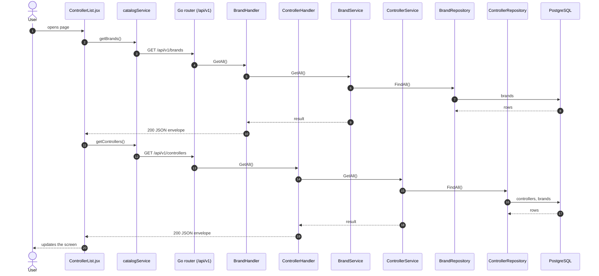
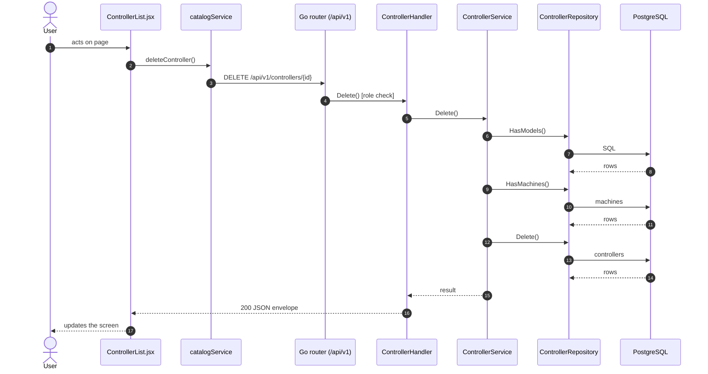
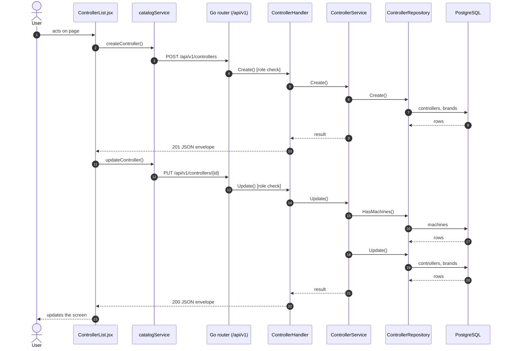

# Controllers

- **Route:** `/masters/controllers` · **Component:** [ControllerList.jsx](../../src/pages/Controllers/ControllerList.jsx) · **Auth:** protected (superadmin) · **Guard/Layout:** `ProtectedRoute` (session) + role guard · `MainLayout`
- **Purpose:** Machine catalog: controllers of a brand (superadmin).
- **Navigation:** Sidebar › Admin › Machine catalog → Controllers → Models

## On page load

**Steps**

1. [ControllerList.jsx](../../src/pages/Controllers/ControllerList.jsx) → useEffect(): runs on load `getBrands()`
2. [catalogService.js](../../src/services/catalogService.js) → getBrands(): calls `GET /api/v1/brands`
3. [brand_routes.go](../../../7th-sense-server/internal/routes/brand_routes.go) → `GET /v1/brands` → BrandHandler.GetAll
4. [brand_handler.go](../../../7th-sense-server/internal/handler/brand_handler.go) → GetAll(): reads the logged-in user; calls the service
5. [brand_service.go](../../../7th-sense-server/internal/service/brand_service.go) → GetAll(): 
6. [brand_repository.go](../../../7th-sense-server/internal/repository/brand_repository.go) → FindAll(): reads / writes `brands`
7. [ControllerList.jsx](../../src/pages/Controllers/ControllerList.jsx) → useEffect(): runs on load `getControllers()`
8. [catalogService.js](../../src/services/catalogService.js) → getControllers(): calls `GET /api/v1/controllers`
9. [controller_routes.go](../../../7th-sense-server/internal/routes/controller_routes.go) → `GET /v1/controllers` → ControllerHandler.GetAll
10. [controller_handler.go](../../../7th-sense-server/internal/handler/controller_handler.go) → GetAll(): query brandId; calls the service
11. [controller_service.go](../../../7th-sense-server/internal/service/controller_service.go) → GetAll(): Returns the controllers. A non-nil brandID keeps only that brand's controllers.
12. [controller_repository.go](../../../7th-sense-server/internal/repository/controller_repository.go) → FindAll(): reads / writes `controllers`, `brands`

## Delete controller

**Sequence diagram**

**Steps**

1. [ControllerList.jsx](../../src/pages/Controllers/ControllerList.jsx) → confirmDelete(): runs `deleteController()`
2. [catalogService.js](../../src/services/catalogService.js) → deleteController(): calls `DELETE /api/v1/controllers/{id}`
3. [controller_routes.go](../../../7th-sense-server/internal/routes/controller_routes.go) → `DELETE /v1/controllers/{id}` (superAdminOnly) → ControllerHandler.Delete
4. [controller_handler.go](../../../7th-sense-server/internal/handler/controller_handler.go) → Delete(): reads {id}; calls the service
5. [controller_service.go](../../../7th-sense-server/internal/service/controller_service.go) → Delete(): Soft-deletes the controller. A controller that still has models or is used by machines is kept: those must be deleted or changed first.
6. [controller_repository.go](../../../7th-sense-server/internal/repository/controller_repository.go) → HasModels(): runs its SQL
7. [controller_repository.go](../../../7th-sense-server/internal/repository/controller_repository.go) → HasMachines(): reads / writes `machines`
8. [controller_repository.go](../../../7th-sense-server/internal/repository/controller_repository.go) → Delete(): reads / writes `controllers`

**Rules & edge cases**

- Superadmin only (server `superAdminOnly`, others 403).

## Save controller (add / edit form)

**Sequence diagram**

**Steps**

1. [ControllerFormModal.jsx](../../src/pages/Controllers/ControllerFormModal.jsx) → onSubmit(): runs `createController()`
2. [catalogService.js](../../src/services/catalogService.js) → createController(): calls `POST /api/v1/controllers`
3. [controller_routes.go](../../../7th-sense-server/internal/routes/controller_routes.go) → `POST /v1/controllers` (superAdminOnly) → ControllerHandler.Create
4. [controller_handler.go](../../../7th-sense-server/internal/handler/controller_handler.go) → Create(): decodes `dto.CreateControllerRequest` and runs its Validate(); calls the service
5. [controller_service.go](../../../7th-sense-server/internal/service/controller_service.go) → Create(): 
6. [controller_repository.go](../../../7th-sense-server/internal/repository/controller_repository.go) → Create(): reads / writes `controllers`, `brands`
7. [ControllerFormModal.jsx](../../src/pages/Controllers/ControllerFormModal.jsx) → onSubmit(): runs `updateController()`
8. [catalogService.js](../../src/services/catalogService.js) → updateController(): calls `PUT /api/v1/controllers/{id}`
9. [controller_routes.go](../../../7th-sense-server/internal/routes/controller_routes.go) → `PUT /v1/controllers/{id}` (superAdminOnly) → ControllerHandler.Update
10. [controller_handler.go](../../../7th-sense-server/internal/handler/controller_handler.go) → Update(): reads {id}; decodes `dto.UpdateControllerRequest` and runs its Validate(); calls the service
11. [controller_service.go](../../../7th-sense-server/internal/service/controller_service.go) → Update(): Replaces the controller's fields. Its brand cannot change while machines use it, because each machine stores the brand of its controller.
12. [controller_repository.go](../../../7th-sense-server/internal/repository/controller_repository.go) → HasMachines(): reads / writes `machines`
13. [controller_repository.go](../../../7th-sense-server/internal/repository/controller_repository.go) → Update(): reads / writes `controllers`, `brands`

**Rules & edge cases**

- Superadmin only (server `superAdminOnly`, others 403).

## UI states

- **Loading:** `<Loader>` while the request runs.
- **Error:** a red `<Alert>` with the server message (some pages add Retry).
- **Success / failure of an action:** toast message (`utils/toast.js`).
- **Empty:** an empty-state message instead of the table / chart.
- **Delete:** asks for confirmation first.

## API calls on this page

| Method | Endpoint | Triggered by (section) | API docs |
|---|---|---|---|
| DELETE | `/api/v1/controllers/{id}` | Delete controller | [Swagger](http://localhost:8080/api-docs/index.html#/Machine%20catalog/deleteController) · [openapi.yaml](../../../7th-sense-server/docs/api/openapi.yaml) |
| GET | `/api/v1/brands` | On page load | [Swagger](http://localhost:8080/api-docs/index.html#/Machine%20catalog/getBrands) · [openapi.yaml](../../../7th-sense-server/docs/api/openapi.yaml) |
| GET | `/api/v1/controllers` | On page load | [Swagger](http://localhost:8080/api-docs/index.html#/Machine%20catalog/getControllers) · [openapi.yaml](../../../7th-sense-server/docs/api/openapi.yaml) |
| POST | `/api/v1/controllers` | Save controller (add / edit form) | [Swagger](http://localhost:8080/api-docs/index.html#/Machine%20catalog/createController) · [openapi.yaml](../../../7th-sense-server/docs/api/openapi.yaml) |
| PUT | `/api/v1/controllers/{id}` | Save controller (add / edit form) | [Swagger](http://localhost:8080/api-docs/index.html#/Machine%20catalog/updateController) · [openapi.yaml](../../../7th-sense-server/docs/api/openapi.yaml) |

## State & storage

- Local component state (`useState`) for filters, form and modal

## Shared components used

[ConfirmModal.jsx](../../src/components/common/ConfirmModal.jsx), [Loader.jsx](../../src/components/common/Loader.jsx), [TablePagination.jsx](../../src/components/common/TablePagination.jsx), [SortableHead.jsx](../../src/components/common/SortableHead.jsx), [IconAction.jsx](../../src/components/common/IconAction.jsx), [FieldLabel.jsx](../../src/components/common/FieldLabel.jsx)

## Decisions

- [Client ADR index](../adr/README.md)
