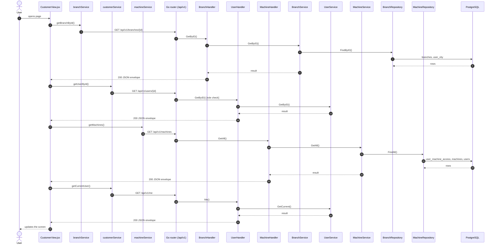
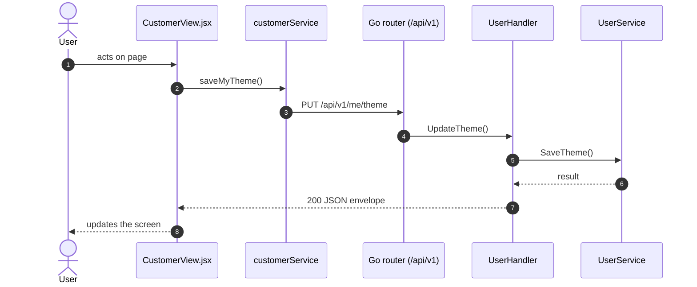

# Customer / user detail

- **Route:** `/masters/customers/:id` · `/masters/users/:id` (kind `user`) · **Component:** [CustomerView.jsx](../../src/pages/Customers/CustomerView.jsx) · **Auth:** protected (customers: superadmin; users: superadmin, customer, admin — [ADR 0016](../adr/0016-account-center-superadmin-only.md)) · **Guard/Layout:** `ProtectedRoute` (session) + role guard · `MainLayout`
- **Purpose:** Read-only view of one customer or user and what belongs to it.
- **Navigation:** Customer / user list → detail → Edit

## On page load

**Steps**

1. [CustomerView.jsx](../../src/pages/Customers/CustomerView.jsx) → useEffect(): runs on load `getBranchById()`
2. [branchService.js](../../src/services/branchService.js) → getBranchById(): calls `GET /api/v1/branches/{id}`
3. [branch_routes.go](../../../7th-sense-server/internal/routes/branch_routes.go) → `GET /v1/branches/{id}` → BranchHandler.GetByID
4. [branch_handler.go](../../../7th-sense-server/internal/handler/branch_handler.go) → GetByID(): reads {id}; calls the service
5. [branch_service.go](../../../7th-sense-server/internal/service/branch_service.go) → GetByID(): 
6. [branch_repository.go](../../../7th-sense-server/internal/repository/branch_repository.go) → FindByID(): reads / writes `branches`, `user_city`
7. [CustomerView.jsx](../../src/pages/Customers/CustomerView.jsx) → useEffect(): runs on load `getUserById()`
8. [customerService.js](../../src/services/customerService.js) → getUserById(): calls `GET /api/v1/users/{id}`
9. [user_routes.go](../../../7th-sense-server/internal/routes/user_routes.go) → `GET /v1/users/{id}` (managersOnly: superadmin, customer, admin) → UserHandler.GetByID
10. [user_handler.go](../../../7th-sense-server/internal/handler/user_handler.go) → GetByID(): reads {id}; calls the service
11. [user_service.go](../../../7th-sense-server/internal/service/user_service.go) → GetByID(): Returns user id with its details, or "User not found" when the user may not see it.
12. [CustomerView.jsx](../../src/pages/Customers/CustomerView.jsx) → useEffect(): runs on load `getMachines()`
13. [machineService.js](../../src/services/machineService.js) → getMachines(): calls `GET /api/v1/machines`
14. [machine_routes.go](../../../7th-sense-server/internal/routes/machine_routes.go) → `GET /v1/machines` → MachineHandler.GetAll
15. [machine_handler.go](../../../7th-sense-server/internal/handler/machine_handler.go) → GetAll(): query userId; calls the service
16. [machine_service.go](../../../7th-sense-server/internal/service/machine_service.go) → GetAll(): Returns the machines the user may access (see machineScope). A non-nil customerID keeps only that customer's machines.
17. [machine_repository.go](../../../7th-sense-server/internal/repository/machine_repository.go) → FindAll(): reads / writes `user_machine_access`, `machines`, `users`, `company_profiles`
18. [theme.js](../../src/utils/theme.js) → refreshUserTheme(): runs `getCurrentUser()`
19. [customerService.js](../../src/services/customerService.js) → getCurrentUser(): calls `GET /api/v1/me`
20. [user_routes.go](../../../7th-sense-server/internal/routes/user_routes.go) → `GET /v1/me` → UserHandler.Me
21. [user_handler.go](../../../7th-sense-server/internal/handler/user_handler.go) → Me(): reads the logged-in user; calls the service
22. [user_service.go](../../../7th-sense-server/internal/service/user_service.go) → GetCurrent(): Returns the logged-in user (userID) with its details.

## Change theme

**Sequence diagram**

**Steps**

1. [theme.js](../../src/utils/theme.js) → chooseTheme(): runs `saveMyTheme()`
2. [customerService.js](../../src/services/customerService.js) → saveMyTheme(): calls `PUT /api/v1/me/theme`
3. [user_routes.go](../../../7th-sense-server/internal/routes/user_routes.go) → `PUT /v1/me/theme` → UserHandler.UpdateTheme
4. [user_handler.go](../../../7th-sense-server/internal/handler/user_handler.go) → UpdateTheme(): decodes `dto.UpdateThemeRequest` and runs its Validate(); calls the service
5. [user_service.go](../../../7th-sense-server/internal/service/user_service.go) → SaveTheme(): Sets the UI theme of userID (the logged-in user).

**Rules & edge cases**

- Server validation (`dto.UpdateThemeRequest.Validate`): Please enter valid theme.

## UI states

- **Loading:** `<Loader>` while the request runs.
- **Error:** a red `<Alert>` with the server message (some pages add Retry).

## API calls on this page

| Method | Endpoint | Triggered by (section) | API docs |
|---|---|---|---|
| GET | `/api/v1/branches/{id}` | On page load | [Swagger](http://localhost:8080/api-docs/index.html#/Branches/getBranchById) · [openapi.yaml](../../../7th-sense-server/docs/api/openapi.yaml) |
| GET | `/api/v1/users/{id}` | On page load | [Swagger](http://localhost:8080/api-docs/index.html#/Users/getUserById) · [openapi.yaml](../../../7th-sense-server/docs/api/openapi.yaml) |
| GET | `/api/v1/machines` | On page load | [Swagger](http://localhost:8080/api-docs/index.html#/Machines/getMachines) · [openapi.yaml](../../../7th-sense-server/docs/api/openapi.yaml) |
| GET | `/api/v1/me` | On page load | [Swagger](http://localhost:8080/api-docs/index.html#/Users/getCurrentUser) · [openapi.yaml](../../../7th-sense-server/docs/api/openapi.yaml) |
| PUT | `/api/v1/me/theme` | Change theme | [Swagger](http://localhost:8080/api-docs/index.html#/Users/saveMyTheme) · [openapi.yaml](../../../7th-sense-server/docs/api/openapi.yaml) |

## State & storage

- Route param `:id` (`useParams`)
- `useAuth()` (logged-in user, roles)
- Local component state (`useState`) for filters, form and modal

## Shared components used

[Loader.jsx](../../src/components/common/Loader.jsx), [StatusBadge.jsx](../../src/components/common/StatusBadge.jsx)

## Decisions

- [Client ADR index](../adr/README.md)
