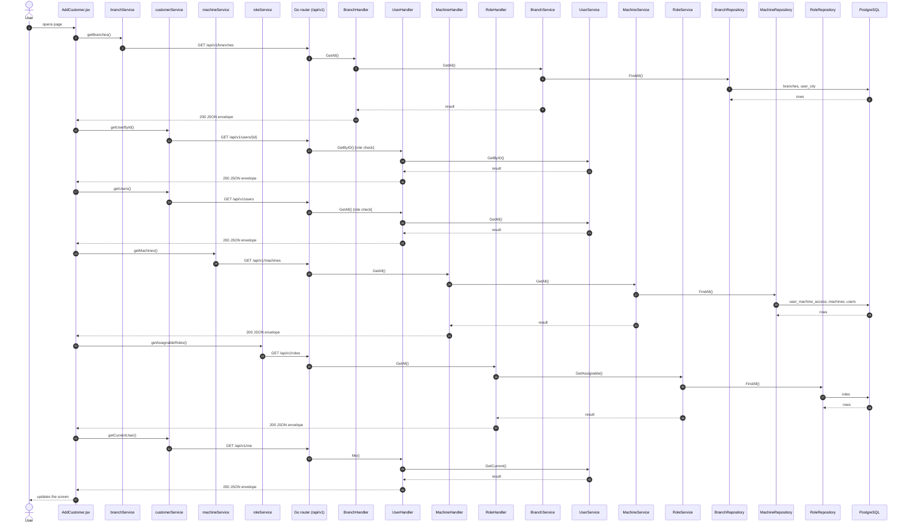
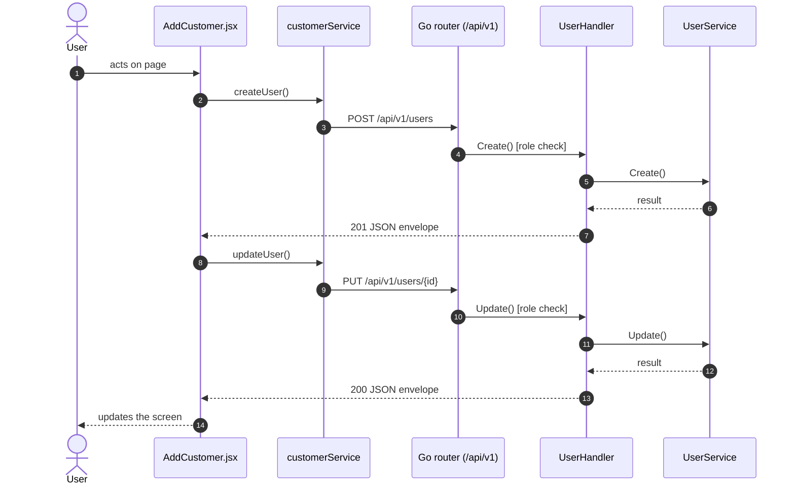
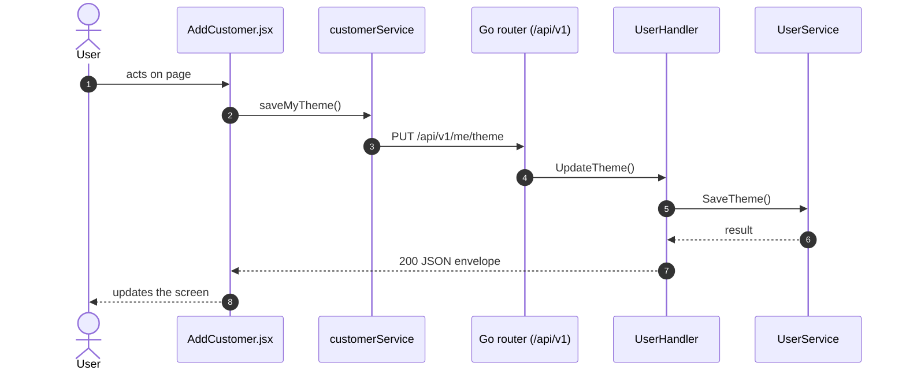

# Add / edit customer or user

- **Route:** `/masters/customers/add` · `/masters/customers/:id/edit` · `/masters/users/add` (kind `user`) · `/masters/users/:id/edit` (kind `user`) · **Component:** [AddCustomer.jsx](../../src/pages/Customers/AddCustomer.jsx) · **Auth:** protected (customers: superadmin; users: superadmin, customer, admin — [ADR 0016](../adr/0016-account-center-superadmin-only.md)) · **Guard/Layout:** `ProtectedRoute` (session) + role guard · `MainLayout`
- **Purpose:** Add or edit a customer (company) or one of its users, with role, branch and assigned machines.
- **Navigation:** Customer / user list → form → back to the list

## On page load

**Steps**

1. [AddCustomer.jsx](../../src/pages/Customers/AddCustomer.jsx) → useEffect(): runs on load `getBranches()`
2. [branchService.js](../../src/services/branchService.js) → getBranches(): calls `GET /api/v1/branches`
3. [branch_routes.go](../../../7th-sense-server/internal/routes/branch_routes.go) → `GET /v1/branches` → BranchHandler.GetAll
4. [branch_handler.go](../../../7th-sense-server/internal/handler/branch_handler.go) → GetAll(): query userCityId; calls the service
5. [branch_service.go](../../../7th-sense-server/internal/service/branch_service.go) → GetAll(): Returns the branches. A non-nil userCityID keeps only that city's branches.
6. [branch_repository.go](../../../7th-sense-server/internal/repository/branch_repository.go) → FindAll(): reads / writes `branches`, `user_city`
7. [AddCustomer.jsx](../../src/pages/Customers/AddCustomer.jsx) → useEffect(): runs on load `getUserById()`
8. [customerService.js](../../src/services/customerService.js) → getUserById(): calls `GET /api/v1/users/{id}`
9. [user_routes.go](../../../7th-sense-server/internal/routes/user_routes.go) → `GET /v1/users/{id}` (managersOnly: superadmin, customer, admin) → UserHandler.GetByID
10. [user_handler.go](../../../7th-sense-server/internal/handler/user_handler.go) → GetByID(): reads {id}; calls the service
11. [user_service.go](../../../7th-sense-server/internal/service/user_service.go) → GetByID(): Returns user id with its details, or "User not found" when the user may not see it.
12. [AddCustomer.jsx](../../src/pages/Customers/AddCustomer.jsx) → useEffect(): runs on load `getUsers()`
13. [customerService.js](../../src/services/customerService.js) → getUsers(): calls `GET /api/v1/users`
14. [user_routes.go](../../../7th-sense-server/internal/routes/user_routes.go) → `GET /v1/users` (managersOnly: superadmin, customer, admin) → UserHandler.GetAll
15. [user_handler.go](../../../7th-sense-server/internal/handler/user_handler.go) → GetAll(): query companyId, filterRole; calls the service
16. [user_service.go](../../../7th-sense-server/internal/service/user_service.go) → GetAll(): Returns the users the user may see, narrowed by filter: every user for the superadmin, the company's members for a customer or admin. A customer or admin asking for another company gets Forbidden.
17. [AddCustomer.jsx](../../src/pages/Customers/AddCustomer.jsx) → useEffect(): runs on load `getMachines()`
18. [machineService.js](../../src/services/machineService.js) → getMachines(): calls `GET /api/v1/machines`
19. [machine_routes.go](../../../7th-sense-server/internal/routes/machine_routes.go) → `GET /v1/machines` → MachineHandler.GetAll
20. [machine_handler.go](../../../7th-sense-server/internal/handler/machine_handler.go) → GetAll(): query userId; calls the service
21. [machine_service.go](../../../7th-sense-server/internal/service/machine_service.go) → GetAll(): Returns the machines the user may access (see machineScope). A non-nil customerID keeps only that customer's machines.
22. [machine_repository.go](../../../7th-sense-server/internal/repository/machine_repository.go) → FindAll(): reads / writes `user_machine_access`, `machines`, `users`, `company_profiles`
23. [AddCustomer.jsx](../../src/pages/Customers/AddCustomer.jsx) → useEffect(): runs on load `getAssignableRoles()`
24. [roleService.js](../../src/services/roleService.js) → getAssignableRoles(): calls `GET /api/v1/roles`
25. [role_routes.go](../../../7th-sense-server/internal/routes/role_routes.go) → `GET /v1/roles` → RoleHandler.GetAll
26. [role_handler.go](../../../7th-sense-server/internal/handler/role_handler.go) → GetAll(): reads the logged-in user; calls the service
27. [role_service.go](../../../7th-sense-server/internal/service/role_service.go) → GetAssignable(): Returns the roles the user may give to the users they create or edit, by id. It is empty for users who manage no users.
28. [role_repository.go](../../../7th-sense-server/internal/repository/role_repository.go) → FindAll(): reads / writes `roles`
29. [theme.js](../../src/utils/theme.js) → refreshUserTheme(): runs `getCurrentUser()`
30. [customerService.js](../../src/services/customerService.js) → getCurrentUser(): calls `GET /api/v1/me`
31. [user_routes.go](../../../7th-sense-server/internal/routes/user_routes.go) → `GET /v1/me` → UserHandler.Me
32. [user_handler.go](../../../7th-sense-server/internal/handler/user_handler.go) → Me(): reads the logged-in user; calls the service
33. [user_service.go](../../../7th-sense-server/internal/service/user_service.go) → GetCurrent(): Returns the logged-in user (userID) with its details.

## Save user (add / edit form)

**Sequence diagram**

**Steps**

1. [AddCustomer.jsx](../../src/pages/Customers/AddCustomer.jsx) → onSubmit(): runs `createUser()`
2. [customerService.js](../../src/services/customerService.js) → createUser(): calls `POST /api/v1/users`
3. [user_routes.go](../../../7th-sense-server/internal/routes/user_routes.go) → `POST /v1/users` (managersOnly: superadmin, customer, admin) → UserHandler.Create
4. [user_handler.go](../../../7th-sense-server/internal/handler/user_handler.go) → Create(): decodes `dto.CreateUserRequest` and runs its Validate(); calls the service
5. [user_service.go](../../../7th-sense-server/internal/service/user_service.go) → Create(): Adds a user with its customer details and machine access. the user must be allowed to give the role (see accessFor).
6. [AddCustomer.jsx](../../src/pages/Customers/AddCustomer.jsx) → onSubmit(): runs `updateUser()`
7. [customerService.js](../../src/services/customerService.js) → updateUser(): calls `PUT /api/v1/users/{id}`
8. [user_routes.go](../../../7th-sense-server/internal/routes/user_routes.go) → `PUT /v1/users/{id}` (managersOnly: superadmin, customer, admin) → UserHandler.Update
9. [user_handler.go](../../../7th-sense-server/internal/handler/user_handler.go) → Update(): reads {id}; decodes `dto.UpdateUserRequest` and runs its Validate(); calls the service
10. [user_service.go](../../../7th-sense-server/internal/service/user_service.go) → Update(): Replaces the user and its customer details. Customer details the user does not have yet are created.

**Rules & edge cases**

- Only superadmin, customer and admin may do this (server `managersOnly`, others 403); the page hides the controls for other roles.
- Server validation (`dto.CreateUserRequest.Validate`): Please enter valid password.
- Server validation (`dto.UpdateUserRequest.Validate`): Please enter valid status.

## Change theme

**Sequence diagram**

**Steps**

1. [theme.js](../../src/utils/theme.js) → chooseTheme(): runs `saveMyTheme()`
2. [customerService.js](../../src/services/customerService.js) → saveMyTheme(): calls `PUT /api/v1/me/theme`
3. [user_routes.go](../../../7th-sense-server/internal/routes/user_routes.go) → `PUT /v1/me/theme` → UserHandler.UpdateTheme
4. [user_handler.go](../../../7th-sense-server/internal/handler/user_handler.go) → UpdateTheme(): decodes `dto.UpdateThemeRequest` and runs its Validate(); calls the service
5. [user_service.go](../../../7th-sense-server/internal/service/user_service.go) → SaveTheme(): Sets the UI theme of userID (the logged-in user).

**Rules & edge cases**

- Server validation (`dto.UpdateThemeRequest.Validate`): Please enter valid theme.

## UI states

- **Loading:** `<Loader>` while the request runs.
- **Error:** a red `<Alert>` with the server message (some pages add Retry).
- **Success / failure of an action:** toast message (`utils/toast.js`).

## API calls on this page

| Method | Endpoint | Triggered by (section) | API docs |
|---|---|---|---|
| GET | `/api/v1/branches` | On page load | [Swagger](http://localhost:8080/api-docs/index.html#/Branches/getBranches) · [openapi.yaml](../../../7th-sense-server/docs/api/openapi.yaml) |
| POST | `/api/v1/users` | Save user (add / edit form) | [Swagger](http://localhost:8080/api-docs/index.html#/Users/createUser) · [openapi.yaml](../../../7th-sense-server/docs/api/openapi.yaml) |
| GET | `/api/v1/users/{id}` | On page load | [Swagger](http://localhost:8080/api-docs/index.html#/Users/getUserById) · [openapi.yaml](../../../7th-sense-server/docs/api/openapi.yaml) |
| GET | `/api/v1/users` | On page load | [Swagger](http://localhost:8080/api-docs/index.html#/Users/getUsers) · [openapi.yaml](../../../7th-sense-server/docs/api/openapi.yaml) |
| PUT | `/api/v1/users/{id}` | Save user (add / edit form) | [Swagger](http://localhost:8080/api-docs/index.html#/Users/updateUser) · [openapi.yaml](../../../7th-sense-server/docs/api/openapi.yaml) |
| GET | `/api/v1/machines` | On page load | [Swagger](http://localhost:8080/api-docs/index.html#/Machines/getMachines) · [openapi.yaml](../../../7th-sense-server/docs/api/openapi.yaml) |
| GET | `/api/v1/roles` | On page load | [Swagger](http://localhost:8080/api-docs/index.html#/Users/getAssignableRoles) · [openapi.yaml](../../../7th-sense-server/docs/api/openapi.yaml) |
| GET | `/api/v1/me` | On page load | [Swagger](http://localhost:8080/api-docs/index.html#/Users/getCurrentUser) · [openapi.yaml](../../../7th-sense-server/docs/api/openapi.yaml) |
| PUT | `/api/v1/me/theme` | Change theme | [Swagger](http://localhost:8080/api-docs/index.html#/Users/saveMyTheme) · [openapi.yaml](../../../7th-sense-server/docs/api/openapi.yaml) |

## State & storage

- Route param `:id` (`useParams`)
- `useAuth()` (logged-in user, roles)
- Local component state (`useState`) for filters, form and modal

## Shared components used

[FieldLabel.jsx](../../src/components/common/FieldLabel.jsx), [TimePicker.jsx](../../src/components/common/TimePicker.jsx), [IconAction.jsx](../../src/components/common/IconAction.jsx), [Loader.jsx](../../src/components/common/Loader.jsx)

## Decisions

- [Client ADR index](../adr/README.md)
