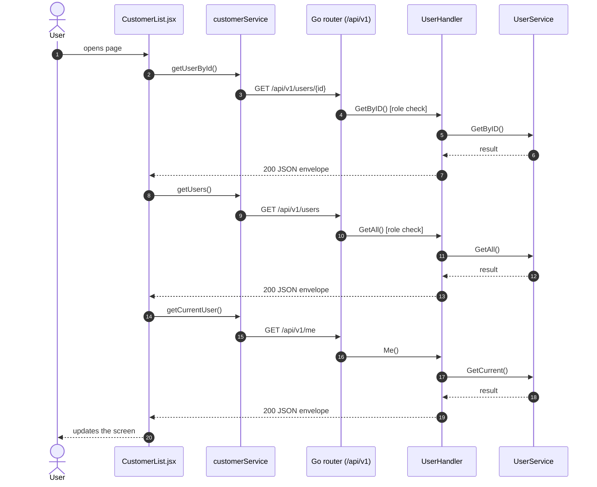
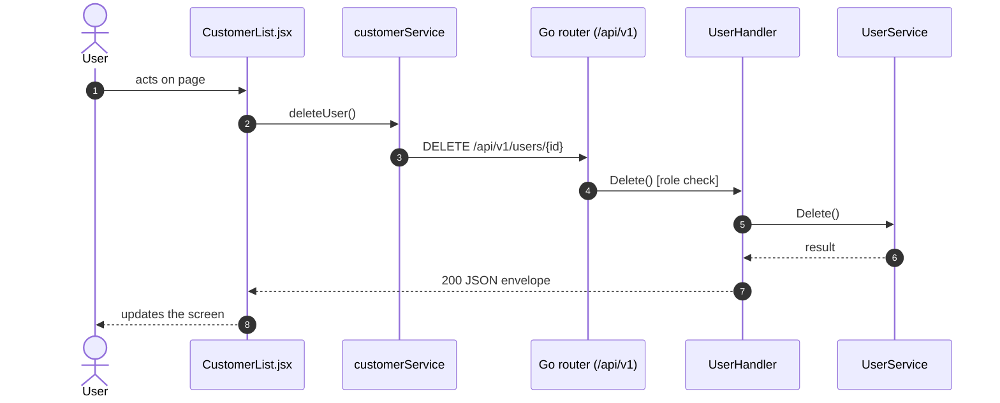
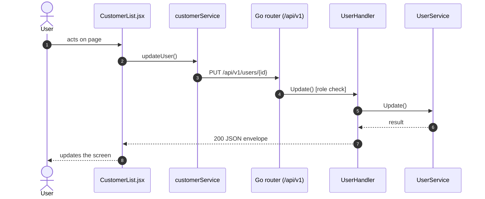
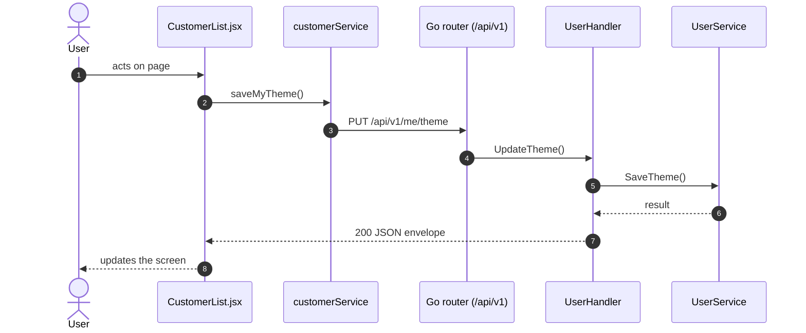
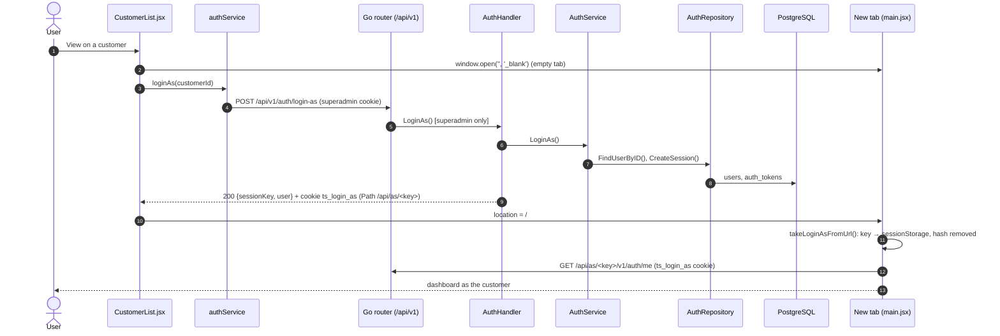

# Customers / Users list

- **Route:** `/masters/customers` · `/masters/users` (kind `user`) · **Component:** [CustomerList.jsx](../../src/pages/Customers/CustomerList.jsx) · **Auth:** protected (customers: superadmin; users: superadmin, customer, admin) · **Guard/Layout:** `ProtectedRoute` (session) + role guard · `MainLayout`
- **Purpose:** Lists the main customers (superadmin, Account Center › Customer: `GET /users?filterRole=customer`) or company members (Masters › Users: `GET /users?membersOnly=true` — a customer / admin gets the users created for its company, the superadmin every company's with a Customer column); search, open, edit or delete one.
- **Navigation:** customers: Sidebar › System › Account Center → **Customer** tab ([AccountCenterPage.jsx](../../src/pages/AccountCenter/AccountCenterPage.jsx): page header + tabs (only the ones the role may open), this screen is the tab body; the tab is the route) → Add / Edit, **View** = log in as the customer in a new tab (below); users: Sidebar › Masters › Users → list → Add / View / Edit

## On page load

**Steps**

1. [CustomerList.jsx](../../src/pages/Customers/CustomerList.jsx) → setStatusBusy(): runs `getUserById()`
2. [customerService.js](../../src/services/customerService.js) → getUserById(): calls `GET /api/v1/users/{id}`
3. [user_routes.go](../../../7th-sense-server/internal/routes/user_routes.go) → `GET /v1/users/{id}` (managersOnly: superadmin, customer, admin) → UserHandler.GetByID
4. [user_handler.go](../../../7th-sense-server/internal/handler/user_handler.go) → GetByID(): reads {id}; calls the service
5. [user_service.go](../../../7th-sense-server/internal/service/user_service.go) → GetByID(): Returns user id with its details, or "User not found" when the user may not see it.
6. [CustomerList.jsx](../../src/pages/Customers/CustomerList.jsx) → useEffect(): runs on load `getUsers()`
7. [customerService.js](../../src/services/customerService.js) → getUsers(): calls `GET /api/v1/users`
8. [user_routes.go](../../../7th-sense-server/internal/routes/user_routes.go) → `GET /v1/users` (managersOnly: superadmin, customer, admin) → UserHandler.GetAll
9. [user_handler.go](../../../7th-sense-server/internal/handler/user_handler.go) → GetAll(): query companyId, filterRole, membersOnly; calls the service
10. [user_service.go](../../../7th-sense-server/internal/service/user_service.go) → GetAll(): Returns the users the user may see, narrowed by filter: every user for the superadmin, the company's members for a customer or admin. A customer or admin asking for another company gets Forbidden.
11. [theme.js](../../src/utils/theme.js) → refreshUserTheme(): runs `getCurrentUser()`
12. [customerService.js](../../src/services/customerService.js) → getCurrentUser(): calls `GET /api/v1/me`
13. [user_routes.go](../../../7th-sense-server/internal/routes/user_routes.go) → `GET /v1/me` → UserHandler.Me
14. [user_handler.go](../../../7th-sense-server/internal/handler/user_handler.go) → Me(): reads the logged-in user; calls the service
15. [user_service.go](../../../7th-sense-server/internal/service/user_service.go) → GetCurrent(): Returns the logged-in user (userID) with its details.

## Delete user

**Sequence diagram**

**Steps**

1. [CustomerList.jsx](../../src/pages/Customers/CustomerList.jsx) → confirmDelete(): runs `deleteUser()`
2. [customerService.js](../../src/services/customerService.js) → deleteUser(): calls `DELETE /api/v1/users/{id}`
3. [user_routes.go](../../../7th-sense-server/internal/routes/user_routes.go) → `DELETE /v1/users/{id}` (managersOnly: superadmin, customer, admin) → UserHandler.Delete
4. [user_handler.go](../../../7th-sense-server/internal/handler/user_handler.go) → Delete(): reads {id}; calls the service
5. [user_service.go](../../../7th-sense-server/internal/service/user_service.go) → Delete(): Soft-deletes the user with its profiles and addresses, and removes its machine access. the user must be allowed to manage the user.

**Rules & edge cases**

- Only superadmin, customer and admin may do this (server `managersOnly`, others 403); the page hides the controls for other roles.

## Save user (add / edit form)

**Sequence diagram**

**Steps**

1. [CustomerList.jsx](../../src/pages/Customers/CustomerList.jsx) → setStatusBusy(): runs `updateUser()`
2. [customerService.js](../../src/services/customerService.js) → updateUser(): calls `PUT /api/v1/users/{id}`
3. [user_routes.go](../../../7th-sense-server/internal/routes/user_routes.go) → `PUT /v1/users/{id}` (managersOnly: superadmin, customer, admin) → UserHandler.Update
4. [user_handler.go](../../../7th-sense-server/internal/handler/user_handler.go) → Update(): reads {id}; decodes `dto.UpdateUserRequest` and runs its Validate(); calls the service
5. [user_service.go](../../../7th-sense-server/internal/service/user_service.go) → Update(): Replaces the user and its customer details. Customer details the user does not have yet are created.

**Rules & edge cases**

- Only superadmin, customer and admin may do this (server `managersOnly`, others 403); the page hides the controls for other roles.
- Server validation (`dto.UpdateUserRequest.Validate`): Please enter valid status.

## Change theme

**Sequence diagram**

**Steps**

1. [theme.js](../../src/utils/theme.js) → chooseTheme(): runs `saveMyTheme()`
2. [customerService.js](../../src/services/customerService.js) → saveMyTheme(): calls `PUT /api/v1/me/theme`
3. [user_routes.go](../../../7th-sense-server/internal/routes/user_routes.go) → `PUT /v1/me/theme` → UserHandler.UpdateTheme
4. [user_handler.go](../../../7th-sense-server/internal/handler/user_handler.go) → UpdateTheme(): decodes `dto.UpdateThemeRequest` and runs its Validate(); calls the service
5. [user_service.go](../../../7th-sense-server/internal/service/user_service.go) → SaveTheme(): Sets the UI theme of userID (the logged-in user).

**Rules & edge cases**

- Server validation (`dto.UpdateThemeRequest.Validate`): Please enter valid theme.

## View customer (log in as)

Customers only. The new tab opens on the dashboard (`/`) as the customer, exactly like a normal customer login (name, menus, data). It has its own session on its own API path, so the superadmin stays logged in here and a sign out in either tab never ends the other ([ADR 0018](../adr/0018-login-as-without-route.md), server [ADR 0008](../../../7th-sense-server/docs/adr/0008-login-as-path-scoped-session.md)). Users' View opens their detail page.

**Steps**

1. [CustomerList.jsx](../../src/pages/Customers/CustomerList.jsx) → handleView(): opens an empty tab inside the click (pop-up blockers allow it; blocked → toast), then calls `loginAs()`
2. [authService.js](../../src/services/authService.js) → loginAs(): `POST /api/v1/auth/login-as {customerId}`
3. [auth_routes.go](../../../7th-sense-server/internal/routes/auth_routes.go) → `POST /v1/auth/login-as` (authenticate + superAdminOnly) → AuthHandler.LoginAs
4. [auth_handler.go](../../../7th-sense-server/internal/handler/auth_handler.go) → LoginAs(): validates `dto.LoginAsRequest`, sets the HttpOnly `ts_login_as` cookie on `/api/as/<sessionKey>`
5. [auth_service.go](../../../7th-sense-server/internal/service/auth_service.go) → LoginAs(): only an active customer; a one-day session with `impersonated_by` = the superadmin and a random key
6. [auth_repository.go](../../../7th-sense-server/internal/repository/auth_repository.go) → FindUserByID(), CreateSession(): `users`, `auth_tokens`
7. [CustomerList.jsx](../../src/pages/Customers/CustomerList.jsx): sets `tab.opener = null` and sends the tab to `/#loginAs=<sessionKey>`; on an error closes the tab and shows a toast
8. [main.jsx](../../src/main.jsx) → [loginAs.js](../../src/utils/loginAs.js) takeLoginAsFromUrl(): keeps the key in the tab's sessionStorage and removes the hash before the first render
9. [apiClient.js](../../src/services/apiClient.js): every request of that tab goes to `apiBaseUrl()` = `/api/as/<sessionKey>/v1`; [auth.go](../../../7th-sense-server/internal/middleware/auth.go) → RouteLoginAs() serves it as `/api/v1/...` and SessionToken() reads only `ts_login_as`

**Rules & edge cases**

- Only the superadmin, only users with the customer role, only active accounts (server: Customer not found / account inactive → toast, the tab closes).
- Sign out in the customer tab ends only its session ([AuthProvider.jsx](../../src/context/AuthProvider.jsx) → logout() drops the key) and shows the login screen; the superadmin's tabs stay logged in. The superadmin's logout never ends the customer tab.
- A link opened in another tab from the customer tab has no key and opens as the superadmin.

## UI states

- **Loading:** `<Loader>` while the request runs.
- **Error:** a red `<Alert>` with the server message (some pages add Retry).
- **Success / failure of an action:** toast message (`utils/toast.js`).
- **Empty:** an empty-state message instead of the table / chart.
- **Delete:** asks for confirmation first.

## API calls on this page

| Method | Endpoint | Triggered by (section) | API docs |
|---|---|---|---|
| DELETE | `/api/v1/users/{id}` | Delete user | [Swagger](http://localhost:8080/api-docs/index.html#/Users/deleteUser) · [openapi.yaml](../../../7th-sense-server/docs/api/openapi.yaml) |
| GET | `/api/v1/users/{id}` | On page load | [Swagger](http://localhost:8080/api-docs/index.html#/Users/getUserById) · [openapi.yaml](../../../7th-sense-server/docs/api/openapi.yaml) |
| GET | `/api/v1/users` | On page load | [Swagger](http://localhost:8080/api-docs/index.html#/Users/getUsers) · [openapi.yaml](../../../7th-sense-server/docs/api/openapi.yaml) |
| POST | `/api/v1/auth/login-as` | View customer (log in as) | [Swagger](http://localhost:8080/api-docs/index.html#/Auth/loginAs) · [openapi.yaml](../../../7th-sense-server/docs/api/openapi.yaml) |
| PUT | `/api/v1/users/{id}` | Save user (add / edit form) | [Swagger](http://localhost:8080/api-docs/index.html#/Users/updateUser) · [openapi.yaml](../../../7th-sense-server/docs/api/openapi.yaml) |
| GET | `/api/v1/me` | On page load | [Swagger](http://localhost:8080/api-docs/index.html#/Users/getCurrentUser) · [openapi.yaml](../../../7th-sense-server/docs/api/openapi.yaml) |
| PUT | `/api/v1/me/theme` | Change theme | [Swagger](http://localhost:8080/api-docs/index.html#/Users/saveMyTheme) · [openapi.yaml](../../../7th-sense-server/docs/api/openapi.yaml) |

## State & storage

- Local component state (`useState`) for filters, form and modal
- Customer tab: sessionStorage `ts.loginAs` (`STORAGE_KEYS.LOGIN_AS`) = that tab's session key; the token is only in the HttpOnly cookie `ts_login_as`

## Shared components used

[ConfirmModal.jsx](../../src/components/common/ConfirmModal.jsx), [Loader.jsx](../../src/components/common/Loader.jsx), [TablePagination.jsx](../../src/components/common/TablePagination.jsx), [SortableHead.jsx](../../src/components/common/SortableHead.jsx), [IconAction.jsx](../../src/components/common/IconAction.jsx)

## Decisions

- [ADR 0011: tabbed page](../adr/0011-business-setup-tabbed-page.md), [ADR 0014: renamed Account Center](../adr/0014-account-center.md), [ADR 0016: Account Center superadmin only, Users lists members only](../adr/0016-account-center-superadmin-only.md), [ADR 0018: log in as customer](../adr/0018-login-as-without-route.md)
- [Client ADR index](../adr/README.md)
