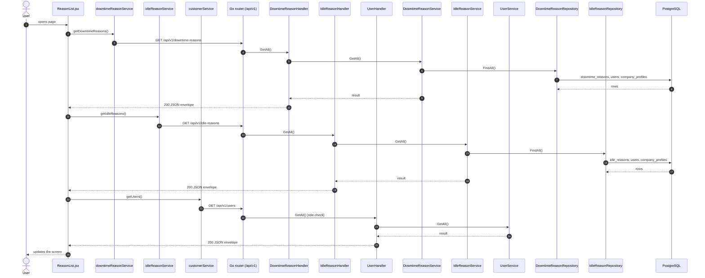
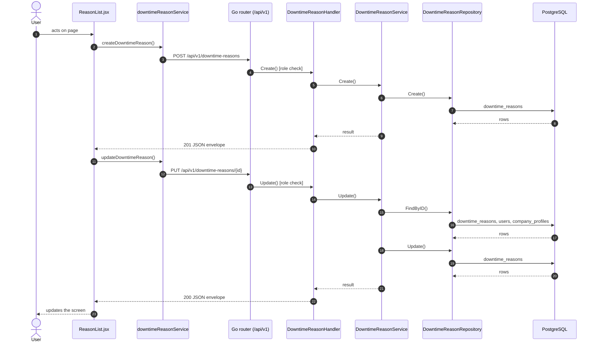
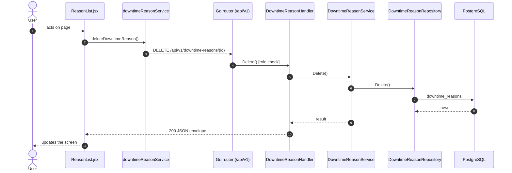
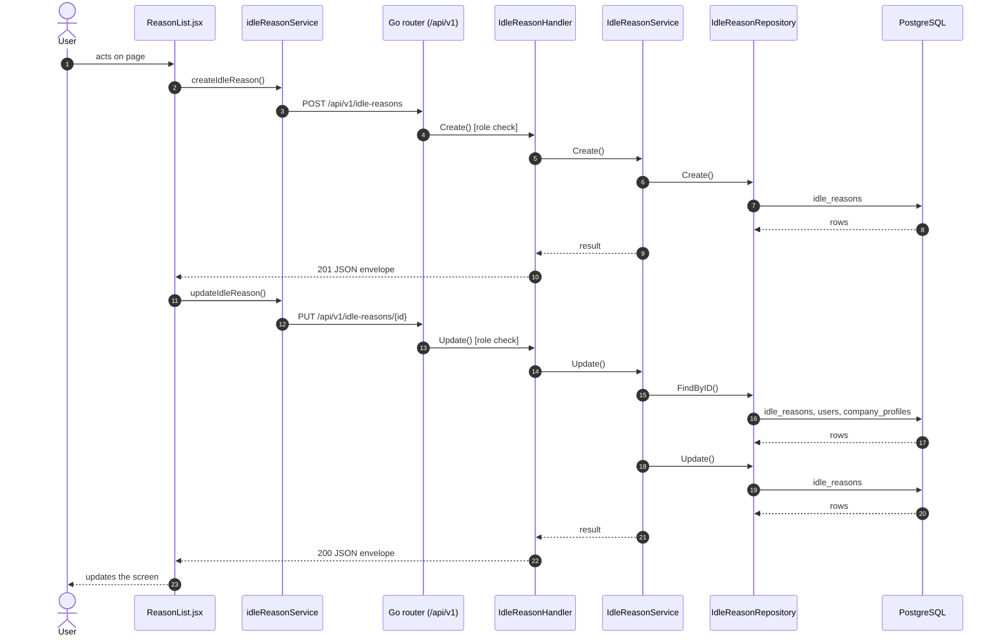
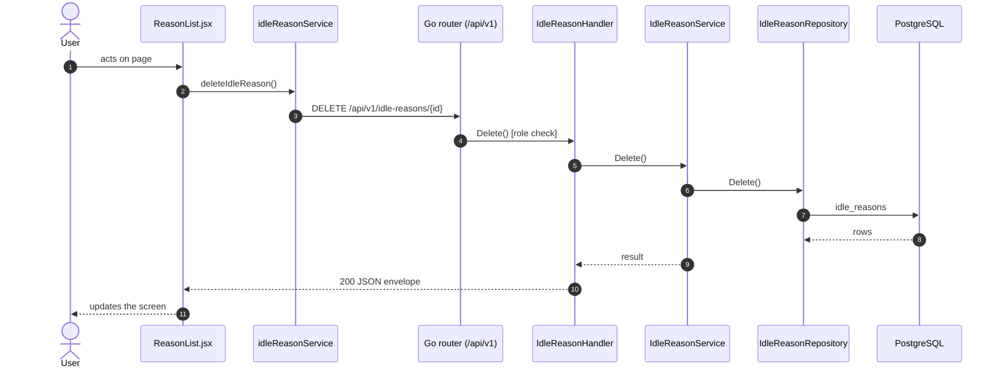

# Downtime / idle reasons

- **Route:** `/masters/downtime-reasons` (kind `downtime`) · `/masters/idle-reasons` (kind `idle`) · **Component:** [ReasonList.jsx](../../src/pages/Reasons/ReasonList.jsx) · **Auth:** protected (every logged-in role) · **Guard/Layout:** `ProtectedRoute` (session) + role guard · `MainLayout`
- **Purpose:** One screen for two lists (kind): reasons a machine was down, reasons it stood idle. Managers add, edit and delete.
- **Navigation:** Sidebar › Masters › Downtime → Downtime List / Idle List
- **Used in:** the active reasons are what the [Productivity](productivity.md#add-a-downtime-or-idle-reason) timeline's popup offers.

## On page load

**Steps**

1. [reasonPages.js](../../src/pages/Reasons/reasonPages.js) → list(): runs `getDowntimeReasons()`
2. [downtimeReasonService.js](../../src/services/downtimeReasonService.js) → getDowntimeReasons(): calls `GET /api/v1/downtime-reasons`
3. [downtime_reason_routes.go](../../../7th-sense-server/internal/routes/downtime_reason_routes.go) → `GET /v1/downtime-reasons` → DowntimeReasonHandler.GetAll
4. [downtime_reason_handler.go](../../../7th-sense-server/internal/handler/downtime_reason_handler.go) → GetAll(): query userId; calls the service
5. [downtime_reason_service.go](../../../7th-sense-server/internal/service/downtime_reason_service.go) → GetAll(): Returns the downtime reasons the user may read. A non-nil customerID keeps only that customer's reasons.
6. [downtime_reason_repository.go](../../../7th-sense-server/internal/repository/downtime_reason_repository.go) → FindAll(): reads / writes `downtime_reasons`, `users`, `company_profiles`
7. [reasonPages.js](../../src/pages/Reasons/reasonPages.js) → list(): runs `getIdleReasons()`
8. [idleReasonService.js](../../src/services/idleReasonService.js) → getIdleReasons(): calls `GET /api/v1/idle-reasons`
9. [idle_reason_routes.go](../../../7th-sense-server/internal/routes/idle_reason_routes.go) → `GET /v1/idle-reasons` → IdleReasonHandler.GetAll
10. [idle_reason_handler.go](../../../7th-sense-server/internal/handler/idle_reason_handler.go) → GetAll(): query userId; calls the service
11. [idle_reason_service.go](../../../7th-sense-server/internal/service/idle_reason_service.go) → GetAll(): Returns the idle reasons the user may read. A non-nil customerID keeps only that customer's reasons.
12. [idle_reason_repository.go](../../../7th-sense-server/internal/repository/idle_reason_repository.go) → FindAll(): reads / writes `idle_reasons`, `users`, `company_profiles`
13. [ReasonFormModal.jsx](../../src/pages/Reasons/ReasonFormModal.jsx) → useEffect(): runs on load `getUsers()`
14. [customerService.js](../../src/services/customerService.js) → getUsers(): calls `GET /api/v1/users`
15. [user_routes.go](../../../7th-sense-server/internal/routes/user_routes.go) → `GET /v1/users` (managersOnly: superadmin, customer, admin) → UserHandler.GetAll
16. [user_handler.go](../../../7th-sense-server/internal/handler/user_handler.go) → GetAll(): query companyId, filterRole; calls the service
17. [user_service.go](../../../7th-sense-server/internal/service/user_service.go) → GetAll(): Returns the users the user may see, narrowed by filter: every user for the superadmin, the company's members for a customer or admin. A customer or admin asking for another company gets Forbidden.

## Save downtime reason (add / edit form)

**Sequence diagram**

**Steps**

1. [reasonPages.js](../../src/pages/Reasons/reasonPages.js) → create(): runs `createDowntimeReason()`
2. [downtimeReasonService.js](../../src/services/downtimeReasonService.js) → createDowntimeReason(): calls `POST /api/v1/downtime-reasons`
3. [downtime_reason_routes.go](../../../7th-sense-server/internal/routes/downtime_reason_routes.go) → `POST /v1/downtime-reasons` (managersOnly: superadmin, customer, admin) → DowntimeReasonHandler.Create
4. [downtime_reason_handler.go](../../../7th-sense-server/internal/handler/downtime_reason_handler.go) → Create(): decodes `dto.CreateDowntimeReasonRequest` and runs its Validate(); calls the service
5. [downtime_reason_service.go](../../../7th-sense-server/internal/service/downtime_reason_service.go) → Create(): Adds a downtime reason. A customer or admin (the logged-in user) adds it to their own company, whatever customer the request names; the superadmin to the customer named.
6. [downtime_reason_repository.go](../../../7th-sense-server/internal/repository/downtime_reason_repository.go) → Create(): reads / writes `downtime_reasons`
7. [reasonPages.js](../../src/pages/Reasons/reasonPages.js) → update(): runs `updateDowntimeReason()`
8. [downtimeReasonService.js](../../src/services/downtimeReasonService.js) → updateDowntimeReason(): calls `PUT /api/v1/downtime-reasons/{id}`
9. [downtime_reason_routes.go](../../../7th-sense-server/internal/routes/downtime_reason_routes.go) → `PUT /v1/downtime-reasons/{id}` (managersOnly: superadmin, customer, admin) → DowntimeReasonHandler.Update
10. [downtime_reason_handler.go](../../../7th-sense-server/internal/handler/downtime_reason_handler.go) → Update(): reads {id}; decodes `dto.UpdateDowntimeReasonRequest` and runs its Validate(); calls the service
11. [downtime_reason_service.go](../../../7th-sense-server/internal/service/downtime_reason_service.go) → Update(): Replaces the downtime reason. A blank status keeps the saved one.
12. [downtime_reason_repository.go](../../../7th-sense-server/internal/repository/downtime_reason_repository.go) → FindByID(): reads / writes `downtime_reasons`, `users`, `company_profiles`
13. [downtime_reason_repository.go](../../../7th-sense-server/internal/repository/downtime_reason_repository.go) → Update(): reads / writes `downtime_reasons`

**Rules & edge cases**

- Only superadmin, customer and admin may do this (server `managersOnly`, others 403); the page hides the controls for other roles.
- Server validation (`dto.UpdateDowntimeReasonRequest.Validate`): Please enter valid status.

## Delete downtime reason

**Sequence diagram**

**Steps**

1. [reasonPages.js](../../src/pages/Reasons/reasonPages.js) → remove(): runs `deleteDowntimeReason()`
2. [downtimeReasonService.js](../../src/services/downtimeReasonService.js) → deleteDowntimeReason(): calls `DELETE /api/v1/downtime-reasons/{id}`
3. [downtime_reason_routes.go](../../../7th-sense-server/internal/routes/downtime_reason_routes.go) → `DELETE /v1/downtime-reasons/{id}` (managersOnly: superadmin, customer, admin) → DowntimeReasonHandler.Delete
4. [downtime_reason_handler.go](../../../7th-sense-server/internal/handler/downtime_reason_handler.go) → Delete(): reads {id}; calls the service
5. [downtime_reason_service.go](../../../7th-sense-server/internal/service/downtime_reason_service.go) → Delete(): Soft-deletes the downtime reason. A customer or admin (the logged-in user) deletes only their company's reasons ("Downtime reason not found" for others).
6. [downtime_reason_repository.go](../../../7th-sense-server/internal/repository/downtime_reason_repository.go) → Delete(): reads / writes `downtime_reasons`

**Rules & edge cases**

- Only superadmin, customer and admin may do this (server `managersOnly`, others 403); the page hides the controls for other roles.

## Save idle reason (add / edit form)

**Sequence diagram**

**Steps**

1. [reasonPages.js](../../src/pages/Reasons/reasonPages.js) → create(): runs `createIdleReason()`
2. [idleReasonService.js](../../src/services/idleReasonService.js) → createIdleReason(): calls `POST /api/v1/idle-reasons`
3. [idle_reason_routes.go](../../../7th-sense-server/internal/routes/idle_reason_routes.go) → `POST /v1/idle-reasons` (managersOnly: superadmin, customer, admin) → IdleReasonHandler.Create
4. [idle_reason_handler.go](../../../7th-sense-server/internal/handler/idle_reason_handler.go) → Create(): decodes `dto.CreateIdleReasonRequest` and runs its Validate(); calls the service
5. [idle_reason_service.go](../../../7th-sense-server/internal/service/idle_reason_service.go) → Create(): Adds a idle reason. A customer or admin (the logged-in user) adds it to their own company, whatever customer the request names; the superadmin to the customer named.
6. [idle_reason_repository.go](../../../7th-sense-server/internal/repository/idle_reason_repository.go) → Create(): reads / writes `idle_reasons`
7. [reasonPages.js](../../src/pages/Reasons/reasonPages.js) → update(): runs `updateIdleReason()`
8. [idleReasonService.js](../../src/services/idleReasonService.js) → updateIdleReason(): calls `PUT /api/v1/idle-reasons/{id}`
9. [idle_reason_routes.go](../../../7th-sense-server/internal/routes/idle_reason_routes.go) → `PUT /v1/idle-reasons/{id}` (managersOnly: superadmin, customer, admin) → IdleReasonHandler.Update
10. [idle_reason_handler.go](../../../7th-sense-server/internal/handler/idle_reason_handler.go) → Update(): reads {id}; decodes `dto.UpdateIdleReasonRequest` and runs its Validate(); calls the service
11. [idle_reason_service.go](../../../7th-sense-server/internal/service/idle_reason_service.go) → Update(): Replaces the idle reason. A blank status keeps the saved one.
12. [idle_reason_repository.go](../../../7th-sense-server/internal/repository/idle_reason_repository.go) → FindByID(): reads / writes `idle_reasons`, `users`, `company_profiles`
13. [idle_reason_repository.go](../../../7th-sense-server/internal/repository/idle_reason_repository.go) → Update(): reads / writes `idle_reasons`

**Rules & edge cases**

- Only superadmin, customer and admin may do this (server `managersOnly`, others 403); the page hides the controls for other roles.
- Server validation (`dto.UpdateIdleReasonRequest.Validate`): Please enter valid status.

## Delete idle reason

**Sequence diagram**

**Steps**

1. [reasonPages.js](../../src/pages/Reasons/reasonPages.js) → remove(): runs `deleteIdleReason()`
2. [idleReasonService.js](../../src/services/idleReasonService.js) → deleteIdleReason(): calls `DELETE /api/v1/idle-reasons/{id}`
3. [idle_reason_routes.go](../../../7th-sense-server/internal/routes/idle_reason_routes.go) → `DELETE /v1/idle-reasons/{id}` (managersOnly: superadmin, customer, admin) → IdleReasonHandler.Delete
4. [idle_reason_handler.go](../../../7th-sense-server/internal/handler/idle_reason_handler.go) → Delete(): reads {id}; calls the service
5. [idle_reason_service.go](../../../7th-sense-server/internal/service/idle_reason_service.go) → Delete(): Soft-deletes the idle reason. A customer or admin (the logged-in user) deletes only their company's reasons ("Idle reason not found" for others).
6. [idle_reason_repository.go](../../../7th-sense-server/internal/repository/idle_reason_repository.go) → Delete(): reads / writes `idle_reasons`

**Rules & edge cases**

- Only superadmin, customer and admin may do this (server `managersOnly`, others 403); the page hides the controls for other roles.

## UI states

- **Loading:** `<Loader>` while the request runs.
- **Error:** a red `<Alert>` with the server message (some pages add Retry).
- **Success / failure of an action:** toast message (`utils/toast.js`).
- **Empty:** an empty-state message instead of the table / chart.
- **Delete:** asks for confirmation first.

## API calls on this page

| Method | Endpoint | Triggered by (section) | API docs |
|---|---|---|---|
| POST | `/api/v1/downtime-reasons` | Save downtime reason (add / edit form) | [Swagger](http://localhost:8080/api-docs/index.html#/Reasons/createDowntimeReason) · [openapi.yaml](../../../7th-sense-server/docs/api/openapi.yaml) |
| DELETE | `/api/v1/downtime-reasons/{id}` | Delete downtime reason | [Swagger](http://localhost:8080/api-docs/index.html#/Reasons/deleteDowntimeReason) · [openapi.yaml](../../../7th-sense-server/docs/api/openapi.yaml) |
| GET | `/api/v1/downtime-reasons` | On page load | [Swagger](http://localhost:8080/api-docs/index.html#/Reasons/getDowntimeReasons) · [openapi.yaml](../../../7th-sense-server/docs/api/openapi.yaml) |
| PUT | `/api/v1/downtime-reasons/{id}` | Save downtime reason (add / edit form) | [Swagger](http://localhost:8080/api-docs/index.html#/Reasons/updateDowntimeReason) · [openapi.yaml](../../../7th-sense-server/docs/api/openapi.yaml) |
| POST | `/api/v1/idle-reasons` | Save idle reason (add / edit form) | [Swagger](http://localhost:8080/api-docs/index.html#/Reasons/createIdleReason) · [openapi.yaml](../../../7th-sense-server/docs/api/openapi.yaml) |
| DELETE | `/api/v1/idle-reasons/{id}` | Delete idle reason | [Swagger](http://localhost:8080/api-docs/index.html#/Reasons/deleteIdleReason) · [openapi.yaml](../../../7th-sense-server/docs/api/openapi.yaml) |
| GET | `/api/v1/idle-reasons` | On page load | [Swagger](http://localhost:8080/api-docs/index.html#/Reasons/getIdleReasons) · [openapi.yaml](../../../7th-sense-server/docs/api/openapi.yaml) |
| PUT | `/api/v1/idle-reasons/{id}` | Save idle reason (add / edit form) | [Swagger](http://localhost:8080/api-docs/index.html#/Reasons/updateIdleReason) · [openapi.yaml](../../../7th-sense-server/docs/api/openapi.yaml) |
| GET | `/api/v1/users` | On page load | [Swagger](http://localhost:8080/api-docs/index.html#/Users/getUsers) · [openapi.yaml](../../../7th-sense-server/docs/api/openapi.yaml) |

## State & storage

- `useAuth()` (logged-in user, roles)
- Local component state (`useState`) for filters, form and modal

## Shared components used

[ConfirmModal.jsx](../../src/components/common/ConfirmModal.jsx), [Loader.jsx](../../src/components/common/Loader.jsx), [SortableHead.jsx](../../src/components/common/SortableHead.jsx), [TablePagination.jsx](../../src/components/common/TablePagination.jsx), [IconAction.jsx](../../src/components/common/IconAction.jsx), [StatusBadge.jsx](../../src/components/common/StatusBadge.jsx), [FieldLabel.jsx](../../src/components/common/FieldLabel.jsx), [StatusToggle.jsx](../../src/components/common/StatusToggle.jsx)

## Decisions

- [Client ADR index](../adr/README.md)
