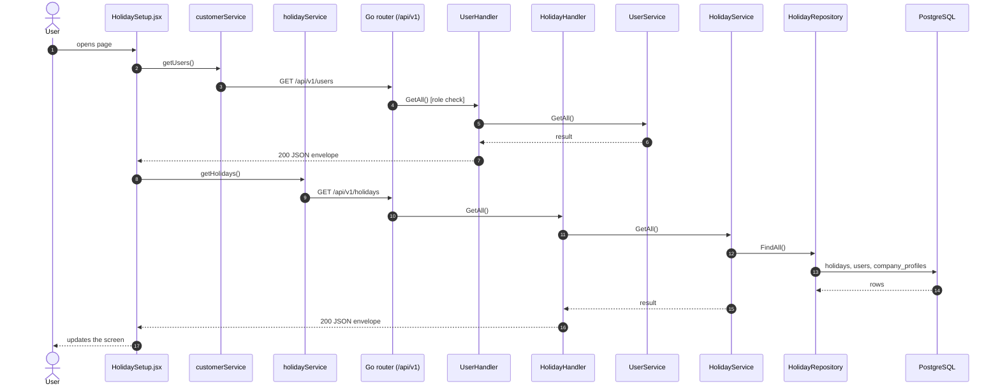
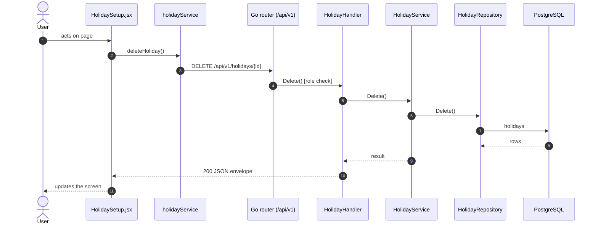
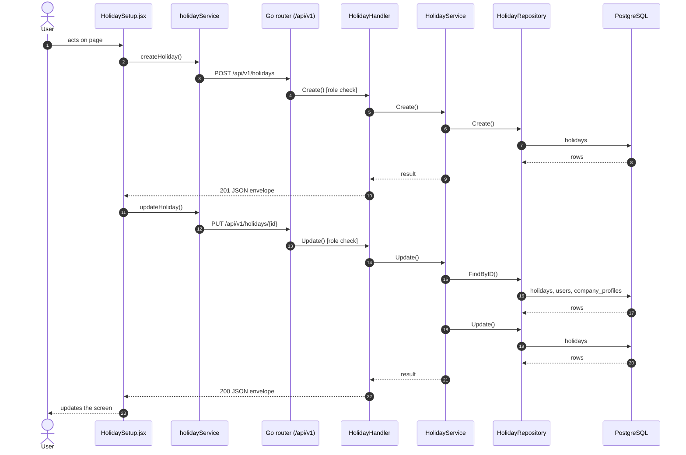

# Holidays / week off

- **Route:** `/masters/holidays` · **Component:** [HolidaySetup.jsx](../../src/pages/Holidays/HolidaySetup.jsx) · **Auth:** protected (every logged-in role) · **Guard/Layout:** `ProtectedRoute` (session) + role guard · `MainLayout`
- **Purpose:** Holidays and week-offs; managers add, edit and delete in a modal.
- **Navigation:** Sidebar › Masters › Shift → Holiday / Week Off

## On page load

**Steps**

1. [HolidaySetup.jsx](../../src/pages/Holidays/HolidaySetup.jsx) → useEffect(): runs on load `getUsers()`
2. [customerService.js](../../src/services/customerService.js) → getUsers(): calls `GET /api/v1/users`
3. [user_routes.go](../../../7th-sense-server/internal/routes/user_routes.go) → `GET /v1/users` (managersOnly: superadmin, customer, admin) → UserHandler.GetAll
4. [user_handler.go](../../../7th-sense-server/internal/handler/user_handler.go) → GetAll(): query companyId, filterRole; calls the service
5. [user_service.go](../../../7th-sense-server/internal/service/user_service.go) → GetAll(): Returns the users the user may see, narrowed by filter: every user for the superadmin, the company's members for a customer or admin. A customer or admin asking for another company gets Forbidden.
6. [HolidaySetup.jsx](../../src/pages/Holidays/HolidaySetup.jsx) → useEffect(): runs on load `getHolidays()`
7. [holidayService.js](../../src/services/holidayService.js) → getHolidays(): calls `GET /api/v1/holidays`
8. [holiday_routes.go](../../../7th-sense-server/internal/routes/holiday_routes.go) → `GET /v1/holidays` → HolidayHandler.GetAll
9. [holiday_handler.go](../../../7th-sense-server/internal/handler/holiday_handler.go) → GetAll(): query userId; calls the service
10. [holiday_service.go](../../../7th-sense-server/internal/service/holiday_service.go) → GetAll(): Returns the holidays and week offs the user may read. A non-nil customerID keeps only that customer's.
11. [holiday_repository.go](../../../7th-sense-server/internal/repository/holiday_repository.go) → FindAll(): reads / writes `holidays`, `users`, `company_profiles`

## Delete holiday

**Sequence diagram**

**Steps**

1. [HolidaySetup.jsx](../../src/pages/Holidays/HolidaySetup.jsx) → confirmDelete(): runs `deleteHoliday()`
2. [holidayService.js](../../src/services/holidayService.js) → deleteHoliday(): calls `DELETE /api/v1/holidays/{id}`
3. [holiday_routes.go](../../../7th-sense-server/internal/routes/holiday_routes.go) → `DELETE /v1/holidays/{id}` (managersOnly: superadmin, customer, admin) → HolidayHandler.Delete
4. [holiday_handler.go](../../../7th-sense-server/internal/handler/holiday_handler.go) → Delete(): reads {id}; calls the service
5. [holiday_service.go](../../../7th-sense-server/internal/service/holiday_service.go) → Delete(): Soft-deletes the holiday. A customer or admin (the logged-in user) deletes only their company's ("Holiday not found" for others).
6. [holiday_repository.go](../../../7th-sense-server/internal/repository/holiday_repository.go) → Delete(): reads / writes `holidays`

**Rules & edge cases**

- Only superadmin, customer and admin may do this (server `managersOnly`, others 403); the page hides the controls for other roles.

## Save holiday (add / edit form)

**Sequence diagram**

**Steps**

1. [HolidayFormModal.jsx](../../src/pages/Holidays/HolidayFormModal.jsx) → onSubmit(): runs `createHoliday()`
2. [holidayService.js](../../src/services/holidayService.js) → createHoliday(): calls `POST /api/v1/holidays`
3. [holiday_routes.go](../../../7th-sense-server/internal/routes/holiday_routes.go) → `POST /v1/holidays` (managersOnly: superadmin, customer, admin) → HolidayHandler.Create
4. [holiday_handler.go](../../../7th-sense-server/internal/handler/holiday_handler.go) → Create(): decodes `dto.CreateHolidayRequest` and runs its Validate(); calls the service
5. [holiday_service.go](../../../7th-sense-server/internal/service/holiday_service.go) → Create(): Adds a holiday or week off. A customer or admin (the logged-in user) adds it to their own company, whatever customer the request names; the superadmin to the customer named.
6. [holiday_repository.go](../../../7th-sense-server/internal/repository/holiday_repository.go) → Create(): reads / writes `holidays`
7. [HolidayFormModal.jsx](../../src/pages/Holidays/HolidayFormModal.jsx) → onSubmit(): runs `updateHoliday()`
8. [holidayService.js](../../src/services/holidayService.js) → updateHoliday(): calls `PUT /api/v1/holidays/{id}`
9. [holiday_routes.go](../../../7th-sense-server/internal/routes/holiday_routes.go) → `PUT /v1/holidays/{id}` (managersOnly: superadmin, customer, admin) → HolidayHandler.Update
10. [holiday_handler.go](../../../7th-sense-server/internal/handler/holiday_handler.go) → Update(): reads {id}; decodes `dto.UpdateHolidayRequest` and runs its Validate(); calls the service
11. [holiday_service.go](../../../7th-sense-server/internal/service/holiday_service.go) → Update(): Replaces the holiday (it may change between holiday and week off). A blank status keeps the saved one.
12. [holiday_repository.go](../../../7th-sense-server/internal/repository/holiday_repository.go) → FindByID(): reads / writes `holidays`, `users`, `company_profiles`
13. [holiday_repository.go](../../../7th-sense-server/internal/repository/holiday_repository.go) → Update(): reads / writes `holidays`

**Rules & edge cases**

- Only superadmin, customer and admin may do this (server `managersOnly`, others 403); the page hides the controls for other roles.
- Server validation (`dto.UpdateHolidayRequest.Validate`): Please enter valid status.

## UI states

- **Loading:** `<Loader>` while the request runs.
- **Error:** a red `<Alert>` with the server message (some pages add Retry).
- **Success / failure of an action:** toast message (`utils/toast.js`).
- **Empty:** an empty-state message instead of the table / chart.
- **Delete:** asks for confirmation first.

## API calls on this page

| Method | Endpoint | Triggered by (section) | API docs |
|---|---|---|---|
| GET | `/api/v1/users` | On page load | [Swagger](http://localhost:8080/api-docs/index.html#/Users/getUsers) · [openapi.yaml](../../../7th-sense-server/docs/api/openapi.yaml) |
| DELETE | `/api/v1/holidays/{id}` | Delete holiday | [Swagger](http://localhost:8080/api-docs/index.html#/Holidays/deleteHoliday) · [openapi.yaml](../../../7th-sense-server/docs/api/openapi.yaml) |
| GET | `/api/v1/holidays` | On page load | [Swagger](http://localhost:8080/api-docs/index.html#/Holidays/getHolidays) · [openapi.yaml](../../../7th-sense-server/docs/api/openapi.yaml) |
| POST | `/api/v1/holidays` | Save holiday (add / edit form) | [Swagger](http://localhost:8080/api-docs/index.html#/Holidays/createHoliday) · [openapi.yaml](../../../7th-sense-server/docs/api/openapi.yaml) |
| PUT | `/api/v1/holidays/{id}` | Save holiday (add / edit form) | [Swagger](http://localhost:8080/api-docs/index.html#/Holidays/updateHoliday) · [openapi.yaml](../../../7th-sense-server/docs/api/openapi.yaml) |

## State & storage

- `useAuth()` (logged-in user, roles)
- Local component state (`useState`) for filters, form and modal

## Shared components used

[ConfirmModal.jsx](../../src/components/common/ConfirmModal.jsx), [Loader.jsx](../../src/components/common/Loader.jsx), [TablePagination.jsx](../../src/components/common/TablePagination.jsx), [SortableHead.jsx](../../src/components/common/SortableHead.jsx), [IconAction.jsx](../../src/components/common/IconAction.jsx), [StatusBadge.jsx](../../src/components/common/StatusBadge.jsx), [DatePicker.jsx](../../src/components/common/DatePicker.jsx), [FieldLabel.jsx](../../src/components/common/FieldLabel.jsx), [StatusToggle.jsx](../../src/components/common/StatusToggle.jsx)

## Decisions

- [Client ADR index](../adr/README.md)
