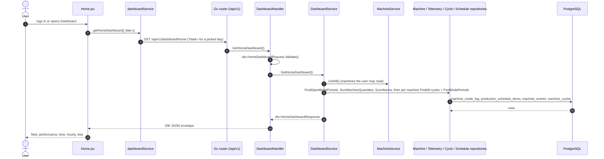

# Home (Dashboard)

- **Route:** `/` · **Component:** [Home.jsx](../../src/pages/Home/Home.jsx) ([HomeCards.jsx](../../src/pages/Home/HomeCards.jsx), [HomeLists.jsx](../../src/pages/Home/HomeLists.jsx), [homeSettings.js](../../src/pages/Home/homeSettings.js)) · **Auth:** protected (every logged-in role) · **Guard/Layout:** `ProtectedRoute` (session) + role guard · `MainLayout`
- **Purpose:** The landing page after login: every active machine the user may read, together — the fleet now, the day's OEE / utilization / parts vs plan / cycles, where the time went, machines needing attention, the lowest OEE and the top alarms. Per-machine detail stays on [Productivity](productivity.md).
- **Navigation:** Login → **Dashboard** (Sidebar › Main › Dashboard). Mode tiles open [Monitoring](monitoring-machines.md) searched by that mode (`/monitoring?search=Idle`, `monitoringSearchPath` in [monitoring.js](../../src/constants/monitoring.js); **Other modes** opens the whole list); machine names open that machine's [Productivity](productivity.md) tab.

## On page load

**Steps**

1. [Home.jsx](../../src/pages/Home/Home.jsx) → useLoad(): runs on load `getHomeDashboard({ date, userId })`; `date` is sent only for a picked past day, so "today" is always the server's today and the page moves to the new day by itself after midnight; reloads every `MONITOR_REFRESH_MS` (30 s) while on today (a past day loads once)
2. [dashboardService.js](../../src/services/dashboardService.js) → getHomeDashboard(): calls `GET /api/v1/dashboard/home`
3. [dashboard_routes.go](../../../7th-sense-server/internal/routes/dashboard_routes.go) → `GET /v1/dashboard/home` → DashboardHandler.GetHomeDashboard
4. [dashboard_handler.go](../../../7th-sense-server/internal/handler/dashboard_handler.go) → GetHomeDashboard(): reads `date`, `userId`; [dashboard_dto.go](../../../7th-sense-server/internal/dto/dashboard_dto.go) → `HomeDashboardRequest.Validate()` (valid date, not after today)
5. [dashboard_service.go](../../../7th-sense-server/internal/service/dashboard_service.go) → GetHomeDashboard(): `MachineService.GetAll` (role scope; `userId` = one customer for the superadmin), keeps the **active** machines (inactive ones are only counted), then:
   - fleet now: online / offline (`machines.online_status`), mode = open `machine_mode_log` period ([machine_telemetry_repository.go](../../../7th-sense-server/internal/repository/machine_telemetry_repository.go) → FindOpenModePeriods; `machines.mode_id` without one), no mode = awaiting data
   - per machine, the day (whole day up to now, no shifts — the rules of `GET /productivity/machine-summaries`): cycles (`machine_cycles`), OEE parts (`machineDayOEE`), seconds per mode group (`modeGroup`); the fleet OEE adds every machine's seconds and cycles (`oeeSum`, weighted by time — never an average of percentages)
   - parts vs plan: [production_schedule_repository.go](../../../7th-sense-server/internal/repository/production_schedule_repository.go) → SumMachineQuantities (active schedules' jobs on that day); only machines with a job count against the plan
   - parts per hour: parts of the cycles completed in each hour, the day and the day before
   - top alarms: `machine_events` `alarm_on` of the day grouped by code, most raised first (SumAlarms, `dto.HomeTopAlarms` 10)

## Pick another day or customer

- The date field ([ChartDateFilter](../../src/components/charts/ChartDateFilter.jsx), not after today) and, for the superadmin, the customer select (customers from `useOrgUser().users`, role customer) change the query: the page loads again (same flow as above). Live Machine Status is always the current state; everything else is that day.

## UI states

- **Loading:** `Loader` until the first answer. **Error:** red alert when nothing loaded; a failed refresh keeps the shown data under an amber "Could not refresh" alert.
- **Empty:** no OEE before any recorded time ("—"); "No job scheduled" without a plan; each list shows its own empty line.

## Rules & edge cases

- **Live Machine Status:** Machines = active machines (inactive are noted, not counted); Online + Offline = Machines; mode tiles follow the Productivity Machine Modes order (`SUMMARY_MODE_IDS`, In Production includes Rapid Mode 12); other modes (Setup, planned downtime) are counted under **Other modes**; mode tiles link to Monitoring with the mode name in the search box, so the list shows the machines in that mode (a text match: "Downtime" also finds Planned Downtime, and In Production does not list Rapid Mode machines).
- **Production Performance:** OEE with A · P · Q; **Utilization** = OEE availability without schedule (run time of the day so far); **Parts made** with "x of y planned" only for machines with a job that day; **Cycles completed** with the unfinished rate of closed cycles.
- **Where the time went:** every machine's time of the day so far (machines × hours) per mode from `time.modes` (`timeByMode` in [homeSettings.js](../../src/pages/Home/homeSettings.js)): the fleet modes in their mode colours (In Production includes Rapid Mode, as on the tiles), **Other modes** (Setup, planned downtime, …) and **Not recorded** (no mode period, e.g. before collection started; under a minute is left out, since the server rounds each mode down to whole seconds). Slices are at least `TIME_MIN_SLICE_DEG` (4°), so a few minutes of Hold beside a day of Offline stays visible; the exact time is in the tooltip and in the list beside the chart (each mode with its colour mark, time and share; fleet modes shown at 0 too). The centre is the In Production share.
- **Parts per hour:** hidden (the controllers send no part count yet); `HourlyCard` and the response's `hourly` stay for when they do.
- **Needs attention:** machines in Downtime or Hold for `ATTENTION_MINUTES` (15) or more (from the open mode period's start and the response's `serverTime`), longest first, at most 8.
- **Lowest OEE:** the 5 machines with the lowest OEE of the day (only machines with an OEE), with parts / planned.
- The lists are short top-N tables: sortable headers (`SortableHead` + `useTableSort`), no paging.

## API calls on this page

| Method | Path | When | Docs |
|---|---|---|---|
| GET | `/api/v1/dashboard/home` | On page load, every 30 s for today, on date / customer change | [Swagger](http://localhost:8080/api-docs/index.html#/Dashboard/getHomeDashboard) · [openapi.yaml](../../../7th-sense-server/docs/api/openapi.yaml) |

## State & storage

- `pickedDate` (empty = today) and `customerId` (superadmin) in component state; nothing stored.

## Shared components used

- `ChartCard`, `DonutChart`, `BarLineChart`, `ChartDateFilter`, `SortableHead`, `Loader`; `MachineOee` from [MachineMetrics.jsx](../../src/pages/Monitoring/MachineMetrics.jsx); `formatCount` / `percent` / `SUMMARY_MODE_IDS` from [productivitySettings.js](../../src/pages/Productivity/productivitySettings.js).

## Decisions

- One page-wise endpoint (server [ADR 0006](../../../7th-sense-server/docs/adr/0006-page-wise-dashboard-endpoints.md)) instead of combining `/machines` + `/productivity/machine-summaries` on the client: one request, and the fleet numbers use the same server rules as the Productivity cards.
- Not `/health/machines` (public, every company's machines).
- [Client ADR index](../adr/README.md)
