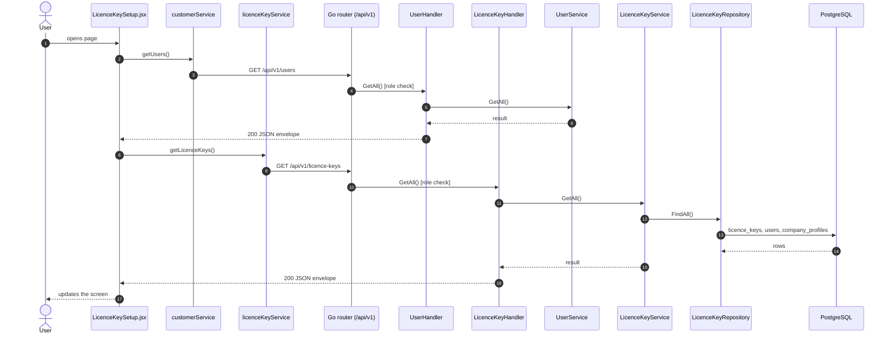
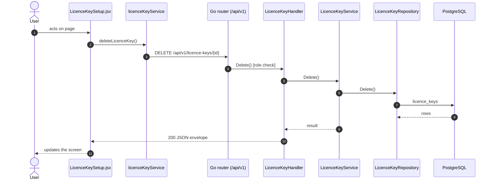
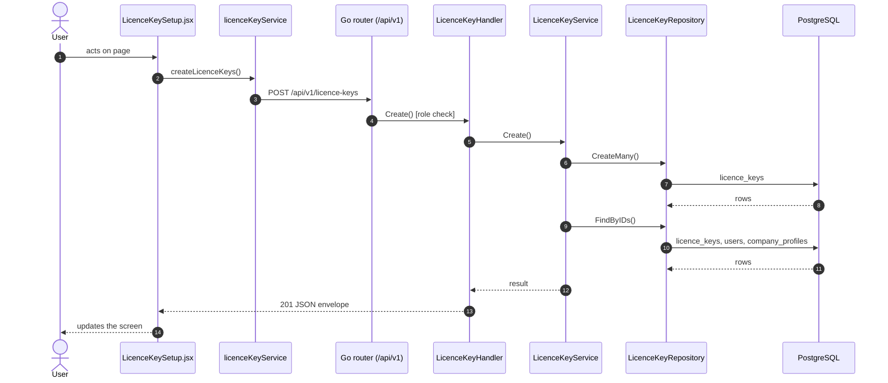
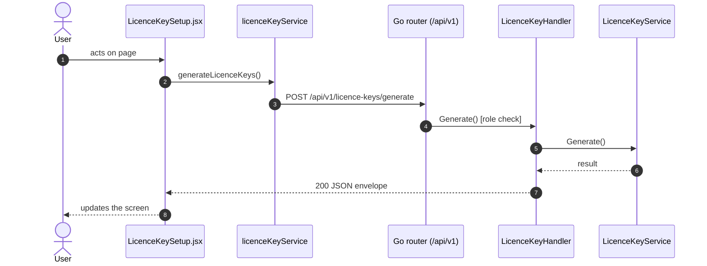
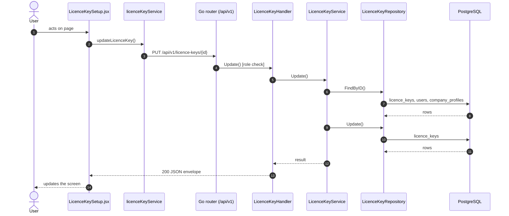

# Licence keys

- **Route:** `/masters/licence-keys` · **Component:** [LicenceKeySetup.jsx](../../src/pages/LicenceKeys/LicenceKeySetup.jsx) · **Auth:** protected (superadmin, customer, admin) · **Guard/Layout:** `ProtectedRoute` (session) + role guard · `MainLayout`
- **Purpose:** Licence keys of a company: the superadmin generates, edits and deletes; customers and admins read theirs.
- **Navigation:** Sidebar › Masters → Licence Keys

## On page load

**Steps**

1. [LicenceKeySetup.jsx](../../src/pages/LicenceKeys/LicenceKeySetup.jsx) → useEffect(): runs on load `getUsers()`
2. [customerService.js](../../src/services/customerService.js) → getUsers(): calls `GET /api/v1/users`
3. [user_routes.go](../../../7th-sense-server/internal/routes/user_routes.go) → `GET /v1/users` (managersOnly: superadmin, customer, admin) → UserHandler.GetAll
4. [user_handler.go](../../../7th-sense-server/internal/handler/user_handler.go) → GetAll(): query companyId, filterRole; calls the service
5. [user_service.go](../../../7th-sense-server/internal/service/user_service.go) → GetAll(): Returns the users the user may see, narrowed by filter: every user for the superadmin, the company's members for a customer or admin. A customer or admin asking for another company gets Forbidden.
6. [LicenceKeySetup.jsx](../../src/pages/LicenceKeys/LicenceKeySetup.jsx) → useEffect(): runs on load `getLicenceKeys()`
7. [licenceKeyService.js](../../src/services/licenceKeyService.js) → getLicenceKeys(): calls `GET /api/v1/licence-keys`
8. [licence_key_routes.go](../../../7th-sense-server/internal/routes/licence_key_routes.go) → `GET /v1/licence-keys` (managersOnly: superadmin, customer, admin) → LicenceKeyHandler.GetAll
9. [licence_key_handler.go](../../../7th-sense-server/internal/handler/licence_key_handler.go) → GetAll(): query userId; calls the service
10. [licence_key_service.go](../../../7th-sense-server/internal/service/licence_key_service.go) → GetAll(): Returns the licence keys the user may read. A non-nil customerID keeps only that customer's.
11. [licence_key_repository.go](../../../7th-sense-server/internal/repository/licence_key_repository.go) → FindAll(): reads / writes `licence_keys`, `users`, `company_profiles`

## Delete licence key

**Sequence diagram**

**Steps**

1. [LicenceKeySetup.jsx](../../src/pages/LicenceKeys/LicenceKeySetup.jsx) → confirmDelete(): runs `deleteLicenceKey()`
2. [licenceKeyService.js](../../src/services/licenceKeyService.js) → deleteLicenceKey(): calls `DELETE /api/v1/licence-keys/{id}`
3. [licence_key_routes.go](../../../7th-sense-server/internal/routes/licence_key_routes.go) → `DELETE /v1/licence-keys/{id}` (superAdminOnly) → LicenceKeyHandler.Delete
4. [licence_key_handler.go](../../../7th-sense-server/internal/handler/licence_key_handler.go) → Delete(): reads {id}; calls the service
5. [licence_key_service.go](../../../7th-sense-server/internal/service/licence_key_service.go) → Delete(): Soft-deletes the licence key.
6. [licence_key_repository.go](../../../7th-sense-server/internal/repository/licence_key_repository.go) → Delete(): reads / writes `licence_keys`

**Rules & edge cases**

- Superadmin only (server `superAdminOnly`, others 403).

## Save licence keys (add / edit form)

**Sequence diagram**

**Steps**

1. [LicenceKeyGenerator.jsx](../../src/pages/LicenceKeys/LicenceKeyGenerator.jsx) → onSave(): runs `createLicenceKeys()`
2. [licenceKeyService.js](../../src/services/licenceKeyService.js) → createLicenceKeys(): calls `POST /api/v1/licence-keys`
3. [licence_key_routes.go](../../../7th-sense-server/internal/routes/licence_key_routes.go) → `POST /v1/licence-keys` (superAdminOnly) → LicenceKeyHandler.Create
4. [licence_key_handler.go](../../../7th-sense-server/internal/handler/licence_key_handler.go) → Create(): decodes `dto.CreateLicenceKeysRequest` and runs its Validate(); calls the service
5. [licence_key_service.go](../../../7th-sense-server/internal/service/licence_key_service.go) → Create(): Saves the keys for the customer named, all or none, and returns them. Each licence runs for its duration from today.
6. [licence_key_repository.go](../../../7th-sense-server/internal/repository/licence_key_repository.go) → CreateMany(): reads / writes `licence_keys`
7. [licence_key_repository.go](../../../7th-sense-server/internal/repository/licence_key_repository.go) → FindByIDs(): reads / writes `licence_keys`, `users`, `company_profiles`

**Rules & edge cases**

- Superadmin only (server `superAdminOnly`, others 403).
- Server validation (`dto.CreateLicenceKeysRequest.Validate`): Please select customer; Please generate licence keys; Please save at most 100 licence keys at once; Please enter valid licence key; Licence key is repeated.

## Generate licence keys

**Sequence diagram**

**Steps**

1. [LicenceKeyGenerator.jsx](../../src/pages/LicenceKeys/LicenceKeyGenerator.jsx) → handleGenerate(): runs `generateLicenceKeys()`
2. [licenceKeyService.js](../../src/services/licenceKeyService.js) → generateLicenceKeys(): calls `POST /api/v1/licence-keys/generate`
3. [licence_key_routes.go](../../../7th-sense-server/internal/routes/licence_key_routes.go) → `POST /v1/licence-keys/generate` (superAdminOnly) → LicenceKeyHandler.Generate
4. [licence_key_handler.go](../../../7th-sense-server/internal/handler/licence_key_handler.go) → Generate(): decodes `dto.GenerateLicenceKeysRequest` and runs its Validate(); calls the service
5. [licence_key_service.go](../../../7th-sense-server/internal/service/licence_key_service.go) → Generate(): Returns count new random keys. They are not saved: the superadmin reviews them and saves them with Create.

**Rules & edge cases**

- Superadmin only (server `superAdminOnly`, others 403).
- Server validation (`dto.GenerateLicenceKeysRequest.Validate`): Please enter valid number of keys (1 to 100).

## Save licence key (add / edit form)

**Sequence diagram**

**Steps**

1. [LicenceKeyFormModal.jsx](../../src/pages/LicenceKeys/LicenceKeyFormModal.jsx) → onSubmit(): runs `updateLicenceKey()`
2. [licenceKeyService.js](../../src/services/licenceKeyService.js) → updateLicenceKey(): calls `PUT /api/v1/licence-keys/{id}`
3. [licence_key_routes.go](../../../7th-sense-server/internal/routes/licence_key_routes.go) → `PUT /v1/licence-keys/{id}` (superAdminOnly) → LicenceKeyHandler.Update
4. [licence_key_handler.go](../../../7th-sense-server/internal/handler/licence_key_handler.go) → Update(): reads {id}; decodes `dto.UpdateLicenceKeyRequest` and runs its Validate(); calls the service
5. [licence_key_service.go](../../../7th-sense-server/internal/service/licence_key_service.go) → Update(): Changes the customer, duration and status of the key (a blank status keeps the saved one). The end date is counted again from the day the key was saved.
6. [licence_key_repository.go](../../../7th-sense-server/internal/repository/licence_key_repository.go) → FindByID(): reads / writes `licence_keys`, `users`, `company_profiles`
7. [licence_key_repository.go](../../../7th-sense-server/internal/repository/licence_key_repository.go) → Update(): reads / writes `licence_keys`

**Rules & edge cases**

- Superadmin only (server `superAdminOnly`, others 403).
- Server validation (`dto.UpdateLicenceKeyRequest.Validate`): Please select customer; Please enter valid status.

## UI states

- **Loading:** `<Loader>` while the request runs.
- **Error:** a red `<Alert>` with the server message (some pages add Retry).
- **Success / failure of an action:** toast message (`utils/toast.js`).
- **Empty:** an empty-state message instead of the table / chart.
- **Delete:** asks for confirmation first.

## API calls on this page

| Method | Endpoint | Triggered by (section) | API docs |
|---|---|---|---|
| GET | `/api/v1/users` | On page load | [Swagger](http://localhost:8080/api-docs/index.html#/Users/getUsers) · [openapi.yaml](../../../7th-sense-server/docs/api/openapi.yaml) |
| DELETE | `/api/v1/licence-keys/{id}` | Delete licence key | [Swagger](http://localhost:8080/api-docs/index.html#/Licence%20keys/deleteLicenceKey) · [openapi.yaml](../../../7th-sense-server/docs/api/openapi.yaml) |
| GET | `/api/v1/licence-keys` | On page load | [Swagger](http://localhost:8080/api-docs/index.html#/Licence%20keys/getLicenceKeys) · [openapi.yaml](../../../7th-sense-server/docs/api/openapi.yaml) |
| POST | `/api/v1/licence-keys` | Save licence keys (add / edit form) | [Swagger](http://localhost:8080/api-docs/index.html#/Licence%20keys/createLicenceKeys) · [openapi.yaml](../../../7th-sense-server/docs/api/openapi.yaml) |
| POST | `/api/v1/licence-keys/generate` | Generate licence keys | [Swagger](http://localhost:8080/api-docs/index.html#/Licence%20keys/generateLicenceKeys) · [openapi.yaml](../../../7th-sense-server/docs/api/openapi.yaml) |
| PUT | `/api/v1/licence-keys/{id}` | Save licence key (add / edit form) | [Swagger](http://localhost:8080/api-docs/index.html#/Licence%20keys/updateLicenceKey) · [openapi.yaml](../../../7th-sense-server/docs/api/openapi.yaml) |

## State & storage

- `useAuth()` (logged-in user, roles)
- Local component state (`useState`) for filters, form and modal

## Shared components used

[ConfirmModal.jsx](../../src/components/common/ConfirmModal.jsx), [Loader.jsx](../../src/components/common/Loader.jsx), [SortableHead.jsx](../../src/components/common/SortableHead.jsx), [TablePagination.jsx](../../src/components/common/TablePagination.jsx), [IconAction.jsx](../../src/components/common/IconAction.jsx), [StatusBadge.jsx](../../src/components/common/StatusBadge.jsx), [FieldLabel.jsx](../../src/components/common/FieldLabel.jsx), [StatusToggle.jsx](../../src/components/common/StatusToggle.jsx)

## Decisions

- [Client ADR index](../adr/README.md)
