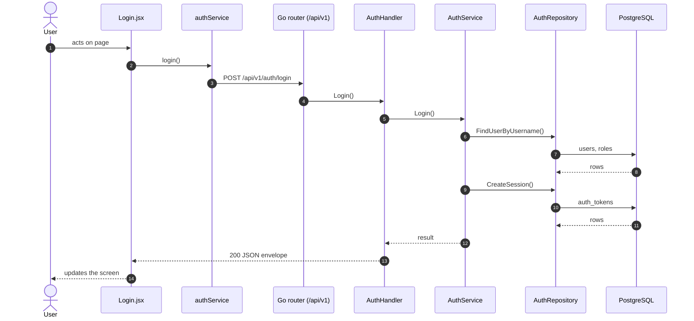

# Login

- **Route:** `/login` · **Component:** [Login.jsx](../../src/pages/Login/Login.jsx) · **Auth:** public · **Guard/Layout:** none (public)
- **Purpose:** Log in with username and password (optional Remember me).
- **Navigation:** Any protected URL without a session → Login → the page asked for (or Home)

## Submit login form

**Sequence diagram**

**Steps**

1. [AuthProvider.jsx](../../src/context/AuthProvider.jsx) → login(): runs `login()`
2. [authService.js](../../src/services/authService.js) → login(): calls `POST /api/v1/auth/login`
3. [auth_routes.go](../../../7th-sense-server/internal/routes/auth_routes.go) → `POST /v1/auth/login` → AuthHandler.Login
4. [auth_handler.go](../../../7th-sense-server/internal/handler/auth_handler.go) → Login(): decodes `dto.LoginRequest` and runs its Validate(); calls the service
5. [auth_service.go](../../../7th-sense-server/internal/service/auth_service.go) → Login(): Checks the credentials and starts a session. deviceInfo (the browser's user agent) is stored with the session for auditing.
6. [auth_repository.go](../../../7th-sense-server/internal/repository/auth_repository.go) → FindUserByUsername(): reads / writes `users`, `roles`
7. [auth_repository.go](../../../7th-sense-server/internal/repository/auth_repository.go) → CreateSession(): reads / writes `auth_tokens`

**Rules & edge cases**

- Server validation (`dto.LoginRequest.Validate`): Invalid username or password; Please enter username; Please enter password.

**Rules & edge cases**

- Client validation: [Login.jsx](../../src/pages/Login/Login.jsx) uses react-hook-form + zod (username and password required) before any request.
- Server: a wrong username or password → 401 "Invalid username or password"; an inactive account → 403; too many failed attempts → 429 (try again in 15 minutes).
- On success the server sets the HttpOnly `ts_session` cookie (path `/api`); scripts never see it. Without **Remember me** it ends with the browser session; the server also expires sessions.
- The user object returned is kept in [AuthProvider.jsx](../../src/context/AuthProvider.jsx); the page then redirects to the page asked for (or Home).

## UI states

- **Loading:** `<Loader>` while the request runs.
- **Error:** a red `<Alert>` with the server message (some pages add Retry).
- **Success / failure of an action:** toast message (`utils/toast.js`).

## API calls on this page

| Method | Endpoint | Triggered by (section) | API docs |
|---|---|---|---|
| POST | `/api/v1/auth/login` | Submit login form | [Swagger](http://localhost:8080/api-docs/index.html#/Auth/login) · [openapi.yaml](../../../7th-sense-server/docs/api/openapi.yaml) |

## State & storage

- `useAuth()` (logged-in user, roles)
- Local component state (`useState`) for filters, form and modal

## Shared components used

[BrandLogo.jsx](../../src/components/common/BrandLogo.jsx), [Loader.jsx](../../src/components/common/Loader.jsx)

## Decisions

- [Client ADR index](../adr/README.md)
