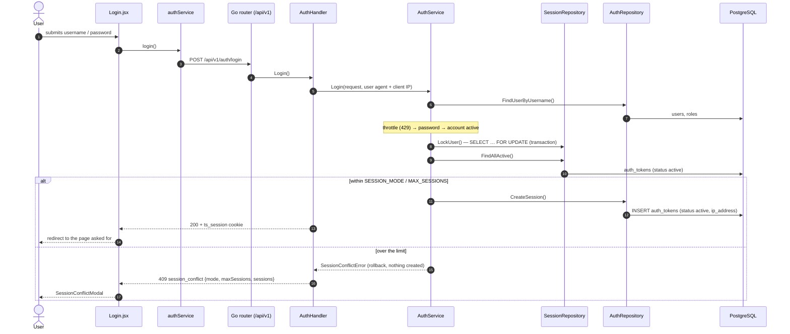
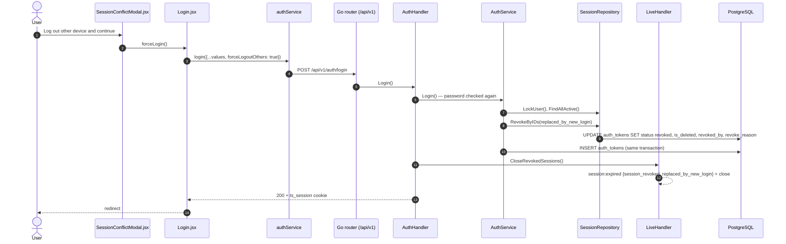

# Login

- **Route:** `/login` · **Component:** [Login.jsx](../../src/pages/Login/Login.jsx) · **Auth:** public · **Guard/Layout:** none (public)
- **Purpose:** Log in with username and password (optional Remember me). When the account already has as many sessions as the server allows, ask before logging the other device out.
- **Navigation:** Any protected URL without a session → Login → the page asked for (or Home). A session that was revoked or expired lands here too, with a toast saying why ([app-shell.md](app-shell.md#session-ended)).

## Submit login form

**Sequence diagram**

**Steps**

1. [Login.jsx](../../src/pages/Login/Login.jsx) → onSubmit(): runs `finishLogin()`, which calls `useAuth().login()`
2. [AuthProvider.jsx](../../src/context/AuthProvider.jsx) → login(): calls the service, keeps the user
3. [authService.js](../../src/services/authService.js) → login(): `POST /api/v1/auth/login {username, password, remember, forceLogoutOthers}`
4. [auth_routes.go](../../../7th-sense-server/internal/routes/auth_routes.go) → `POST /v1/auth/login` → AuthHandler.Login
5. [auth_handler.go](../../../7th-sense-server/internal/handler/auth_handler.go) → Login(): decodes `dto.LoginRequest` (Validate()); passes the user agent and `middleware.ClientIP` ([client_ip.go](../../../7th-sense-server/internal/middleware/client_ip.go), X-Forwarded-For only behind `TRUSTED_PROXIES`); a `SessionConflictError` is sent as 409 with its data
6. [auth_service.go](../../../7th-sense-server/internal/service/auth_service.go) → Login(): throttle, password, active account, then startSession(): one transaction that locks the user's row, reads the active sessions ("log in as" ones left out) and applies `sessionsInTheWay()` (single: every one; multiple with `MAX_SESSIONS`: the least recently used beyond the limit)
7. [session_repository.go](../../../7th-sense-server/internal/repository/session_repository.go) → LockUser(), FindAllActive(): `users` FOR UPDATE, `auth_tokens`
8. [auth_repository.go](../../../7th-sense-server/internal/repository/auth_repository.go) → CreateSession(): inserts the active session with IP and `last_used_at`

## Log out other device and continue (conflict modal)

**Sequence diagram**

**Steps**

1. [SessionConflictModal.jsx](../../src/pages/Login/SessionConflictModal.jsx): a short message only (no device list) saying which device Continue logs out — single mode: the other device; multiple mode: only the one inactive the longest, the others stay signed in. Cancel closes it and keeps every session
2. [Login.jsx](../../src/pages/Login/Login.jsx) → forceLogin(): logs in again with the kept form values and `forceLogoutOthers: true`; an error closes the modal and shows the server message
3. [auth_service.go](../../../7th-sense-server/internal/service/auth_service.go) → startSession(): revokes the sessions in the way and creates the new one in one transaction
4. [session_repository.go](../../../7th-sense-server/internal/repository/session_repository.go) → RevokeByIDs(): returns the revoked token hashes
5. [live_handler.go](../../../7th-sense-server/internal/handler/live_handler.go) → CloseRevokedSessions(): the revoked browser's sockets get `session:expired` and close; its next API call answers 401 `session_revoked` → [app-shell.md](app-shell.md#session-ended)

**Rules & edge cases**

- Client validation: react-hook-form + zod ([loginForm.js](../../src/pages/Login/loginForm.js), username and password required) before any request.
- Server: wrong username or password → 401 "Invalid username or password"; inactive account → 403; too many failed attempts → 429 (checked before the session limit).
- 409 `session_conflict` only follows valid credentials; it creates no session and does not end the other one. Continue sends the password again, so it cannot be used without it.
- Single mode: one active session per user, Continue logs out all others. Multiple mode with `MAX_SESSIONS`: Continue logs out the least recently used one. Multiple mode without a limit never conflicts.
- "Log in as" sessions the superadmin opened on the account never count and are never logged out by Continue.
- Two logins at once of the same user cannot both pass the limit (row lock on the user).
- On success the server sets the HttpOnly `ts_session` cookie (path `/api`); scripts never see it. Without **Remember me** it ends with the browser session; the server also expires sessions (12 h, 30 days remembered).

## UI states

- **Checking:** `<Loader>` while the session check of a reload runs.
- **Submitting:** spinner in the Login button; in the modal, spinner in Continue and the modal cannot be closed.
- **Error:** a red `<Alert>` with the server message.
- **Conflict:** `SessionConflictModal`, an alert dialog (`.ts-alert-modal` in `_components.scss`: amber shield badge, title — single "Already signed in elsewhere", multiple "Session limit reached" — a short text, a list of what Continue does, full-width "Log out other device and continue" (orange, "Signing in…" while busy) and Cancel). The 409 still lists the sessions in `data`; the modal does not show them.

## API calls on this page

| Method | Endpoint | Triggered by (section) | API docs |
|---|---|---|---|
| POST | `/api/v1/auth/login` | Submit login form · Log out other device and continue | [Swagger](http://localhost:8080/api-docs/index.html#/Auth/login) · [openapi.yaml](../../../7th-sense-server/docs/api/openapi.yaml) |

## State & storage

- `useAuth()` (logged-in user); local state: `conflict` (409 data + the submitted values), `forcing`
- localStorage `REMEMBERED_USERNAME` when Remember is ticked

## Shared components used

[BrandLogo.jsx](../../src/components/common/BrandLogo.jsx), [Loader.jsx](../../src/components/common/Loader.jsx)

## Decisions

- Server [ADR 0014](../../../7th-sense-server/docs/adr/0014-session-modes-and-login-conflict.md) (session modes, conflict, row lock) · client [ADR 0027](../adr/0027-session-codes-and-conflict-modal.md) (message codes worded in `constants/session.js`)
