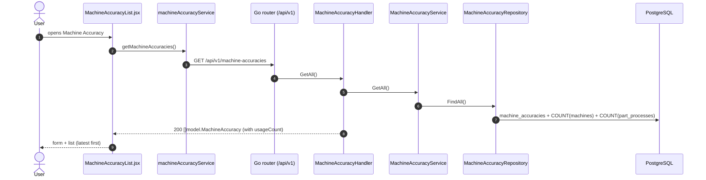

# Machine accuracy

- **Route:** `/masters/machine-accuracy` · **Component:** [MachineAccuracyList.jsx](../../src/pages/MachineAccuracy/MachineAccuracyList.jsx) inside [AccountCenterPage.jsx](../../src/pages/AccountCenter/AccountCenterPage.jsx) · **Auth:** protected (superadmin) · **Guard/Layout:** `ProtectedRoute` + `roles: SUPERADMIN_ONLY` · `MainLayout`
- **Purpose:** The superadmin manages the machine accuracy levels (Good, Average, Poor, …) that the [machine form](machine-form.md) and the [part form](part-form.md) offer. One list for every customer and user: nothing is set per customer.
- **Navigation:** System › Account Center → Machine Accuracy tab

## On page load



**Steps**

1. [MachineAccuracyList.jsx](../../src/pages/MachineAccuracy/MachineAccuracyList.jsx): loads the list (Retry on error)
2. [machineAccuracyService.js](../../src/services/machineAccuracyService.js) → getMachineAccuracies()
3. [machine_accuracy_routes.go](../../../7th-sense-server/internal/routes/machine_accuracy_routes.go) → `GET /v1/machine-accuracies` (every logged-in user)
4. [machine_accuracy_repository.go](../../../7th-sense-server/internal/repository/machine_accuracy_repository.go) → FindAll(): `usage_count` = machines + part processes not deleted that use the accuracy

## Save machine accuracy (add / edit form)

```mermaid
sequenceDiagram
  autonumber
  actor User
  participant Form as MachineAccuracyEditor.jsx
  participant machineAccuracyService
  participant API as Go router (/api/v1)
  participant MachineAccuracyHandler
  participant MachineAccuracyService
  participant MachineAccuracyRepository
  participant DB as PostgreSQL
  User->>Form: Machine Accuracy → Save / Update
  Form->>machineAccuracyService: createMachineAccuracy(name) / updateMachineAccuracy(id, name)
  machineAccuracyService->>API: POST /machine-accuracies · PUT /machine-accuracies/{id} (superAdminOnly)
  API->>MachineAccuracyHandler: Create() / Update() — dto Validate()
  MachineAccuracyHandler->>MachineAccuracyService: Create() / Update()
  MachineAccuracyService->>MachineAccuracyRepository: Create() / Update(), FindByID()
  MachineAccuracyRepository->>DB: machine_accuracies (unique LOWER(name))
  MachineAccuracyHandler-->>Form: 201 / 200 model.MachineAccuracy
  Form-->>User: toast; row added on top / replaced
```

**Steps**

1. [MachineAccuracyEditor.jsx](../../src/pages/MachineAccuracy/MachineAccuracyEditor.jsx): React Hook Form + Zod ([machineAccuracyForm.js](../../src/pages/MachineAccuracy/machineAccuracyForm.js) `accuracySchema`: required, ≤ 50 characters); spaces are trimmed and joined as the server does
2. Edit (a row's Edit loads it into the form, row highlighted) says how many machines / processes use it; Cancel goes back to adding
3. [machine_accuracy_dto.go](../../../7th-sense-server/internal/dto/machine_accuracy_dto.go) → Validate(); [machine_accuracy_service.go](../../../7th-sense-server/internal/service/machine_accuracy_service.go) → Create() / Update(): duplicate → "This machine accuracy already exists"; a new name shows on every machine and process that uses it

## Delete machine accuracy

1. Row Delete opens `ConfirmModal`. Not used → **Delete** → `deleteMachineAccuracy(id)` → `DELETE /api/v1/machine-accuracies/{id}` → MachineAccuracyService.Delete (soft delete)
2. Used by machines or part processes → "Machine accuracy is in use", **OK** only: change their accuracy first. The server refuses deleting one in use anyway (400 with the count)

**Rules & edge cases**

- Superadmin only (tab, route and every write endpoint). Every user reads the list for the machine and part forms.
- No customer field or column: the list is the same for every customer (server ADR 0017).
- The machine and part saves refuse an accuracy id that is not in the list (`checkReferences`).

## UI states

- **Loading:** `<Loader>`. **Error:** red `<Alert>` with Retry. **No accuracies:** `.ts-empty`.
- **Search with no hits:** `TableNoResults` with Clear filters. **Saving:** spinner, server message in the form's alert, success toast; the form card stays in view from `lg` (`.ts-side-form`).

## API calls on this page

| Method | Endpoint | Triggered by (section) | API docs |
|---|---|---|---|
| GET | `/api/v1/machine-accuracies` | On page load | [Swagger](http://localhost:8080/api-docs/index.html#/Machine%20accuracies/getMachineAccuracies) · [openapi.yaml](../../../7th-sense-server/docs/api/openapi.yaml) |
| POST | `/api/v1/machine-accuracies` | Save machine accuracy | [Swagger](http://localhost:8080/api-docs/index.html#/Machine%20accuracies/createMachineAccuracy) · [openapi.yaml](../../../7th-sense-server/docs/api/openapi.yaml) |
| PUT | `/api/v1/machine-accuracies/{id}` | Save machine accuracy (edit) | [Swagger](http://localhost:8080/api-docs/index.html#/Machine%20accuracies/updateMachineAccuracy) · [openapi.yaml](../../../7th-sense-server/docs/api/openapi.yaml) |
| DELETE | `/api/v1/machine-accuracies/{id}` | Delete machine accuracy | [Swagger](http://localhost:8080/api-docs/index.html#/Machine%20accuracies/deleteMachineAccuracy) · [openapi.yaml](../../../7th-sense-server/docs/api/openapi.yaml) |

## State & storage

- Local state: `accuracies`, `editing`, search / sort / page, `pendingDelete`.

## Shared components used

[FieldLabel.jsx](../../src/components/common/FieldLabel.jsx), [SortableHead.jsx](../../src/components/common/SortableHead.jsx), [TablePagination.jsx](../../src/components/common/TablePagination.jsx), [TableNoResults.jsx](../../src/components/common/TableNoResults.jsx), [ConfirmModal.jsx](../../src/components/common/ConfirmModal.jsx), [IconAction.jsx](../../src/components/common/IconAction.jsx); row: [MachineAccuracyRow.jsx](../../src/pages/MachineAccuracy/MachineAccuracyRow.jsx)

## Decisions

- Server [ADR 0017](../../../7th-sense-server/docs/adr/0017-machine-accuracy-shared-list.md): one shared list in a table (was a fixed client list), superadmin writes, delete refused while in use.
