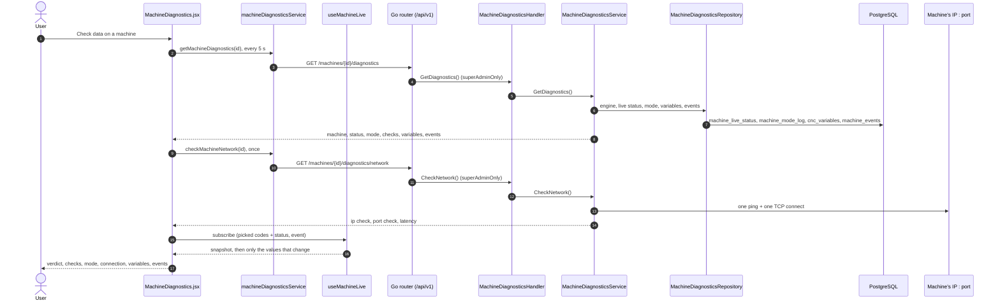
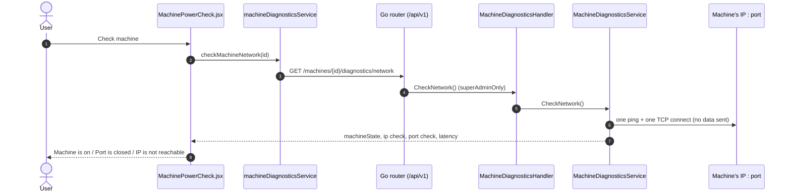
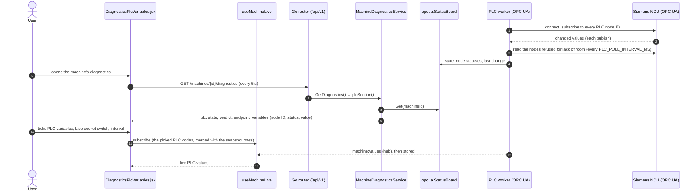

# Machine diagnostics

- **Route:** `/machines/:id/diagnostics` · **Component:** [MachineDiagnostics.jsx](../../src/pages/MachineDiagnostics/MachineDiagnostics.jsx) · **Auth:** protected · **Roles:** superadmin only · **Guard/Layout:** `ProtectedRoute` (session) + role guard · `MainLayout`
- **Purpose:** When a customer reports a problem with a machine: check in order whether its data reaches the server and the screen, watch the variables you pick live, and see what is wrong and what to do.
- **Navigation:** Sidebar › Machines › [All Machines](machine-list.md) → a machine's **Check data** action (table and cards; superadmin only). **Machine list** goes back.

## On page load

1. [machine_diagnostics_handler.go](../../../7th-sense-server/internal/handler/machine_diagnostics_handler.go) → GetDiagnostics(), CheckNetwork(); [machine_diagnostics_routes.go](../../../7th-sense-server/internal/routes/machine_diagnostics_routes.go): `superAdminOnly`.
2. [machine_diagnostics_service.go](../../../7th-sense-server/internal/service/machine_diagnostics_service.go) → works out the checks and each reason; [machine_network_probe.go](../../../7th-sense-server/internal/service/machine_network_probe.go) → ping and TCP connect.
3. [machine_diagnostics_repository.go](../../../7th-sense-server/internal/repository/machine_diagnostics_repository.go) → reads only.
4. [diagnosticsSettings.js](../../src/pages/MachineDiagnostics/diagnosticsSettings.js) → `buildChecks()` puts the network and socket checks in order, `buildVerdict()` picks the first failed one, `variableState()` says what a row's data is doing.

## The checks

| # | Check | OK means | Reasons when not |
|---|---|---|---|
| 1 | Machine set-up | Active, controller with a CNC engine, IP, port | Inactive, no controller, no engine, no IP, no port |
| 2 | Data collector | A worker is reporting or retrying | Build is not 32-bit (GOARCH=386), `CNC_MACHINE_IDS` leaves it out, no sign of a worker |
| 3 | IP address | Replied to ping, or answered on TCP | No reply to either, no route, not resolvable |
| 4 | Port | Accepted a TCP connection | Refused (on, nothing listening), no answer in 4 s, no route |
| 5 | Controller connection | The DLL is connected | DLL could not connect, controller does not answer, set-up event, certificate rejected; warns when values could not be stored |
| 6 | Machine mode | Any mode but Offline, with what it means | Offline, none recorded |
| 7 | Snapshot variables | Readable variables have values | None readable, no reading yet, every value 0 or empty |
| 8 | Live socket | Connected and subscribed | Live data off on the server, not connected (with the error), refused, codes the collector does not read |

## Check machine (is the machine on?)

1. [MachinePowerCheck.jsx](../../src/pages/MachineDiagnostics/MachinePowerCheck.jsx): the **Is the machine on?** card (right column, above Machine mode); **Check machine** in its header runs the same test as on opening, and the IP address and Port checks update with it.
2. [machine_network_probe.go](../../../7th-sense-server/internal/service/machine_network_probe.go) → machineStateOf(): sums the test up as `machineState`.
3. [diagnosticsSettings.js](../../src/pages/MachineDiagnostics/diagnosticsSettings.js) → `machineStateLook()` words it; `NETWORK_ROWS` / `networkRowLabel()` label the IP and port rows.

| `machineState` | Card says | When |
|---|---|---|
| `powered_on` | Machine is on (green) | The port accepted a TCP connection |
| `port_closed` | Port is closed (amber) | The IP answers (ping, or a refused connect) but the port does not accept |
| `ip_unreachable` | IP is not reachable (red) | No answer to ping or TCP, or no route: the machine is off or the network is down |
| `ip_invalid` | IP is not valid (red) | The Live IP is not an address and does not resolve |

Below the answer: the IP and port with Reachable / Not reachable, Open / Closed and the server's reason and hint, then when it was checked and the TCP connect time.

## Watch variables live

Each variable is a card: its value large, what its data is doing, its address, last change and last stored number. A value the socket changes updates in place with a short highlight; cards keep their place and all show at once (no paging). Tick the variables to receive (all readable ones to start, **Pick all** / **Pick none**), choose how often and turn **Live socket** off or on. Each change sends a new `subscribe` of exactly those codes ([live-socket-events.md](../../../7th-sense-server/docs/live-socket-events.md)).

| Data | Meaning |
|---|---|
| Updating | The value changed while the page was open (how often and when beside it) |
| Steady | Read, and unchanged. Not a fault: only changes are sent |
| Last known | The controller is not connected; this was the last value |
| No value yet | Connected, but no reading has held it since the server started |
| No data | Not connected and no value known |
| Not readable | The server cannot read it on this machine; the card says why |

**Rules & edge cases**

- A machine connected with no recent reading is OK: the DLL calls back only when something changes, and the connection is reopened after `CNC_QUIET_SEC`.
- A status row not updated for 30 s does not count as connected: a stopped server leaves its last value.
- A failed IP or port test while the collector is connected only warns: the test may be blocked. `machineState` still says what the test found, and the card adds that the collector is connected.
- "On" means the port answered, not that the controller answers on it: the Controller connection check says that.
- The network test runs on opening, on **Run checks again** and on **Check machine**, never on a timer. The rest reloads every 5 s and on any alarm, emergency or cycle event.
- With no readable variable the list opens on all variables, so each reason shows.

## PLC variables (OPC UA)

1. [DiagnosticsPlcVariables.jsx](../../src/pages/MachineDiagnostics/DiagnosticsPlcVariables.jsx) → the "PLC variables (OPC UA)" card below the snapshot variables: connection chip, the server's verdict (`plc.status` / `message` / `hint`), facts (endpoint, security mode · policy, connected since, last value change, changes received, last error) and a card per PLC variable, the same card as the snapshot variables ([DiagnosticsVariableCard.jsx](../../src/pages/MachineDiagnostics/DiagnosticsVariableCard.jsx)): code / name, a tick to receive it live, value large (flashes on change), Data state, node ID, last change (time · count), last stored; a refused or turned-off variable shows why instead of a value.
2. Its own toolbar, like the snapshot variables: **Live socket** switch, interval, **Pick all** / **Pick none** (every subscribed PLC variable is picked at first; only `subscribed` ones can be ticked, the socket answers others as unknown), search, status filter and category. It calls `useMachineLive` itself with the picked PLC codes, only while the PLC reader is connected; [liveSocket.js](../../src/services/liveSocket.js) merges it with the snapshot variables' into one `subscribe` per machine, at the shorter of the two intervals.
3. [diagnosticsSettings.js](../../src/pages/MachineDiagnostics/diagnosticsSettings.js) → `PLC_STATE_LOOK` (Connected / Connecting / Not connected / Nothing to read / Not read / Not reported), `plcVariableState()` (Turned off, the controller's node status such as `BadNodeIdUnknown`, Last known, No data, Updating, Steady, No value yet).
4. Server: [machine_diagnostics_plc.go](../../../7th-sense-server/internal/service/machine_diagnostics_plc.go) → `plcSection()`, `plcVerdict()`, `plcErrorHint()` (login, certificate, endpoint, network); the PLC reader: [plc_worker.go](../../../7th-sense-server/internal/monitor/plc_worker.go), [connection.go](../../../7th-sense-server/internal/opcua/connection.go) (server ADR 0021). A node the controller has no room to monitor (`BadTooManyMonitoredItems`) is read instead every `PLC_POLL_INTERVAL_MS` and shows like a subscribed one, its values up to that interval late (server ADR 0023).

- Only Siemens machines are read over OPC UA (`plc.supported`); on others the card says so and lists no live values. PLC variables appear only here, not in the snapshot variables.
- Filters: search (code, name, node ID), All / Subscribed / Refused or off, category.
- The PLC and snapshot sections have their own Live socket switch and picks; turning one off does not stop the other. Both share one socket subscription, so its interval is the shorter one picked.

## UI states

- **Loading:** `<Loader>`; the IP and port show "Testing from the server…" and the card "Checking…" until the test answers; **Check machine** shows a spinner and is disabled while a test runs (the last result stays).
- **No Live IP or port:** the card says so and **Check machine** is disabled. **Test failed to run:** a red alert in the card.
- **Error:** a red `<Alert>` with Retry (404 "Machine not found"); a failed refresh keeps the last data with a warning.
- **Not the superadmin:** no action in the list, the route shows Forbidden, the APIs answer 403.

## API calls on this page

| Method | Endpoint | Triggered by (section) | API docs |
|---|---|---|---|
| GET | `/api/v1/machines/{id}/diagnostics` | On page load, every 5 s | [Swagger](http://localhost:8080/api-docs/index.html#/Machines/getMachineDiagnostics) · [openapi.yaml](../../../7th-sense-server/docs/api/openapi.yaml) |
| GET | `/api/v1/machines/{id}/diagnostics/network` | On page load · Run checks again · Check machine | [Swagger](http://localhost:8080/api-docs/index.html#/Machines/checkMachineNetwork) · [openapi.yaml](../../../7th-sense-server/docs/api/openapi.yaml) |
| WS | `/api/v1/socket.io/` | Watch variables live · PLC variables (OPC UA) | [live-socket-events.md](../../../7th-sense-server/docs/live-socket-events.md) |

## State & storage

- Route param `:id`; `useLoad()` (reload), `useMachineLive()` (socket), local state: network test `{data, error, running}` (shared by the checks and the card), live on / off, interval, picked variables, filters (snapshot variables in the page; PLC variables in `DiagnosticsPlcVariables`, each its own). Change counts live only while the page is open.

## Shared components used

[ChartCard.jsx](../../src/components/charts/ChartCard.jsx), [TableNoResults.jsx](../../src/components/common/TableNoResults.jsx) (`NoResults`), [Loader.jsx](../../src/components/common/Loader.jsx)

## Decisions

- [Server ADR 0013: Machine diagnostics from what the collector recorded](../../../7th-sense-server/docs/adr/0013-machine-diagnostics-from-collector-evidence.md)
- [Server ADR 0021: Read PLC variables over OPC UA with gopcua](../../../7th-sense-server/docs/adr/0021-opcua-plc-reader-gopcua.md)
- [Client ADR index](../adr/README.md)
