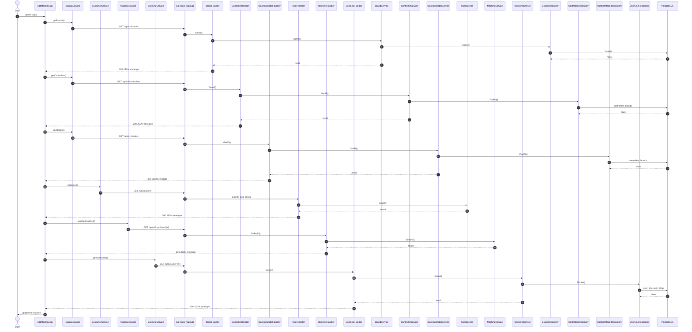
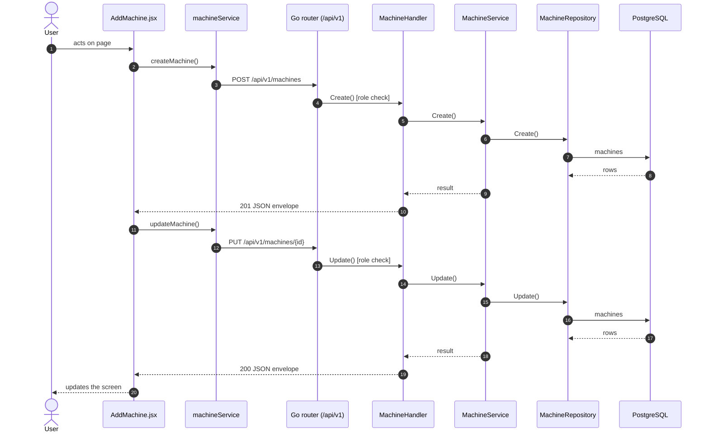

# Add / edit machine

- **Route:** `/machines/add` · `/machines/:id/edit` · **Component:** [AddMachine.jsx](../../src/pages/Machines/AddMachine.jsx) · **Auth:** protected (superadmin, customer, admin) · **Guard/Layout:** `ProtectedRoute` (session) + role guard · `MainLayout`
- **Purpose:** Add or edit a machine: customer, catalog (brand → controller → model), connection and organization placement.
- **Navigation:** All Machines → form → back to All Machines

## On page load

**Steps**

1. [AddMachine.jsx](../../src/pages/Machines/AddMachine.jsx) → loadBrands(): runs `getBrands()`
2. [catalogService.js](../../src/services/catalogService.js) → getBrands(): calls `GET /api/v1/brands`
3. [brand_routes.go](../../../7th-sense-server/internal/routes/brand_routes.go) → `GET /v1/brands` → BrandHandler.GetAll
4. [brand_handler.go](../../../7th-sense-server/internal/handler/brand_handler.go) → GetAll(): reads the logged-in user; calls the service
5. [brand_service.go](../../../7th-sense-server/internal/service/brand_service.go) → GetAll(): 
6. [brand_repository.go](../../../7th-sense-server/internal/repository/brand_repository.go) → FindAll(): reads / writes `brands`
7. [AddMachine.jsx](../../src/pages/Machines/AddMachine.jsx) → loadControllers(): runs `getControllers()`
8. [catalogService.js](../../src/services/catalogService.js) → getControllers(): calls `GET /api/v1/controllers`
9. [controller_routes.go](../../../7th-sense-server/internal/routes/controller_routes.go) → `GET /v1/controllers` → ControllerHandler.GetAll
10. [controller_handler.go](../../../7th-sense-server/internal/handler/controller_handler.go) → GetAll(): query brandId; calls the service
11. [controller_service.go](../../../7th-sense-server/internal/service/controller_service.go) → GetAll(): Returns the controllers. A non-nil brandID keeps only that brand's controllers.
12. [controller_repository.go](../../../7th-sense-server/internal/repository/controller_repository.go) → FindAll(): reads / writes `controllers`, `brands`
13. [AddMachine.jsx](../../src/pages/Machines/AddMachine.jsx) → loadModels(): runs `getModels()`
14. [catalogService.js](../../src/services/catalogService.js) → getModels(): calls `GET /api/v1/models`
15. [machine_model_routes.go](../../../7th-sense-server/internal/routes/machine_model_routes.go) → `GET /v1/models` → MachineModelHandler.GetAll
16. [machine_model_handler.go](../../../7th-sense-server/internal/handler/machine_model_handler.go) → GetAll(): query controllerId; calls the service
17. [machine_model_service.go](../../../7th-sense-server/internal/service/machine_model_service.go) → GetAll(): Returns the models. A non-nil controllerID keeps only that controller's models.
18. [machine_model_repository.go](../../../7th-sense-server/internal/repository/machine_model_repository.go) → FindAll(): reads / writes `controllers`, `brands`
19. [AddMachine.jsx](../../src/pages/Machines/AddMachine.jsx) → loadCustomers(): runs `getUsers()`
20. [customerService.js](../../src/services/customerService.js) → getUsers(): calls `GET /api/v1/users`
21. [user_routes.go](../../../7th-sense-server/internal/routes/user_routes.go) → `GET /v1/users` (managersOnly: superadmin, customer, admin) → UserHandler.GetAll
22. [user_handler.go](../../../7th-sense-server/internal/handler/user_handler.go) → GetAll(): query companyId, filterRole; calls the service
23. [user_service.go](../../../7th-sense-server/internal/service/user_service.go) → GetAll(): Returns the users the user may see, narrowed by filter: every user for the superadmin, the company's members for a customer or admin. A customer or admin asking for another company gets Forbidden.
24. [AddMachine.jsx](../../src/pages/Machines/AddMachine.jsx) → useEffect(): runs on load `getMachineById()`
25. [machineService.js](../../src/services/machineService.js) → getMachineById(): calls `GET /api/v1/machines/{id}`
26. [machine_routes.go](../../../7th-sense-server/internal/routes/machine_routes.go) → `GET /v1/machines/{id}` → MachineHandler.GetByID
27. [machine_handler.go](../../../7th-sense-server/internal/handler/machine_handler.go) → GetByID(): reads {id}; query userId; calls the service
28. [machine_service.go](../../../7th-sense-server/internal/service/machine_service.go) → GetByID(): Returns the machine when the user may access it (see machineScope), else "Machine not found". A non-nil customerID finds it only when that customer owns it.
29. [AddMachine.jsx](../../src/pages/Machines/AddMachine.jsx) → AddMachine(): runs `getUserLines()`
30. [userLineService.js](../../src/services/userLineService.js) → getUserLines(): calls `GET /api/v1/user-line`
31. [user_line_routes.go](../../../7th-sense-server/internal/routes/user_line_routes.go) → `GET /v1/user-line` → UserLineHandler.GetAll
32. [user_line_handler.go](../../../7th-sense-server/internal/handler/user_line_handler.go) → GetAll(): query userShopId, userId; calls the service
33. [user_line_service.go](../../../7th-sense-server/internal/service/user_line_service.go) → GetAll(): Returns the user's lines. A non-nil userShopID keeps only that shop's lines.
34. [user_line_repository.go](../../../7th-sense-server/internal/repository/user_line_repository.go) → FindAll(): reads / writes `user_line`, `user_shop`

## Save machine (add / edit form)

**Sequence diagram**

**Steps**

1. [AddMachine.jsx](../../src/pages/Machines/AddMachine.jsx) → onSubmit(): runs `createMachine()`
2. [machineService.js](../../src/services/machineService.js) → createMachine(): calls `POST /api/v1/machines`
3. [machine_routes.go](../../../7th-sense-server/internal/routes/machine_routes.go) → `POST /v1/machines` (managersOnly: superadmin, customer, admin) → MachineHandler.Create
4. [machine_handler.go](../../../7th-sense-server/internal/handler/machine_handler.go) → Create(): decodes `dto.CreateMachineRequest` and runs its Validate(); calls the service
5. [machine_service.go](../../../7th-sense-server/internal/service/machine_service.go) → Create(): Adds a machine. A customer or admin (the logged-in user) adds it to their own company, whatever customer the request names; the superadmin to the customer named.
6. [machine_repository.go](../../../7th-sense-server/internal/repository/machine_repository.go) → Create(): reads / writes `machines`
7. [AddMachine.jsx](../../src/pages/Machines/AddMachine.jsx) → onSubmit(): runs `updateMachine()`
8. [machineService.js](../../src/services/machineService.js) → updateMachine(): calls `PUT /api/v1/machines/{id}`
9. [machine_routes.go](../../../7th-sense-server/internal/routes/machine_routes.go) → `PUT /v1/machines/{id}` (managersOnly: superadmin, customer, admin) → MachineHandler.Update
10. [machine_handler.go](../../../7th-sense-server/internal/handler/machine_handler.go) → Update(): reads {id}; decodes `dto.UpdateMachineRequest` and runs its Validate(); calls the service
11. [machine_service.go](../../../7th-sense-server/internal/service/machine_service.go) → Update(): Replaces the form fields. A blank password or status keeps the saved one.
12. [machine_repository.go](../../../7th-sense-server/internal/repository/machine_repository.go) → Update(): reads / writes `machines`

**Rules & edge cases**

- Only superadmin, customer and admin may do this (server `managersOnly`, others 403); the page hides the controls for other roles.
- Server validation (`dto.CreateMachineRequest.Validate`): Please enter valid password.
- Server validation (`dto.UpdateMachineRequest.Validate`): Please enter valid password; Please enter valid status.

## UI states

- **Loading:** `<Loader>` while the request runs.
- **Error:** a red `<Alert>` with the server message (some pages add Retry).
- **Success / failure of an action:** toast message (`utils/toast.js`).

## API calls on this page

| Method | Endpoint | Triggered by (section) | API docs |
|---|---|---|---|
| GET | `/api/v1/brands` | On page load | [Swagger](http://localhost:8080/api-docs/index.html#/Machine%20catalog/getBrands) · [openapi.yaml](../../../7th-sense-server/docs/api/openapi.yaml) |
| GET | `/api/v1/controllers` | On page load | [Swagger](http://localhost:8080/api-docs/index.html#/Machine%20catalog/getControllers) · [openapi.yaml](../../../7th-sense-server/docs/api/openapi.yaml) |
| GET | `/api/v1/models` | On page load | [Swagger](http://localhost:8080/api-docs/index.html#/Machine%20catalog/getModels) · [openapi.yaml](../../../7th-sense-server/docs/api/openapi.yaml) |
| GET | `/api/v1/users` | On page load | [Swagger](http://localhost:8080/api-docs/index.html#/Users/getUsers) · [openapi.yaml](../../../7th-sense-server/docs/api/openapi.yaml) |
| POST | `/api/v1/machines` | Save machine (add / edit form) | [Swagger](http://localhost:8080/api-docs/index.html#/Machines/createMachine) · [openapi.yaml](../../../7th-sense-server/docs/api/openapi.yaml) |
| GET | `/api/v1/machines/{id}` | On page load | [Swagger](http://localhost:8080/api-docs/index.html#/Machines/getMachineById) · [openapi.yaml](../../../7th-sense-server/docs/api/openapi.yaml) |
| PUT | `/api/v1/machines/{id}` | Save machine (add / edit form) | [Swagger](http://localhost:8080/api-docs/index.html#/Machines/updateMachine) · [openapi.yaml](../../../7th-sense-server/docs/api/openapi.yaml) |
| GET | `/api/v1/user-line` | On page load | [Swagger](http://localhost:8080/api-docs/index.html#/Organization/getUserLines) · [openapi.yaml](../../../7th-sense-server/docs/api/openapi.yaml) |

## State & storage

- Route param `:id` (`useParams`)
- `useAuth()` (logged-in user, roles)
- Local component state (`useState`) for filters, form and modal

## Shared components used

[DatePicker.jsx](../../src/components/common/DatePicker.jsx), [FieldLabel.jsx](../../src/components/common/FieldLabel.jsx), [Loader.jsx](../../src/components/common/Loader.jsx)

## Decisions

- [Client ADR index](../adr/README.md)
