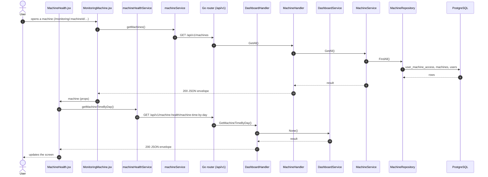

# Machine health

- **Route:** `/monitoring/:machineId/health` · **Component:** [MachineHealth.jsx](../../src/pages/MachineHealth/MachineHealth.jsx) inside [MonitoringMachine.jsx](../../src/pages/Monitoring/MonitoringMachine.jsx) ([MonitoringPage.jsx](../../src/pages/Monitoring/MonitoringPage.jsx)) · **Auth:** protected (every logged-in role) · **Guard/Layout:** `ProtectedRoute` (session) + role guard · `MainLayout`
- **Purpose:** Health dashboard of one machine; the Machine Time by Day chart is live from the server (other sensor charts still use sample data).
- **Navigation:** Sidebar › Operations › **Monitoring** → [machine list](monitoring-machines.md) → a machine's Health action → **Machine Health** tab (same machine view as [Productivity](productivity.md): machine name header, **Machine list** back arrow, Productivity / Machine Health tabs; no machine select).

## On page load

**Steps**

1. [MachineHealth.jsx](../../src/pages/MachineHealth/MachineHealth.jsx) → useLoad(): runs on load `getMachineTimeByDay()`
2. [machineHealthService.js](../../src/services/machineHealthService.js) → getMachineTimeByDay(): calls `GET /api/v1/machine-health/machine-time-by-day`
3. [dashboard_routes.go](../../../7th-sense-server/internal/routes/dashboard_routes.go) → `GET /v1/machine-health/machine-time-by-day` → DashboardHandler.GetMachineTimeByDay
4. [dashboard_handler.go](../../../7th-sense-server/internal/handler/dashboard_handler.go) → GetMachineTimeByDay(): query machineId, from, to; calls the service
5. [MonitoringMachine.jsx](../../src/pages/Monitoring/MonitoringMachine.jsx) → [useMachines.js](../../src/pages/Machines/useMachines.js) → useEffect(): runs on load `getMachines()`, finds `:machineId` (else "Machine not found") and passes `machine` to MachineHealth
6. [machineService.js](../../src/services/machineService.js) → getMachines(): calls `GET /api/v1/machines`
7. [machine_routes.go](../../../7th-sense-server/internal/routes/machine_routes.go) → `GET /v1/machines` → MachineHandler.GetAll
8. [machine_handler.go](../../../7th-sense-server/internal/handler/machine_handler.go) → GetAll(): query userId; calls the service
9. [machine_service.go](../../../7th-sense-server/internal/service/machine_service.go) → GetAll(): Returns the machines the user may access (see machineScope). A non-nil customerID keeps only that customer's machines.
10. [machine_repository.go](../../../7th-sense-server/internal/repository/machine_repository.go) → FindAll(): reads / writes `user_machine_access`, `machines`, `users`, `company_profiles`

## Live updates

- **Machine Time by Day** loads `GET /machine-health/machine-time-by-day` for the selected machine and range, and reloads every 60 s while the range includes today. Time without a recorded mode counts as offline.
- The other sensor charts on this page still use sample data ([healthSampleData.js](../../src/pages/MachineHealth/healthSampleData.js)) and call no API yet.

## UI states

- **Loading:** `<Loader>` while the request runs.
- **Error:** a red `<Alert>` with the server message (some pages add Retry).
- **Empty:** an empty-state message instead of the table / chart.

## API calls on this page

| Method | Endpoint | Triggered by (section) | API docs |
|---|---|---|---|
| GET | `/api/v1/machine-health/machine-time-by-day` | On page load | [Swagger](http://localhost:8080/api-docs/index.html#/Machine%20health/getMachineTimeByDay) · [openapi.yaml](../../../7th-sense-server/docs/api/openapi.yaml) |
| GET | `/api/v1/machines` | On page load | [Swagger](http://localhost:8080/api-docs/index.html#/Machines/getMachines) · [openapi.yaml](../../../7th-sense-server/docs/api/openapi.yaml) |

## State & storage

- Route param `:machineId` (read by [MonitoringPage.jsx](../../src/pages/Monitoring/MonitoringPage.jsx)); MachineHealth gets the machine as a prop
- `useAuth()` (logged-in user, roles)
- `useLoad()` (fetch + optional polling)
- Local component state (`useState`) for filters, form and modal

## Shared components used

[AreaGrowthChart.jsx](../../src/components/charts/AreaGrowthChart.jsx), [BarLineChart.jsx](../../src/components/charts/BarLineChart.jsx), [ChartCard.jsx](../../src/components/charts/ChartCard.jsx), [ChartDateFilter.jsx](../../src/components/charts/ChartDateFilter.jsx), [DonutChart.jsx](../../src/components/charts/DonutChart.jsx), [GroupedBarChart.jsx](../../src/components/charts/GroupedBarChart.jsx), [RadarScoreChart.jsx](../../src/components/charts/RadarScoreChart.jsx), [Speedometer.jsx](../../src/components/charts/Speedometer.jsx), [StackedBarChart.jsx](../../src/components/charts/StackedBarChart.jsx), [chartTheme.js](../../src/components/charts/chartTheme.js), [Loader.jsx](../../src/components/common/Loader.jsx), [LineTrendChart.jsx](../../src/components/charts/LineTrendChart.jsx)

## Decisions

- [ADR 0019: Monitoring machine list, then the machine's tabs with a back arrow](../adr/0019-monitoring-machine-view.md) (replaces [ADR 0012](../adr/0012-monitoring-tabbed-page.md) / [0013](../adr/0013-monitoring-machine-list.md))
- [Client ADR index](../adr/README.md)
