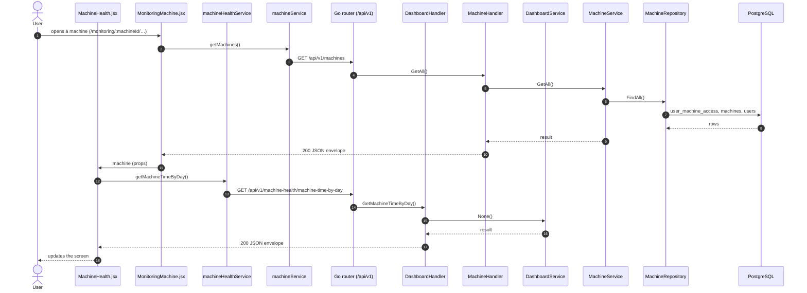
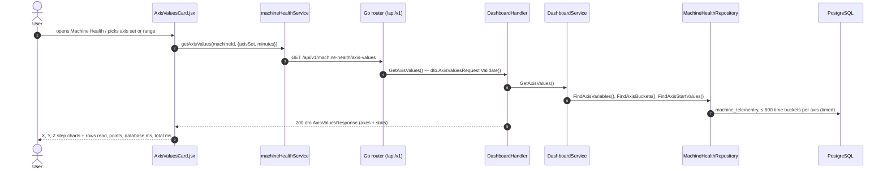

# Machine health

- **Route:** `/monitoring/:machineId/health` · **Component:** [MachineHealth.jsx](../../src/pages/MachineHealth/MachineHealth.jsx) inside [MonitoringMachine.jsx](../../src/pages/Monitoring/MonitoringMachine.jsx) ([MonitoringPage.jsx](../../src/pages/Monitoring/MonitoringPage.jsx)) · **Auth:** protected (every logged-in role) · **Guard/Layout:** `ProtectedRoute` (session) + role guard · `MainLayout`
- **Purpose:** Health dashboard of one machine; the Axis Values (X / Y / Z) and Machine Time by Day charts are live from the server (other sensor charts still use sample data).
- **Navigation:** Sidebar › Operations › **Monitoring** → [machine list](monitoring-machines.md) → a machine's Health action → **Machine Health** tab (same machine view as [Productivity](productivity.md): machine name header, **Machine list** back arrow, Productivity / Machine Health tabs; no machine select).

## On page load

**Steps**

1. [MachineHealth.jsx](../../src/pages/MachineHealth/MachineHealth.jsx) → useLoad(): runs on load `getMachineTimeByDay()`
2. [machineHealthService.js](../../src/services/machineHealthService.js) → getMachineTimeByDay(): calls `GET /api/v1/machine-health/machine-time-by-day`
3. [dashboard_routes.go](../../../7th-sense-server/internal/routes/dashboard_routes.go) → `GET /v1/machine-health/machine-time-by-day` → DashboardHandler.GetMachineTimeByDay
4. [dashboard_handler.go](../../../7th-sense-server/internal/handler/dashboard_handler.go) → GetMachineTimeByDay(): query machineId, from, to; calls the service
5. [MonitoringMachine.jsx](../../src/pages/Monitoring/MonitoringMachine.jsx) → [useMachines.js](../../src/pages/Machines/useMachines.js) → useEffect(): runs on load `getMachines()`, finds `:machineId` (else "Machine not found") and passes `machine` to MachineHealth
6. [machineService.js](../../src/services/machineService.js) → getMachines(): calls `GET /api/v1/machines`
7. [machine_routes.go](../../../7th-sense-server/internal/routes/machine_routes.go) → `GET /v1/machines` → MachineHandler.GetAll
8. [machine_handler.go](../../../7th-sense-server/internal/handler/machine_handler.go) → GetAll(): query userId; calls the service
9. [machine_service.go](../../../7th-sense-server/internal/service/machine_service.go) → GetAll(): Returns the machines the user may access (see machineScope). A non-nil customerID keeps only that customer's machines.
10. [machine_repository.go](../../../7th-sense-server/internal/repository/machine_repository.go) → FindAll(): reads / writes `user_machine_access`, `machines`, `users`, `company_profiles`

## Axis Values (X, Y, Z)

**Steps**

1. [AxisValuesCard.jsx](../../src/pages/MachineHealth/AxisValuesCard.jsx): axis set select (machine position by default, [axisValues.js](../../src/pages/MachineHealth/axisValues.js) `AXIS_SETS`) and range buttons 5 Min … 30 Days (`AXIS_RANGES`, last N minutes up to now); `loadTimed()` times the whole request with `performance.now()`. Ranges up to a day reload every 30 s
2. [machineHealthService.js](../../src/services/machineHealthService.js) → getAxisValues(): `GET /api/v1/machine-health/axis-values?machineId&axisSet&minutes` (zoomed: `&start&end` instead of `minutes`)
3. [dashboard_routes.go](../../../7th-sense-server/internal/routes/dashboard_routes.go) → [dashboard_handler.go](../../../7th-sense-server/internal/handler/dashboard_handler.go) → GetAxisValues(): [machine_health_dto.go](../../../7th-sense-server/internal/dto/machine_health_dto.go) `AxisValuesRequest` (axis set from `dto.AxisSets`, ≤ 31 days)
4. [dashboard_service.go](../../../7th-sense-server/internal/service/dashboard_service.go) → GetAxisValues(): machine access (`MachineService.GetByID`, else 404); `axisPoints()`: every stored value (`raw`) while no axis holds more than 20,000 in the range, else 600 buckets (`bucketSec` = range / 600); times the telemetry queries (`stats.queryMs`)
5. [machine_health_repository.go](../../../7th-sense-server/internal/repository/machine_health_repository.go) → FindAxisRows(): up to 20,001 stored values per axis; FindAxisBuckets() (fallback): per bucket the last value (newest row, looked up by index), min, max, row count; FindAxisStartValues(): the value before the range
6. `axisRows()` turns each axis into `{time, value}` rows from the range start to its end; `LineTrendChart` draws them with `curve="stepAfter"` (values are stored only on change). The status line says "Every stored value" (`raw`) or how long one grouped point is

## Zoom the axis charts

1. Drag across any of the three charts: [LineTrendChart.jsx](../../src/components/charts/LineTrendChart.jsx) `onSelectRange` shades the selection and returns its start / end times; [AxisValuesCard.jsx](../../src/pages/MachineHealth/AxisValuesCard.jsx) `zoomTo()` keeps the window (≥ 1 s) for all three charts
2. The window is loaded again: `getAxisValues(machineId, {axisSet, start, end})` → same endpoint with `start` / `end` ([machine_health_dto.go](../../../7th-sense-server/internal/dto/machine_health_dto.go) `checkWindow()`), so a grouped range zoomed in far enough returns every stored value; a zoomed window does not refresh on the timer
3. **Zoom out** doubles the window around its centre (`zoomedOut()`, back to the range when it would cover it); **Reset zoom** or a range button returns to the whole range

**Rules & edge cases**

- Every role, for machines it may read. Needs migration 038 (index on machine, variable, time) to stay fast with many machines.
- An axis with no readings shows "No readings in this range."; an unknown axis set is a 400.

## Live updates

- **Machine Time by Day** loads `GET /machine-health/machine-time-by-day` for the selected machine and range, and reloads every 60 s while the range includes today. A range nobody picked follows today, so it moves on after midnight. Time without a recorded mode counts as offline.
- **Axis Values** reloads every 30 s for ranges up to a day while not zoomed; 7 / 30 days and zoomed windows load once.
- The other sensor charts on this page still use sample data ([healthSampleData.js](../../src/pages/MachineHealth/healthSampleData.js)) and call no API yet.

## UI states

- **Loading:** `<Loader>` while the request runs.
- **Error:** a red `<Alert>` with the server message (some pages add Retry).
- **Empty:** an empty-state message instead of the table / chart.

## API calls on this page

| Method | Endpoint | Triggered by (section) | API docs |
|---|---|---|---|
| GET | `/api/v1/machine-health/axis-values` | Axis Values (X, Y, Z) | [Swagger](http://localhost:8080/api-docs/index.html#/Machine%20health/getAxisValues) · [openapi.yaml](../../../7th-sense-server/docs/api/openapi.yaml) |
| GET | `/api/v1/machine-health/machine-time-by-day` | On page load | [Swagger](http://localhost:8080/api-docs/index.html#/Machine%20health/getMachineTimeByDay) · [openapi.yaml](../../../7th-sense-server/docs/api/openapi.yaml) |
| GET | `/api/v1/machines` | On page load | [Swagger](http://localhost:8080/api-docs/index.html#/Machines/getMachines) · [openapi.yaml](../../../7th-sense-server/docs/api/openapi.yaml) |

## State & storage

- Route param `:machineId` (read by [MonitoringPage.jsx](../../src/pages/Monitoring/MonitoringPage.jsx)); MachineHealth gets the machine as a prop
- `useAuth()` (logged-in user, roles)
- `useLoad()` (fetch + optional polling)
- Local component state (`useState`) for filters, form and modal

## Shared components used

[AreaGrowthChart.jsx](../../src/components/charts/AreaGrowthChart.jsx), [BarLineChart.jsx](../../src/components/charts/BarLineChart.jsx), [ChartCard.jsx](../../src/components/charts/ChartCard.jsx), [ChartDateFilter.jsx](../../src/components/charts/ChartDateFilter.jsx), [DonutChart.jsx](../../src/components/charts/DonutChart.jsx), [GroupedBarChart.jsx](../../src/components/charts/GroupedBarChart.jsx), [RadarScoreChart.jsx](../../src/components/charts/RadarScoreChart.jsx), [Speedometer.jsx](../../src/components/charts/Speedometer.jsx), [StackedBarChart.jsx](../../src/components/charts/StackedBarChart.jsx), [chartTheme.js](../../src/components/charts/chartTheme.js), [Loader.jsx](../../src/components/common/Loader.jsx), [LineTrendChart.jsx](../../src/components/charts/LineTrendChart.jsx)

## Decisions

- [ADR 0019: Monitoring machine list, then the machine's tabs with a back arrow](../adr/0019-monitoring-machine-view.md) (replaces [ADR 0012](../adr/0012-monitoring-tabbed-page.md) / [0013](../adr/0013-monitoring-machine-list.md))
- Server [ADR 0018](../../../7th-sense-server/docs/adr/0018-machine-health-axis-values.md): X / Y / Z charts timed, on the machine-health routes; index of migration 038
- Server [ADR 0019](../../../7th-sense-server/docs/adr/0019-axis-values-raw-and-zoom.md): every stored value when it fits (≤ 20,000 per axis), drag-to-zoom loads the window again
- [Client ADR index](../adr/README.md)
