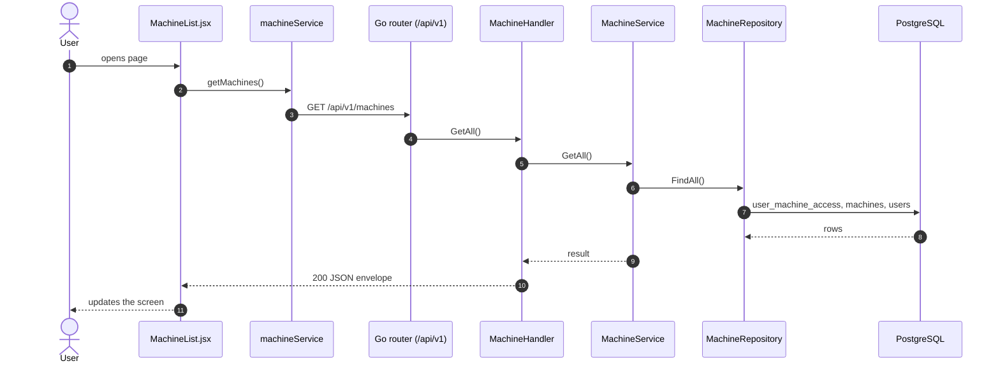
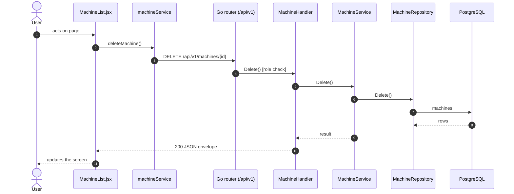

# All machines

- **Route:** `/machines` · **Component:** [MachineList.jsx](../../src/pages/Machines/MachineList.jsx) · **Auth:** protected (every logged-in role) · **Guard/Layout:** `ProtectedRoute` (session) + role guard · `MainLayout`
- **Purpose:** Machine set-up: lists the machines the user may see (table or cards); managers add / edit, the superadmin deletes. No Productivity / Health links: live data lives only under [Monitoring › Machines](monitoring-machines.md).
- **Navigation:** Sidebar › Operations → All Machines → Add / Edit

## On page load

**Steps**

1. [MachineList.jsx](../../src/pages/Machines/MachineList.jsx) → [useMachines.js](../../src/pages/Machines/useMachines.js) → useEffect(): runs on load `getMachines()`; the list itself (search, customer filter, sort, paging, table / cards) is the shared [MachineBrowser.jsx](../../src/pages/Machines/MachineBrowser.jsx)
2. [machineService.js](../../src/services/machineService.js) → getMachines(): calls `GET /api/v1/machines`
3. [machine_routes.go](../../../7th-sense-server/internal/routes/machine_routes.go) → `GET /v1/machines` → MachineHandler.GetAll
4. [machine_handler.go](../../../7th-sense-server/internal/handler/machine_handler.go) → GetAll(): query userId; calls the service
5. [machine_service.go](../../../7th-sense-server/internal/service/machine_service.go) → GetAll(): Returns the machines the user may access (see machineScope). A non-nil customerID keeps only that customer's machines.
6. [machine_repository.go](../../../7th-sense-server/internal/repository/machine_repository.go) → FindAll(): reads / writes `user_machine_access`, `machines`, `users`, `company_profiles`

## Edit machine

The Edit icon (row Actions / card header, managers only) navigates to `/machines/:id/edit` ([machine-form.md](machine-form.md)). Roles without Edit see no Actions column.

## Delete machine

**Sequence diagram**

**Steps**

1. [MachineList.jsx](../../src/pages/Machines/MachineList.jsx) → confirmDelete(): runs `deleteMachine()`
2. [machineService.js](../../src/services/machineService.js) → deleteMachine(): calls `DELETE /api/v1/machines/{id}`
3. [machine_routes.go](../../../7th-sense-server/internal/routes/machine_routes.go) → `DELETE /v1/machines/{id}` (superAdminOnly) → MachineHandler.Delete
4. [machine_handler.go](../../../7th-sense-server/internal/handler/machine_handler.go) → Delete(): reads {id}; calls the service
5. [machine_service.go](../../../7th-sense-server/internal/service/machine_service.go) → Delete(): 
6. [machine_repository.go](../../../7th-sense-server/internal/repository/machine_repository.go) → Delete(): reads / writes `machines`

**Rules & edge cases**

- Superadmin only (server `superAdminOnly`, others 403).

## UI states

- **Loading:** `<Loader>` while the request runs.
- **Error:** a red `<Alert>` with the server message (some pages add Retry).
- **Success / failure of an action:** toast message (`utils/toast.js`).
- **Empty:** an empty-state message instead of the table / chart.
- **Delete:** asks for confirmation first.

## API calls on this page

| Method | Endpoint | Triggered by (section) | API docs |
|---|---|---|---|
| DELETE | `/api/v1/machines/{id}` | Delete machine | [Swagger](http://localhost:8080/api-docs/index.html#/Machines/deleteMachine) · [openapi.yaml](../../../7th-sense-server/docs/api/openapi.yaml) |
| GET | `/api/v1/machines` | On page load | [Swagger](http://localhost:8080/api-docs/index.html#/Machines/getMachines) · [openapi.yaml](../../../7th-sense-server/docs/api/openapi.yaml) |

## State & storage

- `useAuth()` (logged-in user, roles)
- Local component state (`useState`) for filters, form and modal
- `localStorage` `ts.machines.view` (`STORAGE_KEYS.MACHINE_VIEW`): table or cards, via [useMachineView.js](../../src/pages/Machines/useMachineView.js)

## Shared components used

[MachineBrowser.jsx](../../src/pages/Machines/MachineBrowser.jsx) (with [MachineRow.jsx](../../src/pages/Machines/MachineRow.jsx) / [MachineCard.jsx](../../src/pages/Machines/MachineCard.jsx), actions passed in by the page), [MachineViewToggle.jsx](../../src/pages/Machines/MachineViewToggle.jsx), [ConfirmModal.jsx](../../src/components/common/ConfirmModal.jsx), [Loader.jsx](../../src/components/common/Loader.jsx), [TablePagination.jsx](../../src/components/common/TablePagination.jsx), [SortableHead.jsx](../../src/components/common/SortableHead.jsx), [IconAction.jsx](../../src/components/common/IconAction.jsx), [StatusBadge.jsx](../../src/components/common/StatusBadge.jsx)

## Decisions

- [ADR 0013](../adr/0013-monitoring-machine-list.md): set-up and monitoring are separate lists
- [Client ADR index](../adr/README.md)
