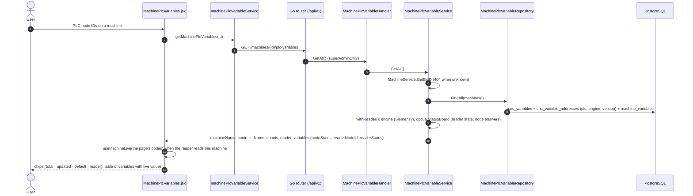
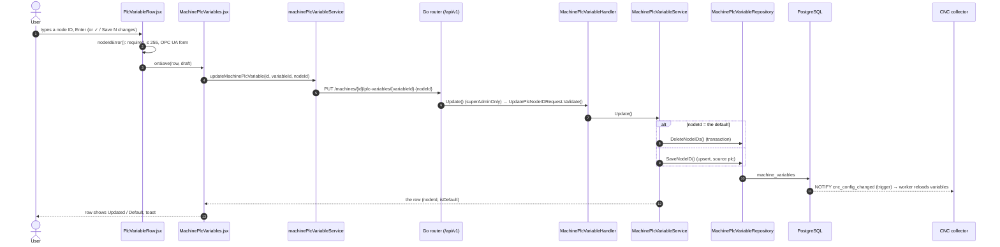
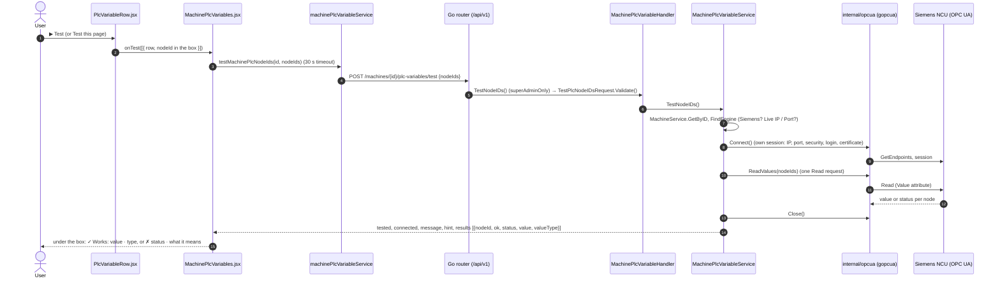

# Machine PLC node IDs

- **Route:** `/machines/:id/plc-variables` · **Component:** [MachinePlcVariables.jsx](../../src/pages/MachinePlcVariables/MachinePlcVariables.jsx) · **Auth:** protected · **Roles:** superadmin only · **Guard/Layout:** `ProtectedRoute` (session) + role guard · `MainLayout`
- **Purpose:** Every PLC variable has a default OPC UA node ID, but machines are wired differently. Here the superadmin sees every PLC variable for one machine — **Default** (no node ID of its own, reads the default) or **Updated** (the machine's own) — and changes it in place. A variable without its own node ID always follows the default. **Test** reads a node ID (saved or only typed) once from the machine and shows its value in the row, and **Live value** shows what the PLC reader receives now, so a node ID that brings no value can be changed and tried on the spot.
- **Navigation:** Sidebar › Operations › [All Machines](machine-list.md) → a machine's **PLC node IDs** action (table and cards; superadmin only). **Machine list** goes back.

## On page load

1. [MachinePlcVariables.jsx](../../src/pages/MachinePlcVariables/MachinePlcVariables.jsx) → loads the list once (no timer); keeps typed node IDs in `drafts` (variable id → text) across pages and filters.
2. [machine_plc_variable_routes.go](../../../7th-sense-server/internal/routes/machine_plc_variable_routes.go) → `superAdminOnly`; [machine_plc_variable_handler.go](../../../7th-sense-server/internal/handler/machine_plc_variable_handler.go) → GetAll().
3. [machine_plc_variable_service.go](../../../7th-sense-server/internal/service/machine_plc_variable_service.go) → GetAll(): the machine must exist (`MachineService.GetByID`).
4. [machine_plc_variable_service.go](../../../7th-sense-server/internal/service/machine_plc_variable_service.go) → withReader(): `reader` = `{enabled (PLC_ENABLED), supported (Siemens), state, lastError}` and per variable `readerNodeId` (the node ID the PLC reader subscribed to) and `readerStatus` (the controller's refusal, e.g. BadNodeIdUnknown), from the in-memory `opcua.StatusBoard` the PLC workers write (server ADR 0021). A node refused only for lack of room (`BadTooManyMonitoredItems`) is read instead every `PLC_POLL_INTERVAL_MS`, so its `readerStatus` stays empty (server ADR 0023).
5. [machine_plc_variable_repository.go](../../../7th-sense-server/internal/repository/machine_plc_variable_repository.go) → FindAll(): a variable is listed when it has a `plc` address in `cnc_variable_addresses` for any engine; the default is the best `plc` address in `cnc_variable_addresses`: the machine's own CNC engine and controller version first, else another engine's (PLC defaults exist for Siemens only, so a Fanuc machine reads the Siemens node IDs by default) (`plcDefaultOrder`). The collector ranks plc addresses the same way, so the page shows the node ID it uses. The machine's own node ID is its `machine_variables` row with source `plc`.

## Change a node ID

1. [PlcVariableRow.jsx](../../src/pages/MachinePlcVariables/PlcVariableRow.jsx) → the node ID is an input in the row: **Enter** saves, **Esc** undoes; while it differs from the saved value the row is marked **Unsaved** and shows ✓ (save) and ✕ (undo). An invalid value shows the reason under the input and cannot be saved.
2. [plcVariableSettings.js](../../src/pages/MachinePlcVariables/plcVariableSettings.js) → `nodeIdError()` mirrors the server (`ns=<n>;s=…`, also `i=` / `g=` / `b=`); `changedDraft()` = the typed value when it differs from the saved one.
3. **Save N changes** in the toolbar saves every edited, valid row (one request each); **Discard** drops all typing. A refused row keeps its typing and the toast gives the server's message.
4. [machine_plc_variable_dto.go](../../../7th-sense-server/internal/dto/machine_plc_variable_dto.go) → `UpdatePlcNodeIDRequest.Validate()` trims and checks the node ID.
5. [machine_plc_variable_service.go](../../../7th-sense-server/internal/service/machine_plc_variable_service.go) → Update(): a variable not in the machine's PLC list answers 404; saving the default node ID resets instead of storing a copy, so a later change of the default reaches the machine.
6. The `machine_variables` trigger sends `cnc_config_changed`, so the machine's worker reloads its variables at once (no restart).

## Test a node ID

1. [PlcVariableRow.jsx](../../src/pages/MachinePlcVariables/PlcVariableRow.jsx) → ▶ (`ACTION_ICONS.testNode`) tests the node ID in the box — the typed one while editing, so it can be tried **before** it is saved. The result shows under the box while the box still holds that node ID (typing something else hides it): a spinner, **Works: value · data type · time**, or the controller's status with its meaning (`statusHint()`: BadNodeIdUnknown = the node does not exist on this controller, BadUserAccessDenied = this login may not read it, …).
2. **Test this page (N)** in the toolbar tests every row on the page with a valid node ID in one request (Siemens machines only) and toasts how many read a value.
3. [MachinePlcVariables.jsx](../../src/pages/MachinePlcVariables/MachinePlcVariables.jsx) → runTest(): marks the rows testing, keeps a result only while it is the row's latest test (`startedAt`); a machine it could not reach, or did not try, toasts the server's `message` + `hint`.
4. [machine_plc_variable_dto.go](../../../7th-sense-server/internal/dto/machine_plc_variable_dto.go) → `TestPlcNodeIDsRequest.Validate()`: 1–100 node IDs, each checked like a save, repeats dropped.
5. [machine_plc_node_probe.go](../../../7th-sense-server/internal/service/machine_plc_node_probe.go) → TestNodeIDs(): not Siemens or no Live IP / Port → `tested: false` with the reason; otherwise a session of its own (server [ADR 0022](../../../7th-sense-server/docs/adr/0022-plc-node-test-own-session.md)), one read, closed again. A connect / read failure is an answer (`connected: false`, `hint` from `plcErrorHint()`: login, certificate, endpoint, network), not an error. Nothing is stored or sent on the socket.
6. [connection.go](../../../7th-sense-server/internal/opcua/connection.go) → ReadValues(): one Read request; an invalid or refused node gets its status, the others are still read.

## Live value

1. [MachinePlcVariables.jsx](../../src/pages/MachinePlcVariables/MachinePlcVariables.jsx) → `useMachineLive(machineId, { codes: the page's codes, intervalMs: PLC_LIVE_INTERVAL_MS })` while `reader.enabled && reader.supported` (the socket takes ≤ 100 codes, the largest page); `trackChanges()` (diagnostics) counts changes, so a changed value flashes.
2. [plcVariableSettings.js](../../src/pages/MachinePlcVariables/plcVariableSettings.js) → `liveState()` words the cell: Not read (reader off / not Siemens), Not connected (the reader's last error), Not subscribed (inactive or turned off), **Subscribing…** (`readerNodeId` ≠ the saved node ID: just saved), the controller's refusal (`readerStatus`), Socket not connected, Updating, Steady (only changes are sent), No value yet. `readerLook()` words the reader chip.
3. After a save or reset the page fetches the list again after `READER_REFRESH_DELAY_MS` (3 s) and takes only `reader` / `readerNodeId` / `readerStatus` from it (`withReader()`), so the row shows the controller's answer for the new node ID.

## Reset to default

1. On an Updated row, ↺ calls `resetMachinePlcVariable()` → `DELETE /machines/{id}/plc-variables/{variableId}` → `MachinePlcVariableService.Reset()`; the row is Default again.
2. **Reset all to default** (header, enabled while something is Updated) asks first, then `resetMachinePlcVariables()` → `DELETE /machines/{id}/plc-variables` → `ResetAll()` returns the whole list; unsaved typing is discarded.
3. [machine_plc_variable_repository.go](../../../7th-sense-server/internal/repository/machine_plc_variable_repository.go) → DeleteNodeIDs(): a row that only held the node ID is deleted; a row that also turns the variable off or sets a deadband keeps those and only loses the node ID.

## UI states

- Loading: `Loader`. Load failed / unknown machine: red alert with the server message, Machine list and Retry.
- No PLC variables at all (no `plc` row in `cnc_variable_addresses`): `.ts-empty`.
- Saving a row: spinner in its Actions cell, input disabled. Testing: spinner under the box (and on Test this page). Filters with no match: `TableNoResults` with Clear filters.
- Filters: search (code, name, node ID, default, id), status (All / Updated / Default / Unsaved changes), category. Chips: total, updated, default, unsaved, PLC reader state (`readerLook()`).
- Inactive variables are listed (marked `· inactive`): the collector does not read them, but their node ID can be set in advance.

## Rules & edge cases

- **PLC only:** variables with a `plc` address for any controller. Snapshot and NC addresses are not shown or changed here.
- `nodeStatus` comes from the server: `default` or `updated`. Every PLC variable has a default, also on a controller with no PLC rows of its own (Fanuc reads the Siemens node IDs).
- Controller version not set on the machine: the default for every version is preferred, then an 828D / 840D one (the subtitle says the version is not set); set it on the machine form to get the right defaults.
- Siemens machines are read over OPC UA (server ADR 0021): a saved node ID makes the machine's PLC worker subscribe again at once; the Live value column and the machine's [Diagnostics](machine-diagnostics.md) show what it receives. Other controllers are not read over OPC UA: their PLC node IDs stay configuration only (`FindVariableConfig` gives them no plc address), Live value says Not read and Test is answered "not tested".
- A test opens a short OPC UA session of its own beside the DLL's and the PLC reader's (three for a moment); the NCU must allow it. It reads the Value attribute once: a node that exists but never changes still answers, unlike the live socket, which sends only changes. A test takes up to `PLC_CONNECT_TIMEOUT_SEC` (10 s) to connect plus as long to read.
- Leaving the page drops unsaved typing (no prompt).

## API calls on this page

| Method | Endpoint | Triggered by (section) | API docs |
|---|---|---|---|
| GET | `/api/v1/machines/{id}/plc-variables` | On page load | [Swagger](http://localhost:8080/api-docs/index.html#/Machines/getMachinePlcVariables) · [openapi.yaml](../../../7th-sense-server/docs/api/openapi.yaml) |
| PUT | `/api/v1/machines/{id}/plc-variables/{variableId}` | Change a node ID | [Swagger](http://localhost:8080/api-docs/index.html#/Machines/updateMachinePlcVariable) · [openapi.yaml](../../../7th-sense-server/docs/api/openapi.yaml) |
| DELETE | `/api/v1/machines/{id}/plc-variables/{variableId}` | Reset to default (one row) | [Swagger](http://localhost:8080/api-docs/index.html#/Machines/resetMachinePlcVariable) · [openapi.yaml](../../../7th-sense-server/docs/api/openapi.yaml) |
| DELETE | `/api/v1/machines/{id}/plc-variables` | Reset all to default | [Swagger](http://localhost:8080/api-docs/index.html#/Machines/resetMachinePlcVariables) · [openapi.yaml](../../../7th-sense-server/docs/api/openapi.yaml) |
| POST | `/api/v1/machines/{id}/plc-variables/test` | Test a node ID · Test this page | [Swagger](http://localhost:8080/api-docs/index.html#/Machines/testMachinePlcNodeIds) · [openapi.yaml](../../../7th-sense-server/docs/api/openapi.yaml) |
| WS | `/api/v1/socket.io/` | Live value | [live-socket-events.md](../../../7th-sense-server/docs/live-socket-events.md) |

## State & storage

- Component state only: the list, `drafts`, rows being saved, `tests` (variable id → last test result), live change counts, filters, page. Nothing in local storage.
- Server: `machine_variables` (`machine_id`, `id` = variable, `source = 'plc'`, `address` = node ID); defaults in `cnc_variable_addresses`. No new table.

## Shared components used

`SortableHead` + `useTableSort`, `TablePagination`, `TableNoResults`, `IconAction` (`ACTION_ICONS.testNode` / `save` / `undo` / `resetDefault`; All Machines uses `plcNodes`), `ConfirmModal`, `Loader`, `.ts-chip`, `.ts-diag-state` tones, `useMachineLive`, `formatValue` / `trackChanges` from [diagnosticsSettings.js](../../src/pages/MachineDiagnostics/diagnosticsSettings.js).

## Decisions

- Server [ADR 0020](../../../7th-sense-server/docs/adr/0020-machine-plc-node-ids.md): the machine's own node ID goes in the existing `machine_variables` override row, superadmin only, PLC only.
- Inline editing in the table with plain component state instead of a React Hook Form: each row saves on its own (Enter), so there is no form to submit; validation mirrors the server in `plcVariableSettings.js`.
- Server [ADR 0022](../../../7th-sense-server/docs/adr/0022-plc-node-test-own-session.md): a test reads in a short session of its own, not through the running PLC worker, so it works for typed node IDs and while the reader is down.
