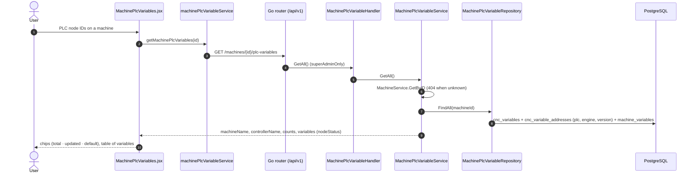
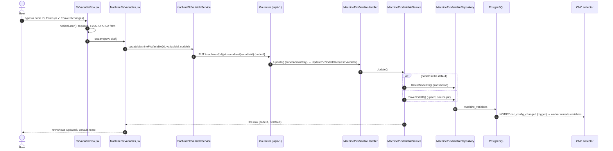

# Machine PLC node IDs

- **Route:** `/machines/:id/plc-variables` · **Component:** [MachinePlcVariables.jsx](../../src/pages/MachinePlcVariables/MachinePlcVariables.jsx) · **Auth:** protected · **Roles:** superadmin only · **Guard/Layout:** `ProtectedRoute` (session) + role guard · `MainLayout`
- **Purpose:** Every PLC variable has a default OPC UA node ID, but machines are wired differently. Here the superadmin sees every PLC variable for one machine — **Default** (no node ID of its own, reads the default) or **Updated** (the machine's own) — and changes it in place. A variable without its own node ID always follows the default.
- **Navigation:** Sidebar › Operations › [All Machines](machine-list.md) → a machine's **PLC node IDs** action (table and cards; superadmin only). **Machine list** goes back.

## On page load

1. [MachinePlcVariables.jsx](../../src/pages/MachinePlcVariables/MachinePlcVariables.jsx) → loads the list once (no timer); keeps typed node IDs in `drafts` (variable id → text) across pages and filters.
2. [machine_plc_variable_routes.go](../../../7th-sense-server/internal/routes/machine_plc_variable_routes.go) → `superAdminOnly`; [machine_plc_variable_handler.go](../../../7th-sense-server/internal/handler/machine_plc_variable_handler.go) → GetAll().
3. [machine_plc_variable_service.go](../../../7th-sense-server/internal/service/machine_plc_variable_service.go) → GetAll(): the machine must exist (`MachineService.GetByID`).
4. [machine_plc_variable_repository.go](../../../7th-sense-server/internal/repository/machine_plc_variable_repository.go) → FindAll(): a variable is listed when it has a `plc` address in `cnc_variable_addresses` for any engine; the default is the best `plc` address in `cnc_variable_addresses`: the machine's own CNC engine and controller version first, else another engine's (PLC defaults exist for Siemens only, so a Fanuc machine reads the Siemens node IDs by default) (`plcDefaultOrder`). The collector ranks plc addresses the same way, so the page shows the node ID it uses. The machine's own node ID is its `machine_variables` row with source `plc`.

## Change a node ID

1. [PlcVariableRow.jsx](../../src/pages/MachinePlcVariables/PlcVariableRow.jsx) → the node ID is an input in the row: **Enter** saves, **Esc** undoes; while it differs from the saved value the row is marked **Unsaved** and shows ✓ (save) and ✕ (undo). An invalid value shows the reason under the input and cannot be saved.
2. [plcVariableSettings.js](../../src/pages/MachinePlcVariables/plcVariableSettings.js) → `nodeIdError()` mirrors the server (`ns=<n>;s=…`, also `i=` / `g=` / `b=`); `changedDraft()` = the typed value when it differs from the saved one.
3. **Save N changes** in the toolbar saves every edited, valid row (one request each); **Discard** drops all typing. A refused row keeps its typing and the toast gives the server's message.
4. [machine_plc_variable_dto.go](../../../7th-sense-server/internal/dto/machine_plc_variable_dto.go) → `UpdatePlcNodeIDRequest.Validate()` trims and checks the node ID.
5. [machine_plc_variable_service.go](../../../7th-sense-server/internal/service/machine_plc_variable_service.go) → Update(): a variable not in the machine's PLC list answers 404; saving the default node ID resets instead of storing a copy, so a later change of the default reaches the machine.
6. The `machine_variables` trigger sends `cnc_config_changed`, so the machine's worker reloads its variables at once (no restart).

## Reset to default

1. On an Updated row, ↺ calls `resetMachinePlcVariable()` → `DELETE /machines/{id}/plc-variables/{variableId}` → `MachinePlcVariableService.Reset()`; the row is Default again.
2. **Reset all to default** (header, enabled while something is Updated) asks first, then `resetMachinePlcVariables()` → `DELETE /machines/{id}/plc-variables` → `ResetAll()` returns the whole list; unsaved typing is discarded.
3. [machine_plc_variable_repository.go](../../../7th-sense-server/internal/repository/machine_plc_variable_repository.go) → DeleteNodeIDs(): a row that only held the node ID is deleted; a row that also turns the variable off or sets a deadband keeps those and only loses the node ID.

## UI states

- Loading: `Loader`. Load failed / unknown machine: red alert with the server message, Machine list and Retry.
- No PLC variables at all (no `plc` row in `cnc_variable_addresses`): `.ts-empty`.
- Saving a row: spinner in its Actions cell, input disabled. Filters with no match: `TableNoResults` with Clear filters.
- Filters: search (code, name, node ID, default, id), status (All / Updated / Default / Unsaved changes), category. Chips: total, updated, default, unsaved.
- Inactive variables are listed (marked `· inactive`): the collector does not read them, but their node ID can be set in advance.

## Rules & edge cases

- **PLC only:** variables with a `plc` address for any controller. Snapshot and NC addresses are not shown or changed here.
- `nodeStatus` comes from the server: `default` or `updated`. Every PLC variable has a default, also on a controller with no PLC rows of its own (Fanuc reads the Siemens node IDs).
- Controller version not set on the machine: the default for every version is preferred, then an 828D / 840D one (the subtitle says the version is not set); set it on the machine form to get the right defaults.
- Siemens machines are read over OPC UA (server ADR 0021): a saved node ID makes the machine's PLC worker subscribe again at once; its live values and whether the controller accepted each node ID are on the machine's [Diagnostics](machine-diagnostics.md). Other controllers are not read over OPC UA: their PLC node IDs stay configuration only (`FindVariableConfig` gives them no plc address).
- Leaving the page drops unsaved typing (no prompt).

## API calls on this page

| Method | Endpoint | Triggered by (section) | API docs |
|---|---|---|---|
| GET | `/api/v1/machines/{id}/plc-variables` | On page load | [Swagger](http://localhost:8080/api-docs/index.html#/Machines/getMachinePlcVariables) · [openapi.yaml](../../../7th-sense-server/docs/api/openapi.yaml) |
| PUT | `/api/v1/machines/{id}/plc-variables/{variableId}` | Change a node ID | [Swagger](http://localhost:8080/api-docs/index.html#/Machines/updateMachinePlcVariable) · [openapi.yaml](../../../7th-sense-server/docs/api/openapi.yaml) |
| DELETE | `/api/v1/machines/{id}/plc-variables/{variableId}` | Reset to default (one row) | [Swagger](http://localhost:8080/api-docs/index.html#/Machines/resetMachinePlcVariable) · [openapi.yaml](../../../7th-sense-server/docs/api/openapi.yaml) |
| DELETE | `/api/v1/machines/{id}/plc-variables` | Reset all to default | [Swagger](http://localhost:8080/api-docs/index.html#/Machines/resetMachinePlcVariables) · [openapi.yaml](../../../7th-sense-server/docs/api/openapi.yaml) |

## State & storage

- Component state only: the list, `drafts`, rows being saved, filters, page. Nothing in local storage.
- Server: `machine_variables` (`machine_id`, `id` = variable, `source = 'plc'`, `address` = node ID); defaults in `cnc_variable_addresses`. No new table.

## Shared components used

`SortableHead` + `useTableSort`, `TablePagination`, `TableNoResults`, `IconAction` (`ACTION_ICONS.save` / `undo` / `resetDefault`; All Machines uses `plcNodes`), `ConfirmModal`, `Loader`, `.ts-chip`.

## Decisions

- Server [ADR 0020](../../../7th-sense-server/docs/adr/0020-machine-plc-node-ids.md): the machine's own node ID goes in the existing `machine_variables` override row, superadmin only, PLC only.
- Inline editing in the table with plain component state instead of a React Hook Form: each row saves on its own (Enter), so there is no form to submit; validation mirrors the server in `plcVariableSettings.js`.
