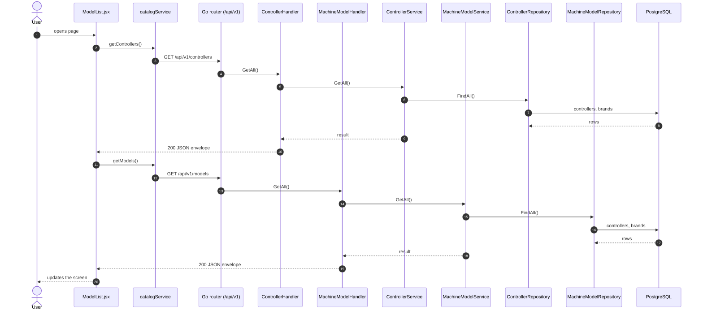
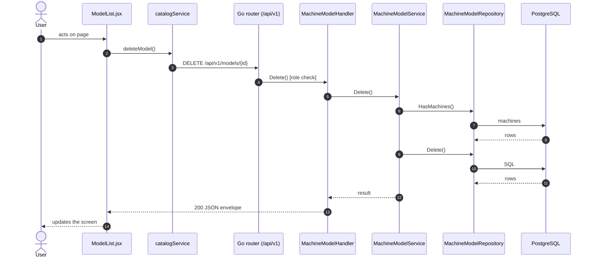
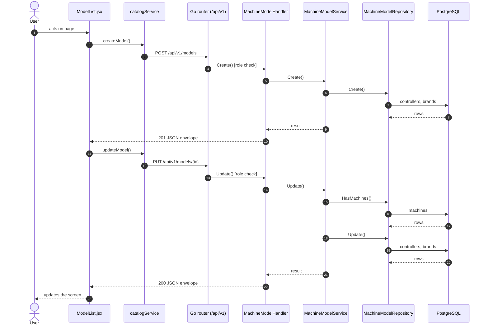

# Machine models

- **Route:** `/masters/models` · **Component:** [ModelList.jsx](../../src/pages/Models/ModelList.jsx) · **Auth:** protected (superadmin) · **Guard/Layout:** `ProtectedRoute` (session) + role guard · `MainLayout`
- **Purpose:** Machine catalog: machine models of a controller (superadmin).
- **Navigation:** Sidebar › System › Account Center → **Machine Catalog** tab → **Models** tab (second tab row: Brands, Controllers, Models; [AccountCenterPage.jsx](../../src/pages/AccountCenter/AccountCenterPage.jsx): page header + tabs (only the ones the role may open), this screen is the tab body; the tab is the route)

## On page load

**Steps**

1. [ModelList.jsx](../../src/pages/Models/ModelList.jsx) → useEffect(): runs on load `getControllers()`
2. [catalogService.js](../../src/services/catalogService.js) → getControllers(): calls `GET /api/v1/controllers`
3. [controller_routes.go](../../../7th-sense-server/internal/routes/controller_routes.go) → `GET /v1/controllers` → ControllerHandler.GetAll
4. [controller_handler.go](../../../7th-sense-server/internal/handler/controller_handler.go) → GetAll(): query brandId; calls the service
5. [controller_service.go](../../../7th-sense-server/internal/service/controller_service.go) → GetAll(): Returns the controllers. A non-nil brandID keeps only that brand's controllers.
6. [controller_repository.go](../../../7th-sense-server/internal/repository/controller_repository.go) → FindAll(): reads / writes `controllers`, `brands`
7. [ModelList.jsx](../../src/pages/Models/ModelList.jsx) → useEffect(): runs on load `getModels()`
8. [catalogService.js](../../src/services/catalogService.js) → getModels(): calls `GET /api/v1/models`
9. [machine_model_routes.go](../../../7th-sense-server/internal/routes/machine_model_routes.go) → `GET /v1/models` → MachineModelHandler.GetAll
10. [machine_model_handler.go](../../../7th-sense-server/internal/handler/machine_model_handler.go) → GetAll(): query controllerId; calls the service
11. [machine_model_service.go](../../../7th-sense-server/internal/service/machine_model_service.go) → GetAll(): Returns the models. A non-nil controllerID keeps only that controller's models.
12. [machine_model_repository.go](../../../7th-sense-server/internal/repository/machine_model_repository.go) → FindAll(): reads / writes `controllers`, `brands`

## Delete model

**Sequence diagram**

**Steps**

1. [ModelList.jsx](../../src/pages/Models/ModelList.jsx) → confirmDelete(): runs `deleteModel()`
2. [catalogService.js](../../src/services/catalogService.js) → deleteModel(): calls `DELETE /api/v1/models/{id}`
3. [machine_model_routes.go](../../../7th-sense-server/internal/routes/machine_model_routes.go) → `DELETE /v1/models/{id}` (superAdminOnly) → MachineModelHandler.Delete
4. [machine_model_handler.go](../../../7th-sense-server/internal/handler/machine_model_handler.go) → Delete(): reads {id}; calls the service
5. [machine_model_service.go](../../../7th-sense-server/internal/service/machine_model_service.go) → Delete(): Soft-deletes the model. A model used by machines is kept.
6. [machine_model_repository.go](../../../7th-sense-server/internal/repository/machine_model_repository.go) → HasMachines(): reads / writes `machines`
7. [machine_model_repository.go](../../../7th-sense-server/internal/repository/machine_model_repository.go) → Delete(): runs its SQL

**Rules & edge cases**

- Superadmin only (server `superAdminOnly`, others 403).

## Save model (add / edit form)

**Sequence diagram**

**Steps**

1. [ModelFormModal.jsx](../../src/pages/Models/ModelFormModal.jsx) → onSubmit(): runs `createModel()`
2. [catalogService.js](../../src/services/catalogService.js) → createModel(): calls `POST /api/v1/models`
3. [machine_model_routes.go](../../../7th-sense-server/internal/routes/machine_model_routes.go) → `POST /v1/models` (superAdminOnly) → MachineModelHandler.Create
4. [machine_model_handler.go](../../../7th-sense-server/internal/handler/machine_model_handler.go) → Create(): decodes `dto.MachineModelRequest` and runs its Validate(); calls the service
5. [machine_model_service.go](../../../7th-sense-server/internal/service/machine_model_service.go) → Create(): 
6. [machine_model_repository.go](../../../7th-sense-server/internal/repository/machine_model_repository.go) → Create(): reads / writes `controllers`, `brands`
7. [ModelFormModal.jsx](../../src/pages/Models/ModelFormModal.jsx) → onSubmit(): runs `updateModel()`
8. [catalogService.js](../../src/services/catalogService.js) → updateModel(): calls `PUT /api/v1/models/{id}`
9. [machine_model_routes.go](../../../7th-sense-server/internal/routes/machine_model_routes.go) → `PUT /v1/models/{id}` (superAdminOnly) → MachineModelHandler.Update
10. [machine_model_handler.go](../../../7th-sense-server/internal/handler/machine_model_handler.go) → Update(): reads {id}; decodes `dto.MachineModelRequest` and runs its Validate(); calls the service
11. [machine_model_service.go](../../../7th-sense-server/internal/service/machine_model_service.go) → Update(): Replaces the model's controller and name. Its controller cannot change while machines use it, because each machine stores the controller of its model.
12. [machine_model_repository.go](../../../7th-sense-server/internal/repository/machine_model_repository.go) → HasMachines(): reads / writes `machines`
13. [machine_model_repository.go](../../../7th-sense-server/internal/repository/machine_model_repository.go) → Update(): reads / writes `controllers`, `brands`

**Rules & edge cases**

- Superadmin only (server `superAdminOnly`, others 403).
- Server validation (`dto.MachineModelRequest.Validate`): Please select controller; Please enter valid name.

## UI states

- **Loading:** `<Loader>` while the request runs.
- **Error:** a red `<Alert>` with the server message (some pages add Retry).
- **Success / failure of an action:** toast message (`utils/toast.js`).
- **Empty:** an empty-state message instead of the table / chart.
- **Delete:** asks for confirmation first.

## API calls on this page

| Method | Endpoint | Triggered by (section) | API docs |
|---|---|---|---|
| DELETE | `/api/v1/models/{id}` | Delete model | [Swagger](http://localhost:8080/api-docs/index.html#/Machine%20catalog/deleteModel) · [openapi.yaml](../../../7th-sense-server/docs/api/openapi.yaml) |
| GET | `/api/v1/controllers` | On page load | [Swagger](http://localhost:8080/api-docs/index.html#/Machine%20catalog/getControllers) · [openapi.yaml](../../../7th-sense-server/docs/api/openapi.yaml) |
| GET | `/api/v1/models` | On page load | [Swagger](http://localhost:8080/api-docs/index.html#/Machine%20catalog/getModels) · [openapi.yaml](../../../7th-sense-server/docs/api/openapi.yaml) |
| POST | `/api/v1/models` | Save model (add / edit form) | [Swagger](http://localhost:8080/api-docs/index.html#/Machine%20catalog/createModel) · [openapi.yaml](../../../7th-sense-server/docs/api/openapi.yaml) |
| PUT | `/api/v1/models/{id}` | Save model (add / edit form) | [Swagger](http://localhost:8080/api-docs/index.html#/Machine%20catalog/updateModel) · [openapi.yaml](../../../7th-sense-server/docs/api/openapi.yaml) |

## State & storage

- Local component state (`useState`) for filters, form and modal

## Shared components used

[ConfirmModal.jsx](../../src/components/common/ConfirmModal.jsx), [Loader.jsx](../../src/components/common/Loader.jsx), [TablePagination.jsx](../../src/components/common/TablePagination.jsx), [SortableHead.jsx](../../src/components/common/SortableHead.jsx), [IconAction.jsx](../../src/components/common/IconAction.jsx), [FieldLabel.jsx](../../src/components/common/FieldLabel.jsx)

## Decisions

- [ADR 0011: tabbed page](../adr/0011-business-setup-tabbed-page.md), [ADR 0014: renamed Account Center](../adr/0014-account-center.md)
- [Client ADR index](../adr/README.md)
