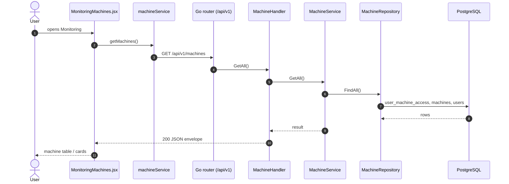

# Monitoring › Machines

- **Route:** `/monitoring` · **Component:** [MonitoringMachines.jsx](../../src/pages/Monitoring/MonitoringMachines.jsx) inside [MonitoringPage.jsx](../../src/pages/Monitoring/MonitoringPage.jsx) · **Auth:** protected (every logged-in role) · **Guard/Layout:** `ProtectedRoute` (session) + role guard · `MainLayout`
- **Purpose:** The first Monitoring tab. It lists the machines the user may see (table or cards) with the mode each one is in now, and offers only **Productivity** and **Health** for each. Machine set-up (add, edit, delete) is on [All Machines](machine-list.md).
- **Navigation:** Sidebar › Operations › Monitoring → **Machines** tab → Productivity ([productivity.md](productivity.md)) / Health ([machine-health.md](machine-health.md))

## On page load

**Steps**

1. [MonitoringMachines.jsx](../../src/pages/Monitoring/MonitoringMachines.jsx) → [useMachines.js](../../src/pages/Machines/useMachines.js) `({ refreshMs: MONITOR_REFRESH_MS })` → useEffect(): runs `getMachines()` on load (and on Retry), then again every 30 s in the background so the mode and connection stay current. A failed background reload keeps the last list.
2. [machineService.js](../../src/services/machineService.js) → getMachines(): calls `GET /api/v1/machines`
3. [machine_routes.go](../../../7th-sense-server/internal/routes/machine_routes.go) → `GET /v1/machines` → MachineHandler.GetAll
4. [machine_handler.go](../../../7th-sense-server/internal/handler/machine_handler.go) → GetAll(): calls the service
5. [machine_service.go](../../../7th-sense-server/internal/service/machine_service.go) → GetAll(): returns the machines the user may access (machineScope)
6. [machine_repository.go](../../../7th-sense-server/internal/repository/machine_repository.go) → FindAll(): reads `user_machine_access`, `machines`, `users`, `company_profiles`

What each view shows:

- **Cards** ([MonitorMachineCard.jsx](../../src/pages/Monitoring/MonitorMachineCard.jsx)): an Active / Inactive strip on the left (green / red bar). Next to it, a machine picture with a "Machine # id" tab underneath; machines have no photo, so this is [MachineSilhouette.jsx](../../src/pages/Monitoring/MachineSilhouette.jsx), coloured by the theme. A red dot marks an offline machine (`onlineStatus` false). On the right: the name, model, brand and controller, the customer (superadmin only), and the current mode (`modeId`, shown with [MachineMode.jsx](../../src/pages/Machines/MachineMode.jsx): a bar in the `--ts-mode-*` colour plus the `MACHINE_MODE_TYPES` label, hidden when the mode is unknown). Last come the Health and Productivity links. There are no set-up actions.
- **Table:** the All Machines columns plus a **Mode** column (sortable by mode name, "—" when unknown) and the Productivity / Health icons.

The list is [MachineBrowser.jsx](../../src/pages/Machines/MachineBrowser.jsx), the same component All Machines uses. It handles search (here also by the current mode, e.g. "Idle", because `showMode` is on), the customer filter (superadmin only), sorting, paging and the table / card view. All of this runs in the browser; no further API calls.

## Open productivity / health

Table: the Productivity and Health icons in the Actions column. Cards: the Productivity and Health buttons in the footer. Each one navigates to `/monitoring/productivity?machineId=<id>` or `/monitoring/health?machineId=<id>` (`machineMonitorPath` in [monitoring.js](../../src/constants/monitoring.js)). That tab then loads the machine as described in its own page doc.

## UI states

- **Loading:** `<Loader>` while the machines load.
- **Error:** a red `<Alert>` with the server message and Retry.
- **Empty:** "No machines to monitor yet." (or "No machines match these filters.").

## Rules & edge cases

- Every role sees this tab, but only for the machines the server returns them. There is no Add, Edit or Delete here.
- The mode is the `machines.mode_id` the CNC collector last wrote (`GET /machines` returns it as `modeId`). It is as fresh as the last 30-second reload.
- The Machines tab link drops `?machineId`; the Productivity / Health tab links keep it.

## API calls on this page

| Method | Endpoint | Triggered by (section) | API docs |
|---|---|---|---|
| GET | `/api/v1/machines` | On page load | [Swagger](http://localhost:8080/api-docs/index.html#/Machines/getMachines) · [openapi.yaml](../../../7th-sense-server/docs/api/openapi.yaml) |

## State & storage

- `useAuth()` (superadmin: Customer column and filter)
- `localStorage` `ts.monitoring.view` (`STORAGE_KEYS.MONITORING_VIEW`): table or cards, via [useMachineView.js](../../src/pages/Machines/useMachineView.js)

## Shared components used

[MachineBrowser.jsx](../../src/pages/Machines/MachineBrowser.jsx) (`renderCard`, `showMode`), [MachineRow.jsx](../../src/pages/Machines/MachineRow.jsx), [MonitorMachineCard.jsx](../../src/pages/Monitoring/MonitorMachineCard.jsx), [MachineMode.jsx](../../src/pages/Machines/MachineMode.jsx), [MachineSilhouette.jsx](../../src/pages/Monitoring/MachineSilhouette.jsx), [MachineViewToggle.jsx](../../src/pages/Machines/MachineViewToggle.jsx), [IconAction.jsx](../../src/components/common/IconAction.jsx), [Loader.jsx](../../src/components/common/Loader.jsx), [SortableHead.jsx](../../src/components/common/SortableHead.jsx), [TablePagination.jsx](../../src/components/common/TablePagination.jsx), [StatusBadge.jsx](../../src/components/common/StatusBadge.jsx)

## Decisions

- [ADR 0012](../adr/0012-monitoring-tabbed-page.md) (tabbed page), [ADR 0013](../adr/0013-monitoring-machine-list.md) (machine list first; set-up kept on All Machines)
