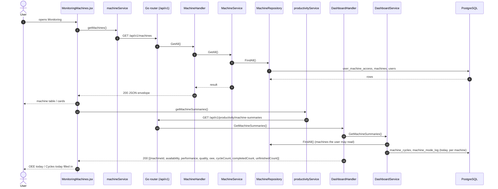

# Monitoring (machine list)

- **Route:** `/monitoring` · **Component:** [MonitoringMachines.jsx](../../src/pages/Monitoring/MonitoringMachines.jsx) inside [MonitoringPage.jsx](../../src/pages/Monitoring/MonitoringPage.jsx) · **Auth:** protected (every logged-in role) · **Guard/Layout:** `ProtectedRoute` (session) + role guard · `MainLayout`
- **Purpose:** The main Monitoring screen (no tabs). It lists the machines the user may see (table or cards) with the mode each one is in now and today's OEE and cycles, and offers only **Productivity** and **Health** for each. Machine set-up (add, edit, delete) is on [All Machines](machine-list.md).
- **Navigation:** Sidebar › Operations › **Monitoring** (its own item, no submenu) → a machine's Productivity / Health → that machine's view with Productivity ([productivity.md](productivity.md)), Machine Health ([machine-health.md](machine-health.md)) and Tool List / Tool Life / Virtual Screen ([machine-tools-virtual-screen.md](machine-tools-virtual-screen.md)) tabs and a **Machine list** back arrow to return here. Page header "Operations · Monitoring" with the table / cards toggle.

## On page load

**Steps**

1. [MonitoringMachines.jsx](../../src/pages/Monitoring/MonitoringMachines.jsx) → [useMachines.js](../../src/pages/Machines/useMachines.js) `({ refreshMs: MONITOR_REFRESH_MS })` → useEffect(): runs `getMachines()` on load (and on Retry), then again every 30 s in the background so the mode and connection stay current. A failed background reload keeps the last list.
2. [machineService.js](../../src/services/machineService.js) → getMachines(): calls `GET /api/v1/machines`
3. [machine_routes.go](../../../7th-sense-server/internal/routes/machine_routes.go) → `GET /v1/machines` → MachineHandler.GetAll
4. [machine_handler.go](../../../7th-sense-server/internal/handler/machine_handler.go) → GetAll(): calls the service
5. [machine_service.go](../../../7th-sense-server/internal/service/machine_service.go) → GetAll(): returns the machines the user may access (machineScope)
6. [machine_repository.go](../../../7th-sense-server/internal/repository/machine_repository.go) → FindAll(): reads `user_machine_access`, `machines`, `users`, `company_profiles`
7. [MonitoringMachines.jsx](../../src/pages/Monitoring/MonitoringMachines.jsx) → useLoad(): `getMachineSummaries()` on load and every 30 s ([productivityService.js](../../src/services/productivityService.js) → `GET /api/v1/productivity/machine-summaries`), kept as a Map by machine id. A failed load only leaves OEE / cycles as "—".
8. [dashboard_routes.go](../../../7th-sense-server/internal/routes/dashboard_routes.go) → [dashboard_handler.go](../../../7th-sense-server/internal/handler/dashboard_handler.go) GetMachineSummaries(): checks the optional `date` (default today) → [dashboard_service.go](../../../7th-sense-server/internal/service/dashboard_service.go) GetMachineSummaries(): every machine the user may read (`MachineService.GetAll`); per machine the day's cycles (`summarizeCycles`: total / completed / unfinished) and OEE (`machineDayOEE`, the same rules as `GET /productivity/oee` for one machine over the whole day, no shifts)

What each view shows:

- **Cards** ([MonitorMachineCard.jsx](../../src/pages/Monitoring/MonitorMachineCard.jsx)): an Active / Inactive strip on the left (green / red bar). Next to it, a machine picture with a "Machine # id" tab underneath; machines have no photo, so this is [MachineSilhouette.jsx](../../src/pages/Monitoring/MachineSilhouette.jsx), coloured by the theme. A red dot marks an offline machine (`onlineStatus` false). On the right: the name, model, brand and controller, the customer (superadmin only), and the current mode (`modeId`, shown with [MachineMode.jsx](../../src/pages/Machines/MachineMode.jsx): a bar in the `--ts-mode-*` colour plus the `MACHINE_MODE_TYPES` label, hidden when the mode is unknown). Last come the Health and Productivity links. There are no set-up actions.
- **Cards** also show **OEE today** and **Cycles today** (same values as the table).
- **Table** ([MonitorMachineRow.jsx](../../src/pages/Monitoring/MonitorMachineRow.jsx), columns `monitorColumns` in [monitorTable.js](../../src/pages/Monitoring/monitorTable.js)): compact, stacked cells so it fits the page without sideways scroll (below tablet width the table still scrolls). Columns: **Machine** (name; `# id · line` underneath), **Customer** (superadmin), **Model** (model; brand · controller underneath), **Mode** ("—" when unknown), **OEE today** (OEE % with a bar: green from the world-class 85 %, amber from 60 %, red below; Availability / Performance / Quality as `A · P · Q` columns underneath; "—" before any planned time or closed cycle), **Cycles today** (total with a completed / unfinished split bar; a "● n completed ● n unfinished" legend underneath, [MachineMetrics.jsx](../../src/pages/Monitoring/MachineMetrics.jsx)), **Status** (Online / Offline; an Inactive badge under it for an inactive machine), then the Productivity / Health icons. Every column but Actions sorts (OEE / cycles: machines without a value last). Serial number and installation date are not shown here (All Machines has them; the search still finds the serial).

The list is [MachineBrowser.jsx](../../src/pages/Machines/MachineBrowser.jsx), the same component All Machines uses. It handles search (here also by the current mode, e.g. "Idle", because `showMode` is on), the customer filter (superadmin only), sorting, paging and the table / card view; this page brings its own table (`tableColumns` / `renderRow`). All of this runs in the browser; no further API calls.

## Open productivity / health

Table: the Productivity and Health icons in the Actions column. Cards: the Productivity and Health buttons in the footer. Each one navigates to `/monitoring/<id>/productivity` or `/monitoring/<id>/health` (`machineMonitorPath` in [monitoring.js](../../src/constants/monitoring.js)). [MonitoringPage.jsx](../../src/pages/Monitoring/MonitoringPage.jsx) sees the `:machineId` and shows [MonitoringMachine.jsx](../../src/pages/Monitoring/MonitoringMachine.jsx) instead of this list: the machine header, the back arrow and the tabs, then the tab screen as described in its own page doc.

## UI states

- **Loading:** `<Loader>` while the machines load.
- **Error:** a red `<Alert>` with the server message and Retry.
- **Empty:** "No machines to monitor yet." (or "No machines match these filters.").

## Rules & edge cases

- Every role sees this screen, but only for the machines the server returns them. There is no Add, Edit or Delete here.
- The mode is the `machines.mode_id` the CNC collector last wrote (`GET /machines` returns it as `modeId`). It is as fresh as the last 30-second reload.
- OEE / cycles today cover the whole calendar day (server time zone) up to now, not shifts; the machine's Productivity tab has the shift and program filters.
- The machine view's tabs keep the machine (`/monitoring/<id>/…`); the **Machine list** button goes back to `/monitoring`. A machine the user cannot read shows "Machine not found" with a link back.

## API calls on this page

| Method | Endpoint | Triggered by (section) | API docs |
|---|---|---|---|
| GET | `/api/v1/machines` | On page load | [Swagger](http://localhost:8080/api-docs/index.html#/Machines/getMachines) · [openapi.yaml](../../../7th-sense-server/docs/api/openapi.yaml) |
| GET | `/api/v1/productivity/machine-summaries` | On page load (every 30 s) | [Swagger](http://localhost:8080/api-docs/index.html#/Productivity/getMachineSummaries) · [openapi.yaml](../../../7th-sense-server/docs/api/openapi.yaml) |

## State & storage

- `useAuth()` (superadmin: Customer column and filter)
- `localStorage` `ts.monitoring.view` (`STORAGE_KEYS.MONITORING_VIEW`): table or cards, via [useMachineView.js](../../src/pages/Machines/useMachineView.js)

## Shared components used

[MachineBrowser.jsx](../../src/pages/Machines/MachineBrowser.jsx) (`renderCard`, `tableColumns`, `renderRow`, `showMode`), [MonitorMachineRow.jsx](../../src/pages/Monitoring/MonitorMachineRow.jsx), [MachineMetrics.jsx](../../src/pages/Monitoring/MachineMetrics.jsx), [MonitorMachineCard.jsx](../../src/pages/Monitoring/MonitorMachineCard.jsx), [MachineMode.jsx](../../src/pages/Machines/MachineMode.jsx), [MachineSilhouette.jsx](../../src/pages/Monitoring/MachineSilhouette.jsx), [MachineViewToggle.jsx](../../src/pages/Machines/MachineViewToggle.jsx), [IconAction.jsx](../../src/components/common/IconAction.jsx), [Loader.jsx](../../src/components/common/Loader.jsx), [SortableHead.jsx](../../src/components/common/SortableHead.jsx), [TablePagination.jsx](../../src/components/common/TablePagination.jsx), [StatusBadge.jsx](../../src/components/common/StatusBadge.jsx)

## Decisions

- [ADR 0019](../adr/0019-monitoring-machine-view.md) (machine list, then the machine's tabs with a back arrow; replaces [ADR 0012](../adr/0012-monitoring-tabbed-page.md) / [0013](../adr/0013-monitoring-machine-list.md); set-up stays on All Machines)
