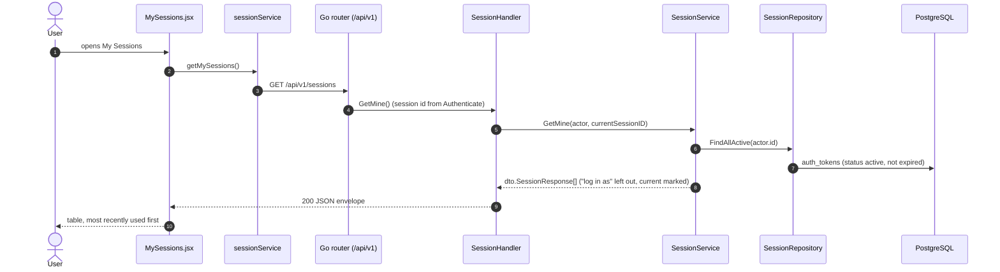
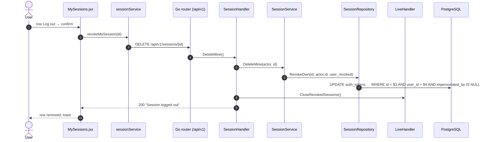

# My sessions

- **Route:** `/my-sessions` · **Component:** [MySessions.jsx](../../src/pages/Sessions/MySessions.jsx) · **Auth:** protected (every logged-in role) · **Guard/Layout:** `ProtectedRoute` · `MainLayout`
- **Purpose:** See the devices where your account is signed in and log out one of them, or all but this one.
- **Navigation:** Sidebar System › My Sessions

## On page load

**Steps**

1. [MySessions.jsx](../../src/pages/Sessions/MySessions.jsx) → useEffect: loads the list (Retry on error)
2. [sessionService.js](../../src/services/sessionService.js) → getMySessions(): `GET /api/v1/sessions`
3. [session_routes.go](../../../7th-sense-server/internal/routes/session_routes.go) → `GET /v1/sessions` → SessionHandler.GetMine
4. [session_handler.go](../../../7th-sense-server/internal/handler/session_handler.go) → GetMine(): the user and `middleware.SessionID` of the request
5. [session_service.go](../../../7th-sense-server/internal/service/session_service.go) → GetMine(): drops "log in as" sessions (except the current one), marks `isCurrent`
6. [session_repository.go](../../../7th-sense-server/internal/repository/session_repository.go) → FindAllActive(); [session_dto.go](../../../7th-sense-server/internal/dto/session_dto.go) → NewSessionResponse(): device = browser + OS from the user agent

## Log out one session

**Steps**

1. [SessionTable.jsx](../../src/pages/Sessions/SessionTable.jsx): Log out icon on every row but the current one
2. [MySessions.jsx](../../src/pages/Sessions/MySessions.jsx) → confirmRevoke(): `ConfirmModal`, then the call; on an error (404: it ended meanwhile) a toast and the list reloads
3. [session_handler.go](../../../7th-sense-server/internal/handler/session_handler.go) → DeleteMine() → [session_service.go](../../../7th-sense-server/internal/service/session_service.go) → DeleteMine(): not found → 404 "Session not found"
4. [session_repository.go](../../../7th-sense-server/internal/repository/session_repository.go) → RevokeOwn(): ownership in the WHERE clause; status revoked, soft-deleted, `revoked_by` = the user
5. [live_handler.go](../../../7th-sense-server/internal/handler/live_handler.go) → CloseRevokedSessions(): that browser's sockets get `session:expired` and close; its next request answers 401 `session_revoked` ([app-shell.md](app-shell.md#session-ended))

## Log out all other sessions

Same flow with the header button: `revokeMyOtherSessions()` → `DELETE /api/v1/sessions/others` → SessionService.DeleteMyOthers → SessionRepository.RevokeOthers (every active password-login session of the user but the current one) → `{revoked}`; the table keeps only this session.

**Rules & edge cases**

- Another user's session id, a "log in as" session or one already ended answers 404, never 403.
- The current session has no Log out icon: it ends with the normal Log out ([app-shell.md](app-shell.md)).
- "Log in as" sessions the superadmin opened on this account are not listed and not logged out here.
- No location: the server does no IP lookup (shown as unavailable in the subtitle).

## UI states

- **Loading:** `<Loader>`. **Error:** red `<Alert>` with Retry.
- **Search with no hits:** `TableNoResults` with Clear filters. "Log out all other sessions" is disabled when there is no other session.
- **Confirm:** `ConfirmModal` (busy while the request runs); success / failure toasts.

## API calls on this page

| Method | Endpoint | Triggered by (section) | API docs |
|---|---|---|---|
| GET | `/api/v1/sessions` | On page load | [Swagger](http://localhost:8080/api-docs/index.html#/Sessions/getMySessions) · [openapi.yaml](../../../7th-sense-server/docs/api/openapi.yaml) |
| DELETE | `/api/v1/sessions/{id}` | Log out one session | [Swagger](http://localhost:8080/api-docs/index.html#/Sessions/revokeMySession) · [openapi.yaml](../../../7th-sense-server/docs/api/openapi.yaml) |
| DELETE | `/api/v1/sessions/others` | Log out all other sessions | [Swagger](http://localhost:8080/api-docs/index.html#/Sessions/revokeMyOtherSessions) · [openapi.yaml](../../../7th-sense-server/docs/api/openapi.yaml) |

## State & storage

- Local state: `sessions`, `pendingRevoke` (a session or `'others'`), `revoking`; the table keeps search, sort and page.

## Shared components used

[SessionTable.jsx](../../src/pages/Sessions/SessionTable.jsx) (with [SortableHead.jsx](../../src/components/common/SortableHead.jsx), [TablePagination.jsx](../../src/components/common/TablePagination.jsx), [TableNoResults.jsx](../../src/components/common/TableNoResults.jsx), [IconAction.jsx](../../src/components/common/IconAction.jsx)), [ConfirmModal.jsx](../../src/components/common/ConfirmModal.jsx), [Loader.jsx](../../src/components/common/Loader.jsx)

## Decisions

- Rows stay in the server's order (most recently used first), not `newestFirst`: when a device was last active matters more than when it logged in.
- Server [ADR 0014](../../../7th-sense-server/docs/adr/0014-session-modes-and-login-conflict.md), client [ADR 0027](../adr/0027-session-codes-and-conflict-modal.md)
