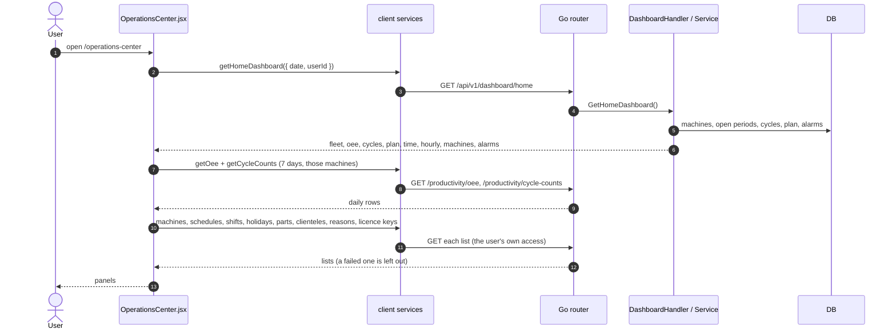

# Operations Center

- **Route:** `/operations-center` · **Component:** [OperationsCenter.jsx](../../src/pages/OperationsCenter/OperationsCenter.jsx) · **Auth:** protected (every logged-in role) · **Guard/Layout:** `ProtectedRoute` (session) · `MainLayout`
- **Purpose:** One screen to see how the plant runs and decide what to do first: live fleet, OEE and its biggest loss, a ranked action queue, every machine by line, 7-day trends, the production plan, alarms and readiness. Sits beside [Home](home.md) for comparison ([ADR 0024](../adr/0024-operations-center-beside-home.md)).
- **Navigation:** Sidebar › Main › **Operations Center**. Tiles and rows open [Monitoring](monitoring-machines.md), a machine's [Productivity](productivity.md), the schedule or the master screen concerned.

## On page load

1. [OperationsCenter.jsx](../../src/pages/OperationsCenter/OperationsCenter.jsx) → `useLoad(getHomeDashboard)`: [dashboardService.js](../../src/services/dashboardService.js); `date` is sent only for a picked past day, so the page follows the server's today. Reloaded every `MONITOR_REFRESH_MS` (30 s) on today.
2. [dashboard_handler.go](../../../7th-sense-server/internal/handler/dashboard_handler.go) → GetHomeDashboard(), [dashboard_service.go](../../../7th-sense-server/internal/service/dashboard_service.go) → GetHomeDashboard(): see [home.md](home.md#on-page-load).
3. [OperationsCenter.jsx](../../src/pages/OperationsCenter/OperationsCenter.jsx) → second `useLoad`: [productivityService.js](../../src/services/productivityService.js) `getOee()` + `getCycleCounts()` for the machines and day the server answered with, `TREND_DAYS` (7) days. Reloaded every `SLOW_REFRESH_MS` (5 min) on today.
4. [OperationsCenter.jsx](../../src/pages/OperationsCenter/OperationsCenter.jsx) → third `useLoad`: the master lists, each `.catch` → null so its panel leaves it out. Licence keys only for `MANAGERS` (the route is `managersOnly`).
5. [operationsSettings.js](../../src/pages/OperationsCenter/operationsSettings.js) → `buildActions()`, `buildReadiness()`, `floorGroups()`, `dayOffName()`, `currentShift()`: work the panels out from those responses.

## What the screen shows

| Panel | Data | Notes |
|---|---|---|
| Pulse | `oee`, day before from the trend | OEE, change in points against the day before (a whole day, labelled), A · P · Q bars, biggest loss = lowest factor |
| Fleet tiles | `fleet`, `cycles`, `machines`, `plan` | Online, Producing (+ Rapid Mode), Downtime or Hold now, Cycles, Machines with a job, Parts ("No part count from the controllers" at 0) |
| Action queue | `machines`, `alarms`, `fleet` | See below; top `ACTION_LIMIT` (8) |
| Shop floor | `machines` + line from `GET /machines` | A tile per machine by line (customer · line for the superadmin on all customers), mode colour, time in mode, OEE, cycles; mode chips and search |
| OEE trend, Cycles per day | `/productivity/oee`, `/productivity/cycle-counts` | Same rules as Productivity |
| Where the time went, Lowest OEE, Top alarms | `time`, `machines`, `alarms` | The Home cards |
| Production plan | `machines` with `plannedQuantity`, schedules | Completed cycles against quantity (as the Virtual Screen's batch progress), least done first; `PLAN_LIMIT` (8) |
| Parts per hour | `hourly` | Only when any part count arrived |
| Readiness | machines, licences, shifts + counts | Warranties and licences ended or ending within 30 days, maintenance flag, machines without a line, no shift, no job; counts link to the master screens |
| Header | shifts, holidays | Current shift chip and a holiday / week off note, only with one company in view |

### Action queue rules

| Severity | Row | Rule |
|---|---|---|
| Critical | Offline with a job scheduled | `plannedQuantity` set and not online |
| Critical / Warning | In Downtime / Hold | In the mode for `ATTENTION_MINUTES` (15) or more, the Home rule |
| Warning | Low OEE | The 3 lowest below `FAIR_OEE` (60 %), online, with the biggest loss |
| Warning | Unfinished cycles | At least 3 closed, `UNFINISHED_WARNING` (10 %) or more unfinished |
| Warning | Alarm repeated | Raised 3 times or more |
| Warning | Machines offline | One row: offline without a job |
| Info | Producing without a schedule | One row: only when some machine has a job |
| Info | Awaiting data | One row: no mode collected yet |

On a past day only low OEE, unfinished cycles and alarms are listed: where a machine is now says nothing about that day.

## Change the date or the customer

The date field (not after today) and, for the superadmin, the customer select change the query: the three loads run again (same flow as above). Picking today again clears the picked date. The floor map's mode chips and search work on the loaded rows, with no request.

## UI states

- **Loading:** `<Loader>`; charts say "Loading…" while their data arrives.
- **Dashboard failed:** red alert with Retry; **a later refresh failed:** amber note, the last data stays.
- **Another list failed:** its panel, tile or alert is left out; a trend chart shows the message.
- **No active machine:** empty state with Add a machine for managers.
- **Nothing to act on:** "Nothing needs action right now."

## Rules & edge cases

- Every role sees only the machines the server returns; the superadmin can narrow to one customer. No new access rules on this page.
- Nothing is estimated: figures are the server's or plain counts of its rows. The one calculation added is the change against the day before, and cycles / quantity.
- Part counts are unreliable, so plan progress uses completed cycles and no "behind plan" alarm is raised from parts.
- Dates use the day the server answered with. After midnight the page moves on at the next refresh.
- The floor map's line comes from `GET /machines`; until that loads, or if it fails, machines show under "No line".
- The licence row links only for the superadmin, who alone can open that screen.
- Shift and holiday are shown only with one company in view; several companies have different ones. Machine times use the browser's time zone, like Home.

## API calls on this page

| Method | Path | When | Docs |
|---|---|---|---|
| GET | `/api/v1/dashboard/home` | On load, on a date / customer change, every 30 s on today | [Swagger](http://localhost:8080/api-docs/index.html#/Dashboard/getHomeDashboard) · [openapi.yaml](../../../7th-sense-server/docs/api/openapi.yaml) |
| GET | `/api/v1/productivity/oee` | After the dashboard, every 5 min on today | [Swagger](http://localhost:8080/api-docs/index.html#/Productivity/getOee) · [openapi.yaml](../../../7th-sense-server/docs/api/openapi.yaml) |
| GET | `/api/v1/productivity/cycle-counts` | With the OEE | [Swagger](http://localhost:8080/api-docs/index.html#/Productivity/getCycleCounts) · [openapi.yaml](../../../7th-sense-server/docs/api/openapi.yaml) |
| GET | `/api/v1/machines`, `/production-schedules`, `/shifts`, `/holidays`, `/parts`, `/clienteles`, `/downtime-reasons` | On load, on a customer change, every 5 min | [openapi.yaml](../../../7th-sense-server/docs/api/openapi.yaml) |
| GET | `/api/v1/licence-keys` | With those, `MANAGERS` only | [openapi.yaml](../../../7th-sense-server/docs/api/openapi.yaml) |

## State & storage

- `pickedDate` (empty = today), `customerId` (superadmin), floor map chip and search in component state; nothing stored.
- Three `useLoad` states: live, trends, set-up.

## Shared components used

[ChartCard](../../src/components/charts/ChartCard.jsx), [LineTrendChart](../../src/components/charts/LineTrendChart.jsx), [StackedBarChart](../../src/components/charts/StackedBarChart.jsx), [ChartDateFilter](../../src/components/charts/ChartDateFilter.jsx), [SortableHead](../../src/components/common/SortableHead.jsx), [Loader](../../src/components/common/Loader.jsx), [NoResults](../../src/components/common/TableNoResults.jsx); from Home: [HomeCards.jsx](../../src/pages/Home/HomeCards.jsx), [HomeLists.jsx](../../src/pages/Home/HomeLists.jsx), [homeSettings.js](../../src/pages/Home/homeSettings.js)

## Decisions

- [ADR 0024](../adr/0024-operations-center-beside-home.md): a second dashboard beside Home, on the existing APIs
