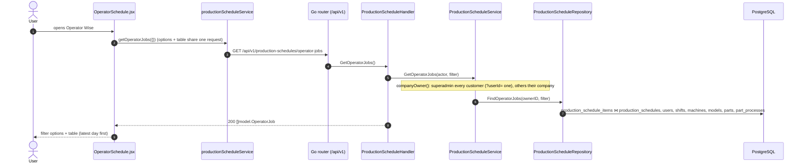
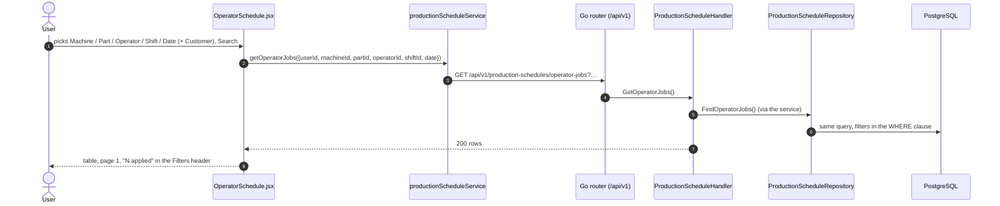

# Operator wise production schedule

- **Route:** `/production/operator-schedule` · **Component:** [OperatorSchedule.jsx](../../src/pages/ProductionSchedules/OperatorSchedule.jsx) · **Auth:** protected (every logged-in role) · **Guard/Layout:** `ProtectedRoute` (session) · `MainLayout`
- **Purpose:** Every scheduled job as one row — who runs which job, when, on which machine, with which part and program. Read only.
- **Navigation:** Sidebar › Masters → Production Schedule → Operator Wise

## On page load

**Steps**

1. [OperatorSchedule.jsx](../../src/pages/ProductionSchedules/OperatorSchedule.jsx): the superadmin's customer list (`GET /users?filterRole=customer`), the option jobs (unfiltered, for the picked customer) and the table jobs (the applied filters); the first two job loads are the same URL, so `sharedGet` sends one request
2. [productionScheduleService.js](../../src/services/productionScheduleService.js) → getOperatorJobs(): `GET /api/v1/production-schedules/operator-jobs` with the filters as query
3. [production_schedule_routes.go](../../../7th-sense-server/internal/routes/production_schedule_routes.go) → `GET /v1/production-schedules/operator-jobs` (every logged-in user) → ProductionScheduleHandler.GetOperatorJobs
4. [production_schedule_handler.go](../../../7th-sense-server/internal/handler/production_schedule_handler.go) → readOperatorJobFilter(): ids as positive integers, `dto.OperatorJobFilter.Validate()` (date `YYYY-MM-DD`)
5. [production_schedule_service.go](../../../7th-sense-server/internal/service/production_schedule_service.go) → GetOperatorJobs(): `companyOwner` (same access as the schedule list)
6. [production_schedule_repository.go](../../../7th-sense-server/internal/repository/production_schedule_repository.go) → FindOperatorJobs(): one row per item not deleted of a schedule not deleted; latest day first, then in the order the jobs run (a night shift's jobs before its start time — 02:00 in a 22:00–06:00 shift — come after its evening jobs)
7. [operatorScheduleSettings.js](../../src/pages/ProductionSchedules/operatorScheduleSettings.js) → filterOptions(): the Machine / Part / Operator / Shift options are the ones that have jobs

## Search (apply filters)

**Steps**

1. [OperatorSchedule.jsx](../../src/pages/ProductionSchedules/OperatorSchedule.jsx) → applyFilters(): `applied` = the form's `draft`; the table reloads. The filters apply only on Search
2. Changing the customer (superadmin) clears Machine / Part / Operator / Shift (they belong to the customer) and reloads their options
3. Reset (↺ button, or Clear filters in "no results") empties the filters and the search box and loads every job again
4. The search box narrows the loaded rows (date, operator, shift, job ID, machine, part, program, customer) without a request

**Rules & edge cases**

- Read only; every role. The server scopes the rows like the schedule list: the superadmin every customer's (Customer column), everyone else their company's; another company's `?userId=` answers 403.
- Every filter is optional; a wrong id or date answers 400 ("Please enter valid machineId", "Please enter valid date").
- Operators, supervisors and other non-managers cannot call `GET /users`, so the Operator list comes from the jobs the user may read, not from the user list.
- Columns: Sr. No. (position in the shown order), Date (DD-MM-YYYY), Operator, Shift, Job ID, Qty., Machine (machine - model), Period ("05:30 AM to 12:30 PM"), Part (part no. (name)), Program (the process's program name), Customer (superadmin).

## UI states

- **Loading:** `<Loader>`. **Error:** red `<Alert>` with Retry.
- **No jobs at all:** `.ts-empty` pointing to Production › Schedule. **Filters / search with no hits:** `TableNoResults` with Clear filters (resets the filters).

## API calls on this page

| Method | Endpoint | Triggered by (section) | API docs |
|---|---|---|---|
| GET | `/api/v1/production-schedules/operator-jobs` | On page load · Search | [Swagger](http://localhost:8080/api-docs/index.html#/Production%20schedules/getOperatorJobs) · [openapi.yaml](../../../7th-sense-server/docs/api/openapi.yaml) |
| GET | `/api/v1/users?filterRole=customer` | On page load (superadmin) | [Swagger](http://localhost:8080/api-docs/index.html#/Users/getUsers) · [openapi.yaml](../../../7th-sense-server/docs/api/openapi.yaml) |

## State & storage

- Local state: `draft` / `applied` filters, `optionJobs`, `jobs`, search, sort, page. `useOrgUser().customerLabel` names the Customer column.

## Shared components used

[DatePicker.jsx](../../src/components/common/DatePicker.jsx), [SortableHead.jsx](../../src/components/common/SortableHead.jsx), [TablePagination.jsx](../../src/components/common/TablePagination.jsx), [TableNoResults.jsx](../../src/components/common/TableNoResults.jsx), [Loader.jsx](../../src/components/common/Loader.jsx); row: [OperatorJobRow.jsx](../../src/pages/ProductionSchedules/OperatorJobRow.jsx)

## Decisions

- Rows keep the server's order (latest day, then as the jobs run) rather than `newestFirst`; any column can still be sorted.
- One flat endpoint instead of loading every schedule with its items: the filters run in SQL and the screen needs one request.
