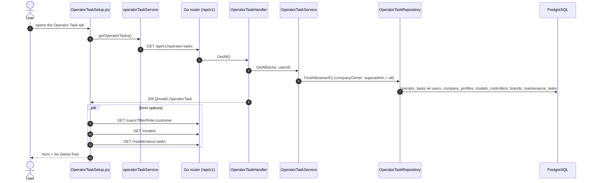

# Operator tasks

- **Route:** `/masters/operator-tasks` · **Component:** [OperatorTaskSetup.jsx](../../src/pages/OperatorTasks/OperatorTaskSetup.jsx) inside [AccountCenterPage.jsx](../../src/pages/AccountCenter/AccountCenterPage.jsx) · **Auth:** protected (superadmin) · **Guard/Layout:** `ProtectedRoute` + `roles: SUPERADMIN_ONLY` · `MainLayout`
- **Purpose:** The superadmin sets which checks an operator does on a customer's machines, per machine type (catalog model). The Add / Edit form sits beside the list.
- **Navigation:** System › Account Center → Operator Task tab → Operator Tasks sub-tab (beside [Task list](task-list.md), where the tasks themselves are managed)

## On page load



**Steps**

1. [OperatorTaskSetup.jsx](../../src/pages/OperatorTasks/OperatorTaskSetup.jsx): the list (Retry on error), and the form options — customers, machine types (catalog models) and tasks — each loaded alone (a failure shows a toast)
2. [operatorTaskService.js](../../src/services/operatorTaskService.js) → getOperatorTasks() / getMaintenanceTasks()
3. [operator_task_routes.go](../../../7th-sense-server/internal/routes/operator_task_routes.go) → `GET /v1/operator-tasks`, `GET /v1/maintenance-tasks` (every logged-in user)
4. [operator_task_service.go](../../../7th-sense-server/internal/service/operator_task_service.go) → GetAll(): `companyOwner`
5. [operator_task_repository.go](../../../7th-sense-server/internal/repository/operator_task_repository.go) → FindAll(); [maintenance_task_repository.go](../../../7th-sense-server/internal/repository/maintenance_task_repository.go) → FindAll()

## Save operator task (add / edit form)

```mermaid
sequenceDiagram
  autonumber
  actor User
  participant Form as OperatorTaskEditor.jsx
  participant operatorTaskService
  participant API as Go router (/api/v1)
  participant OperatorTaskHandler
  participant OperatorTaskService
  participant OperatorTaskRepository
  participant DB as PostgreSQL
  User->>Form: Customer, Machine Type (optional), Task → Save / Update
  Form->>operatorTaskService: createOperatorTask() / updateOperatorTask(id)
  operatorTaskService->>API: POST /operator-tasks · PUT /operator-tasks/{id} (superAdminOnly)
  API->>OperatorTaskHandler: Create() / Update() — dto Validate()
  OperatorTaskHandler->>OperatorTaskService: checkReferences(): customer, model, active task
  OperatorTaskService->>OperatorTaskRepository: Create() / Update(), then FindByID()
  OperatorTaskRepository->>DB: operator_tasks (unique customer + machine type + task)
  OperatorTaskHandler-->>Form: 201 / 200 model.OperatorTask
  Form-->>User: toast; the row is added on top / replaced
```

**Steps**

1. [OperatorTaskEditor.jsx](../../src/pages/OperatorTasks/OperatorTaskEditor.jsx) (named Editor, not Form: `operatorTaskForm.js` differs only in case and Windows would resolve one for the other): React Hook Form + Zod ([operatorTaskForm.js](../../src/pages/OperatorTasks/operatorTaskForm.js) `operatorTaskSchema`: customer and task required); Machine Type lists the catalog models grouped by "Brand · Controller", blank = All machines
2. After an add the form keeps the customer and machine type and clears the task, so several tasks are added in a row; Clear empties it. A row's Edit loads it into the form (title "Edit Operator Task", the row is highlighted); Update / Cancel
3. [operator_task_handler.go](../../../7th-sense-server/internal/handler/operator_task_handler.go) → Create() / Update(): `dto.CreateOperatorTaskRequest` / `UpdateOperatorTaskRequest`
4. [operator_task_service.go](../../../7th-sense-server/internal/service/operator_task_service.go) → checkReferences(), toOperatorTaskResponseError() (duplicate → "This task is already added for this customer and machine type")

## New task (add to the task list)

1. **New task** above the Task field opens an inset box; Enter or **Add** saves it, Esc or ✕ closes it
2. [operatorTaskForm.js](../../src/pages/OperatorTasks/operatorTaskForm.js) → findTask(): a description already in the list (ignoring case and extra spaces) is picked, no request
3. Otherwise `createMaintenanceTask()` → `POST /api/v1/maintenance-tasks` (superAdminOnly) → [maintenance_task_service.go](../../../7th-sense-server/internal/service/maintenance_task_service.go) → Create(); the new task joins the dropdown (sorted) and is picked
4. Errors ("This task already exists", "Task must be at most 100 characters") show under the box

## Delete operator task

Row Delete → `ConfirmModal` → `deleteOperatorTask(id)` → `DELETE /api/v1/operator-tasks/{id}` (superAdminOnly) → OperatorTaskService.Delete (soft delete) → the row leaves the list (and the form if it was being edited). The task stays in the task list.

**Rules & edge cases**

- Superadmin only, on the route and on every write endpoint; customers and their users can read their company's operator tasks through the API (for a future operator checklist), but have no screen.
- A task once per customer and machine type; "All machines" counts as its own type.
- The Task dropdown offers only active tasks ([Task list](task-list.md)); an edited row keeps its inactive task, marked "(inactive)". The server refuses an inactive task for a new operator task.
- The customer must be a customer, the machine type a catalog model, the task an active task of the list (server 400 otherwise, shown in the form's alert).

## UI states

- **Loading:** `<Loader>` in the list card. **Error:** red `<Alert>` with Retry. **No operator tasks:** `.ts-empty`.
- **Search / customer filter with no hits:** `TableNoResults` with Clear filters.
- **Saving:** spinner in Save / Update; server message in the form's alert; success toast. From `lg` the form card stays in view while the list scrolls (`.ts-side-form`).

## API calls on this page

| Method | Endpoint | Triggered by (section) | API docs |
|---|---|---|---|
| GET | `/api/v1/operator-tasks` | On page load | [Swagger](http://localhost:8080/api-docs/index.html#/Operator%20tasks/getOperatorTasks) · [openapi.yaml](../../../7th-sense-server/docs/api/openapi.yaml) |
| GET | `/api/v1/maintenance-tasks` | On page load | [Swagger](http://localhost:8080/api-docs/index.html#/Operator%20tasks/getMaintenanceTasks) · [openapi.yaml](../../../7th-sense-server/docs/api/openapi.yaml) |
| GET | `/api/v1/users?filterRole=customer` | On page load | [Swagger](http://localhost:8080/api-docs/index.html#/Users/getUsers) · [openapi.yaml](../../../7th-sense-server/docs/api/openapi.yaml) |
| GET | `/api/v1/models` | On page load | [Swagger](http://localhost:8080/api-docs/index.html#/Models/getModels) · [openapi.yaml](../../../7th-sense-server/docs/api/openapi.yaml) |
| POST | `/api/v1/operator-tasks` | Save operator task | [Swagger](http://localhost:8080/api-docs/index.html#/Operator%20tasks/createOperatorTask) · [openapi.yaml](../../../7th-sense-server/docs/api/openapi.yaml) |
| PUT | `/api/v1/operator-tasks/{id}` | Save operator task (edit) | [Swagger](http://localhost:8080/api-docs/index.html#/Operator%20tasks/updateOperatorTask) · [openapi.yaml](../../../7th-sense-server/docs/api/openapi.yaml) |
| POST | `/api/v1/maintenance-tasks` | New task | [Swagger](http://localhost:8080/api-docs/index.html#/Operator%20tasks/createMaintenanceTask) · [openapi.yaml](../../../7th-sense-server/docs/api/openapi.yaml) |
| DELETE | `/api/v1/operator-tasks/{id}` | Delete operator task | [Swagger](http://localhost:8080/api-docs/index.html#/Operator%20tasks/deleteOperatorTask) · [openapi.yaml](../../../7th-sense-server/docs/api/openapi.yaml) |

## State & storage

- Page: `operatorTasks`, `customers`, `models`, `tasks`, `editing`, search / customer filter / sort / page, `pendingDelete`. Form: React Hook Form values, the New task box state. `useOrgUser().customerLabel` names the Customer column.

## Shared components used

[FieldLabel.jsx](../../src/components/common/FieldLabel.jsx) (help: [operatorTaskHelp.js](../../src/pages/OperatorTasks/operatorTaskHelp.js)), [SortableHead.jsx](../../src/components/common/SortableHead.jsx), [TablePagination.jsx](../../src/components/common/TablePagination.jsx), [TableNoResults.jsx](../../src/components/common/TableNoResults.jsx), [ConfirmModal.jsx](../../src/components/common/ConfirmModal.jsx), [IconAction.jsx](../../src/components/common/IconAction.jsx), [Loader.jsx](../../src/components/common/Loader.jsx)

## Decisions

- Server [ADR 0015](../../../7th-sense-server/docs/adr/0015-operator-tasks-master-list-and-machine-model.md): Machine Type = catalog model (optional), a shared task list with quick add, superadmin-only writes.
- The form sits beside the list (like the reference screen) instead of a modal: tasks are added several at a time for one customer.
