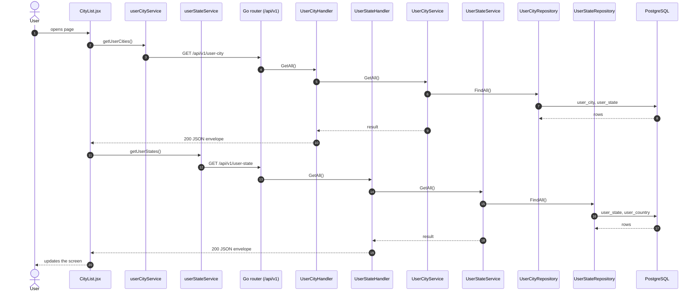
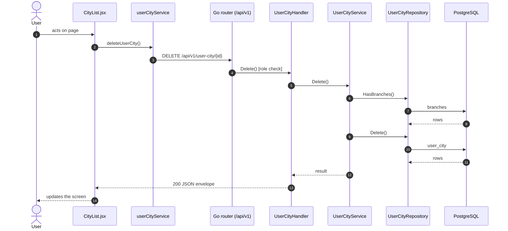
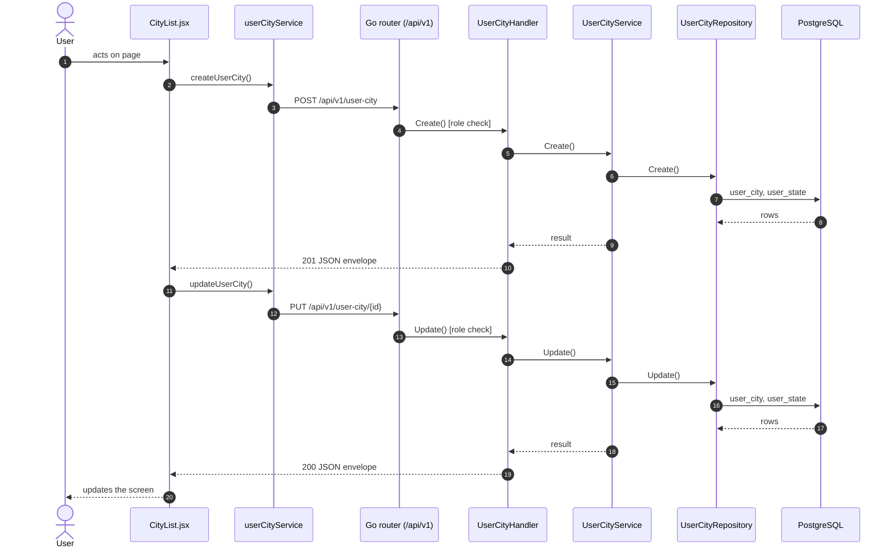

# Cities

- **Route:** `/organization/cities` · **Component:** [CityList.jsx](../../src/pages/Organization/Cities/CityList.jsx) · **Auth:** protected (every logged-in role) · **Guard/Layout:** `ProtectedRoute` (session) + role guard · `MainLayout`
- **Purpose:** Organization level 3: cities of a state.
- **Navigation:** States → Cities → Locations

## On page load

**Steps**

1. [CityList.jsx](../../src/pages/Organization/Cities/CityList.jsx) → useEffect(): runs on load `getUserCities()`
2. [userCityService.js](../../src/services/userCityService.js) → getUserCities(): calls `GET /api/v1/user-city`
3. [user_city_routes.go](../../../7th-sense-server/internal/routes/user_city_routes.go) → `GET /v1/user-city` → UserCityHandler.GetAll
4. [user_city_handler.go](../../../7th-sense-server/internal/handler/user_city_handler.go) → GetAll(): query userStateId, userId; calls the service
5. [user_city_service.go](../../../7th-sense-server/internal/service/user_city_service.go) → GetAll(): Returns the user's cities. A non-nil userStateID keeps only that state's cities.
6. [user_city_repository.go](../../../7th-sense-server/internal/repository/user_city_repository.go) → FindAll(): reads / writes `user_city`, `user_state`
7. [CityList.jsx](../../src/pages/Organization/Cities/CityList.jsx) → useEffect(): runs on load `getUserStates()`
8. [userStateService.js](../../src/services/userStateService.js) → getUserStates(): calls `GET /api/v1/user-state`
9. [user_state_routes.go](../../../7th-sense-server/internal/routes/user_state_routes.go) → `GET /v1/user-state` → UserStateHandler.GetAll
10. [user_state_handler.go](../../../7th-sense-server/internal/handler/user_state_handler.go) → GetAll(): query userCountryId, userId; calls the service
11. [user_state_service.go](../../../7th-sense-server/internal/service/user_state_service.go) → GetAll(): Returns the user's states. A non-nil userCountryID keeps only that country's states.
12. [user_state_repository.go](../../../7th-sense-server/internal/repository/user_state_repository.go) → FindAll(): reads / writes `user_state`, `user_country`

## Delete user city

**Sequence diagram**

**Steps**

1. [CityList.jsx](../../src/pages/Organization/Cities/CityList.jsx) → confirmDelete(): runs `deleteUserCity()`
2. [userCityService.js](../../src/services/userCityService.js) → deleteUserCity(): calls `DELETE /api/v1/user-city/{id}`
3. [user_city_routes.go](../../../7th-sense-server/internal/routes/user_city_routes.go) → `DELETE /v1/user-city/{id}` (managersOnly: superadmin, customer, admin) → UserCityHandler.Delete
4. [user_city_handler.go](../../../7th-sense-server/internal/handler/user_city_handler.go) → Delete(): reads {id}; query userId; calls the service
5. [user_city_service.go](../../../7th-sense-server/internal/service/user_city_service.go) → Delete(): Soft-deletes the city. A city that still has branches is kept: its branches must be deleted first.
6. [user_city_repository.go](../../../7th-sense-server/internal/repository/user_city_repository.go) → HasBranches(): reads / writes `branches`
7. [user_city_repository.go](../../../7th-sense-server/internal/repository/user_city_repository.go) → Delete(): reads / writes `user_city`

**Rules & edge cases**

- Only superadmin, customer and admin may do this (server `managersOnly`, others 403); the page hides the controls for other roles.

## Save user city (add / edit form)

**Sequence diagram**

**Steps**

1. [CityFormModal.jsx](../../src/pages/Organization/Cities/CityFormModal.jsx) → onSubmit(): runs `createUserCity()`
2. [userCityService.js](../../src/services/userCityService.js) → createUserCity(): calls `POST /api/v1/user-city`
3. [user_city_routes.go](../../../7th-sense-server/internal/routes/user_city_routes.go) → `POST /v1/user-city` (managersOnly: superadmin, customer, admin) → UserCityHandler.Create
4. [user_city_handler.go](../../../7th-sense-server/internal/handler/user_city_handler.go) → Create(): query userId; decodes `dto.CreateUserCityRequest` and runs its Validate(); calls the service
5. [user_city_service.go](../../../7th-sense-server/internal/service/user_city_service.go) → Create(): Adds a city for userID under one of the user's states.
6. [user_city_repository.go](../../../7th-sense-server/internal/repository/user_city_repository.go) → Create(): reads / writes `user_city`, `user_state`
7. [CityFormModal.jsx](../../src/pages/Organization/Cities/CityFormModal.jsx) → onSubmit(): runs `updateUserCity()`
8. [userCityService.js](../../src/services/userCityService.js) → updateUserCity(): calls `PUT /api/v1/user-city/{id}`
9. [user_city_routes.go](../../../7th-sense-server/internal/routes/user_city_routes.go) → `PUT /v1/user-city/{id}` (managersOnly: superadmin, customer, admin) → UserCityHandler.Update
10. [user_city_handler.go](../../../7th-sense-server/internal/handler/user_city_handler.go) → Update(): reads {id}; query userId; decodes `dto.UpdateUserCityRequest` and runs its Validate(); calls the service
11. [user_city_service.go](../../../7th-sense-server/internal/service/user_city_service.go) → Update(): Renames the city and moves it under another of the user's states.
12. [user_city_repository.go](../../../7th-sense-server/internal/repository/user_city_repository.go) → Update(): reads / writes `user_city`, `user_state`

**Rules & edge cases**

- Only superadmin, customer and admin may do this (server `managersOnly`, others 403); the page hides the controls for other roles.

## UI states

- **Loading:** `<Loader>` while the request runs.
- **Error:** a red `<Alert>` with the server message (some pages add Retry).
- **Success / failure of an action:** toast message (`utils/toast.js`).
- **Empty:** an empty-state message instead of the table / chart.
- **Delete:** asks for confirmation first.

## API calls on this page

| Method | Endpoint | Triggered by (section) | API docs |
|---|---|---|---|
| DELETE | `/api/v1/user-city/{id}` | Delete user city | [Swagger](http://localhost:8080/api-docs/index.html#/Organization/deleteUserCity) · [openapi.yaml](../../../7th-sense-server/docs/api/openapi.yaml) |
| GET | `/api/v1/user-city` | On page load | [Swagger](http://localhost:8080/api-docs/index.html#/Organization/getUserCities) · [openapi.yaml](../../../7th-sense-server/docs/api/openapi.yaml) |
| GET | `/api/v1/user-state` | On page load | [Swagger](http://localhost:8080/api-docs/index.html#/Organization/getUserStates) · [openapi.yaml](../../../7th-sense-server/docs/api/openapi.yaml) |
| POST | `/api/v1/user-city` | Save user city (add / edit form) | [Swagger](http://localhost:8080/api-docs/index.html#/Organization/createUserCity) · [openapi.yaml](../../../7th-sense-server/docs/api/openapi.yaml) |
| PUT | `/api/v1/user-city/{id}` | Save user city (add / edit form) | [Swagger](http://localhost:8080/api-docs/index.html#/Organization/updateUserCity) · [openapi.yaml](../../../7th-sense-server/docs/api/openapi.yaml) |

## State & storage

- `useOrgUser()` (organization user picked)
- Local component state (`useState`) for filters, form and modal

## Shared components used

[ConfirmModal.jsx](../../src/components/common/ConfirmModal.jsx), [Loader.jsx](../../src/components/common/Loader.jsx), [TablePagination.jsx](../../src/components/common/TablePagination.jsx), [SortableHead.jsx](../../src/components/common/SortableHead.jsx), [IconAction.jsx](../../src/components/common/IconAction.jsx), [OrgCustomerField.jsx](../../src/components/common/OrgCustomerField.jsx)

## Decisions

- [Client ADR index](../adr/README.md)
