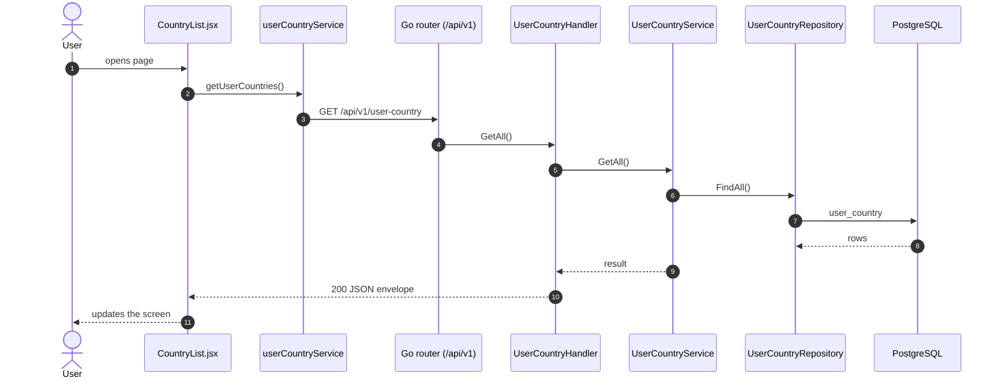
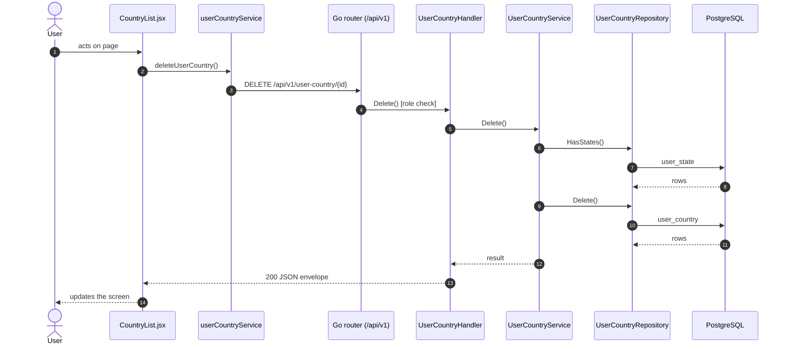
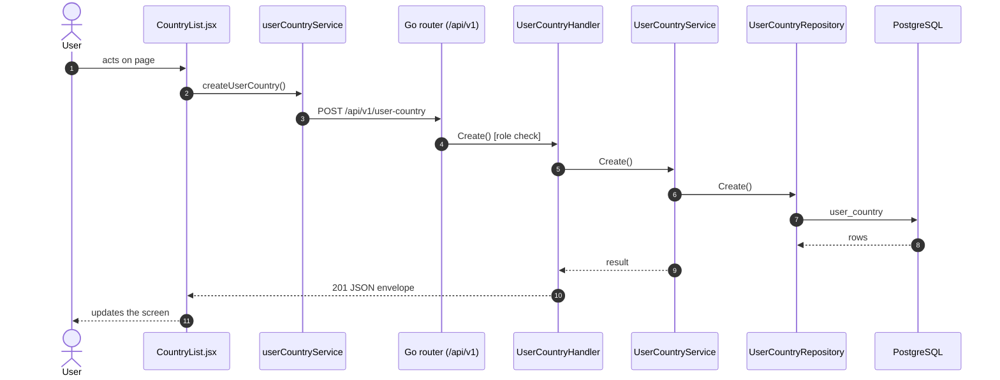

# Countries

- **Route:** `/organization/countries` · **Component:** [CountryList.jsx](../../src/pages/Organization/Countries/CountryList.jsx) · **Auth:** protected (every logged-in role) · **Guard/Layout:** `ProtectedRoute` (session) + role guard · `MainLayout`
- **Purpose:** Organization level 1: the company's countries.
- **Navigation:** Sidebar › Masters › Organization → **Country** tab ([OrganizationPage.jsx](../../src/pages/Organization/OrganizationPage.jsx): page header + tabs, this list is the tab body; the tab is the route)

## On page load

**Steps**

1. [CountryList.jsx](../../src/pages/Organization/Countries/CountryList.jsx) → useEffect(): runs on load `getUserCountries()`
2. [userCountryService.js](../../src/services/userCountryService.js) → getUserCountries(): calls `GET /api/v1/user-country`
3. [user_country_routes.go](../../../7th-sense-server/internal/routes/user_country_routes.go) → `GET /v1/user-country` → UserCountryHandler.GetAll
4. [user_country_handler.go](../../../7th-sense-server/internal/handler/user_country_handler.go) → GetAll(): query userId; calls the service
5. [user_country_service.go](../../../7th-sense-server/internal/service/user_country_service.go) → GetAll(): Returns the user's countries.
6. [user_country_repository.go](../../../7th-sense-server/internal/repository/user_country_repository.go) → FindAll(): reads / writes `user_country`

## Delete user country

**Sequence diagram**

**Steps**

1. [CountryList.jsx](../../src/pages/Organization/Countries/CountryList.jsx) → confirmDelete(): runs `deleteUserCountry()`
2. [userCountryService.js](../../src/services/userCountryService.js) → deleteUserCountry(): calls `DELETE /api/v1/user-country/{id}`
3. [user_country_routes.go](../../../7th-sense-server/internal/routes/user_country_routes.go) → `DELETE /v1/user-country/{id}` (superAdminOnly) → UserCountryHandler.Delete
4. [user_country_handler.go](../../../7th-sense-server/internal/handler/user_country_handler.go) → Delete(): reads {id}; query userId; calls the service
5. [user_country_service.go](../../../7th-sense-server/internal/service/user_country_service.go) → Delete(): Soft-deletes the country. A country that still has states is kept: its states must be deleted first.
6. [user_country_repository.go](../../../7th-sense-server/internal/repository/user_country_repository.go) → HasStates(): reads / writes `user_state`
7. [user_country_repository.go](../../../7th-sense-server/internal/repository/user_country_repository.go) → Delete(): reads / writes `user_country`

**Rules & edge cases**

- Superadmin only (server `superAdminOnly`, others 403).

## Save user country (add / edit form)

**Sequence diagram**

**Steps**

1. [CountryFormModal.jsx](../../src/pages/Organization/Countries/CountryFormModal.jsx) → onSubmit(): runs `createUserCountry()`
2. [userCountryService.js](../../src/services/userCountryService.js) → createUserCountry(): calls `POST /api/v1/user-country`
3. [user_country_routes.go](../../../7th-sense-server/internal/routes/user_country_routes.go) → `POST /v1/user-country` (superAdminOnly) → UserCountryHandler.Create
4. [user_country_handler.go](../../../7th-sense-server/internal/handler/user_country_handler.go) → Create(): query userId; decodes `dto.CreateUserCountryRequest` and runs its Validate(); calls the service
5. [user_country_service.go](../../../7th-sense-server/internal/service/user_country_service.go) → Create(): Adds a country for userID.
6. [user_country_repository.go](../../../7th-sense-server/internal/repository/user_country_repository.go) → Create(): reads / writes `user_country`

**Rules & edge cases**

- Superadmin only (server `superAdminOnly`, others 403).
- Server validation (`dto.CreateUserCountryRequest.Validate`): Please enter valid name.

## UI states

- **Loading:** `<Loader>` while the request runs.
- **Error:** a red `<Alert>` with the server message (some pages add Retry).
- **Success / failure of an action:** toast message (`utils/toast.js`).
- **Empty:** an empty-state message instead of the table / chart.
- **Delete:** asks for confirmation first.

## API calls on this page

| Method | Endpoint | Triggered by (section) | API docs |
|---|---|---|---|
| DELETE | `/api/v1/user-country/{id}` | Delete user country | [Swagger](http://localhost:8080/api-docs/index.html#/Organization/deleteUserCountry) · [openapi.yaml](../../../7th-sense-server/docs/api/openapi.yaml) |
| GET | `/api/v1/user-country` | On page load | [Swagger](http://localhost:8080/api-docs/index.html#/Organization/getUserCountries) · [openapi.yaml](../../../7th-sense-server/docs/api/openapi.yaml) |
| POST | `/api/v1/user-country` | Save user country (add / edit form) | [Swagger](http://localhost:8080/api-docs/index.html#/Organization/createUserCountry) · [openapi.yaml](../../../7th-sense-server/docs/api/openapi.yaml) |

## State & storage

- `useOrgUser()` (may edit, customer label)
- Local component state (`useState`) for filters, form and modal

## Shared components used

[ConfirmModal.jsx](../../src/components/common/ConfirmModal.jsx), [Loader.jsx](../../src/components/common/Loader.jsx), [TablePagination.jsx](../../src/components/common/TablePagination.jsx), [SortableHead.jsx](../../src/components/common/SortableHead.jsx), [IconAction.jsx](../../src/components/common/IconAction.jsx), [MultiSelectPicker.jsx](../../src/components/common/MultiSelectPicker.jsx), [OrgCustomerField.jsx](../../src/components/common/OrgCustomerField.jsx)

## Decisions

- [Client ADR index](../adr/README.md)
