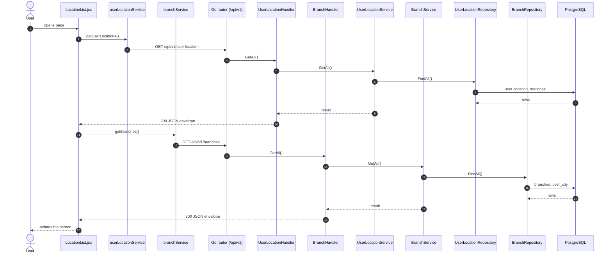
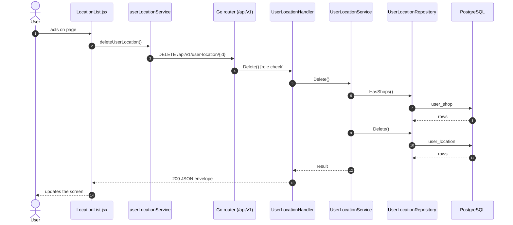
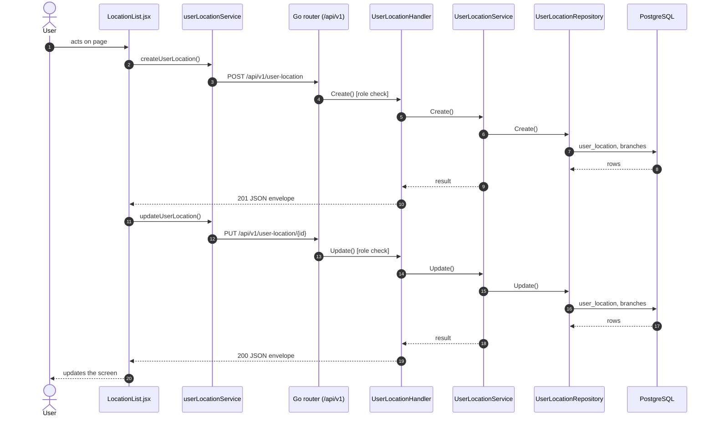

# Locations

- **Route:** `/organization/locations` · **Component:** [LocationList.jsx](../../src/pages/Organization/Locations/LocationList.jsx) · **Auth:** protected (every logged-in role) · **Guard/Layout:** `ProtectedRoute` (session) + role guard · `MainLayout`
- **Purpose:** Organization level 4: locations of a branch.
- **Navigation:** Cities → Locations → Shops

## On page load

**Steps**

1. [LocationList.jsx](../../src/pages/Organization/Locations/LocationList.jsx) → useEffect(): runs on load `getUserLocations()`
2. [userLocationService.js](../../src/services/userLocationService.js) → getUserLocations(): calls `GET /api/v1/user-location`
3. [user_location_routes.go](../../../7th-sense-server/internal/routes/user_location_routes.go) → `GET /v1/user-location` → UserLocationHandler.GetAll
4. [user_location_handler.go](../../../7th-sense-server/internal/handler/user_location_handler.go) → GetAll(): query branchId, userId; calls the service
5. [user_location_service.go](../../../7th-sense-server/internal/service/user_location_service.go) → GetAll(): Returns the user's locations. A non-nil branchID keeps only that branch's locations.
6. [user_location_repository.go](../../../7th-sense-server/internal/repository/user_location_repository.go) → FindAll(): reads / writes `user_location`, `branches`
7. [LocationList.jsx](../../src/pages/Organization/Locations/LocationList.jsx) → useEffect(): runs on load `getBranches()`
8. [branchService.js](../../src/services/branchService.js) → getBranches(): calls `GET /api/v1/branches`
9. [branch_routes.go](../../../7th-sense-server/internal/routes/branch_routes.go) → `GET /v1/branches` → BranchHandler.GetAll
10. [branch_handler.go](../../../7th-sense-server/internal/handler/branch_handler.go) → GetAll(): query userCityId; calls the service
11. [branch_service.go](../../../7th-sense-server/internal/service/branch_service.go) → GetAll(): Returns the branches. A non-nil userCityID keeps only that city's branches.
12. [branch_repository.go](../../../7th-sense-server/internal/repository/branch_repository.go) → FindAll(): reads / writes `branches`, `user_city`

## Delete user location

**Sequence diagram**

**Steps**

1. [LocationList.jsx](../../src/pages/Organization/Locations/LocationList.jsx) → confirmDelete(): runs `deleteUserLocation()`
2. [userLocationService.js](../../src/services/userLocationService.js) → deleteUserLocation(): calls `DELETE /api/v1/user-location/{id}`
3. [user_location_routes.go](../../../7th-sense-server/internal/routes/user_location_routes.go) → `DELETE /v1/user-location/{id}` (managersOnly: superadmin, customer, admin) → UserLocationHandler.Delete
4. [user_location_handler.go](../../../7th-sense-server/internal/handler/user_location_handler.go) → Delete(): reads {id}; query userId; calls the service
5. [user_location_service.go](../../../7th-sense-server/internal/service/user_location_service.go) → Delete(): Soft-deletes the location. A location that still has shops is kept: its shops must be deleted first.
6. [user_location_repository.go](../../../7th-sense-server/internal/repository/user_location_repository.go) → HasShops(): reads / writes `user_shop`
7. [user_location_repository.go](../../../7th-sense-server/internal/repository/user_location_repository.go) → Delete(): reads / writes `user_location`

**Rules & edge cases**

- Only superadmin, customer and admin may do this (server `managersOnly`, others 403); the page hides the controls for other roles.

## Save user location (add / edit form)

**Sequence diagram**

**Steps**

1. [LocationFormModal.jsx](../../src/pages/Organization/Locations/LocationFormModal.jsx) → onSubmit(): runs `createUserLocation()`
2. [userLocationService.js](../../src/services/userLocationService.js) → createUserLocation(): calls `POST /api/v1/user-location`
3. [user_location_routes.go](../../../7th-sense-server/internal/routes/user_location_routes.go) → `POST /v1/user-location` (managersOnly: superadmin, customer, admin) → UserLocationHandler.Create
4. [user_location_handler.go](../../../7th-sense-server/internal/handler/user_location_handler.go) → Create(): query userId; decodes `dto.CreateUserLocationRequest` and runs its Validate(); calls the service
5. [user_location_service.go](../../../7th-sense-server/internal/service/user_location_service.go) → Create(): Adds a location for userID under a branch.
6. [user_location_repository.go](../../../7th-sense-server/internal/repository/user_location_repository.go) → Create(): reads / writes `user_location`, `branches`
7. [LocationFormModal.jsx](../../src/pages/Organization/Locations/LocationFormModal.jsx) → onSubmit(): runs `updateUserLocation()`
8. [userLocationService.js](../../src/services/userLocationService.js) → updateUserLocation(): calls `PUT /api/v1/user-location/{id}`
9. [user_location_routes.go](../../../7th-sense-server/internal/routes/user_location_routes.go) → `PUT /v1/user-location/{id}` (managersOnly: superadmin, customer, admin) → UserLocationHandler.Update
10. [user_location_handler.go](../../../7th-sense-server/internal/handler/user_location_handler.go) → Update(): reads {id}; query userId; decodes `dto.UpdateUserLocationRequest` and runs its Validate(); calls the service
11. [user_location_service.go](../../../7th-sense-server/internal/service/user_location_service.go) → Update(): Renames the location and moves it under another branch.
12. [user_location_repository.go](../../../7th-sense-server/internal/repository/user_location_repository.go) → Update(): reads / writes `user_location`, `branches`

**Rules & edge cases**

- Only superadmin, customer and admin may do this (server `managersOnly`, others 403); the page hides the controls for other roles.

## UI states

- **Loading:** `<Loader>` while the request runs.
- **Error:** a red `<Alert>` with the server message (some pages add Retry).
- **Success / failure of an action:** toast message (`utils/toast.js`).
- **Empty:** an empty-state message instead of the table / chart.
- **Delete:** asks for confirmation first.

## API calls on this page

| Method | Endpoint | Triggered by (section) | API docs |
|---|---|---|---|
| DELETE | `/api/v1/user-location/{id}` | Delete user location | [Swagger](http://localhost:8080/api-docs/index.html#/Organization/deleteUserLocation) · [openapi.yaml](../../../7th-sense-server/docs/api/openapi.yaml) |
| GET | `/api/v1/user-location` | On page load | [Swagger](http://localhost:8080/api-docs/index.html#/Organization/getUserLocations) · [openapi.yaml](../../../7th-sense-server/docs/api/openapi.yaml) |
| GET | `/api/v1/branches` | On page load | [Swagger](http://localhost:8080/api-docs/index.html#/Branches/getBranches) · [openapi.yaml](../../../7th-sense-server/docs/api/openapi.yaml) |
| POST | `/api/v1/user-location` | Save user location (add / edit form) | [Swagger](http://localhost:8080/api-docs/index.html#/Organization/createUserLocation) · [openapi.yaml](../../../7th-sense-server/docs/api/openapi.yaml) |
| PUT | `/api/v1/user-location/{id}` | Save user location (add / edit form) | [Swagger](http://localhost:8080/api-docs/index.html#/Organization/updateUserLocation) · [openapi.yaml](../../../7th-sense-server/docs/api/openapi.yaml) |

## State & storage

- `useOrgUser()` (organization user picked)
- Local component state (`useState`) for filters, form and modal

## Shared components used

[ConfirmModal.jsx](../../src/components/common/ConfirmModal.jsx), [Loader.jsx](../../src/components/common/Loader.jsx), [TablePagination.jsx](../../src/components/common/TablePagination.jsx), [SortableHead.jsx](../../src/components/common/SortableHead.jsx), [IconAction.jsx](../../src/components/common/IconAction.jsx), [OrgCustomerField.jsx](../../src/components/common/OrgCustomerField.jsx)

## Decisions

- [Client ADR index](../adr/README.md)
