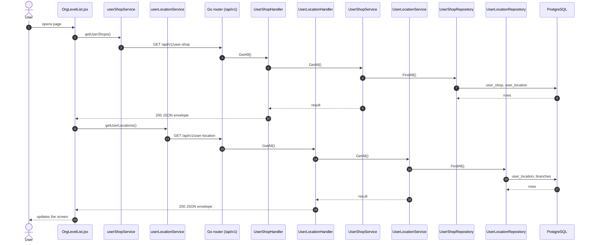
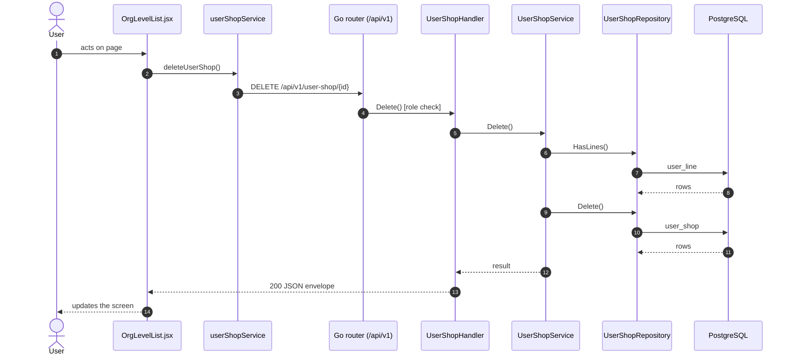
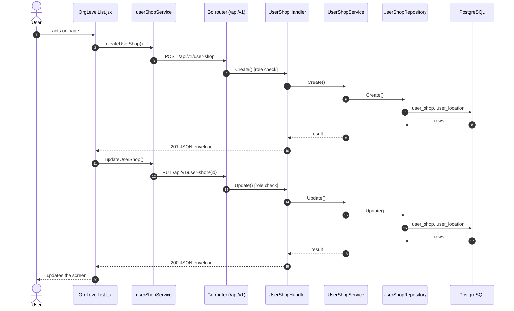

# Shops

- **Route:** `/organization/shops` · **Component:** [OrgLevelList.jsx](../../src/pages/Organization/OrgLevelList.jsx) (`level="shop"`, config in [orgLevels.js](../../src/pages/Organization/orgLevels.js)) · **Auth:** protected (every logged-in role) · **Guard/Layout:** `ProtectedRoute` (session) + role guard · `MainLayout`
- **Purpose:** Organization level 5: shops of a location.
- **Navigation:** Sidebar › Masters › Organization → **Shop** tab ([OrganizationPage.jsx](../../src/pages/Organization/OrganizationPage.jsx): page header + tabs, this list is the tab body; the tab is the route)

## On page load

**Steps**

1. [OrgLevelList.jsx](../../src/pages/Organization/OrgLevelList.jsx) → useEffect(): runs on load `getUserShops()`
2. [userShopService.js](../../src/services/userShopService.js) → getUserShops(): calls `GET /api/v1/user-shop`
3. [user_shop_routes.go](../../../7th-sense-server/internal/routes/user_shop_routes.go) → `GET /v1/user-shop` → UserShopHandler.GetAll
4. [user_shop_handler.go](../../../7th-sense-server/internal/handler/user_shop_handler.go) → GetAll(): query userLocationId, userId; calls the service
5. [user_shop_service.go](../../../7th-sense-server/internal/service/user_shop_service.go) → GetAll(): Returns the user's shops. A non-nil userLocationID keeps only that location's shops.
6. [user_shop_repository.go](../../../7th-sense-server/internal/repository/user_shop_repository.go) → FindAll(): reads / writes `user_shop`, `user_location`
7. [OrgLevelList.jsx](../../src/pages/Organization/OrgLevelList.jsx) → useEffect(): runs on load `getUserLocations()`
8. [userLocationService.js](../../src/services/userLocationService.js) → getUserLocations(): calls `GET /api/v1/user-location`
9. [user_location_routes.go](../../../7th-sense-server/internal/routes/user_location_routes.go) → `GET /v1/user-location` → UserLocationHandler.GetAll
10. [user_location_handler.go](../../../7th-sense-server/internal/handler/user_location_handler.go) → GetAll(): query branchId, userId; calls the service
11. [user_location_service.go](../../../7th-sense-server/internal/service/user_location_service.go) → GetAll(): Returns the user's locations. A non-nil branchID keeps only that branch's locations.
12. [user_location_repository.go](../../../7th-sense-server/internal/repository/user_location_repository.go) → FindAll(): reads / writes `user_location`, `branches`

## Delete user shop

**Sequence diagram**

**Steps**

1. [OrgLevelList.jsx](../../src/pages/Organization/OrgLevelList.jsx) → confirmDelete(): runs `deleteUserShop()`
2. [userShopService.js](../../src/services/userShopService.js) → deleteUserShop(): calls `DELETE /api/v1/user-shop/{id}`
3. [user_shop_routes.go](../../../7th-sense-server/internal/routes/user_shop_routes.go) → `DELETE /v1/user-shop/{id}` (managersOnly: superadmin, customer, admin) → UserShopHandler.Delete
4. [user_shop_handler.go](../../../7th-sense-server/internal/handler/user_shop_handler.go) → Delete(): reads {id}; query userId; calls the service
5. [user_shop_service.go](../../../7th-sense-server/internal/service/user_shop_service.go) → Delete(): Soft-deletes the shop. A shop that still has lines is kept: its lines must be deleted first.
6. [user_shop_repository.go](../../../7th-sense-server/internal/repository/user_shop_repository.go) → HasLines(): reads / writes `user_line`
7. [user_shop_repository.go](../../../7th-sense-server/internal/repository/user_shop_repository.go) → Delete(): reads / writes `user_shop`

**Rules & edge cases**

- Only superadmin, customer and admin may do this (server `managersOnly`, others 403); the page hides the controls for other roles.

## Save user shop (add / edit form)

**Sequence diagram**

**Steps**

1. [OrgLevelFormModal.jsx](../../src/pages/Organization/OrgLevelFormModal.jsx) → onSubmit(): runs `createUserShop()`
2. [userShopService.js](../../src/services/userShopService.js) → createUserShop(): calls `POST /api/v1/user-shop`
3. [user_shop_routes.go](../../../7th-sense-server/internal/routes/user_shop_routes.go) → `POST /v1/user-shop` (managersOnly: superadmin, customer, admin) → UserShopHandler.Create
4. [user_shop_handler.go](../../../7th-sense-server/internal/handler/user_shop_handler.go) → Create(): query userId; decodes `dto.CreateUserShopRequest` and runs its Validate(); calls the service
5. [user_shop_service.go](../../../7th-sense-server/internal/service/user_shop_service.go) → Create(): Adds a shop for userID under one of the user's locations.
6. [user_shop_repository.go](../../../7th-sense-server/internal/repository/user_shop_repository.go) → Create(): reads / writes `user_shop`, `user_location`
7. [OrgLevelFormModal.jsx](../../src/pages/Organization/OrgLevelFormModal.jsx) → onSubmit(): runs `updateUserShop()`
8. [userShopService.js](../../src/services/userShopService.js) → updateUserShop(): calls `PUT /api/v1/user-shop/{id}`
9. [user_shop_routes.go](../../../7th-sense-server/internal/routes/user_shop_routes.go) → `PUT /v1/user-shop/{id}` (managersOnly: superadmin, customer, admin) → UserShopHandler.Update
10. [user_shop_handler.go](../../../7th-sense-server/internal/handler/user_shop_handler.go) → Update(): reads {id}; query userId; decodes `dto.UpdateUserShopRequest` and runs its Validate(); calls the service
11. [user_shop_service.go](../../../7th-sense-server/internal/service/user_shop_service.go) → Update(): Renames the shop and moves it under another of the user's locations.
12. [user_shop_repository.go](../../../7th-sense-server/internal/repository/user_shop_repository.go) → Update(): reads / writes `user_shop`, `user_location`

**Rules & edge cases**

- Only superadmin, customer and admin may do this (server `managersOnly`, others 403); the page hides the controls for other roles.

## UI states

- **Loading:** `<Loader>` while the request runs.
- **Error:** a red `<Alert>` with the server message (some pages add Retry).
- **Success / failure of an action:** toast message (`utils/toast.js`).
- **Empty:** an empty-state message instead of the table / chart.
- **Delete:** asks for confirmation first.

## API calls on this page

| Method | Endpoint | Triggered by (section) | API docs |
|---|---|---|---|
| DELETE | `/api/v1/user-shop/{id}` | Delete user shop | [Swagger](http://localhost:8080/api-docs/index.html#/Organization/deleteUserShop) · [openapi.yaml](../../../7th-sense-server/docs/api/openapi.yaml) |
| GET | `/api/v1/user-shop` | On page load | [Swagger](http://localhost:8080/api-docs/index.html#/Organization/getUserShops) · [openapi.yaml](../../../7th-sense-server/docs/api/openapi.yaml) |
| GET | `/api/v1/user-location` | On page load | [Swagger](http://localhost:8080/api-docs/index.html#/Organization/getUserLocations) · [openapi.yaml](../../../7th-sense-server/docs/api/openapi.yaml) |
| POST | `/api/v1/user-shop` | Save user shop (add / edit form) | [Swagger](http://localhost:8080/api-docs/index.html#/Organization/createUserShop) · [openapi.yaml](../../../7th-sense-server/docs/api/openapi.yaml) |
| PUT | `/api/v1/user-shop/{id}` | Save user shop (add / edit form) | [Swagger](http://localhost:8080/api-docs/index.html#/Organization/updateUserShop) · [openapi.yaml](../../../7th-sense-server/docs/api/openapi.yaml) |

## State & storage

- `useOrgUser()` (may edit, customer label)
- Local component state (`useState`) for filters, form and modal

## Shared components used

[ConfirmModal.jsx](../../src/components/common/ConfirmModal.jsx), [Loader.jsx](../../src/components/common/Loader.jsx), [TablePagination.jsx](../../src/components/common/TablePagination.jsx), [SortableHead.jsx](../../src/components/common/SortableHead.jsx), [IconAction.jsx](../../src/components/common/IconAction.jsx), [OrgCustomerField.jsx](../../src/components/common/OrgCustomerField.jsx)

## Decisions

- [Client ADR index](../adr/README.md)
