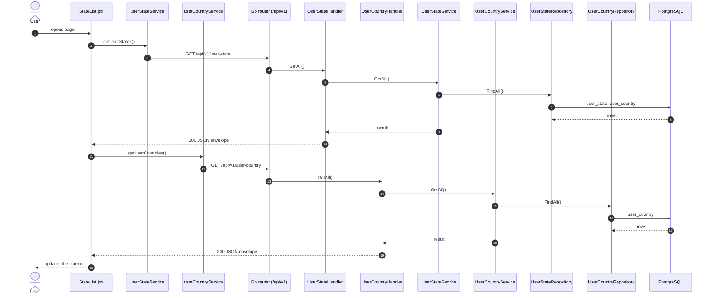
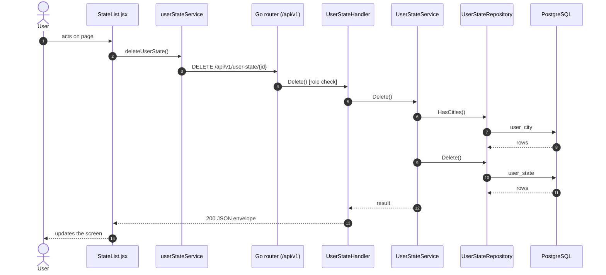
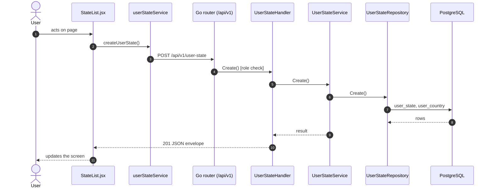

# States

- **Route:** `/organization/states` · **Component:** [StateList.jsx](../../src/pages/Organization/States/StateList.jsx) · **Auth:** protected (every logged-in role) · **Guard/Layout:** `ProtectedRoute` (session) + role guard · `MainLayout`
- **Purpose:** Organization level 2: states of a country.
- **Navigation:** Sidebar › Masters › Organization → **State** tab ([OrganizationPage.jsx](../../src/pages/Organization/OrganizationPage.jsx): page header + tabs, this list is the tab body; the tab is the route)

## On page load

**Steps**

1. [StateList.jsx](../../src/pages/Organization/States/StateList.jsx) → useEffect(): runs on load `getUserStates()`
2. [userStateService.js](../../src/services/userStateService.js) → getUserStates(): calls `GET /api/v1/user-state`
3. [user_state_routes.go](../../../7th-sense-server/internal/routes/user_state_routes.go) → `GET /v1/user-state` → UserStateHandler.GetAll
4. [user_state_handler.go](../../../7th-sense-server/internal/handler/user_state_handler.go) → GetAll(): query userCountryId, userId; calls the service
5. [user_state_service.go](../../../7th-sense-server/internal/service/user_state_service.go) → GetAll(): Returns the user's states. A non-nil userCountryID keeps only that country's states.
6. [user_state_repository.go](../../../7th-sense-server/internal/repository/user_state_repository.go) → FindAll(): reads / writes `user_state`, `user_country`
7. [StateList.jsx](../../src/pages/Organization/States/StateList.jsx) → useEffect(): runs on load `getUserCountries()`
8. [userCountryService.js](../../src/services/userCountryService.js) → getUserCountries(): calls `GET /api/v1/user-country`
9. [user_country_routes.go](../../../7th-sense-server/internal/routes/user_country_routes.go) → `GET /v1/user-country` → UserCountryHandler.GetAll
10. [user_country_handler.go](../../../7th-sense-server/internal/handler/user_country_handler.go) → GetAll(): query userId; calls the service
11. [user_country_service.go](../../../7th-sense-server/internal/service/user_country_service.go) → GetAll(): Returns the user's countries.
12. [user_country_repository.go](../../../7th-sense-server/internal/repository/user_country_repository.go) → FindAll(): reads / writes `user_country`

## Delete user state

**Sequence diagram**

**Steps**

1. [StateList.jsx](../../src/pages/Organization/States/StateList.jsx) → confirmDelete(): runs `deleteUserState()`
2. [userStateService.js](../../src/services/userStateService.js) → deleteUserState(): calls `DELETE /api/v1/user-state/{id}`
3. [user_state_routes.go](../../../7th-sense-server/internal/routes/user_state_routes.go) → `DELETE /v1/user-state/{id}` (superAdminOnly) → UserStateHandler.Delete
4. [user_state_handler.go](../../../7th-sense-server/internal/handler/user_state_handler.go) → Delete(): reads {id}; query userId; calls the service
5. [user_state_service.go](../../../7th-sense-server/internal/service/user_state_service.go) → Delete(): Soft-deletes the state. A state that still has cities is kept: its cities must be deleted first. A state that a user's machine filter names (`IsInMachineFilter`) is refused with 400 too: the user would lose the machines and could not be saved.
6. [user_state_repository.go](../../../7th-sense-server/internal/repository/user_state_repository.go) → HasCities(): reads / writes `user_city`
7. [user_state_repository.go](../../../7th-sense-server/internal/repository/user_state_repository.go) → Delete(): reads / writes `user_state`

**Rules & edge cases**

- Superadmin only (server `superAdminOnly`, others 403).

## Save user state (add / edit form)

**Sequence diagram**

**Steps**

1. [StateFormModal.jsx](../../src/pages/Organization/States/StateFormModal.jsx) → onSubmit(): runs `createUserState()`
2. [userStateService.js](../../src/services/userStateService.js) → createUserState(): calls `POST /api/v1/user-state`
3. [user_state_routes.go](../../../7th-sense-server/internal/routes/user_state_routes.go) → `POST /v1/user-state` (superAdminOnly) → UserStateHandler.Create
4. [user_state_handler.go](../../../7th-sense-server/internal/handler/user_state_handler.go) → Create(): query userId; decodes `dto.CreateUserStateRequest` and runs its Validate(); calls the service
5. [user_state_service.go](../../../7th-sense-server/internal/service/user_state_service.go) → Create(): Adds a state for userID under one of the user's countries.
6. [user_state_repository.go](../../../7th-sense-server/internal/repository/user_state_repository.go) → Create(): reads / writes `user_state`, `user_country`

**Rules & edge cases**

- Superadmin only (server `superAdminOnly`, others 403).

## UI states

- **Loading:** `<Loader>` while the request runs.
- **Error:** a red `<Alert>` with the server message (some pages add Retry).
- **Success / failure of an action:** toast message (`utils/toast.js`).
- **Empty:** an empty-state message instead of the table / chart.
- **Delete:** asks for confirmation first.

## API calls on this page

| Method | Endpoint | Triggered by (section) | API docs |
|---|---|---|---|
| DELETE | `/api/v1/user-state/{id}` | Delete user state | [Swagger](http://localhost:8080/api-docs/index.html#/Organization/deleteUserState) · [openapi.yaml](../../../7th-sense-server/docs/api/openapi.yaml) |
| GET | `/api/v1/user-state` | On page load | [Swagger](http://localhost:8080/api-docs/index.html#/Organization/getUserStates) · [openapi.yaml](../../../7th-sense-server/docs/api/openapi.yaml) |
| GET | `/api/v1/user-country` | On page load | [Swagger](http://localhost:8080/api-docs/index.html#/Organization/getUserCountries) · [openapi.yaml](../../../7th-sense-server/docs/api/openapi.yaml) |
| POST | `/api/v1/user-state` | Save user state (add / edit form) | [Swagger](http://localhost:8080/api-docs/index.html#/Organization/createUserState) · [openapi.yaml](../../../7th-sense-server/docs/api/openapi.yaml) |

## State & storage

- `useOrgUser()` (may edit, customer label)
- Local component state (`useState`) for filters, form and modal

## Shared components used

[ConfirmModal.jsx](../../src/components/common/ConfirmModal.jsx), [Loader.jsx](../../src/components/common/Loader.jsx), [TablePagination.jsx](../../src/components/common/TablePagination.jsx), [SortableHead.jsx](../../src/components/common/SortableHead.jsx), [IconAction.jsx](../../src/components/common/IconAction.jsx), [MultiSelectPicker.jsx](../../src/components/common/MultiSelectPicker.jsx), [OrgCustomerField.jsx](../../src/components/common/OrgCustomerField.jsx)

## Decisions

- [Client ADR index](../adr/README.md)
