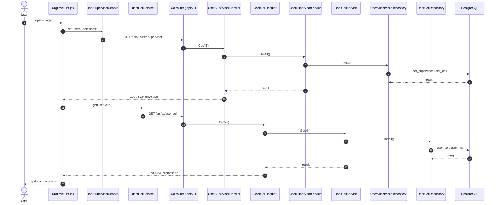
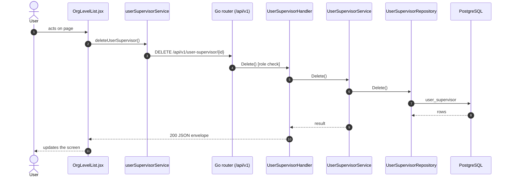
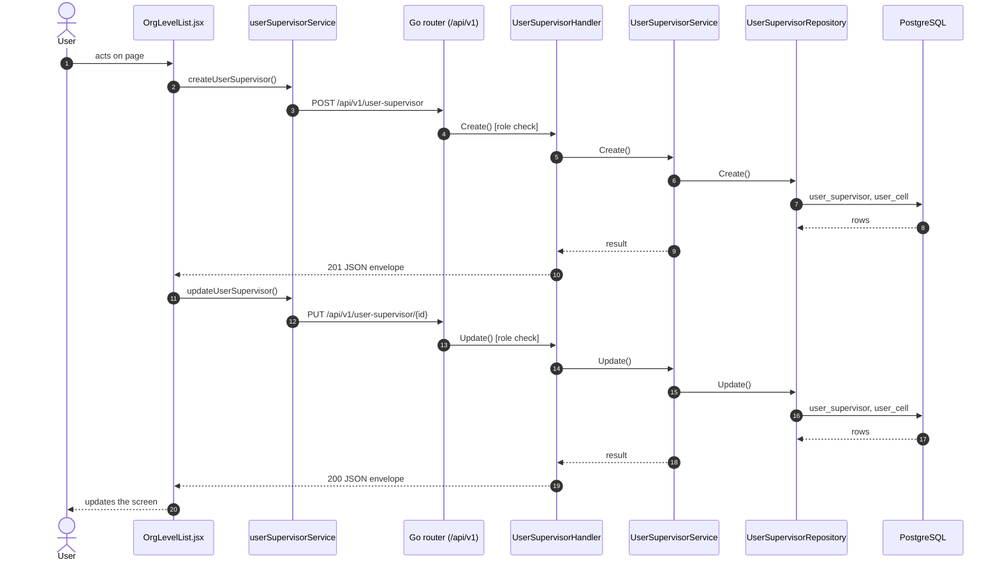

# Supervisors

- **Route:** `/organization/supervisors` · **Component:** [OrgLevelList.jsx](../../src/pages/Organization/OrgLevelList.jsx) (`level="supervisor"`, config in [orgLevels.js](../../src/pages/Organization/orgLevels.js)) · **Auth:** protected (every logged-in role) · **Guard/Layout:** `ProtectedRoute` (session) + role guard · `MainLayout`
- **Purpose:** Organization level 8: supervisors of a cell.
- **Navigation:** Sidebar › Masters › Organization → **Supervisor** tab ([OrganizationPage.jsx](../../src/pages/Organization/OrganizationPage.jsx): page header + tabs, this list is the tab body; the tab is the route)

## On page load

**Steps**

1. [OrgLevelList.jsx](../../src/pages/Organization/OrgLevelList.jsx) → useEffect(): runs on load `getUserSupervisors()`
2. [userSupervisorService.js](../../src/services/userSupervisorService.js) → getUserSupervisors(): calls `GET /api/v1/user-supervisor`
3. [user_supervisor_routes.go](../../../7th-sense-server/internal/routes/user_supervisor_routes.go) → `GET /v1/user-supervisor` → UserSupervisorHandler.GetAll
4. [user_supervisor_handler.go](../../../7th-sense-server/internal/handler/user_supervisor_handler.go) → GetAll(): query userCellId, userId; calls the service
5. [user_supervisor_service.go](../../../7th-sense-server/internal/service/user_supervisor_service.go) → GetAll(): Returns the user's supervisors. A non-nil userCellID keeps only that cell's supervisors.
6. [user_supervisor_repository.go](../../../7th-sense-server/internal/repository/user_supervisor_repository.go) → FindAll(): reads / writes `user_supervisor`, `user_cell`
7. [OrgLevelList.jsx](../../src/pages/Organization/OrgLevelList.jsx) → useEffect(): runs on load `getUserCells()`
8. [userCellService.js](../../src/services/userCellService.js) → getUserCells(): calls `GET /api/v1/user-cell`
9. [user_cell_routes.go](../../../7th-sense-server/internal/routes/user_cell_routes.go) → `GET /v1/user-cell` → UserCellHandler.GetAll
10. [user_cell_handler.go](../../../7th-sense-server/internal/handler/user_cell_handler.go) → GetAll(): query userLineId, userId; calls the service
11. [user_cell_service.go](../../../7th-sense-server/internal/service/user_cell_service.go) → GetAll(): Returns the user's cells. A non-nil userLineID keeps only that line's cells.
12. [user_cell_repository.go](../../../7th-sense-server/internal/repository/user_cell_repository.go) → FindAll(): reads / writes `user_cell`, `user_line`

## Delete user supervisor

**Sequence diagram**

**Steps**

1. [OrgLevelList.jsx](../../src/pages/Organization/OrgLevelList.jsx) → confirmDelete(): runs `deleteUserSupervisor()`
2. [userSupervisorService.js](../../src/services/userSupervisorService.js) → deleteUserSupervisor(): calls `DELETE /api/v1/user-supervisor/{id}`
3. [user_supervisor_routes.go](../../../7th-sense-server/internal/routes/user_supervisor_routes.go) → `DELETE /v1/user-supervisor/{id}` (managersOnly: superadmin, customer, admin) → UserSupervisorHandler.Delete
4. [user_supervisor_handler.go](../../../7th-sense-server/internal/handler/user_supervisor_handler.go) → Delete(): reads {id}; query userId; calls the service
5. [user_supervisor_service.go](../../../7th-sense-server/internal/service/user_supervisor_service.go) → Delete(): Soft-deletes the supervisor.
6. [user_supervisor_repository.go](../../../7th-sense-server/internal/repository/user_supervisor_repository.go) → Delete(): reads / writes `user_supervisor`

**Rules & edge cases**

- Only superadmin, customer and admin may do this (server `managersOnly`, others 403); the page hides the controls for other roles.

## Save user supervisor (add / edit form)

**Sequence diagram**

**Steps**

1. [OrgLevelFormModal.jsx](../../src/pages/Organization/OrgLevelFormModal.jsx) → onSubmit(): runs `createUserSupervisor()`
2. [userSupervisorService.js](../../src/services/userSupervisorService.js) → createUserSupervisor(): calls `POST /api/v1/user-supervisor`
3. [user_supervisor_routes.go](../../../7th-sense-server/internal/routes/user_supervisor_routes.go) → `POST /v1/user-supervisor` (managersOnly: superadmin, customer, admin) → UserSupervisorHandler.Create
4. [user_supervisor_handler.go](../../../7th-sense-server/internal/handler/user_supervisor_handler.go) → Create(): query userId; decodes `dto.CreateUserSupervisorRequest` and runs its Validate(); calls the service
5. [user_supervisor_service.go](../../../7th-sense-server/internal/service/user_supervisor_service.go) → Create(): Adds a supervisor for userID under one of the user's cells.
6. [user_supervisor_repository.go](../../../7th-sense-server/internal/repository/user_supervisor_repository.go) → Create(): reads / writes `user_supervisor`, `user_cell`
7. [OrgLevelFormModal.jsx](../../src/pages/Organization/OrgLevelFormModal.jsx) → onSubmit(): runs `updateUserSupervisor()`
8. [userSupervisorService.js](../../src/services/userSupervisorService.js) → updateUserSupervisor(): calls `PUT /api/v1/user-supervisor/{id}`
9. [user_supervisor_routes.go](../../../7th-sense-server/internal/routes/user_supervisor_routes.go) → `PUT /v1/user-supervisor/{id}` (managersOnly: superadmin, customer, admin) → UserSupervisorHandler.Update
10. [user_supervisor_handler.go](../../../7th-sense-server/internal/handler/user_supervisor_handler.go) → Update(): reads {id}; query userId; decodes `dto.UpdateUserSupervisorRequest` and runs its Validate(); calls the service
11. [user_supervisor_service.go](../../../7th-sense-server/internal/service/user_supervisor_service.go) → Update(): Renames the supervisor and moves it under another of the user's cells.
12. [user_supervisor_repository.go](../../../7th-sense-server/internal/repository/user_supervisor_repository.go) → Update(): reads / writes `user_supervisor`, `user_cell`

**Rules & edge cases**

- Only superadmin, customer and admin may do this (server `managersOnly`, others 403); the page hides the controls for other roles.

## UI states

- **Loading:** `<Loader>` while the request runs.
- **Error:** a red `<Alert>` with the server message (some pages add Retry).
- **Success / failure of an action:** toast message (`utils/toast.js`).
- **Empty:** an empty-state message instead of the table / chart.
- **Delete:** asks for confirmation first.

## API calls on this page

| Method | Endpoint | Triggered by (section) | API docs |
|---|---|---|---|
| DELETE | `/api/v1/user-supervisor/{id}` | Delete user supervisor | [Swagger](http://localhost:8080/api-docs/index.html#/Organization/deleteUserSupervisor) · [openapi.yaml](../../../7th-sense-server/docs/api/openapi.yaml) |
| GET | `/api/v1/user-supervisor` | On page load | [Swagger](http://localhost:8080/api-docs/index.html#/Organization/getUserSupervisors) · [openapi.yaml](../../../7th-sense-server/docs/api/openapi.yaml) |
| GET | `/api/v1/user-cell` | On page load | [Swagger](http://localhost:8080/api-docs/index.html#/Organization/getUserCells) · [openapi.yaml](../../../7th-sense-server/docs/api/openapi.yaml) |
| POST | `/api/v1/user-supervisor` | Save user supervisor (add / edit form) | [Swagger](http://localhost:8080/api-docs/index.html#/Organization/createUserSupervisor) · [openapi.yaml](../../../7th-sense-server/docs/api/openapi.yaml) |
| PUT | `/api/v1/user-supervisor/{id}` | Save user supervisor (add / edit form) | [Swagger](http://localhost:8080/api-docs/index.html#/Organization/updateUserSupervisor) · [openapi.yaml](../../../7th-sense-server/docs/api/openapi.yaml) |

## State & storage

- `useOrgUser()` (may edit, customer label)
- Local component state (`useState`) for filters, form and modal

## Shared components used

[ConfirmModal.jsx](../../src/components/common/ConfirmModal.jsx), [Loader.jsx](../../src/components/common/Loader.jsx), [TablePagination.jsx](../../src/components/common/TablePagination.jsx), [SortableHead.jsx](../../src/components/common/SortableHead.jsx), [IconAction.jsx](../../src/components/common/IconAction.jsx), [OrgCustomerField.jsx](../../src/components/common/OrgCustomerField.jsx)

## Decisions

- [Client ADR index](../adr/README.md)
