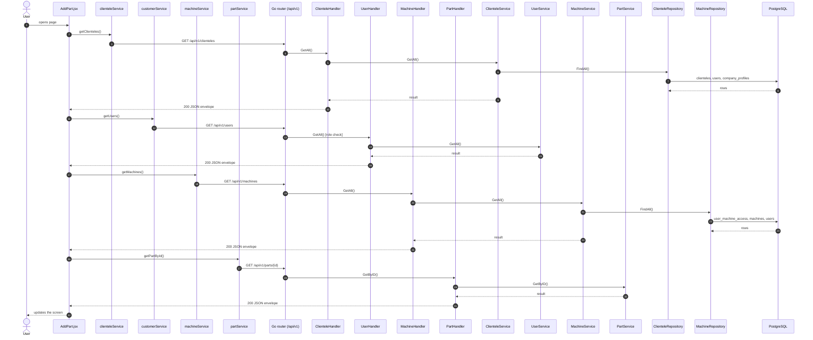
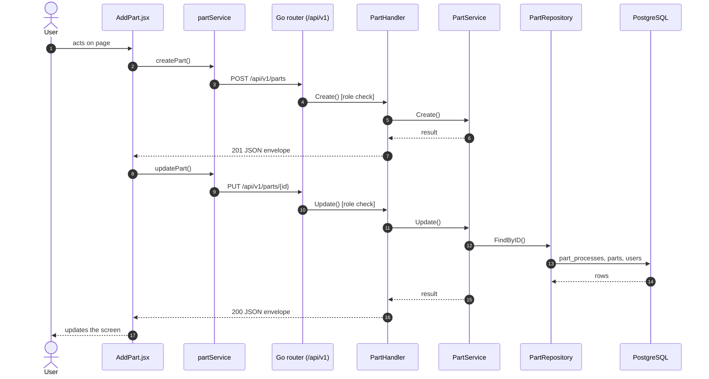
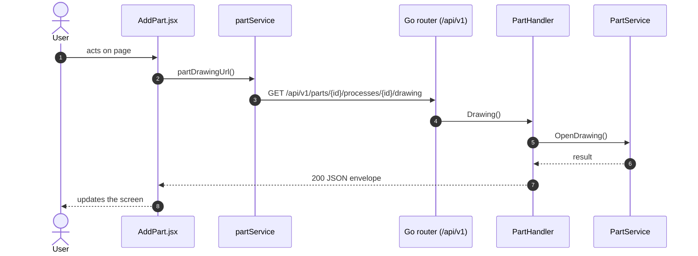
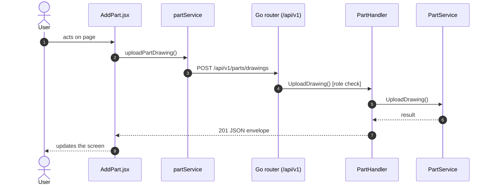

# Add / edit part

- **Route:** `/masters/parts/add` · `/masters/parts/:id/edit` · **Component:** [AddPart.jsx](../../src/pages/Parts/AddPart.jsx) · **Auth:** protected (superadmin, customer, admin) · **Guard/Layout:** `ProtectedRoute` (session) + role guard · `MainLayout`
- **Purpose:** Add or edit a part with its processes, applicable machines and process drawings.
- **Navigation:** Parts → form → back to Parts

## On page load

**Steps**

1. [AddPart.jsx](../../src/pages/Parts/AddPart.jsx) → useEffect(): runs on load `getClienteles()`
2. [clienteleService.js](../../src/services/clienteleService.js) → getClienteles(): calls `GET /api/v1/clienteles`
3. [clientele_routes.go](../../../7th-sense-server/internal/routes/clientele_routes.go) → `GET /v1/clienteles` → ClienteleHandler.GetAll
4. [clientele_handler.go](../../../7th-sense-server/internal/handler/clientele_handler.go) → GetAll(): query userId; calls the service
5. [clientele_service.go](../../../7th-sense-server/internal/service/clientele_service.go) → GetAll(): Returns the clienteles the user may read. A non-nil customerID keeps only that customer's clienteles.
6. [clientele_repository.go](../../../7th-sense-server/internal/repository/clientele_repository.go) → FindAll(): reads / writes `clienteles`, `users`, `company_profiles`
7. [AddPart.jsx](../../src/pages/Parts/AddPart.jsx) → useEffect(): runs on load `getUsers()`
8. [customerService.js](../../src/services/customerService.js) → getUsers(): calls `GET /api/v1/users`
9. [user_routes.go](../../../7th-sense-server/internal/routes/user_routes.go) → `GET /v1/users` (managersOnly: superadmin, customer, admin) → UserHandler.GetAll
10. [user_handler.go](../../../7th-sense-server/internal/handler/user_handler.go) → GetAll(): query companyId, filterRole; calls the service
11. [user_service.go](../../../7th-sense-server/internal/service/user_service.go) → GetAll(): Returns the users the user may see, narrowed by filter: every user for the superadmin, the company's members for a customer or admin. A customer or admin asking for another company gets Forbidden.
12. [AddPart.jsx](../../src/pages/Parts/AddPart.jsx) → useEffect(): runs on load `getMachines()`
13. [machineService.js](../../src/services/machineService.js) → getMachines(): calls `GET /api/v1/machines`
14. [machine_routes.go](../../../7th-sense-server/internal/routes/machine_routes.go) → `GET /v1/machines` → MachineHandler.GetAll
15. [machine_handler.go](../../../7th-sense-server/internal/handler/machine_handler.go) → GetAll(): query userId; calls the service
16. [machine_service.go](../../../7th-sense-server/internal/service/machine_service.go) → GetAll(): Returns the machines the user may access (see machineScope). A non-nil customerID keeps only that customer's machines.
17. [machine_repository.go](../../../7th-sense-server/internal/repository/machine_repository.go) → FindAll(): reads / writes `user_machine_access`, `machines`, `users`, `company_profiles`
18. [AddPart.jsx](../../src/pages/Parts/AddPart.jsx) → useEffect(): runs on load `getPartById()`
19. [partService.js](../../src/services/partService.js) → getPartById(): calls `GET /api/v1/parts/{id}`
20. [part_routes.go](../../../7th-sense-server/internal/routes/part_routes.go) → `GET /v1/parts/{id}` → PartHandler.GetByID
21. [part_handler.go](../../../7th-sense-server/internal/handler/part_handler.go) → GetByID(): reads {id}; query userId; calls the service
22. [part_service.go](../../../7th-sense-server/internal/service/part_service.go) → GetByID(): Returns the part with its processes when the user may read it, else "Part not found".

## Save part (add / edit form)

**Sequence diagram**

**Steps**

1. [AddPart.jsx](../../src/pages/Parts/AddPart.jsx) → onSubmit(): runs `createPart()`
2. [partService.js](../../src/services/partService.js) → createPart(): calls `POST /api/v1/parts`
3. [part_routes.go](../../../7th-sense-server/internal/routes/part_routes.go) → `POST /v1/parts` (managersOnly: superadmin, customer, admin) → PartHandler.Create
4. [part_handler.go](../../../7th-sense-server/internal/handler/part_handler.go) → Create(): decodes `dto.CreatePartRequest` and runs its Validate(); calls the service
5. [part_service.go](../../../7th-sense-server/internal/service/part_service.go) → Create(): Adds a part with its processes. A customer or admin (the logged-in user) adds it to their own company, whatever customer the request names; the superadmin to the customer named.
6. [AddPart.jsx](../../src/pages/Parts/AddPart.jsx) → onSubmit(): runs `updatePart()`
7. [partService.js](../../src/services/partService.js) → updatePart(): calls `PUT /api/v1/parts/{id}`
8. [part_routes.go](../../../7th-sense-server/internal/routes/part_routes.go) → `PUT /v1/parts/{id}` (managersOnly: superadmin, customer, admin) → PartHandler.Update
9. [part_handler.go](../../../7th-sense-server/internal/handler/part_handler.go) → Update(): reads {id}; decodes `dto.UpdatePartRequest` and runs its Validate(); calls the service
10. [part_service.go](../../../7th-sense-server/internal/service/part_service.go) → Update(): Replaces the part and its processes. Processes with an id are updated (they must be the part's), processes without one are added and saved processes missing from the request are deleted.
11. [part_repository.go](../../../7th-sense-server/internal/repository/part_repository.go) → FindByID(): reads / writes `part_processes`, `parts`, `users`, `clienteles`

**Rules & edge cases**

- Only superadmin, customer and admin may do this (server `managersOnly`, others 403); the page hides the controls for other roles.
- Server validation (`dto.UpdatePartRequest.Validate`): Please enter valid status.

## View process drawing

**Sequence diagram**

**Steps**

1. [AddPart.jsx](../../src/pages/Parts/AddPart.jsx) → drawingUrl(): runs `partDrawingUrl()`
2. [partService.js](../../src/services/partService.js) → partDrawingUrl(): calls `GET /api/v1/parts/{id}/processes/{id}/drawing`
3. [part_routes.go](../../../7th-sense-server/internal/routes/part_routes.go) → `GET /v1/parts/{id}/processes/{processId}/drawing` → PartHandler.Drawing
4. [part_handler.go](../../../7th-sense-server/internal/handler/part_handler.go) → Drawing(): reads {id}, {processId}; calls the service
5. [part_service.go](../../../7th-sense-server/internal/service/part_service.go) → OpenDrawing(): Opens the drawing of process processID of part id when the user may read the part. The caller closes the file.

## Upload part drawing

**Sequence diagram**

**Steps**

1. [AddPart.jsx](../../src/pages/Parts/AddPart.jsx) → uploadPendingDrawings(): runs `uploadPartDrawing()`
2. [partService.js](../../src/services/partService.js) → uploadPartDrawing(): calls `POST /api/v1/parts/drawings`
3. [part_routes.go](../../../7th-sense-server/internal/routes/part_routes.go) → `POST /v1/parts/drawings` (managersOnly: superadmin, customer, admin) → PartHandler.UploadDrawing
4. [part_handler.go](../../../7th-sense-server/internal/handler/part_handler.go) → UploadDrawing(): reads the uploaded file; calls the service
5. [part_service.go](../../../7th-sense-server/internal/service/part_service.go) → UploadDrawing(): Stores a part drawing PDF and returns the name a process refers to.

**Rules & edge cases**

- Only superadmin, customer and admin may do this (server `managersOnly`, others 403); the page hides the controls for other roles.

## UI states

- **Loading:** `<Loader>` while the request runs.
- **Error:** a red `<Alert>` with the server message (some pages add Retry).
- **Success / failure of an action:** toast message (`utils/toast.js`).

## API calls on this page

| Method | Endpoint | Triggered by (section) | API docs |
|---|---|---|---|
| GET | `/api/v1/clienteles` | On page load | [Swagger](http://localhost:8080/api-docs/index.html#/Clienteles/getClienteles) · [openapi.yaml](../../../7th-sense-server/docs/api/openapi.yaml) |
| GET | `/api/v1/users` | On page load | [Swagger](http://localhost:8080/api-docs/index.html#/Users/getUsers) · [openapi.yaml](../../../7th-sense-server/docs/api/openapi.yaml) |
| GET | `/api/v1/machines` | On page load | [Swagger](http://localhost:8080/api-docs/index.html#/Machines/getMachines) · [openapi.yaml](../../../7th-sense-server/docs/api/openapi.yaml) |
| POST | `/api/v1/parts` | Save part (add / edit form) | [Swagger](http://localhost:8080/api-docs/index.html#/Parts/createPart) · [openapi.yaml](../../../7th-sense-server/docs/api/openapi.yaml) |
| GET | `/api/v1/parts/{id}` | On page load | [Swagger](http://localhost:8080/api-docs/index.html#/Parts/getPartById) · [openapi.yaml](../../../7th-sense-server/docs/api/openapi.yaml) |
| GET | `/api/v1/parts/{id}/processes/{id}/drawing` | View process drawing | [Swagger](http://localhost:8080/api-docs/index.html#/Parts/partDrawingUrl) · [openapi.yaml](../../../7th-sense-server/docs/api/openapi.yaml) |
| PUT | `/api/v1/parts/{id}` | Save part (add / edit form) | [Swagger](http://localhost:8080/api-docs/index.html#/Parts/updatePart) · [openapi.yaml](../../../7th-sense-server/docs/api/openapi.yaml) |
| POST | `/api/v1/parts/drawings` | Upload part drawing | [Swagger](http://localhost:8080/api-docs/index.html#/Parts/uploadPartDrawing) · [openapi.yaml](../../../7th-sense-server/docs/api/openapi.yaml) |

## State & storage

- Route param `:id` (`useParams`)
- `useAuth()` (logged-in user, roles)
- Local component state (`useState`) for filters, form and modal

## Shared components used

[FieldLabel.jsx](../../src/components/common/FieldLabel.jsx), [Loader.jsx](../../src/components/common/Loader.jsx), [StatusToggle.jsx](../../src/components/common/StatusToggle.jsx), [IconAction.jsx](../../src/components/common/IconAction.jsx)

## Decisions

- [Client ADR index](../adr/README.md)
