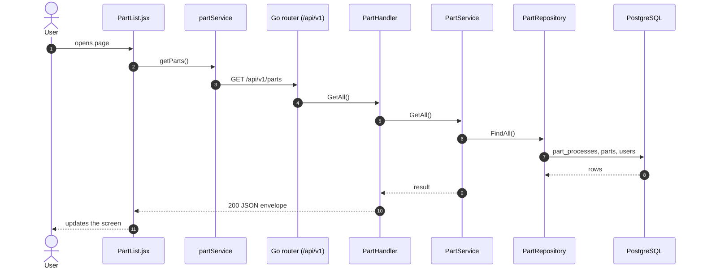
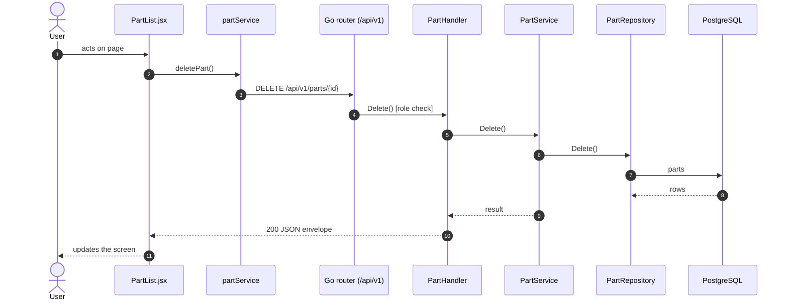

# Parts

- **Route:** `/masters/parts` · **Component:** [PartList.jsx](../../src/pages/Parts/PartList.jsx) · **Auth:** protected (every logged-in role) · **Guard/Layout:** `ProtectedRoute` (session) + role guard · `MainLayout`
- **Purpose:** Lists parts; managers add, edit and delete.
- **Navigation:** Sidebar › Masters → Parts → Add / Edit

## On page load

**Steps**

1. [PartList.jsx](../../src/pages/Parts/PartList.jsx) → useEffect(): runs on load `getParts()`
2. [partService.js](../../src/services/partService.js) → getParts(): calls `GET /api/v1/parts`
3. [part_routes.go](../../../7th-sense-server/internal/routes/part_routes.go) → `GET /v1/parts` → PartHandler.GetAll
4. [part_handler.go](../../../7th-sense-server/internal/handler/part_handler.go) → GetAll(): query userId; calls the service
5. [part_service.go](../../../7th-sense-server/internal/service/part_service.go) → GetAll(): Returns the parts the user may read (see companyOwner), without their processes. A non-nil customerID keeps only that customer's parts.
6. [part_repository.go](../../../7th-sense-server/internal/repository/part_repository.go) → FindAll(): reads / writes `part_processes`, `parts`, `users`, `clienteles`

## Delete part

**Sequence diagram**

**Steps**

1. [PartList.jsx](../../src/pages/Parts/PartList.jsx) → confirmDelete(): runs `deletePart()`
2. [partService.js](../../src/services/partService.js) → deletePart(): calls `DELETE /api/v1/parts/{id}`
3. [part_routes.go](../../../7th-sense-server/internal/routes/part_routes.go) → `DELETE /v1/parts/{id}` (managersOnly: superadmin, customer, admin) → PartHandler.Delete
4. [part_handler.go](../../../7th-sense-server/internal/handler/part_handler.go) → Delete(): reads {id}; calls the service
5. [part_service.go](../../../7th-sense-server/internal/service/part_service.go) → Delete(): Soft-deletes the part. A customer or admin (the logged-in user) deletes only their company's parts ("Part not found" for others).
6. [part_repository.go](../../../7th-sense-server/internal/repository/part_repository.go) → Delete(): reads / writes `parts`

**Rules & edge cases**

- Only superadmin, customer and admin may do this (server `managersOnly`, others 403); the page hides the controls for other roles.

## UI states

- **Loading:** `<Loader>` while the request runs.
- **Error:** a red `<Alert>` with the server message (some pages add Retry).
- **Success / failure of an action:** toast message (`utils/toast.js`).
- **Empty:** an empty-state message instead of the table / chart.
- **Delete:** asks for confirmation first.

## API calls on this page

| Method | Endpoint | Triggered by (section) | API docs |
|---|---|---|---|
| DELETE | `/api/v1/parts/{id}` | Delete part | [Swagger](http://localhost:8080/api-docs/index.html#/Parts/deletePart) · [openapi.yaml](../../../7th-sense-server/docs/api/openapi.yaml) |
| GET | `/api/v1/parts` | On page load | [Swagger](http://localhost:8080/api-docs/index.html#/Parts/getParts) · [openapi.yaml](../../../7th-sense-server/docs/api/openapi.yaml) |

## State & storage

- `useAuth()` (logged-in user, roles)
- Local component state (`useState`) for filters, form and modal

## Shared components used

[ConfirmModal.jsx](../../src/components/common/ConfirmModal.jsx), [Loader.jsx](../../src/components/common/Loader.jsx), [TablePagination.jsx](../../src/components/common/TablePagination.jsx), [SortableHead.jsx](../../src/components/common/SortableHead.jsx), [IconAction.jsx](../../src/components/common/IconAction.jsx), [StatusBadge.jsx](../../src/components/common/StatusBadge.jsx)

## Decisions

- [Client ADR index](../adr/README.md)
