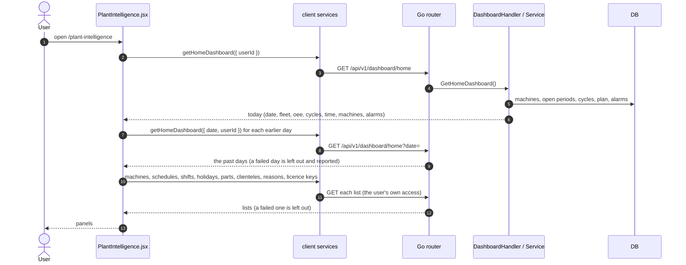

# Plant Intelligence

- **Route:** `/plant-intelligence` · **Component:** [PlantIntelligence.jsx](../../src/pages/PlantIntelligence/PlantIntelligence.jsx) · **Auth:** protected (every logged-in role) · **Guard/Layout:** `ProtectedRoute` (session) · `MainLayout`
- **Purpose:** Why capacity is lost, where, and whether it is improving, over a period and per machine. Sits beside [Home](home.md) and [Operations Center](operations-center.md) for comparison ([ADR 0025](../adr/0025-plant-intelligence-period-analysis.md)).
- **Navigation:** Sidebar › Main › **Plant Intelligence**. Rows and chips open [Monitoring](monitoring-machines.md), a machine's [Productivity](productivity.md), the schedule or the master screen concerned.

## On page load

1. [PlantIntelligence.jsx](../../src/pages/PlantIntelligence/PlantIntelligence.jsx) → `useLoad(getHomeDashboard)`: today, reloaded every `MONITOR_REFRESH_MS` (30 s). [dashboardService.js](../../src/services/dashboardService.js); server side in [home.md](home.md#on-page-load).
2. Second `useLoad`: the earlier days, counted from the `date` the server answered with. Loaded once per period, customer and day.
3. Third `useLoad`: the master lists, each `.catch` → null so its panel leaves it out. Licence keys only for `MANAGERS`. Reloaded every `SLOW_REFRESH_MS` (5 min).
4. [intelligenceSettings.js](../../src/pages/PlantIntelligence/intelligenceSettings.js) → `analyse()`, `buildInsights()`, `timeChart()`, `groupRows()`, `outlookRows()`: work the panels out from those responses.

## What the screen shows

| Panel | Data | Notes |
|---|---|---|
| Right now | `fleet`, `machines` of today | The fleet as one bar in mode colours, chips opening Monitoring, machines in Downtime or Hold for `ATTENTION_MINUTES` or more |
| Period tiles | `analyse()` | Today's OEE + average of daily OEE, availability, quality, cycles, connected time, alarm raises; each with a line of the days |
| What the data says | `buildInsights()` | Findings in words, below |
| Where the machine time went | `time.modes` of each day | Share per mode per day, of the connected time (default) or all time; the period's total per mode beside it, always of all time |
| Machines by day | `machines` of each day, line from `GET /machines` | [MachineHeatmap.jsx](../../src/pages/PlantIntelligence/MachineHeatmap.jsx): Availability, OEE or Cycles per day, worst first; search, line filter, machines that did not run hidden until asked for |
| OEE trend, Cycles per day | `oee`, `cycles` of each day | The Operations Center cards |
| Lines compared | `groupRows()` | Customers instead when the superadmin views all customers. Average machine availability (each machine has the same planned time), cycles, unfinished rate |
| Alarm Pareto | `alarms` of each day | Raises, share, running share and days seen per code. From each day's top 10 codes |
| Next 7 days | schedules, shifts, holidays | Machines with an active schedule; shifts working and holiday / week off only with one company in view |
| Readiness | machines, licences, shifts + counts | The Operations Center card |

### Findings

Most serious first, at most `INSIGHT_LIMIT` (7), each only with enough evidence:

| Finding | Rule |
|---|---|
| Biggest time loss | The largest mode other than production, with its hours. Not recorded also says it includes time before a machine was added |
| Availability trend | Later against earlier finished days (today left out): at least 4 days and a change of 2 points |
| Machines that did not run | No run time and no cycle in the period |
| Performance at exactly 100 % | Every known value is 100, what the server reports when cycles have no standard time |
| Unfinished cycles | At least 3 and `UNFINISHED_WARNING` (10 %) of closed cycles, naming the machine with most |
| Top alarm | Its share and the days seen; warning when seen on half the days or more (at least 2) |
| Weakest machine | Lowest availability of the machines that ran, with at least 3 of them |
| Cycle leaders | The top 3 machines make 60 % or more of completed cycles, with more than 3 producing |
| Plan coverage | Days of the period without any scheduled job |
| Part counters | At least 20 completed cycles and parts under half of them |

## Change the period or the customer

The Period select (7, 14 or 30 days) reloads the past days only. The superadmin's customer select reloads everything for that customer. Nothing is stored; both reset when the page is opened again.

**Rules & edge cases**

- Every figure follows the user's access: the server answers only with machines they may read, and a role that may not read a list simply has no such panel row.
- Period availability = run seconds / (time − planned stops), period quality = completed / closed cycles: the server's formulas on the summed figures. No period OEE exists, since Performance cannot be summed from this response.
- Machines listed are the active ones now. A machine counts for the whole period, also before it was added.
- A score of 0 is neutral in the heatmap (did not run); a blank cell has no value.
- Times and days follow the server's day (`date` of the response), so the page moves to the new day by itself.

## UI states

- **Loading:** `<Loader>` for the page, then for the period panels while Right now already shows.
- **Error:** today failing shows a red `<Alert>` with Retry; a failed refresh keeps the data read last with a warning; failed past days are left out with a warning.
- **Empty:** no active machine shows Add a machine (managers); each panel has its own empty text.

## API calls on this page

| Method | Endpoint | Triggered by (section) | API docs |
|---|---|---|---|
| GET | `/api/v1/dashboard/home` | On page load · Change the period or the customer | [Swagger](http://localhost:8080/api-docs/index.html#/Dashboard/getHomeDashboard) · [openapi.yaml](../../../7th-sense-server/docs/api/openapi.yaml) |
| GET | `/api/v1/machines`, `/production-schedules`, `/shifts`, `/holidays`, `/parts`, `/clienteles`, `/downtime-reasons`, `/licence-keys` | On page load | [openapi.yaml](../../../7th-sense-server/docs/api/openapi.yaml) |

## State & storage

- `useAuth()` (roles), `useOrgUser()` (the superadmin's customers), `useLoad()` (fetch + polling)
- Local `useState`: period, customer, heatmap metric / search / line / silent switch, time view

## Shared components used

[KpiTile, HomeCards.jsx](../../src/pages/Home/HomeCards.jsx), [OpsPanels.jsx](../../src/pages/OperationsCenter/OpsPanels.jsx) (`ActionRow`, `OeeTrendCard`, `CycleTrendCard`, `ReadinessCard`), [ChartCard.jsx](../../src/components/charts/ChartCard.jsx), [StackedBarChart.jsx](../../src/components/charts/StackedBarChart.jsx), [SortableHead.jsx](../../src/components/common/SortableHead.jsx), [TableNoResults.jsx](../../src/components/common/TableNoResults.jsx), [Loader.jsx](../../src/components/common/Loader.jsx)

## Decisions

- [ADR 0025: Plant Intelligence, a period and per-machine dashboard](../adr/0025-plant-intelligence-period-analysis.md)
- [Client ADR index](../adr/README.md)
