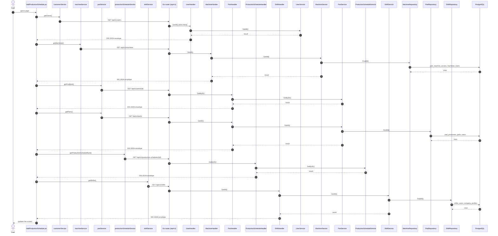
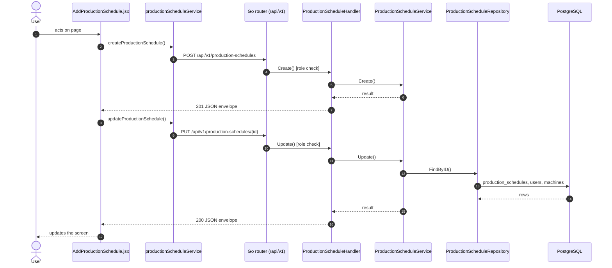

# Add / edit production schedule

- **Route:** `/production/schedule/add` · `/production/schedule/:id/edit` · **Component:** [AddProductionSchedule.jsx](../../src/pages/ProductionSchedules/AddProductionSchedule.jsx) · **Auth:** protected (superadmin, customer, admin) · **Guard/Layout:** `ProtectedRoute` (session) + role guard · `MainLayout`
- **Purpose:** Add or edit a production schedule: machine, shift, part / process and quantities.
- **Navigation:** Production schedules → form → back to the list

## On page load

**Steps**

1. [AddProductionSchedule.jsx](../../src/pages/ProductionSchedules/AddProductionSchedule.jsx) → useEffect(): runs on load `getUsers()`
2. [customerService.js](../../src/services/customerService.js) → getUsers(): calls `GET /api/v1/users`
3. [user_routes.go](../../../7th-sense-server/internal/routes/user_routes.go) → `GET /v1/users` (managersOnly: superadmin, customer, admin) → UserHandler.GetAll
4. [user_handler.go](../../../7th-sense-server/internal/handler/user_handler.go) → GetAll(): query companyId, filterRole; calls the service
5. [user_service.go](../../../7th-sense-server/internal/service/user_service.go) → GetAll(): Returns the users the user may see, narrowed by filter: every user for the superadmin, the company's members for a customer or admin. A customer or admin asking for another company gets Forbidden.
6. [AddProductionSchedule.jsx](../../src/pages/ProductionSchedules/AddProductionSchedule.jsx) → useEffect(): runs on load `getMachines()`
7. [machineService.js](../../src/services/machineService.js) → getMachines(): calls `GET /api/v1/machines`
8. [machine_routes.go](../../../7th-sense-server/internal/routes/machine_routes.go) → `GET /v1/machines` → MachineHandler.GetAll
9. [machine_handler.go](../../../7th-sense-server/internal/handler/machine_handler.go) → GetAll(): query userId; calls the service
10. [machine_service.go](../../../7th-sense-server/internal/service/machine_service.go) → GetAll(): Returns the machines the user may access (see machineScope). A non-nil customerID keeps only that customer's machines.
11. [machine_repository.go](../../../7th-sense-server/internal/repository/machine_repository.go) → FindAll(): reads / writes `user_machine_access`, `machines`, `users`, `company_profiles`
12. [AddProductionSchedule.jsx](../../src/pages/ProductionSchedules/AddProductionSchedule.jsx) → useEffect(): runs on load `getPartById()`
13. [partService.js](../../src/services/partService.js) → getPartById(): calls `GET /api/v1/parts/{id}`
14. [part_routes.go](../../../7th-sense-server/internal/routes/part_routes.go) → `GET /v1/parts/{id}` → PartHandler.GetByID
15. [part_handler.go](../../../7th-sense-server/internal/handler/part_handler.go) → GetByID(): reads {id}; query userId; calls the service
16. [part_service.go](../../../7th-sense-server/internal/service/part_service.go) → GetByID(): Returns the part with its processes when the user may read it, else "Part not found".
17. [AddProductionSchedule.jsx](../../src/pages/ProductionSchedules/AddProductionSchedule.jsx) → useEffect(): runs on load `getParts()`
18. [partService.js](../../src/services/partService.js) → getParts(): calls `GET /api/v1/parts`
19. [part_routes.go](../../../7th-sense-server/internal/routes/part_routes.go) → `GET /v1/parts` → PartHandler.GetAll
20. [part_handler.go](../../../7th-sense-server/internal/handler/part_handler.go) → GetAll(): query userId; calls the service
21. [part_service.go](../../../7th-sense-server/internal/service/part_service.go) → GetAll(): Returns the parts the user may read (see companyOwner), without their processes. A non-nil customerID keeps only that customer's parts.
22. [part_repository.go](../../../7th-sense-server/internal/repository/part_repository.go) → FindAll(): reads / writes `part_processes`, `parts`, `users`, `clienteles`
23. [AddProductionSchedule.jsx](../../src/pages/ProductionSchedules/AddProductionSchedule.jsx) → useEffect(): runs on load `getProductionScheduleById()`
24. [productionScheduleService.js](../../src/services/productionScheduleService.js) → getProductionScheduleById(): calls `GET /api/v1/production-schedules/{id}`
25. [production_schedule_routes.go](../../../7th-sense-server/internal/routes/production_schedule_routes.go) → `GET /v1/production-schedules/{id}` → ProductionScheduleHandler.GetByID
26. [production_schedule_handler.go](../../../7th-sense-server/internal/handler/production_schedule_handler.go) → GetByID(): reads {id}; query userId; calls the service
27. [production_schedule_service.go](../../../7th-sense-server/internal/service/production_schedule_service.go) → GetByID(): Returns the schedule with its items when the user may read it, else "Production schedule not found".
28. [AddProductionSchedule.jsx](../../src/pages/ProductionSchedules/AddProductionSchedule.jsx) → useEffect(): runs on load `getShifts()`
29. [shiftService.js](../../src/services/shiftService.js) → getShifts(): calls `GET /api/v1/shifts`
30. [shift_routes.go](../../../7th-sense-server/internal/routes/shift_routes.go) → `GET /v1/shifts` → ShiftHandler.GetAll
31. [shift_handler.go](../../../7th-sense-server/internal/handler/shift_handler.go) → GetAll(): query userId; calls the service
32. [shift_service.go](../../../7th-sense-server/internal/service/shift_service.go) → GetAll(): Returns the shifts the user may read, each with its breaks. A non-nil customerID keeps only that customer's shifts.
33. [shift_repository.go](../../../7th-sense-server/internal/repository/shift_repository.go) → FindAll(): reads / writes `shifts`, `users`, `company_profiles`

## Save production schedule (add / edit form)

**Sequence diagram**

**Steps**

1. [AddProductionSchedule.jsx](../../src/pages/ProductionSchedules/AddProductionSchedule.jsx) → onSubmit(): runs `createProductionSchedule()`
2. [productionScheduleService.js](../../src/services/productionScheduleService.js) → createProductionSchedule(): calls `POST /api/v1/production-schedules`
3. [production_schedule_routes.go](../../../7th-sense-server/internal/routes/production_schedule_routes.go) → `POST /v1/production-schedules` (managersOnly: superadmin, customer, admin) → ProductionScheduleHandler.Create
4. [production_schedule_handler.go](../../../7th-sense-server/internal/handler/production_schedule_handler.go) → Create(): decodes `dto.CreateProductionScheduleRequest` and runs its Validate(); calls the service
5. [production_schedule_service.go](../../../7th-sense-server/internal/service/production_schedule_service.go) → Create(): Adds a schedule with its items. A customer or admin (the logged-in user) adds it to their own company, whatever customer the request names; the superadmin to the customer named.
6. [AddProductionSchedule.jsx](../../src/pages/ProductionSchedules/AddProductionSchedule.jsx) → onSubmit(): runs `updateProductionSchedule()`
7. [productionScheduleService.js](../../src/services/productionScheduleService.js) → updateProductionSchedule(): calls `PUT /api/v1/production-schedules/{id}`
8. [production_schedule_routes.go](../../../7th-sense-server/internal/routes/production_schedule_routes.go) → `PUT /v1/production-schedules/{id}` (managersOnly: superadmin, customer, admin) → ProductionScheduleHandler.Update
9. [production_schedule_handler.go](../../../7th-sense-server/internal/handler/production_schedule_handler.go) → Update(): reads {id}; decodes `dto.UpdateProductionScheduleRequest` and runs its Validate(); calls the service
10. [production_schedule_service.go](../../../7th-sense-server/internal/service/production_schedule_service.go) → Update(): Replaces the schedule and its items. Items with an id are updated (they must be the schedule's), items without one are added and saved items missing from the request are deleted.
11. [production_schedule_repository.go](../../../7th-sense-server/internal/repository/production_schedule_repository.go) → FindByID(): reads / writes `production_schedules`, `users`, `machines`, `company_profiles`

**Rules & edge cases**

- Only superadmin, customer and admin may do this (server `managersOnly`, others 403); the page hides the controls for other roles.
- Server validation (`dto.UpdateProductionScheduleRequest.Validate`): Please enter valid status.

## UI states

- **Loading:** `<Loader>` while the request runs.
- **Error:** a red `<Alert>` with the server message (some pages add Retry).
- **Success / failure of an action:** toast message (`utils/toast.js`).
- **Empty:** an empty-state message instead of the table / chart.

## API calls on this page

| Method | Endpoint | Triggered by (section) | API docs |
|---|---|---|---|
| GET | `/api/v1/users` | On page load | [Swagger](http://localhost:8080/api-docs/index.html#/Users/getUsers) · [openapi.yaml](../../../7th-sense-server/docs/api/openapi.yaml) |
| GET | `/api/v1/machines` | On page load | [Swagger](http://localhost:8080/api-docs/index.html#/Machines/getMachines) · [openapi.yaml](../../../7th-sense-server/docs/api/openapi.yaml) |
| GET | `/api/v1/parts/{id}` | On page load | [Swagger](http://localhost:8080/api-docs/index.html#/Parts/getPartById) · [openapi.yaml](../../../7th-sense-server/docs/api/openapi.yaml) |
| GET | `/api/v1/parts` | On page load | [Swagger](http://localhost:8080/api-docs/index.html#/Parts/getParts) · [openapi.yaml](../../../7th-sense-server/docs/api/openapi.yaml) |
| POST | `/api/v1/production-schedules` | Save production schedule (add / edit form) | [Swagger](http://localhost:8080/api-docs/index.html#/Production%20schedules/createProductionSchedule) · [openapi.yaml](../../../7th-sense-server/docs/api/openapi.yaml) |
| GET | `/api/v1/production-schedules/{id}` | On page load | [Swagger](http://localhost:8080/api-docs/index.html#/Production%20schedules/getProductionScheduleById) · [openapi.yaml](../../../7th-sense-server/docs/api/openapi.yaml) |
| PUT | `/api/v1/production-schedules/{id}` | Save production schedule (add / edit form) | [Swagger](http://localhost:8080/api-docs/index.html#/Production%20schedules/updateProductionSchedule) · [openapi.yaml](../../../7th-sense-server/docs/api/openapi.yaml) |
| GET | `/api/v1/shifts` | On page load | [Swagger](http://localhost:8080/api-docs/index.html#/Shifts/getShifts) · [openapi.yaml](../../../7th-sense-server/docs/api/openapi.yaml) |

## State & storage

- Route param `:id` (`useParams`)
- `useAuth()` (logged-in user, roles)
- Local component state (`useState`) for filters, form and modal

## Shared components used

[DatePicker.jsx](../../src/components/common/DatePicker.jsx), [FieldLabel.jsx](../../src/components/common/FieldLabel.jsx), [Loader.jsx](../../src/components/common/Loader.jsx), [StatusToggle.jsx](../../src/components/common/StatusToggle.jsx), [IconAction.jsx](../../src/components/common/IconAction.jsx), [TimePicker.jsx](../../src/components/common/TimePicker.jsx)

## Decisions

- [Client ADR index](../adr/README.md)
