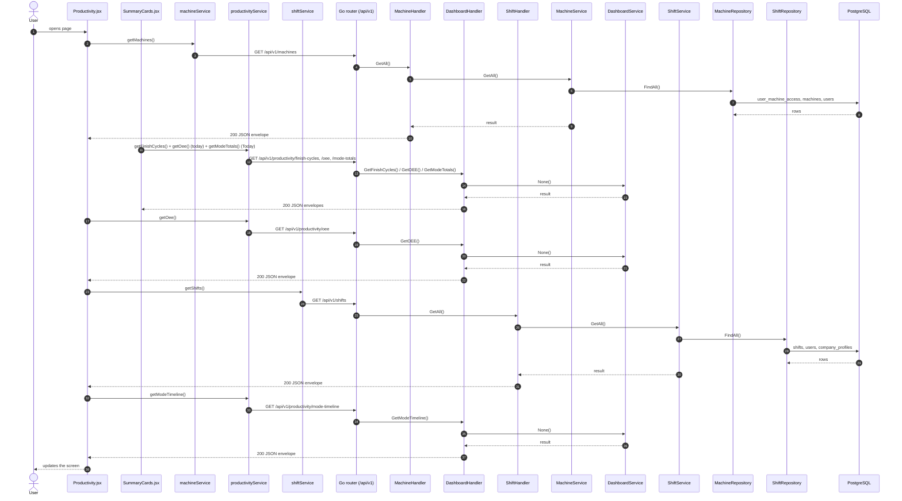
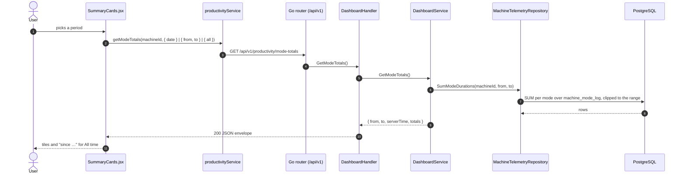

# Productivity

- **Route:** `/monitoring/productivity` · **Component:** [Productivity.jsx](../../src/pages/Productivity/Productivity.jsx) · **Auth:** protected (every logged-in role) · **Guard/Layout:** `ProtectedRoute` (session) + role guard · `MainLayout`
- **Purpose:** Live productivity of one machine: today's Cycles and OEE cards, the Machine Modes card (Today by default, or Yesterday / Last 7 days / Last 30 days / All time), mode Gantt timeline and the OEE trend.
- **Navigation:** Sidebar › Operations › Monitoring → [Machines](monitoring-machines.md) tab (Productivity action) → **Productivity** tab (?machineId; [MonitoringPage.jsx](../../src/pages/Monitoring/MonitoringPage.jsx): page header + tabs, this screen is the tab body; the tab is the route and keeps `?machineId`)

## On page load

**Steps**

1. [Productivity.jsx](../../src/pages/Productivity/Productivity.jsx) → useEffect(): runs on load `getMachines()`
2. [machineService.js](../../src/services/machineService.js) → getMachines(): calls `GET /api/v1/machines`
3. [machine_routes.go](../../../7th-sense-server/internal/routes/machine_routes.go) → `GET /v1/machines` → MachineHandler.GetAll
4. [machine_handler.go](../../../7th-sense-server/internal/handler/machine_handler.go) → GetAll(): query userId; calls the service
5. [machine_service.go](../../../7th-sense-server/internal/service/machine_service.go) → GetAll(): Returns the machines the user may access (see machineScope). A non-nil customerID keeps only that customer's machines.
6. [machine_repository.go](../../../7th-sense-server/internal/repository/machine_repository.go) → FindAll(): reads / writes `user_machine_access`, `machines`, `users`, `company_profiles`
7. [SummaryCards.jsx](../../src/pages/Productivity/SummaryCards.jsx) → three cards, each with its own `useLoad()` for today: **Cycles** `getFinishCycles({ machineId, date })` (Total / Finished / Unfinished Cycle, Average Cycle Time), **OEE** `getOee({ machineIds: [machineId], from, to })` (Availability, Productivity = performance, Quality, OEE) and **Machine Modes** `getModeTotals(machineId, { date })` for Today (the server's time per mode: In Production, Hold, Loading / Unloading, Idle, Downtime, Offline — `SUMMARY_MODE_IDS` — each with its share of the period; see [Change the Machine Modes period](#change-the-machine-modes-period))
8. [productivityService.js](../../src/services/productivityService.js) → getFinishCycles(): calls `GET /api/v1/productivity/finish-cycles`
9. [dashboard_routes.go](../../../7th-sense-server/internal/routes/dashboard_routes.go) → `GET /v1/productivity/finish-cycles` → DashboardHandler.GetFinishCycles
10. [dashboard_handler.go](../../../7th-sense-server/internal/handler/dashboard_handler.go) → GetFinishCycles(): query machineId, date, shiftIds, program; calls the service
11. [Productivity.jsx](../../src/pages/Productivity/Productivity.jsx) → useLoad(): runs on load `getOee()` (OEE trend chart)
12. [productivityService.js](../../src/services/productivityService.js) → getOee(): calls `GET /api/v1/productivity/oee`
13. [dashboard_routes.go](../../../7th-sense-server/internal/routes/dashboard_routes.go) → `GET /v1/productivity/oee` → DashboardHandler.GetOEE
14. [dashboard_handler.go](../../../7th-sense-server/internal/handler/dashboard_handler.go) → GetOEE(): query machineIds, from, to, shiftIds, program, schedule; calls the service
15. [Productivity.jsx](../../src/pages/Productivity/Productivity.jsx) → useLoad(): runs on load `getShifts()`
16. [shiftService.js](../../src/services/shiftService.js) → getShifts(): calls `GET /api/v1/shifts`
17. [shift_routes.go](../../../7th-sense-server/internal/routes/shift_routes.go) → `GET /v1/shifts` → ShiftHandler.GetAll
18. [shift_handler.go](../../../7th-sense-server/internal/handler/shift_handler.go) → GetAll(): query userId; calls the service
19. [shift_service.go](../../../7th-sense-server/internal/service/shift_service.go) → GetAll(): Returns the shifts the user may read, each with its breaks. A non-nil customerID keeps only that customer's shifts.
20. [shift_repository.go](../../../7th-sense-server/internal/repository/shift_repository.go) → FindAll(): reads / writes `shifts`, `users`, `company_profiles`
21. [ModeTimelineCard.jsx](../../src/pages/Productivity/ModeTimelineCard.jsx) → useLoad(): runs on load `getModeTimeline()`
22. [productivityService.js](../../src/services/productivityService.js) → getModeTimeline(): calls `GET /api/v1/productivity/mode-timeline`
23. [dashboard_routes.go](../../../7th-sense-server/internal/routes/dashboard_routes.go) → `GET /v1/productivity/mode-timeline` → DashboardHandler.GetModeTimeline
24. [dashboard_handler.go](../../../7th-sense-server/internal/handler/dashboard_handler.go) → GetModeTimeline(): query machineId, date, minutes; calls the service

## Change the Machine Modes period

The select in the Machine Modes card header (`MODE_RANGES` in [productivitySettings.js](../../src/pages/Productivity/productivitySettings.js)): **Today** (default), Yesterday, Last 7 days, Last 30 days, All time.

**Steps**

1. [SummaryCards.jsx](../../src/pages/Productivity/SummaryCards.jsx) → `setModeRangeValue()`: the period's `query(today)` is part of the `useLoad` key, so only this card reloads (and keeps reloading every `KPI_REFRESH_MS`)
2. [productivityService.js](../../src/services/productivityService.js) → getModeTotals(): calls `GET /api/v1/productivity/mode-totals` with `date` (Today, Yesterday), `from` / `to` (Last 7 / 30 days) or `all=true`
3. [dashboard_routes.go](../../../7th-sense-server/internal/routes/dashboard_routes.go) → `GET /v1/productivity/mode-totals` → DashboardHandler.GetModeTotals
4. [dashboard_handler.go](../../../7th-sense-server/internal/handler/dashboard_handler.go) → GetModeTotals(): query machineId, date / from / to, all; `DashboardRequest.Validate` ([dashboard_dto.go](../../../7th-sense-server/internal/dto/dashboard_dto.go)) skips the 31-day limit only for `all`
5. [dashboard_service.go](../../../7th-sense-server/internal/service/dashboard_service.go) → GetModeTotals(): checks the user may read the machine, cuts the range at now (all time: from the first period); `from` in the response is the range start or, for all time, the first recorded period
6. [machine_telemetry_repository.go](../../../7th-sense-server/internal/repository/machine_telemetry_repository.go) → SumModeDurations(): one `SUM` per mode in SQL over `machine_mode_log` (+ `machine_modes` names), every period clipped to the range and the open one running up to now, so All time does not load every period

## Live updates

- **Cycles / OEE / Machine Modes cards:** each reloads its request every `KPI_REFRESH_MS` ([productivitySettings.js](../../src/pages/Productivity/productivitySettings.js)); a failed call shows its error only in its own card.
- **Machine Mode Timeline** ([ModeTimelineCard.jsx](../../src/pages/Productivity/ModeTimelineCard.jsx)): reloads `GET /productivity/mode-timeline` every 30 s (`TIMELINE_POLL_MS`) and grows the open period every second (`TIMELINE_TICK_MS`) on the server clock (offset from the response's `serverTime`). History (a whole past day) does not poll.
- Filters (machines, dates, shifts, program) are part of the `useLoad` key, so changing one reloads only that chart.

**Rules & edge cases**

- Every user may open the page, for the machines the server returns them; a machine they may not read → 404 "Machine not found".
- Dates: at most 31 days per range; mode timeline `minutes` 1–1440.
- The OEE trend compares machines of the header machine's customer; shift options are that customer's shifts.
- The Finish Cycle Summary and Finished / Unfinished Cycles charts are hidden (`GET /productivity/cycle-counts` is no longer called; the endpoint and `getCycleCounts()` stay).
- The Machine Modes card shows only `SUMMARY_MODE_IDS` (no Setup, Rapid Mode, Planned / Leave Planned Downtime); a mode with no time in the period shows `0m 00s`, and its share is of all recorded time in the period (hidden modes included).
- Machine Modes periods: Today and Yesterday are one day; Last 7 / 30 days end today; All time has no date limit and its subtitle says since when data exists. The period resets to Today when the machine changes.

## UI states

- **Loading:** `<Loader>` while the request runs.
- **Error:** a red `<Alert>` with the server message (some pages add Retry).
- **Empty:** an empty-state message instead of the table / chart.

## API calls on this page

| Method | Endpoint | Triggered by (section) | API docs |
|---|---|---|---|
| GET | `/api/v1/machines` | On page load | [Swagger](http://localhost:8080/api-docs/index.html#/Machines/getMachines) · [openapi.yaml](../../../7th-sense-server/docs/api/openapi.yaml) |
| GET | `/api/v1/productivity/finish-cycles` | On page load | [Swagger](http://localhost:8080/api-docs/index.html#/Productivity/getFinishCycles) · [openapi.yaml](../../../7th-sense-server/docs/api/openapi.yaml) |
| GET | `/api/v1/productivity/oee` | On page load | [Swagger](http://localhost:8080/api-docs/index.html#/Productivity/getOee) · [openapi.yaml](../../../7th-sense-server/docs/api/openapi.yaml) |
| GET | `/api/v1/shifts` | On page load | [Swagger](http://localhost:8080/api-docs/index.html#/Shifts/getShifts) · [openapi.yaml](../../../7th-sense-server/docs/api/openapi.yaml) |
| GET | `/api/v1/productivity/mode-timeline` | On page load | [Swagger](http://localhost:8080/api-docs/index.html#/Productivity/getModeTimeline) · [openapi.yaml](../../../7th-sense-server/docs/api/openapi.yaml) |
| GET | `/api/v1/productivity/mode-totals` | On page load · Change the Machine Modes period | [Swagger](http://localhost:8080/api-docs/index.html#/Productivity/getModeTotals) · [openapi.yaml](../../../7th-sense-server/docs/api/openapi.yaml) |

## State & storage

- URL param `?machineId=`
- `useAuth()` (logged-in user, roles)
- `useLoad()` (fetch + optional polling)
- Local component state (`useState`) for filters, form and modal

## Shared components used

[ChartCard.jsx](../../src/components/charts/ChartCard.jsx), [ChartDateFilter.jsx](../../src/components/charts/ChartDateFilter.jsx), [LineTrendChart.jsx](../../src/components/charts/LineTrendChart.jsx), [Loader.jsx](../../src/components/common/Loader.jsx), [MultiSelectPicker.jsx](../../src/components/common/MultiSelectPicker.jsx), [ModeGanttChart.jsx](../../src/components/charts/ModeGanttChart.jsx)

## Decisions

- [ADR 0012: Monitoring tabbed page](../adr/0012-monitoring-tabbed-page.md)
- [Client ADR index](../adr/README.md)
