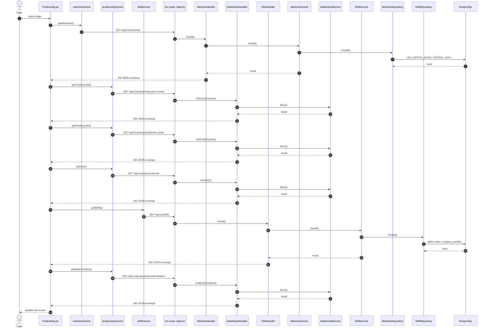

# Productivity

- **Route:** `/machines/productivity` · **Component:** [Productivity.jsx](../../src/pages/Productivity/Productivity.jsx) · **Auth:** protected (every logged-in role) · **Guard/Layout:** `ProtectedRoute` (session) + role guard · `MainLayout`
- **Purpose:** Live productivity of one machine: KPI tiles, mode Gantt timeline, OEE, Finish Cycle Summary and finished / unfinished cycle counts.
- **Navigation:** All Machines (Productivity link) / sidebar → Productivity (?machineId)

## On page load

**Steps**

1. [Productivity.jsx](../../src/pages/Productivity/Productivity.jsx) → useEffect(): runs on load `getMachines()`
2. [machineService.js](../../src/services/machineService.js) → getMachines(): calls `GET /api/v1/machines`
3. [machine_routes.go](../../../7th-sense-server/internal/routes/machine_routes.go) → `GET /v1/machines` → MachineHandler.GetAll
4. [machine_handler.go](../../../7th-sense-server/internal/handler/machine_handler.go) → GetAll(): query userId; calls the service
5. [machine_service.go](../../../7th-sense-server/internal/service/machine_service.go) → GetAll(): Returns the machines the user may access (see machineScope). A non-nil customerID keeps only that customer's machines.
6. [machine_repository.go](../../../7th-sense-server/internal/repository/machine_repository.go) → FindAll(): reads / writes `user_machine_access`, `machines`, `users`, `company_profiles`
7. [Productivity.jsx](../../src/pages/Productivity/Productivity.jsx) → useLoad(): runs on load `getCycleCounts()`
8. [productivityService.js](../../src/services/productivityService.js) → getCycleCounts(): calls `GET /api/v1/productivity/cycle-counts`
9. [dashboard_routes.go](../../../7th-sense-server/internal/routes/dashboard_routes.go) → `GET /v1/productivity/cycle-counts` → DashboardHandler.GetCycleCounts
10. [dashboard_handler.go](../../../7th-sense-server/internal/handler/dashboard_handler.go) → GetCycleCounts(): query machineIds, from, to, shiftIds; calls the service
11. [Productivity.jsx](../../src/pages/Productivity/Productivity.jsx) → useLoad(): runs on load `getFinishCycles()`
12. [productivityService.js](../../src/services/productivityService.js) → getFinishCycles(): calls `GET /api/v1/productivity/finish-cycles`
13. [dashboard_routes.go](../../../7th-sense-server/internal/routes/dashboard_routes.go) → `GET /v1/productivity/finish-cycles` → DashboardHandler.GetFinishCycles
14. [dashboard_handler.go](../../../7th-sense-server/internal/handler/dashboard_handler.go) → GetFinishCycles(): query machineId, date, shiftIds, program; calls the service
15. [Productivity.jsx](../../src/pages/Productivity/Productivity.jsx) → useLoad(): runs on load `getOee()`
16. [productivityService.js](../../src/services/productivityService.js) → getOee(): calls `GET /api/v1/productivity/oee`
17. [dashboard_routes.go](../../../7th-sense-server/internal/routes/dashboard_routes.go) → `GET /v1/productivity/oee` → DashboardHandler.GetOEE
18. [dashboard_handler.go](../../../7th-sense-server/internal/handler/dashboard_handler.go) → GetOEE(): query machineIds, from, to, shiftIds, program, schedule; calls the service
19. [Productivity.jsx](../../src/pages/Productivity/Productivity.jsx) → useLoad(): runs on load `getShifts()`
20. [shiftService.js](../../src/services/shiftService.js) → getShifts(): calls `GET /api/v1/shifts`
21. [shift_routes.go](../../../7th-sense-server/internal/routes/shift_routes.go) → `GET /v1/shifts` → ShiftHandler.GetAll
22. [shift_handler.go](../../../7th-sense-server/internal/handler/shift_handler.go) → GetAll(): query userId; calls the service
23. [shift_service.go](../../../7th-sense-server/internal/service/shift_service.go) → GetAll(): Returns the shifts the user may read, each with its breaks. A non-nil customerID keeps only that customer's shifts.
24. [shift_repository.go](../../../7th-sense-server/internal/repository/shift_repository.go) → FindAll(): reads / writes `shifts`, `users`, `company_profiles`
25. [ModeTimelineCard.jsx](../../src/pages/Productivity/ModeTimelineCard.jsx) → useLoad(): runs on load `getModeTimeline()`
26. [productivityService.js](../../src/services/productivityService.js) → getModeTimeline(): calls `GET /api/v1/productivity/mode-timeline`
27. [dashboard_routes.go](../../../7th-sense-server/internal/routes/dashboard_routes.go) → `GET /v1/productivity/mode-timeline` → DashboardHandler.GetModeTimeline
28. [dashboard_handler.go](../../../7th-sense-server/internal/handler/dashboard_handler.go) → GetModeTimeline(): query machineId, date, minutes; calls the service

## Live updates

- **KPI tiles:** today's `GET /productivity/finish-cycles` reloads every `KPI_REFRESH_MS` ([productivitySettings.js](../../src/pages/Productivity/productivitySettings.js)).
- **Machine Mode Timeline** ([ModeTimelineCard.jsx](../../src/pages/Productivity/ModeTimelineCard.jsx)): reloads `GET /productivity/mode-timeline` every 30 s (`TIMELINE_POLL_MS`) and grows the open period every second (`TIMELINE_TICK_MS`) on the server clock (offset from the response's `serverTime`). History (a whole past day) does not poll.
- Filters (machines, dates, shifts, program) are part of the `useLoad` key, so changing one reloads only that chart.

**Rules & edge cases**

- Every user may open the page, for the machines the server returns them; a machine they may not read → 404 "Machine not found".
- Dates: at most 31 days per range; mode timeline `minutes` 1–1440.
- OEE / cycle counts compare machines of the header machine's customer; shift options are that customer's shifts.

## UI states

- **Loading:** `<Loader>` while the request runs.
- **Error:** a red `<Alert>` with the server message (some pages add Retry).
- **Empty:** an empty-state message instead of the table / chart.

## API calls on this page

| Method | Endpoint | Triggered by (section) | API docs |
|---|---|---|---|
| GET | `/api/v1/machines` | On page load | [Swagger](http://localhost:8080/api-docs/index.html#/Machines/getMachines) · [openapi.yaml](../../../7th-sense-server/docs/api/openapi.yaml) |
| GET | `/api/v1/productivity/cycle-counts` | On page load | [Swagger](http://localhost:8080/api-docs/index.html#/Productivity/getCycleCounts) · [openapi.yaml](../../../7th-sense-server/docs/api/openapi.yaml) |
| GET | `/api/v1/productivity/finish-cycles` | On page load | [Swagger](http://localhost:8080/api-docs/index.html#/Productivity/getFinishCycles) · [openapi.yaml](../../../7th-sense-server/docs/api/openapi.yaml) |
| GET | `/api/v1/productivity/oee` | On page load | [Swagger](http://localhost:8080/api-docs/index.html#/Productivity/getOee) · [openapi.yaml](../../../7th-sense-server/docs/api/openapi.yaml) |
| GET | `/api/v1/shifts` | On page load | [Swagger](http://localhost:8080/api-docs/index.html#/Shifts/getShifts) · [openapi.yaml](../../../7th-sense-server/docs/api/openapi.yaml) |
| GET | `/api/v1/productivity/mode-timeline` | On page load | [Swagger](http://localhost:8080/api-docs/index.html#/Productivity/getModeTimeline) · [openapi.yaml](../../../7th-sense-server/docs/api/openapi.yaml) |

## State & storage

- URL param `?machineId=`
- `useAuth()` (logged-in user, roles)
- `useLoad()` (fetch + optional polling)
- Local component state (`useState`) for filters, form and modal

## Shared components used

[BarLineChart.jsx](../../src/components/charts/BarLineChart.jsx), [ChartCard.jsx](../../src/components/charts/ChartCard.jsx), [ChartDateFilter.jsx](../../src/components/charts/ChartDateFilter.jsx), [GroupedBarChart.jsx](../../src/components/charts/GroupedBarChart.jsx), [LineTrendChart.jsx](../../src/components/charts/LineTrendChart.jsx), [chartTheme.js](../../src/components/charts/chartTheme.js), [Loader.jsx](../../src/components/common/Loader.jsx), [MultiSelectPicker.jsx](../../src/components/common/MultiSelectPicker.jsx), [ModeGanttChart.jsx](../../src/components/charts/ModeGanttChart.jsx)

## Decisions

- [Client ADR index](../adr/README.md)
