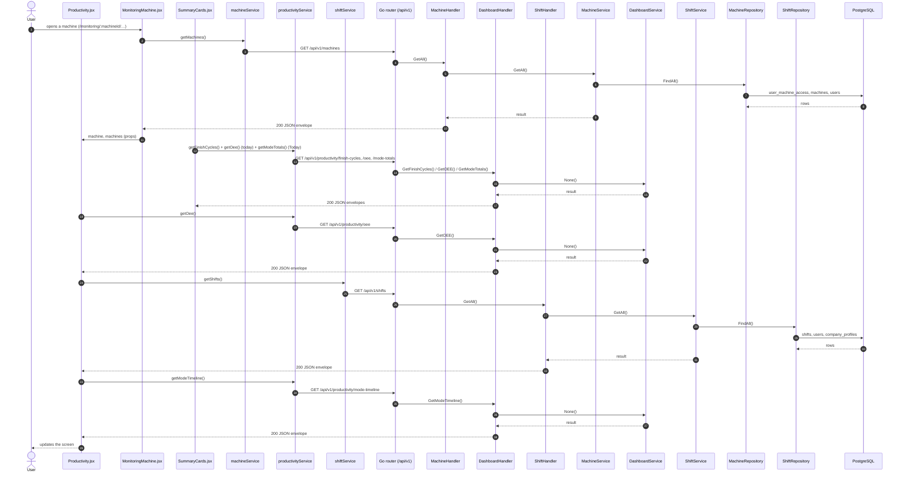
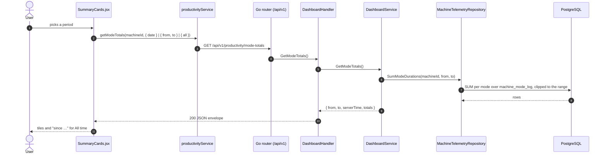
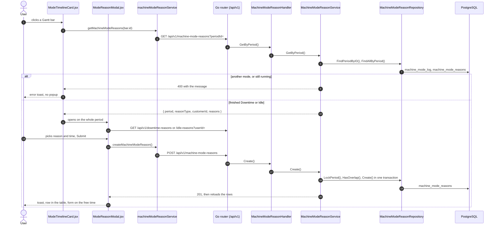

# Productivity

- **Route:** `/monitoring/:machineId/productivity` · **Component:** [Productivity.jsx](../../src/pages/Productivity/Productivity.jsx) inside [MonitoringMachine.jsx](../../src/pages/Monitoring/MonitoringMachine.jsx) ([MonitoringPage.jsx](../../src/pages/Monitoring/MonitoringPage.jsx)) · **Auth:** protected (every logged-in role) · **Guard/Layout:** `ProtectedRoute` (session) + role guard · `MainLayout`
- **Purpose:** Live productivity of one machine: today's Cycles and OEE cards, the Machine Modes card (Today by default, or Yesterday / Last 7 days / Last 30 days / All time), mode Gantt timeline (click a finished Downtime or Idle bar to add its reason) and the OEE trend.
- **Navigation:** Sidebar › Operations › **Monitoring** → [machine list](monitoring-machines.md) → a machine's Productivity action → **Productivity** tab. The machine view has a page header (machine name, "Machine # id · model · customer"), a **Machine list** back-arrow button and the Productivity / Machine Health tabs (the tab is the route; both carry the machine id). There is no machine select: go back to the list to pick another machine.

## On page load

**Steps**

1. [MonitoringMachine.jsx](../../src/pages/Monitoring/MonitoringMachine.jsx) → [useMachines.js](../../src/pages/Machines/useMachines.js) → useEffect(): runs on load `getMachines()`, finds `:machineId` (else "Machine not found") and passes `machine` + `machines` (OEE machine picker) to Productivity
2. [machineService.js](../../src/services/machineService.js) → getMachines(): calls `GET /api/v1/machines`
3. [machine_routes.go](../../../7th-sense-server/internal/routes/machine_routes.go) → `GET /v1/machines` → MachineHandler.GetAll
4. [machine_handler.go](../../../7th-sense-server/internal/handler/machine_handler.go) → GetAll(): query userId; calls the service
5. [machine_service.go](../../../7th-sense-server/internal/service/machine_service.go) → GetAll(): Returns the machines the user may access (see machineScope). A non-nil customerID keeps only that customer's machines.
6. [machine_repository.go](../../../7th-sense-server/internal/repository/machine_repository.go) → FindAll(): reads / writes `user_machine_access`, `machines`, `users`, `company_profiles`
7. [SummaryCards.jsx](../../src/pages/Productivity/SummaryCards.jsx) → three cards, each with its own `useLoad()` for today: **Cycles** `getFinishCycles({ machineId, date })` (Total / Finished / Unfinished Cycle, Average Cycle Time), **OEE** `getOee({ machineIds: [machineId], from, to })` (Availability = utilization, the run time of the day so far; Performance; Quality; OEE) and **Machine Modes** `getModeTotals(machineId, { date })` for Today (the server's time per mode: In Production, Hold, Loading / Unloading, Idle, Downtime, Offline — `SUMMARY_MODE_IDS` — each with its share of the whole period `from` … `to`; In Production includes Rapid Mode 12 (`SUMMARY_MODE_PARTS`), as OEE run time does; see [Change the Machine Modes period](#change-the-machine-modes-period))
8. [productivityService.js](../../src/services/productivityService.js) → getFinishCycles(): calls `GET /api/v1/productivity/finish-cycles`
9. [dashboard_routes.go](../../../7th-sense-server/internal/routes/dashboard_routes.go) → `GET /v1/productivity/finish-cycles` → DashboardHandler.GetFinishCycles
10. [dashboard_handler.go](../../../7th-sense-server/internal/handler/dashboard_handler.go) → GetFinishCycles(): query machineId, date, shiftIds, program; calls the service
11. [Productivity.jsx](../../src/pages/Productivity/Productivity.jsx) → useLoad(): runs on load `getOee()` (OEE trend chart)
12. [productivityService.js](../../src/services/productivityService.js) → getOee(): calls `GET /api/v1/productivity/oee`
13. [dashboard_routes.go](../../../7th-sense-server/internal/routes/dashboard_routes.go) → `GET /v1/productivity/oee` → DashboardHandler.GetOEE
14. [dashboard_handler.go](../../../7th-sense-server/internal/handler/dashboard_handler.go) → GetOEE(): query machineIds, from, to, shiftIds, program, schedule; calls the service (`DashboardService.GetOEE`: several machines are added up as seconds and cycles (`oeeSum`), so each weighs by its planned / run time and closed cycles, not averaged; Performance = standard cycle time × parts counted by the controller (`parts_made`, ProgramPartCount at M30) / production time of the completed cycles; a cycle without a part adds time, not parts)
15. [Productivity.jsx](../../src/pages/Productivity/Productivity.jsx) → useLoad(): runs on load `getShifts()`
16. [shiftService.js](../../src/services/shiftService.js) → getShifts(): calls `GET /api/v1/shifts`
17. [shift_routes.go](../../../7th-sense-server/internal/routes/shift_routes.go) → `GET /v1/shifts` → ShiftHandler.GetAll
18. [shift_handler.go](../../../7th-sense-server/internal/handler/shift_handler.go) → GetAll(): query userId; calls the service
19. [shift_service.go](../../../7th-sense-server/internal/service/shift_service.go) → GetAll(): Returns the shifts the user may read, each with its breaks. A non-nil customerID keeps only that customer's shifts.
20. [shift_repository.go](../../../7th-sense-server/internal/repository/shift_repository.go) → FindAll(): reads / writes `shifts`, `users`, `company_profiles`
21. [ModeTimelineCard.jsx](../../src/pages/Productivity/ModeTimelineCard.jsx) → useLoad(): runs on load `getModeTimeline()`
22. [productivityService.js](../../src/services/productivityService.js) → getModeTimeline(): calls `GET /api/v1/productivity/mode-timeline`
23. [dashboard_routes.go](../../../7th-sense-server/internal/routes/dashboard_routes.go) → `GET /v1/productivity/mode-timeline` → DashboardHandler.GetModeTimeline
24. [dashboard_handler.go](../../../7th-sense-server/internal/handler/dashboard_handler.go) → GetModeTimeline(): query machineId, date, minutes; calls the service

## Change the Machine Modes period

The select in the Machine Modes card header (`MODE_RANGES` in [productivitySettings.js](../../src/pages/Productivity/productivitySettings.js)): **Today** (default), Yesterday, Last 7 days, Last 30 days, All time.

**Steps**

1. [SummaryCards.jsx](../../src/pages/Productivity/SummaryCards.jsx) → `setModeRangeValue()`: the period's `query(today)` is part of the `useLoad` key, so only this card reloads (and keeps reloading every `KPI_REFRESH_MS`)
2. [productivityService.js](../../src/services/productivityService.js) → getModeTotals(): calls `GET /api/v1/productivity/mode-totals` with `date` (Today, Yesterday), `from` / `to` (Last 7 / 30 days) or `all=true`
3. [dashboard_routes.go](../../../7th-sense-server/internal/routes/dashboard_routes.go) → `GET /v1/productivity/mode-totals` → DashboardHandler.GetModeTotals
4. [dashboard_handler.go](../../../7th-sense-server/internal/handler/dashboard_handler.go) → GetModeTotals(): query machineId, date / from / to, all; `DashboardRequest.Validate` ([dashboard_dto.go](../../../7th-sense-server/internal/dto/dashboard_dto.go)) skips the 31-day limit only for `all`
5. [dashboard_service.go](../../../7th-sense-server/internal/service/dashboard_service.go) → GetModeTotals(): checks the user may read the machine, cuts the range at now (all time: from the first period); `from` in the response is the range start or, for all time, the first recorded period
6. [machine_telemetry_repository.go](../../../7th-sense-server/internal/repository/machine_telemetry_repository.go) → SumModeDurations(): one `SUM` per mode in SQL over `machine_mode_log` (+ `machine_modes` names), every period clipped to the range and the open one running up to now, so All time does not load every period

## Add a downtime or idle reason

Click a bar of the Machine Mode Timeline. Only a finished Downtime or Idle bar opens the popup (Update Downtime Reason / Update Idle Reason).

**Steps**

1. [ModeGanttChart.jsx](../../src/components/charts/ModeGanttChart.jsx) → `onBarClick(bar)`; [ModeTimelineCard.jsx](../../src/pages/Productivity/ModeTimelineCard.jsx) → `openReasons()`: loads the period, or shows the server's message in a toast
2. [machineModeReasonService.js](../../src/services/machineModeReasonService.js) → `getMachineModeReasons()`: calls `GET /api/v1/machine-mode-reasons?periodId=`
3. [machine_mode_reason_routes.go](../../../7th-sense-server/internal/routes/machine_mode_reason_routes.go) → [machine_mode_reason_handler.go](../../../7th-sense-server/internal/handler/machine_mode_reason_handler.go) → GetByPeriod(): query periodId
4. [machine_mode_reason_service.go](../../../7th-sense-server/internal/service/machine_mode_reason_service.go) → GetByPeriod(): `readablePeriod()` checks the user may read the machine, `reasonTypeOfPeriod()` refuses other modes and a running period
5. [ModeReasonModal.jsx](../../src/pages/Productivity/ModeReasonModal.jsx): header with the whole period; loads the kind's active reasons ([reasonPages.js](../../src/pages/Reasons/reasonPages.js)); [modeReasonForm.js](../../src/pages/Productivity/modeReasonForm.js) → `newFormValues()` starts on the first free time, `modeReasonSchema()` shows mistakes on their field, `toReasonPayload()` builds the body
6. [machine_mode_reason_dto.go](../../../7th-sense-server/internal/dto/machine_mode_reason_dto.go) → Validate(): reason, times, end after start
7. [machine_mode_reason_service.go](../../../7th-sense-server/internal/service/machine_mode_reason_service.go) → Create() / Update(): `checkInsidePeriod()`, `checkReason()`, then `inPeriodLock()` + `checkNoOverlap()`
8. [machine_mode_reason_repository.go](../../../7th-sense-server/internal/repository/machine_mode_reason_repository.go): reads / writes `machine_mode_reasons`, `machine_mode_log`
9. **Edit** loads a row into the form (`PUT /machine-mode-reasons/{id}`); **Delete** asks first (`DELETE /machine-mode-reasons/{id}`, soft delete, frees the time)

**Rules & edge cases**

- Every user who may read the machine adds, edits and deletes; a machine they may not read → 404 "Machine not found".
- Refused bars: "You can not add a reason in In Production mode." (also Hold, Offline), and "You can not add downtime reason in running mode." for a Downtime or Idle bar still running.
- The time must lie inside the period and overlap no other reason of it; reasons may touch. A period may be split into several reasons.
- The form picks whole minutes. The minute holding the period's start or end means that exact instant, so the default saves the whole period to the second.
- A period past midnight also shows Start Date and End Date fields.
- New picks are active reasons of the machine's customer. A row keeps its reason if that is later made inactive or deleted from the master list.

## Live updates

- **Cycles / OEE / Machine Modes cards:** each reloads its request every `KPI_REFRESH_MS` ([productivitySettings.js](../../src/pages/Productivity/productivitySettings.js)); a failed call shows its error only in its own card.
- **Machine Mode Timeline** ([ModeTimelineCard.jsx](../../src/pages/Productivity/ModeTimelineCard.jsx)): reloads `GET /productivity/mode-timeline` every 30 s (`TIMELINE_POLL_MS`) and grows the open period every second (`TIMELINE_TICK_MS`) on the server clock (offset from the response's `serverTime`). History (a whole past day) does not poll.
- Filters (machines, dates, shifts, program) are part of the `useLoad` key, so changing one reloads only that chart.

**Rules & edge cases**

- Every user may open the page, for the machines the server returns them; a machine they may not read → 404 "Machine not found".
- Dates: at most 31 days per range; mode timeline `minutes` 1–1440.
- The OEE trend compares machines of the machine's customer; shift options are that customer's shifts. The machine picker shows each machine's current mode (`modeId` → `MACHINE_MODE_TYPES`, as of page load) and its search matches the name or the mode (e.g. "Idle").
- The Finish Cycle Summary and Finished / Unfinished Cycles charts are hidden (`GET /productivity/cycle-counts` is no longer called; the endpoint stays).
- The Machine Modes card shows only `SUMMARY_MODE_IDS` (no Setup, Planned / Leave Planned Downtime; Rapid Mode is counted in In Production); a mode with no time in the period shows `0m 00s`. Each share is of the whole period (`to − from` of the response; Today = midnight to now, All time = from the first period), so time with no record (before collection started) is not shared out and the shares may add up to less than 100 %.
- Machine Modes periods: Today and Yesterday are one day; Last 7 / 30 days end today; All time has no date limit and its subtitle says since when data exists. The period resets to Today when the machine changes. The summary cards read today on every render, so the next refresh after midnight moves them to the new day; the timeline's History does the same unless a past day was picked.

## UI states

- **Loading:** `<Loader>` while the request runs.
- **Error:** a red `<Alert>` with the server message (some pages add Retry).
- **Empty:** an empty-state message instead of the table / chart.

## API calls on this page

| Method | Endpoint | Triggered by (section) | API docs |
|---|---|---|---|
| GET | `/api/v1/machines` | On page load | [Swagger](http://localhost:8080/api-docs/index.html#/Machines/getMachines) · [openapi.yaml](../../../7th-sense-server/docs/api/openapi.yaml) |
| GET | `/api/v1/productivity/finish-cycles` | On page load | [Swagger](http://localhost:8080/api-docs/index.html#/Productivity/getFinishCycles) · [openapi.yaml](../../../7th-sense-server/docs/api/openapi.yaml) |
| GET | `/api/v1/productivity/oee` | On page load | [Swagger](http://localhost:8080/api-docs/index.html#/Productivity/getOee) · [openapi.yaml](../../../7th-sense-server/docs/api/openapi.yaml) |
| GET | `/api/v1/shifts` | On page load | [Swagger](http://localhost:8080/api-docs/index.html#/Shifts/getShifts) · [openapi.yaml](../../../7th-sense-server/docs/api/openapi.yaml) |
| GET | `/api/v1/productivity/mode-timeline` | On page load | [Swagger](http://localhost:8080/api-docs/index.html#/Productivity/getModeTimeline) · [openapi.yaml](../../../7th-sense-server/docs/api/openapi.yaml) |
| GET | `/api/v1/productivity/mode-totals` | On page load · Change the Machine Modes period | [Swagger](http://localhost:8080/api-docs/index.html#/Productivity/getModeTotals) · [openapi.yaml](../../../7th-sense-server/docs/api/openapi.yaml) |
| GET | `/api/v1/machine-mode-reasons` | Add a downtime or idle reason | [Swagger](http://localhost:8080/api-docs/index.html#/Reasons/getMachineModeReasons) · [openapi.yaml](../../../7th-sense-server/docs/api/openapi.yaml) |
| POST | `/api/v1/machine-mode-reasons` | Add a downtime or idle reason | [Swagger](http://localhost:8080/api-docs/index.html#/Reasons/createMachineModeReason) · [openapi.yaml](../../../7th-sense-server/docs/api/openapi.yaml) |
| PUT | `/api/v1/machine-mode-reasons/{id}` | Add a downtime or idle reason (Edit) | [Swagger](http://localhost:8080/api-docs/index.html#/Reasons/updateMachineModeReason) · [openapi.yaml](../../../7th-sense-server/docs/api/openapi.yaml) |
| DELETE | `/api/v1/machine-mode-reasons/{id}` | Add a downtime or idle reason (Delete) | [Swagger](http://localhost:8080/api-docs/index.html#/Reasons/deleteMachineModeReason) · [openapi.yaml](../../../7th-sense-server/docs/api/openapi.yaml) |
| GET | `/api/v1/downtime-reasons`, `/api/v1/idle-reasons` | Add a downtime or idle reason (the popup's list) | [Swagger](http://localhost:8080/api-docs/index.html#/Reasons/getDowntimeReasons) · [openapi.yaml](../../../7th-sense-server/docs/api/openapi.yaml) |

## State & storage

- Route param `:machineId` (read by [MonitoringPage.jsx](../../src/pages/Monitoring/MonitoringPage.jsx)); Productivity gets the machine as a prop
- `useAuth()` (logged-in user, roles)
- `useLoad()` (fetch + optional polling)
- Local component state (`useState`) for filters, form and modal

## Shared components used

[ChartCard.jsx](../../src/components/charts/ChartCard.jsx), [ChartDateFilter.jsx](../../src/components/charts/ChartDateFilter.jsx), [LineTrendChart.jsx](../../src/components/charts/LineTrendChart.jsx), [Loader.jsx](../../src/components/common/Loader.jsx), [MultiSelectPicker.jsx](../../src/components/common/MultiSelectPicker.jsx), [ModeGanttChart.jsx](../../src/components/charts/ModeGanttChart.jsx), [TimePicker.jsx](../../src/components/common/TimePicker.jsx), [DatePicker.jsx](../../src/components/common/DatePicker.jsx), [SortableHead.jsx](../../src/components/common/SortableHead.jsx), [TablePagination.jsx](../../src/components/common/TablePagination.jsx), [TableNoResults.jsx](../../src/components/common/TableNoResults.jsx), [ConfirmModal.jsx](../../src/components/common/ConfirmModal.jsx)

## Decisions

- [ADR 0019: Monitoring machine list, then the machine's tabs with a back arrow](../adr/0019-monitoring-machine-view.md) (replaces [ADR 0012](../adr/0012-monitoring-tabbed-page.md) / [0013](../adr/0013-monitoring-machine-list.md))
- [Server ADR 0012: Downtime and idle reasons on a period, one table](../../../7th-sense-server/docs/adr/0012-machine-mode-reasons-one-table.md)
- [Client ADR index](../adr/README.md)
