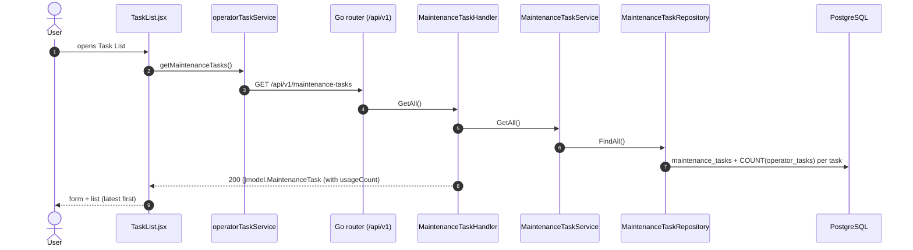

# Task list

- **Route:** `/masters/maintenance-tasks` · **Component:** [TaskList.jsx](../../src/pages/OperatorTasks/TaskList.jsx) inside [AccountCenterPage.jsx](../../src/pages/AccountCenter/AccountCenterPage.jsx) · **Auth:** protected (superadmin) · **Guard/Layout:** `ProtectedRoute` + `roles: SUPERADMIN_ONLY` · `MainLayout`
- **Purpose:** The superadmin manages the shared list of tasks (e.g. "Coolant not working and need to fix") that [Operator tasks](operator-tasks.md) picks from: add, edit, make inactive, delete.
- **Navigation:** System › Account Center → Operator Task tab → Task List sub-tab (beside Operator Tasks)

## On page load



**Steps**

1. [TaskList.jsx](../../src/pages/OperatorTasks/TaskList.jsx): loads every task, active and inactive (Retry on error)
2. [operatorTaskService.js](../../src/services/operatorTaskService.js) → getMaintenanceTasks()
3. [operator_task_routes.go](../../../7th-sense-server/internal/routes/operator_task_routes.go) → `GET /v1/maintenance-tasks`
4. [maintenance_task_repository.go](../../../7th-sense-server/internal/repository/maintenance_task_repository.go) → FindAll(): `usage_count` = operator tasks not deleted that use the task

## Save task (add / edit form)

```mermaid
sequenceDiagram
  autonumber
  actor User
  participant Form as TaskListEditor.jsx
  participant operatorTaskService
  participant API as Go router (/api/v1)
  participant MaintenanceTaskHandler
  participant MaintenanceTaskService
  participant MaintenanceTaskRepository
  participant DB as PostgreSQL
  User->>Form: Task text (+ Status on edit) → Save / Update
  Form->>operatorTaskService: createMaintenanceTask() / updateMaintenanceTask(id)
  operatorTaskService->>API: POST /maintenance-tasks · PUT /maintenance-tasks/{id} (superAdminOnly)
  API->>MaintenanceTaskHandler: Create() / Update() — dto Validate()
  MaintenanceTaskHandler->>MaintenanceTaskService: Create() / Update()
  MaintenanceTaskService->>MaintenanceTaskRepository: Create() / Update(), FindByID()
  MaintenanceTaskRepository->>DB: maintenance_tasks (unique LOWER(description))
  MaintenanceTaskHandler-->>Form: 201 / 200 model.MaintenanceTask
  Form-->>User: toast; row added on top / replaced
```

**Steps**

1. [TaskListEditor.jsx](../../src/pages/OperatorTasks/TaskListEditor.jsx): React Hook Form + Zod ([taskListForm.js](../../src/pages/OperatorTasks/taskListForm.js) `taskSchema`: required, ≤ 100 characters); spaces are trimmed and joined as the server does. A new task is active
2. Edit (a row's Edit loads it into the form, row highlighted) adds **Status** (`StatusToggle`) and says how many operator tasks use the task
3. [maintenance_task_service.go](../../../7th-sense-server/internal/service/maintenance_task_service.go) → Create() / Update(): duplicate → "This task already exists"; a new description shows on every operator task that uses it

## Delete task / Make inactive

1. Row Delete opens `ConfirmModal`. Not used → **Delete** → `deleteMaintenanceTask(id)` → `DELETE /api/v1/maintenance-tasks/{id}` → MaintenanceTaskService.Delete (soft delete)
2. Used by operator tasks → "Task is in use": **Make inactive** → `updateMaintenanceTask(id, {status: 'inactive'})`; already inactive → **OK** (remove it from the operator tasks first). The server refuses deleting a task in use anyway (400 with the count)

**Rules & edge cases**

- Superadmin only (route and every write endpoint). The list is shared by every customer.
- An inactive task is not offered in the Operator Tasks dropdown and the server refuses it for a new operator task; operator tasks that already use it keep it.

## UI states

- **Loading:** `<Loader>`. **Error:** red `<Alert>` with Retry. **No tasks:** `.ts-empty`.
- **Search / status filter with no hits:** `TableNoResults` with Clear filters. **Saving:** spinner, server message in the form's alert, success toast; the form card stays in view from `lg` (`.ts-side-form`).

## API calls on this page

| Method | Endpoint | Triggered by (section) | API docs |
|---|---|---|---|
| GET | `/api/v1/maintenance-tasks` | On page load | [Swagger](http://localhost:8080/api-docs/index.html#/Operator%20tasks/getMaintenanceTasks) · [openapi.yaml](../../../7th-sense-server/docs/api/openapi.yaml) |
| POST | `/api/v1/maintenance-tasks` | Save task | [Swagger](http://localhost:8080/api-docs/index.html#/Operator%20tasks/createMaintenanceTask) · [openapi.yaml](../../../7th-sense-server/docs/api/openapi.yaml) |
| PUT | `/api/v1/maintenance-tasks/{id}` | Save task (edit) · Make inactive | [Swagger](http://localhost:8080/api-docs/index.html#/Operator%20tasks/updateMaintenanceTask) · [openapi.yaml](../../../7th-sense-server/docs/api/openapi.yaml) |
| DELETE | `/api/v1/maintenance-tasks/{id}` | Delete task | [Swagger](http://localhost:8080/api-docs/index.html#/Operator%20tasks/deleteMaintenanceTask) · [openapi.yaml](../../../7th-sense-server/docs/api/openapi.yaml) |

## State & storage

- Local state: `tasks`, `editing`, search / status filter / sort / page, `pendingDelete`.

## Shared components used

[FieldLabel.jsx](../../src/components/common/FieldLabel.jsx), [StatusToggle.jsx](../../src/components/common/StatusToggle.jsx), [StatusBadge.jsx](../../src/components/common/StatusBadge.jsx), [SortableHead.jsx](../../src/components/common/SortableHead.jsx), [TablePagination.jsx](../../src/components/common/TablePagination.jsx), [TableNoResults.jsx](../../src/components/common/TableNoResults.jsx), [ConfirmModal.jsx](../../src/components/common/ConfirmModal.jsx), [IconAction.jsx](../../src/components/common/IconAction.jsx); row: [TaskListRow.jsx](../../src/pages/OperatorTasks/TaskListRow.jsx)

## Decisions

- Server [ADR 0016](../../../7th-sense-server/docs/adr/0016-operator-task-list-screen.md): edit and delete of tasks, delete refused while in use, inactive to retire.
