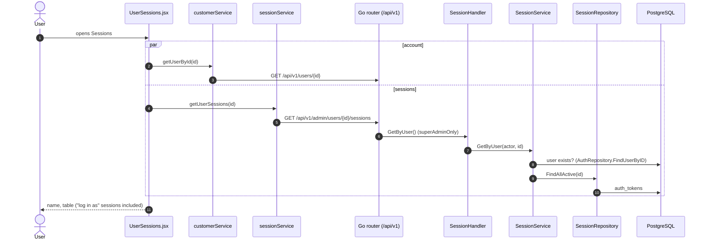
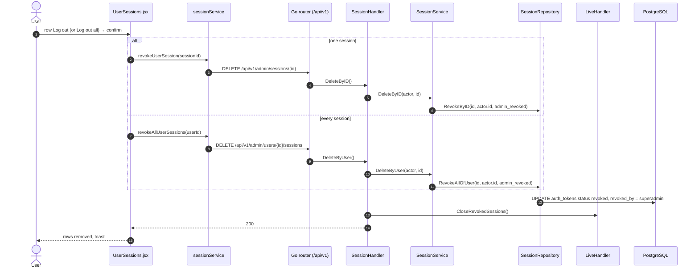

# User sessions

- **Route:** `/account-center/users/:id/sessions` · **Component:** [UserSessions.jsx](../../src/pages/Sessions/UserSessions.jsx) · **Auth:** protected (superadmin) · **Guard/Layout:** `ProtectedRoute` + `roles: SUPERADMIN_ONLY` · `MainLayout`
- **Purpose:** The superadmin sees every active session of one customer or user and force-logs out one of them or all.
- **Navigation:** Account Center › Customer › View, or Masters › Users › View → **Sessions** ([customer-user-detail.md](customer-user-detail.md)); Back returns to that view. The sidebar marks Account Center.

## On page load

**Steps**

1. [UserSessions.jsx](../../src/pages/Sessions/UserSessions.jsx) → useEffect: the account (name, role, company) and its sessions together
2. [sessionService.js](../../src/services/sessionService.js) → getUserSessions(): `GET /api/v1/admin/users/{id}/sessions`
3. [session_routes.go](../../../7th-sense-server/internal/routes/session_routes.go) → `superAdminOnly` → SessionHandler.GetByUser
4. [session_service.go](../../../7th-sense-server/internal/service/session_service.go) → GetByUser(): checkSessionUser() (superadmin, user exists → else 403 / 404), then every active session

## Log out one session / Log out all

**Steps**

1. [SessionTable.jsx](../../src/pages/Sessions/SessionTable.jsx) with `adminView`: Type column (Password / Log in as), Customer column, Log out icon on every row
2. [UserSessions.jsx](../../src/pages/Sessions/UserSessions.jsx) → confirmRevoke(): `ConfirmModal`; an error shows a toast and reloads the list
3. [session_handler.go](../../../7th-sense-server/internal/handler/session_handler.go) → DeleteByID() / DeleteByUser() → [session_service.go](../../../7th-sense-server/internal/service/session_service.go) (superadmin check again, logged)
4. [session_repository.go](../../../7th-sense-server/internal/repository/session_repository.go) → RevokeByID() / RevokeAllOfUser()
5. [live_handler.go](../../../7th-sense-server/internal/handler/live_handler.go) → CloseRevokedSessions(): sockets get `session:expired {session_revoked, admin_revoked}`; the user's next request answers 401 and the toast says an administrator logged them out ([app-shell.md](app-shell.md#session-ended))

**Rules & edge cases**

- Superadmin only (route and server). Customers and admins cannot manage their users' sessions (server ADR 0014).
- "Log out all" includes "log in as" sessions opened on the account; the superadmin's own session is never touched.
- An unknown user answers 404 "User not found"; a session already ended answers 404 "Session not found".
- No location: the server does no IP lookup.

## UI states

- **Loading:** `<Loader>`. **Error:** red `<Alert>` with Retry. **Not signed in anywhere:** `.ts-empty`.
- **Search with no hits:** `TableNoResults` with Clear filters. **Confirm:** `ConfirmModal`; success / failure toasts.

## API calls on this page

| Method | Endpoint | Triggered by (section) | API docs |
|---|---|---|---|
| GET | `/api/v1/users/{id}` | On page load | [Swagger](http://localhost:8080/api-docs/index.html#/Users/getUserById) · [openapi.yaml](../../../7th-sense-server/docs/api/openapi.yaml) |
| GET | `/api/v1/admin/users/{id}/sessions` | On page load | [Swagger](http://localhost:8080/api-docs/index.html#/Sessions/getUserSessions) · [openapi.yaml](../../../7th-sense-server/docs/api/openapi.yaml) |
| DELETE | `/api/v1/admin/sessions/{id}` | Log out one session | [Swagger](http://localhost:8080/api-docs/index.html#/Sessions/revokeUserSession) · [openapi.yaml](../../../7th-sense-server/docs/api/openapi.yaml) |
| DELETE | `/api/v1/admin/users/{id}/sessions` | Log out all | [Swagger](http://localhost:8080/api-docs/index.html#/Sessions/revokeAllUserSessions) · [openapi.yaml](../../../7th-sense-server/docs/api/openapi.yaml) |

## State & storage

- Local state: `account`, `sessions`, `pendingRevoke` (a session or `'all'`), `revoking`. `useOrgUser().customerLabel` names the Customer column (the account itself for a customer, its company for a member).

## Shared components used

[SessionTable.jsx](../../src/pages/Sessions/SessionTable.jsx), [ConfirmModal.jsx](../../src/components/common/ConfirmModal.jsx), [Loader.jsx](../../src/components/common/Loader.jsx)

## Decisions

- Server [ADR 0014](../../../7th-sense-server/docs/adr/0014-session-modes-and-login-conflict.md) (superadmin only), client [ADR 0027](../adr/0027-session-codes-and-conflict-modal.md)
