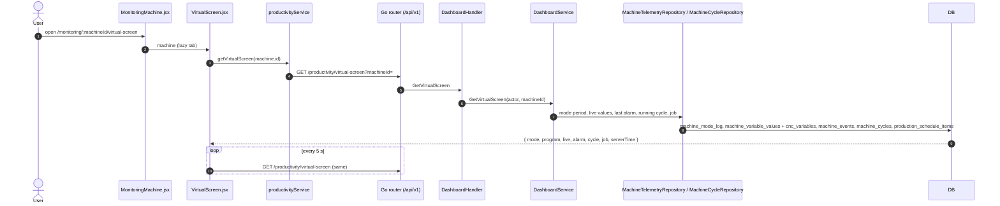

# Virtual Screen (machine tab)

- **Route:** `/monitoring/:machineId/virtual-screen` · **Component:** [VirtualScreen.jsx](../../src/pages/Productivity/VirtualScreen.jsx) (+ [VirtualScreenParts.jsx](../../src/pages/Productivity/VirtualScreenParts.jsx), [virtualScreenSettings.js](../../src/pages/Productivity/virtualScreenSettings.js)) inside [MonitoringMachine.jsx](../../src/pages/Monitoring/MonitoringMachine.jsx) ([MonitoringPage.jsx](../../src/pages/Monitoring/MonitoringPage.jsx)) · **Auth:** protected (every logged-in role, machines they may read) · **Guard/Layout:** `ProtectedRoute` (session) + role guard · `MainLayout`
- **Purpose:** The machine's controller screen, live: spindle load, spindle / feed overrides, axis loads, the alarm, the running cycle and the job it belongs to. Rebuilt from the old PHP `virtualscreen/detail` page (speedometer layout) on the theme's cards, with clearer "not read" / stale / overrun states.
- **Navigation:** Sidebar › Operations › **Monitoring** → [machine list](monitoring-machines.md) → a machine → **Virtual Screen** tab (next to [Productivity](productivity.md), [Machine Health](machine-health.md), [Tool List / Tool Life](machine-tools-virtual-screen.md)). The old page's machine select is the machine header's **Machine list** back arrow.

## On page load

1. [MonitoringMachine.jsx](../../src/pages/Monitoring/MonitoringMachine.jsx) loads the machines and passes `machine` (see [productivity.md](productivity.md#on-page-load)).
2. [VirtualScreen.jsx](../../src/pages/Productivity/VirtualScreen.jsx) → `useLoad(getVirtualScreen, refreshMs: VIRTUAL_SCREEN_REFRESH_MS)`: first load shows a loader, later reloads keep the shown values; it stamps each response with `readAt`.
3. [productivityService.js](../../src/services/productivityService.js) → `getVirtualScreen(machineId)`: `GET /productivity/virtual-screen?machineId=`.
4. [virtual_screen_handler.go](../../../7th-sense-server/internal/handler/virtual_screen_handler.go) → `GetVirtualScreen()`: logged-in user, `machineId` required (400 without).
5. [virtual_screen_service.go](../../../7th-sense-server/internal/service/virtual_screen_service.go) → `GetVirtualScreen()`: the machine via `machinesFor` (404 when the user may not read it); mode / program from the open `machine_mode_log` period (`machines.mode_id` without one); op mode (`GetOpModeName`); live values; last alarm; the running cycle; the job = the running cycle's schedule item, else the one scheduled now (`FindScheduledJob`).
6. [virtual_screen_repository.go](../../../7th-sense-server/internal/repository/virtual_screen_repository.go) → `FindLiveVariables()` (codes in `dto.VirtualScreenVariableCodes`: `SpindleLoad`, `SpindleRpm`, `speedOvr`, `feedRateOvr`, `actFeedRate`, `FeedRev`, `axLoadX/Y/Z`, `toolNumber`, `isEmergency`), `FindLatestAlarm()` (last `alarm_on`; active while no `alarm_off` after it), `FindJobProgress()` (quantity, times, part / process / clientele, planned cycle time, completed cycles of the item).
7. [virtual_screen_dto.go](../../../7th-sense-server/internal/dto/virtual_screen_dto.go) → `NewVirtualScreenLive()`: maps codes to fields, `FeedRev` 0/1/2/3 → mm/min, mm/rev, inch/min, inch/rev.

Between reloads a 1 s tick moves the clock (server time + time since read), the mode duration and the cycle's elapsed time.

## What the screen shows

| Card | Data | Notes |
|---|---|---|
| Header chip | `online`, `live.updatedAt` | **Live**, **Stale** (no value for `STALE_AFTER_MS` 60 s, shows the last read time) or **Offline** |
| Messages & Alarms | `alarm`, `live.emergency` | Red banner for E-stop or an active alarm (code, message, time); otherwise "No active alarm · last …" |
| Spindle Load | `live.spindleLoad`, `spindleSpeed`, `toolNumber` | [Speedometer](../../src/components/charts/Speedometer.jsx) with the Machine Health zones (`SPINDLE_LOAD`: 70 / 90 %), speed in rpm, tool as `T5` |
| Speed, Feed & Axis Load | `spindleOverride`, `feedOverride`, `feedRate` + `feedUnit`, `axisLoadX/Y/Z` | Override dials 0–120 % with a tick at the programmed 100 % and "−20% vs program"; axis bars coloured by `AXIS_LOAD` (70 / 90 %); axes never read (a lathe's Y) are left out |
| Batch Progress | `job` | Cycles done / quantity, remaining time (parts left × planned cycle), progress, scheduled start – end |
| Cycle Progress | `cycle` | Elapsed, remaining (or **Over Plan By** in amber), share of the planned cycle time (held at 99 % while running) |
| Job Details | `job`, `programName` | Client, Job ID, part · process, program |
| Status bar | `modeId` / `modeName`, `modeSince`, `opMode`, `serverTime` | [MachineMode](../../src/pages/Machines/MachineMode.jsx) + "for 12m 05s", operation mode, server date and clock |

## UI states

- **Loading:** tab header + loader card "Connecting to the machine…".
- **Error, nothing loaded:** red alert with the server message.
- **Error on a reload:** amber note "Could not refresh … Showing the values read at …"; the last values stay.
- **No value read:** "—" (never a fake 0); no job: "No job is scheduled on this machine now."; no cycle: "No cycle is running."

## Rules & edge cases

- Read only, every role, only machines the user may read (server `MachineService.GetByID`).
- Times come from the server clock, not the browser's.
- Loads and overrides are clamped for drawing (0–100 %, 0–120 %); the number shows the reading.
- Text variables (program name, alarm message, tool ident) are not stored live by the collector: the program comes from the mode period / cycle, the alarm text from `machine_events`, the tool from `toolNumber`.

## API calls on this page

| Method | Path | When | Docs |
|---|---|---|---|
| GET | `/api/v1/productivity/virtual-screen` | On load, then every 5 s | [Swagger](http://localhost:8080/api-docs/index.html#/Productivity/getVirtualScreen) · [openapi.yaml](../../../7th-sense-server/docs/api/openapi.yaml) |

The machine list call belongs to `MonitoringMachine` ([monitoring-machines.md](monitoring-machines.md#api-calls-on-this-page)).

## State & storage

- Route param `:machineId`; the tab gets `machine` as a prop
- `useLoad` state (the last response + `readAt`), a 1 s `now` tick; nothing stored

## Shared components used

[ChartCard](../../src/components/charts/ChartCard.jsx), [Speedometer](../../src/components/charts/Speedometer.jsx), [MachineMode](../../src/pages/Machines/MachineMode.jsx), [Loader](../../src/components/common/Loader.jsx), `useLoad` ([hooks/useLoad.js](../../src/hooks/useLoad.js))

## Decisions

- [ADR 0019](../adr/0019-monitoring-machine-view.md) (the machine's tabs)
- [ADR 0020](../adr/0020-virtual-screen-polling.md) (one REST snapshot polled every 5 s instead of the old socket stream)
