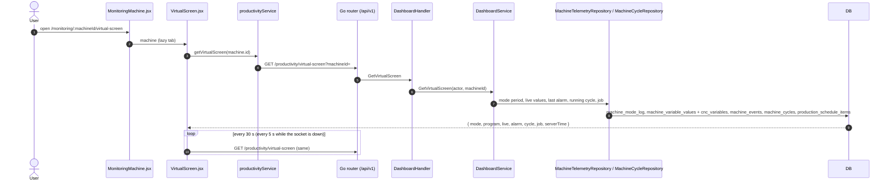

# Virtual Screen (machine tab)

- **Route:** `/monitoring/:machineId/virtual-screen` · **Component:** [VirtualScreen.jsx](../../src/pages/Productivity/VirtualScreen.jsx) (+ [VirtualScreenParts.jsx](../../src/pages/Productivity/VirtualScreenParts.jsx), [virtualScreenSettings.js](../../src/pages/Productivity/virtualScreenSettings.js)) inside [MonitoringMachine.jsx](../../src/pages/Monitoring/MonitoringMachine.jsx) ([MonitoringPage.jsx](../../src/pages/Monitoring/MonitoringPage.jsx)) · **Auth:** protected (every logged-in role, machines they may read) · **Guard/Layout:** `ProtectedRoute` (session) + role guard · `MainLayout`
- **Purpose:** The machine's controller screen, live: spindle load, spindle / feed overrides, axis loads, the alarm, the running cycle and the job it belongs to. Rebuilt from the old PHP `virtualscreen/detail` page (speedometer layout) in its original look (dark screen, image dials, slanted panels), with clearer "not read" / stale / overrun states.
- **Navigation:** Sidebar › Operations › **Monitoring** → [machine list](monitoring-machines.md) → a machine → **Virtual Screen** tab (next to [Productivity](productivity.md), [Machine Health](machine-health.md), [Tool List / Tool Life](machine-tools-virtual-screen.md)). The old page's machine select is the machine header's **Machine list** back arrow.

## On page load



### Live values (Socket.IO)

```mermaid
sequenceDiagram
  autonumber
  participant Page as VirtualScreen.jsx
  participant Hook as useMachineLive
  participant Socket as liveSocket.js
  participant API as Go router (/api/v1/socket.io/)
  participant LiveHandler
  participant MachineService
  participant Hub as live.Hub
  participant Worker as monitor worker
  Page->>Hook: useMachineLive(machine.id, LIVE_CODES.VIRTUAL_SCREEN, 200 ms, status + event)
  Hook->>Socket: watchMachine()
  Socket->>API: WebSocket handshake (session cookie)
  API->>LiveHandler: authenticate, then Serve(): Origin check, onConnection()
  LiveHandler->>MachineService: GetAll(user) = allowed machines
  Socket->>LiveHandler: subscribe {machineIds, codes, channels, intervalMs}
  LiveHandler->>Hub: JoinValues + Snapshot (only allowed machines)
  LiveHandler-->>Socket: ack {denied, unknown, snapshots}
  Worker->>Hub: PublishValues (each reading, before the DB write) / PublishStatus / PublishEvent
  Hub-->>Socket: machine:values (changed codes), machine:status, machine:event
  Socket-->>Page: values overlay the REST data; alarm / cycle event reloads REST
```

1. [MonitoringMachine.jsx](../../src/pages/Monitoring/MonitoringMachine.jsx) loads the machines and passes `machine` (see [productivity.md](productivity.md#on-page-load)).
2. [VirtualScreen.jsx](../../src/pages/Productivity/VirtualScreen.jsx) → `useLoad(getVirtualScreen, refreshMs: VIRTUAL_SCREEN_SAFETY_REFRESH_MS (30 s) with the socket, VIRTUAL_SCREEN_REFRESH_MS (5 s) without)`: first load shows a loader, later reloads keep the shown values; it stamps each response with `readAt`. `getVirtualScreen` does not share a running request (`sharedGet`), so a reload on a live event reads after the event's write.
3. [productivityService.js](../../src/services/productivityService.js) → `getVirtualScreen(machineId)`: `GET /productivity/virtual-screen?machineId=`.
4. [virtual_screen_handler.go](../../../7th-sense-server/internal/handler/virtual_screen_handler.go) → `GetVirtualScreen()`: logged-in user, `machineId` required (400 without).
5. [virtual_screen_service.go](../../../7th-sense-server/internal/service/virtual_screen_service.go) → `GetVirtualScreen()`: the machine via `machinesFor` (404 when the user may not read it); mode / program from the open `machine_mode_log` period (`machines.mode_id` without one); op mode (`GetOpModeName`); live values; last alarm; the running cycle; the job = the running cycle's schedule item, else the one scheduled now (`FindScheduledJob`).
6. [virtual_screen_repository.go](../../../7th-sense-server/internal/repository/virtual_screen_repository.go) → `FindLiveVariables()` (codes in `dto.VirtualScreenVariableCodes`: `SpindleLoad`, `SpindleRpm`, `speedOvr`, `feedRateOvr`, `actFeedRate`, `FeedRev`, `axLoadX/Y/Z`, `toolNumber`, `isEmergency`), `FindLatestAlarm()` (last `alarm_on`; active while no `alarm_off` after it), `FindJobProgress()` (quantity, times, part / process / clientele, planned cycle time, completed cycles of the item).
7. [virtual_screen_dto.go](../../../7th-sense-server/internal/dto/virtual_screen_dto.go) → `NewVirtualScreenLive()`: maps codes to fields, `FeedRev` 0/1/2/3 → mm/min, mm/rev, inch/min, inch/rev.

8. [VirtualScreen.jsx](../../src/pages/Productivity/VirtualScreen.jsx) → `useMachineLive(machine.id, …)` ([hooks/useMachineLive.js](../../src/hooks/useMachineLive.js)): codes `LIVE_CODES.VIRTUAL_SCREEN` at `LIVE_INTERVAL_MS.VIRTUAL_SCREEN` (200 ms) + `status` and `event` channels ([constants/live.js](../../src/constants/live.js)).
9. [liveSocket.js](../../src/services/liveSocket.js) → `watchMachine()`: one socket per tab under `apiBaseUrl()` (WebSocket only), the machine's needs merged into one `subscribe`, sent again after a reconnect; messages older than the snapshot (`seq`) are dropped, and newer ones that overtake the `subscribe` answer are applied again on top of its snapshot. The socket closes when no machine is watched, and one the server closed is dropped (the next screen that watches a machine opens a new one).
10. [live_handler.go](../../../7th-sense-server/internal/handler/live_handler.go) → `Serve()` / `onConnection()` / `subscribe()`: the session's user and its machines from `MachineService.GetAll`; a machine the user may not read is `denied`; the socket joins the room of exactly these codes ([hub.go](../../../7th-sense-server/internal/live/hub.go) `JoinValues`, `Snapshot`).
11. [worker.go](../../../7th-sense-server/internal/monitor/worker.go) → `publishValues()` on every reading before the database write, `recordModeChange()` → status, `recordEventAt()` and [machine_cycle.go](../../../7th-sense-server/internal/monitor/machine_cycle.go) → events; the hub sends only the changed codes of the room, at most every 200 ms.
12. [virtualScreenSettings.js](../../src/pages/Productivity/virtualScreenSettings.js) → `withLiveValues()`: live codes over the REST `live` fields (`FeedRev` → unit, `isEmergency` → E-stop, `progName` → program, `Alarm` / `alarmMsg` → active alarm), status over mode / online; only while the socket is connected, since its last values are frozen once it drops. An `alarm_*`, `emergency_*` or `cycle_*` event calls `useLoad().reload()` (cycle, job and alarm history are worked out by the server); overlapping reloads never replace a newer answer with an older one.

Between reloads a 1 s tick moves the clock (server time + time since read), the mode duration and the cycle's elapsed time.

## What the screen shows

The screen keeps the old PHP page's look: a dark panel with a black frame, Roboto light / italic text, the original dial, needle, strip and panel images (`src/assets/images/virtual-screen/`), drawn as SVGs in [VirtualScreenParts.jsx](../../src/pages/Productivity/VirtualScreenParts.jsx). It stays dark in the light theme. Layout: machine + spindle load on the left, alarms + gauges + axis load on the right, then the Batch / Cycle / Job boxes, then the mode / logo / date footer (stacked on narrow screens).

| Part | Data | Notes |
|---|---|---|
| Header chip (above the screen) | `online`, `live.updatedAt` | **Live**, **Stale** (no value for `STALE_AFTER_MS` 60 s, shows the last read time) or **Offline** |
| Machine name | `machine.name`, brand · controller · version | Large light heading, controller in italic under it |
| Spindle load | `live.spindleLoad` | `SpindleLoadGauge`: the SPINDLE LOAD dial image, white needle 0 % (left) → 100 % (right), reading in the knob; amber / red past the Machine Health limits (`SPINDLE_LOAD`: 70 / 90 %) |
| Message & Alarms | `alarm`, `live.emergency` | Time, code, message; red while the alarm or the E-stop is active, "Cleared" once it went off; "No alarm recorded" without one |
| Spindle / Feed | `spindleOverride` + `spindleSpeed` (RPM), `feedOverride` + `feedRate` / `feedUnit` | `OverrideGauge`: round dial image, needle over 274° for 0–`OVERRIDE_MAX` (120) %, the % and the reading panel beside it |
| Axis Load | `axisLoadX/Y/Z` | `AxisLoadPanel`: Z upright, X / Y tilted ±60° with a handle at the load; X and Z upright when no Y is read (a lathe); readings beside |
| Batch Progress | `job` | Cycles done / quantity, remaining time (parts left × planned cycle), `ScreenProgress` bar (green), Batch Schedule Time or "Not Scheduled" |
| Cycle Progress | `cycle`, `live.toolNumber` | Remaining time (or **Over Plan By**, amber), elapsed, bar (blue; share of the planned time, held at 99 % while running), Active Tool, start time |
| Job box | `job`, `programName` | Client Name, Job ID, Part Name (· process), Program Name |
| Footer | `modeId` / `modeName`, `modeSince`, `opMode`, `serverTime` | Mode dot in its `--ts-mode-*` colour + name, "for 12m 05s · Op mode …"; 7th Sense logo; server date and clock |

## UI states

- **Loading:** tab header + loader card "Connecting to the machine…".
- **Error, nothing loaded:** red alert with the server message.
- **Error on a reload:** amber note "Could not refresh … Showing the values read at …"; the last values stay.
- **No value read:** "—" (never a fake 0); no job: "No job is scheduled on this machine now."; no cycle: "No cycle is running."
- **No access:** the socket denied the machine or `access:changed` removed it → amber "You no longer have access to this machine." instead of the screen.
- **Socket down:** the header note says "refreshed every 5 s", the REST call is polled every 5 s and its values are shown as they are; with the socket it says "as it changes". After the server closed the socket (e.g. the user's socket limit) the screen stays on polling until a machine is opened again.

## Rules & edge cases

- Read only, every role, only machines the user may read (server `MachineService.GetByID`).
- Times come from the server clock, not the browser's.
- Loads and overrides are clamped for drawing (0–100 %, 0–120 %); the number shows the reading.
- Text variables (program name, alarm message) are not stored by the collector; the live socket carries them (`progName`, `alarmMsg`) from the hub's memory. Without the socket the program comes from the mode period / cycle and the alarm text from `machine_events`.
- The socket's user and machines come from the session, never from the page. While connected the REST refresh stays at 30 s: a steady machine sends no changes and the Stale chip reads the REST `updatedAt`.

## API calls on this page

| Method | Path | When | Docs |
|---|---|---|---|
| GET | `/api/v1/productivity/virtual-screen` | On load, on an alarm / emergency / cycle event, then every 30 s (5 s without the socket) | [Swagger](http://localhost:8080/api-docs/index.html#/Productivity/getVirtualScreen) · [openapi.yaml](../../../7th-sense-server/docs/api/openapi.yaml) |
| WebSocket | `/api/v1/socket.io/` | Once per tab while a live screen is open; `subscribe` per machine | Socket.IO, not in OpenAPI: [live-socket-events.md](../../../7th-sense-server/docs/live-socket-events.md) |

The machine list call belongs to `MonitoringMachine` ([monitoring-machines.md](monitoring-machines.md#api-calls-on-this-page)).

## State & storage

- Route param `:machineId`; the tab gets `machine` as a prop
- `useLoad` state (the last response + `readAt`), a 1 s `now` tick; nothing stored
- Live state per machine in [liveSocket.js](../../src/services/liveSocket.js) (module store, read with `useSyncExternalStore`): `{ values, at, status, denied }`; cleared when the socket closes (logout / user change, closed by the server, nothing watched)

## Shared components used

[Loader](../../src/components/common/Loader.jsx), `useLoad` ([hooks/useLoad.js](../../src/hooks/useLoad.js)), `useMachineLive` ([hooks/useMachineLive.js](../../src/hooks/useMachineLive.js))

## Decisions

- [ADR 0019](../adr/0019-monitoring-machine-view.md) (the machine's tabs)
- [ADR 0020](../adr/0020-virtual-screen-polling.md) (one REST snapshot polled every 5 s), superseded by [ADR 0021](../adr/0021-virtual-screen-socket.md) (live values over Socket.IO, REST for derived data; server [ADR 0009](../../../7th-sense-server/docs/adr/0009-socketio-live-data.md))
